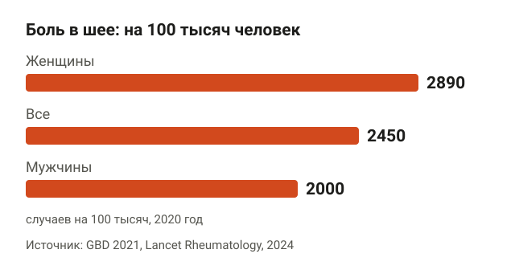
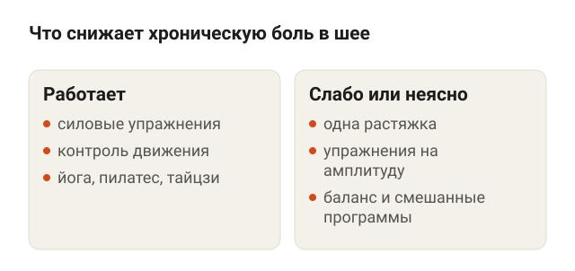
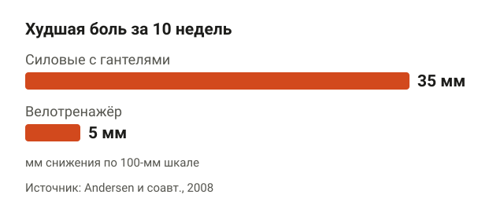
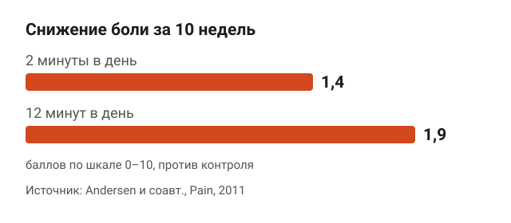
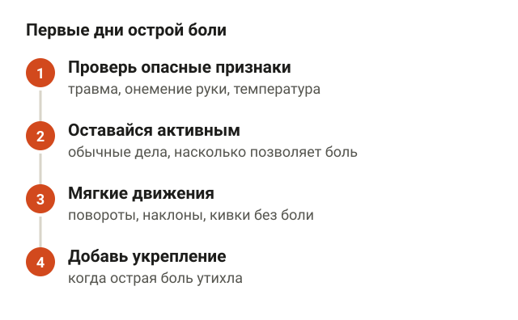
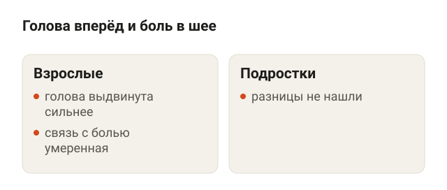
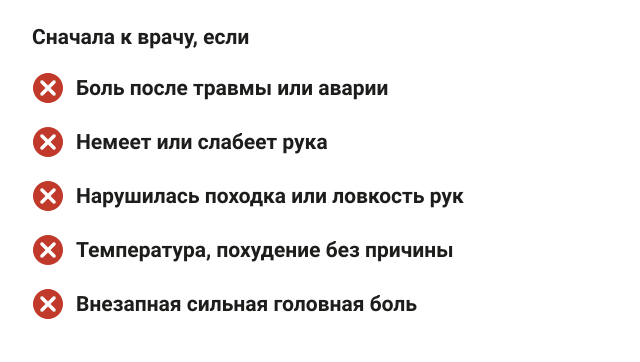
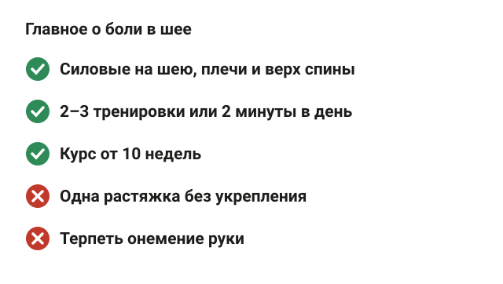

---
{
  "title": "Боль в шее: упражнения, которые помогают, и сколько их делать",
  "seo_title": "Боль в шее: упражнения для шеи и плеч, план занятий",
  "description": "Какие упражнения при боли в шее изучены лучше всего, хватит ли 2 минут в день, что делать при острой боли и когда сначала нужен врач. С данными исследований.",
  "slug": "bol-v-shee-uprazhneniya",
  "date": "2026-11-05",
  "category": "spina-i-osanka",
  "keyword": "боль в шее упражнения",
  "tags": [
    "боль в шее",
    "шея",
    "трапеция",
    "осанка",
    "упражнения со жгутом"
  ],
  "faq": [
    {
      "q": "Какие упражнения снимают боль в шее и плечах?",
      "a": "Лучше всего изучены силовые упражнения на шею, плечи и верх спины: изометрия шеи, шраги, тяги и разведения с гантелями. В исследовании на 48 женщинах такие упражнения 3 раза в неделю по 20 минут за 10 недель снизили худшую боль примерно на 79%."
    },
    {
      "q": "Сколько минут в день нужно делать упражнения для шеи?",
      "a": "В исследовании на 198 работающих взрослых 2 минуты в день со жгутом 5 дней в неделю за 10 недель снизили боль на 1,4 балла из 10, а 12 минут — на 1,9 балла."
    },
    {
      "q": "Помогает ли растяжка при боли в шее?",
      "a": "Одна растяжка помогает слабее: в кокрейновском обзоре доказательства для неё низкого качества. Укрепление, а также пилатес и йога, изучены лучше."
    },
    {
      "q": "Что делать, если болит шея сзади и затылок?",
      "a": "Если нет травмы, онемения руки, температуры и внезапной сильной головной боли, оставайся активным, мягко двигай головой и через несколько дней добавляй укрепляющие упражнения. Сильная внезапная головная боль, двоение в глазах или нарушение речи — повод сразу к врачу."
    },
    {
      "q": "Когда с болью в шее нужно к врачу?",
      "a": "После травмы, при онемении или слабости руки, нарушении походки, температуре, необъяснимом похудении, ночной боли в покое и если в прошлом был рак."
    }
  ],
  "sources": [
    {
      "title": "GBD 2021 Neck Pain Collaborators. Global, regional, and national burden of neck pain, 1990–2020, and projections to 2050 (Lancet Rheumatology, 2024)",
      "url": "https://doi.org/10.1016/S2665-9913(23)00321-1"
    },
    {
      "title": "Gross A. и соавт. Exercises for mechanical neck disorders (Cochrane Database Syst Rev, 2015)",
      "url": "https://doi.org/10.1002/14651858.CD004250.pub5"
    },
    {
      "title": "de Zoete R. M. J. и соавт. Comparative effectiveness of physical exercise interventions for chronic non-specific neck pain: systematic review with network meta-analysis of 40 RCTs (Br J Sports Med, 2021)",
      "url": "https://doi.org/10.1136/bjsports-2020-102664"
    },
    {
      "title": "Bertozzi L. и соавт. Effect of therapeutic exercise on pain and disability in the management of chronic nonspecific neck pain: systematic review and meta-analysis (Phys Ther, 2013)",
      "url": "https://doi.org/10.2522/ptj.20120412"
    },
    {
      "title": "Ylinen J. и соавт. Active neck muscle training in the treatment of chronic neck pain in women: RCT (JAMA, 2003)",
      "url": "https://doi.org/10.1001/jama.289.19.2509"
    },
    {
      "title": "Andersen L. L. и соавт. Effect of two contrasting types of physical exercise on chronic neck muscle pain (Arthritis Rheum, 2008)",
      "url": "https://doi.org/10.1002/art.23256"
    },
    {
      "title": "Andersen L. L. и соавт. Effectiveness of small daily amounts of progressive resistance training for frequent neck/shoulder pain: RCT (Pain, 2011)",
      "url": "https://doi.org/10.1016/j.pain.2010.11.016"
    },
    {
      "title": "Blanpied P. R. и соавт. Neck Pain: Revision 2017. Clinical Practice Guidelines (JOSPT, 2017)",
      "url": "https://doi.org/10.2519/jospt.2017.0302"
    },
    {
      "title": "Mahmoud N. F. и соавт. The relationship between forward head posture and neck pain: systematic review and meta-analysis (Curr Rev Musculoskelet Med, 2019)",
      "url": "https://doi.org/10.1007/s12178-019-09594-y"
    }
  ]
}
---
При боли в шее лучше всего изучены силовые упражнения на шею, плечи и верх спины: в обзорах рандомизированных исследований они снижали хроническую боль в шее сильнее, чем отсутствие занятий. В датском исследовании хватало даже 2 минут в день с резиновым жгутом. Растяжка в одиночку и общие кардиотренировки помогают слабее.

Ниже разберу, откуда берётся такая боль, какие упражнения делать при боли в шее, сколько заниматься, что делать при острой боли и в каких случаях сначала нужен врач.

## Почему болит шея и насколько это частая история

<figure class="step"><figcaption>У женщин боль в шее встречается чаще: 2890 против 2000 на 100 тысяч.</figcaption></figure>

По оценке исследования глобального бремени болезней (GBD 2021), в 2020 году от боли в шее страдали 203 миллиона человек в мире. Это примерно 2450 человек на каждые 100 тысяч. У женщин боль в шее встречается чаще: 2890 против 2000 на 100 тысяч у мужчин. Чаще всего шея болит в 45–74 года. К 2050 году авторы ждут 269 миллионов случаев, на 32,5% больше, чем в 2020-м.

В большинстве случаев у боли в шее нет одной конкретной причины, которую видно на снимке. Врачи называют её неспецифической: болят мышцы и ткани шеи и надплечий, а грыжи, перелома или воспаления нет. Та же логика, что и с поясницей, — подробно разбирал её в статье про [неспецифическую боль в спине](/stati/nespecificheskaya-bol-v-spine/).

Хронической боль называют, когда она держится больше 3 месяцев. Почти все исследования упражнений ниже сделаны именно на хронической неспецифической боли в шее.

## Помогают ли упражнения при боли в шее

<figure class="step"><figcaption>Укрепление, контроль движения и пилатес с йогой работают примерно одинаково.</figcaption></figure>

Помогают, и данных уже немало. Главное — какие именно упражнения.

**Кокрейновский обзор (Gross и соавторы, 2015)** собрал 27 рандомизированных исследований, 2485 человек. При хронической боли в шее доказательства среднего качества есть для силовых упражнений на шею, лопатки и руки: боль после курса снижалась на умеренную или большую величину. Для растяжки в одиночку и общей физподготовки доказательства низкого качества. При острой боли в шее исследований с упражнениями авторы не нашли.

**Сетевой мета-анализ 40 исследований (de Zoete и соавторы, 2021)** сравнил разные виды упражнений между собой. По сравнению с отсутствием занятий боль снижали три вида:

- упражнения на контроль движения, то есть на точную работу глубоких мышц шеи;
- йога, пилатес, тайцзи и цигун;
- силовые упражнения.

Все три сработали примерно одинаково. Упражнения на амплитуду, баланс и смешанные программы, где намешано три и больше видов нагрузки, дали неуверенный или почти нулевой результат. Честная оговорка: качество доказательств авторы оценили как очень низкое, исследования небольшие и разные.

**Мета-анализ Bertozzi и соавторов (2013)** по 7 исследованиям показал средний эффект упражнений на боль в ближайшие недели и через несколько месяцев после курса.

То есть вывод такой: лучше всего изучено укрепление. Если тебе ближе пилатес или йога, это тоже рабочий вариант. А вот одной растяжки шеи мало.

## Какие упражнения делать: укрепление шеи и верха спины

<figure class="step"><figcaption>Силовые на шею и плечи снизили боль на 35 мм, велотренажёр — на 5 мм и ненадолго.</figcaption></figure>

Две работы показывают, как это выглядит на практике.

В финском исследовании Ylinen и соавторов 180 женщин с хронической болью в шее, офисные сотрудницы 25–53 лет, год занимались по одной из двух программ или были в контрольной группе. Силовая группа делала изометрические упражнения на шею с резиновой лентой: голова не двигается, мышцы напрягаются против сопротивления. Группа на выносливость поднимала голову лёжа на спине и на животе. Обе группы ещё делали упражнения с гантелями на плечи и руки. Через 12 месяцев боль и ограничения в обеих группах снизились сильнее, чем в контрольной. Сила шеи в силовой группе выросла на 69–110% в зависимости от направления.

В датском исследовании Andersen и соавторов 48 женщин с хронической болью в трапециевидной мышце 10 недель тренировались 3 раза в неделю по 20 минут. Упражнения с гантелями: тяга одной рукой в наклоне, подъём рук в стороны, подъём плеч (шраги), разведения в наклоне и тяга к подбородку. Вес постепенно прибавляли. Худшая боль снизилась на 35 мм по 100-миллиметровой шкале, примерно на 79%. Велотренажёр с расслабленными плечами дал только короткое снижение боли на 5 мм сразу после занятия.

Вот упражнения в духе этих программ. Начинай с лёгкого веса и без боли во время движения.

**Изометрия шеи.** Сядь ровно, ладонь положи на лоб. Дави лбом в ладонь, а ладонью не давай голове сдвинуться, 5–10 секунд. Потом то же затылком в ладони, сцепленные за головой, и боком в ладонь у виска. Сила давления — на треть или половину от максимума, без рывков.

**Подъём головы лёжа на спине.** Ляг на спину, колени согнуты. Подтяни подбородок к шее, как будто делаешь двойной подбородок, и подними голову на 2–3 см от пола. Задержись на 3–5 секунд и опусти. Плечи остаются на полу, подбородок не задирается вверх.

**Подъём плеч с гантелями (шраги).** Встань прямо, гантели в опущенных руках. Подними плечи к ушам, задержись на секунду и опусти. Руки не сгибаются, голова не уходит вперёд.

**Тяга гантелей в наклоне.** Наклонись вперёд с прямой спиной, колени слегка согнуты, гантели висят под плечами. Потяни гантели к поясу, сводя лопатки, и опусти. Поясница не округляется, шея на одной линии со спиной, взгляд в пол.

<figure class="step move"></figure>

**Разведения в наклоне.** Положение как в тяге, руки почти прямые. Разведи гантели в стороны до уровня плеч, лопатки сводятся. Вес здесь нужен лёгкий: работают задние дельты и середина трапеции, а не спина целиком.

Больше упражнений на верх спины, с резинкой и на тренажёрах, собрал в статье [сутулость: упражнения в тренажёрном зале](/stati/sutulost-uprazhneniya-v-trenazhernom-zale/).

## Сколько заниматься: хватит ли 2 минут в день

<figure class="step"><figcaption>2 минуты в день снизили боль на 1,4 балла, 12 минут — на 1,9 балла из 10.</figcaption></figure>

Отдельное исследование проверило минимальную дозу. Andersen и соавторы в 2011 году взяли 198 работающих взрослых, 174 женщины и 24 мужчины, с частой болью в шее и плечах. Одна группа 10 недель занималась с резиновым жгутом 2 минуты в день, другая — 12 минут в день, 5 дней в неделю. Третья раз в неделю получала советы о здоровье.

По сравнению с контролем боль по шкале от 0 до 10 снизилась:

- на 1,4 балла при 2 минутах в день;
- на 1,9 балла при 12 минутах в день.

Болезненность мышц при надавливании снизилась примерно одинаково, на 4,2 и 4,4 балла. Сила выросла в обеих группах.

По сути, 2 минуты в день уже дали заметный результат, а 12 минут добавили немного. Для человека, который сидит за компьютером весь день и «нет времени на зал», это хороший старт: один подход упражнения со жгутом в обеденный перерыв.

План, который вытекает из исследований:

1. 2–3 силовые тренировки в неделю по 15–20 минут или короткие подходы по 2–5 минут каждый день.
2. 2–3 подхода по 10–15 повторений, последние повторения даются с усилием.
3. Вес или натяжение прибавляй, когда все подходы стали лёгкими.
4. Результат оценивай через 8–10 недель: в исследованиях курс длился от 10 недель до года.

## Острая боль в шее: что делать в первые дни

<figure class="step"><figcaption>Оставайся активным, двигай шеей без боли, укрепление добавляй позже.</figcaption></figure>

Острая боль — до 6 недель, часто после сна в неудобной позе, сквозняка или резкого поворота головы. Для неё исследований с упражнениями почти нет: кокрейновский обзор не нашёл ни одного подходящего.

Клинические рекомендации американских физиотерапевтов (Blanpied и соавторы, 2017) при острой боли без опасных признаков советуют:

- оставаться активным и продолжать обычные дела насколько позволяет боль;
- делать мягкие движения головой в безболезненной амплитуде: повороты, наклоны, кивки.

Силовые упражнения на шею добавляй, когда острая боль утихла. Если боль не уменьшается за 1–2 недели, это повод показаться врачу или физиотерапевту.

## Осанка, телефон и боль в шее

<figure class="step"><figcaption>У взрослых связь умеренная, у подростков её не нашли.</figcaption></figure>

Голова, выдвинутая вперёд, — частая причина, которую называют первой. Данные тут неоднозначные.

Мета-анализ Mahmoud и соавторов (2019) сравнил положение головы у людей с болью в шее и без неё. У взрослых с болью голова в среднем была выдвинута вперёд сильнее, и чем сильнее выдвинута, тем выше боль и ограничения. Связь умеренная. У подростков разницы не нашли совсем, а возраст авторы назвали важным искажающим фактором.

Это связь, а не доказательство причины: непонятно, голова уходит вперёд из-за боли или боль из-за положения головы. Поэтому ставка только на «правильную осанку» не работает. Укрепление верха спины и шеи даёт больше, а перерывы в работе за компьютером не помешают. Как работать с самой осанкой, разбирал в статье [как исправить осанку у взрослого](/stati/kak-ispravit-osanku-u-vzroslogo/).

## Когда с болью в шее идти к врачу

<figure class="step"><figcaption>Любой из этих признаков — повод для обследования до упражнений.</figcaption></figure>

Упражнения подходят для неспецифической боли. Сначала к врачу, если есть хотя бы один из признаков:

- боль появилась после травмы: падения, аварии, удара;
- немеет, слабеет или «простреливает» рука;
- стало трудно застёгивать пуговицы, нарушилась походка;
- температура, озноб или необъяснимое похудение;
- боль не стихает ночью и в покое;
- внезапная сильная головная боль, двоение в глазах, головокружение, нарушение речи;
- в прошлом был рак.

Эти признаки клинические рекомендации называют поводом для обследования. Если ничего из списка нет, но боль не проходит месяц и больше, врач или физиотерапевт помогут подобрать нагрузку.

## Шпаргалка

<figure class="step"><figcaption>Укрепление 2–3 раза в неделю, курс от 10 недель.</figcaption></figure>

- Боль в шее бывает у 203 миллионов человек в мире, чаще у женщин и после 45 лет.
- Чаще всего она неспецифическая: без грыжи, травмы и воспаления.
- Лучше всего изучены силовые упражнения на шею, плечи и верх спины. Пилатес и йога работают сравнимо, одна растяжка — слабее.
- Даже 2 минуты упражнений со жгутом в день за 10 недель снижали боль.
- Ориентир: 2–3 тренировки в неделю, 2–3 подхода по 10–15 повторений, курс от 10 недель.
- При острой боли — оставаться активным и мягко двигать шеей.
- Травма, онемение руки, температура, ночная боль — сначала к врачу.
