---
{
  "title": "Болит колено после приседаний: причины и что делать",
  "seo_title": "Болит колено после приседаний: почему и что делать",
  "description": "Почему колено болит после приседаний со штангой и без, как отличить перегрузку от травмы и какие упражнения помогают вернуть присед без боли.",
  "slug": "bolit-koleno-posle-prisedaniy",
  "date": "2026-11-01",
  "category": "travmy",
  "keyword": "болит колено после приседаний",
  "tags": [
    "колено",
    "приседания",
    "пателлофеморальная боль",
    "тендинопатия",
    "техника приседаний",
    "восстановление"
  ],
  "faq": [
    {
      "q": "Можно ли приседать, если болит колено после тренировки?",
      "a": "Можно, если присед проходит без боли или с лёгким дискомфортом, который не растёт. Рекомендации советуют дозированную нагрузку, а не полный отказ. Если присед вызывает боль, снижай вес и глубину, например переходи на присед на бокс."
    },
    {
      "q": "Если колено болит при сгибании, это всегда пателлофеморальная боль?",
      "a": "Нет. Если болит вокруг или за надколенником именно в приседе, ПФБ вероятна, а боль точечно под чашечкой больше похожа на тендинопатию. Если есть отёк, заклинивание или нестабильность, причина может быть в травме, и это повод для осмотра у врача."
    },
    {
      "q": "Нужны ли наколенники или тейпирование?",
      "a": "Тейп и стельки могут снизить боль и помочь упражнениям в первые 4 недели. Коленные бандажи при пателлофеморальной боли по рекомендациям APTA назначать не стоит. Главное средство — упражнения на бедро и колено."
    },
    {
      "q": "Сколько времени уходит боль, если делать упражнения?",
      "a": "Точных сроков в найденных данных нет. Ориентируйся на реакцию колена: если боль на упражнениях низкая и не усиливается на следующий день, можно постепенно добавлять глубину и вес."
    },
    {
      "q": "Когда идти к врачу, если болит колено после приседаний?",
      "a": "Если колено отекло, заклинивает, подкашивается, была конкретная травма или боль держится вне зала, в покое и при ходьбе. Также, если боль не стихает после снижения нагрузки."
    }
  ],
  "sources": [
    {
      "title": "Patellofemoral Pain Syndrome Risk Associated with Squats: A Systematic Review (IJERPH, 2022)",
      "url": "https://www.ncbi.nlm.nih.gov/pmc/articles/PMC9367913/"
    },
    {
      "title": "Incidence and prevalence of patellofemoral pain: A systematic review and meta-analysis",
      "url": "https://pmc.ncbi.nlm.nih.gov/articles/PMC5764329/"
    },
    {
      "title": "Patellofemoral Pain: Clinical Practice Guidelines (JOSPT 2019)",
      "url": "https://www.jospt.org/doi/10.2519/jospt.2019.0302"
    },
    {
      "title": "Hip and Knee Exercise for Patellofemoral Pain (JOSPT)",
      "url": "https://www.jospt.org/doi/10.2519/jospt.2018.0502"
    },
    {
      "title": "APTA Patellofemoral Pain Guideline Summary (Guideline Central)",
      "url": "https://www.guidelinecentral.com/guideline/8381/"
    },
    {
      "title": "Patellofemoral Pain: Guidelines from the American Physical Therapy Association (AAFP)",
      "url": "https://www.aafp.org/afp/2020/1001/p442"
    },
    {
      "title": "Dutch multidisciplinary guideline on anterior knee pain (2024)",
      "url": "https://www.ncbi.nlm.nih.gov/pmc/articles/PMC11792096/"
    },
    {
      "title": "Impact of the deep squat on articular knee joint structures, friend or enemy? A scoping review",
      "url": "https://www.frontiersin.org/journals/sports-and-active-living/articles/10.3389/fspor.2024.1477796/full"
    },
    {
      "title": "Efficacy of an acute bout of isometric wall squat exercise in knee osteoarthritis (RCT, BMJ Open 2025)",
      "url": "https://pubmed.ncbi.nlm.nih.gov/41381113/"
    },
    {
      "title": "Stronger By Science, «Squatting with Patellar Tendinopathy»",
      "url": "https://www.strongerbyscience.com/squatting-with-patellar-tendinopathy/"
    },
    {
      "title": "Stronger By Science, «How to Squat: The Definitive Guide»",
      "url": "https://www.strongerbyscience.com/how-to-squat/"
    },
    {
      "title": "Generation Iron, статья о Jeff Nippard (quad exercises)",
      "url": "https://generationiron.com/jeff-nippard-reverse-nordics/"
    }
  ]
}
---
Если болит колено после приседаний, чаще всего это перегрузка передней части колена: пателлофеморальная боль или раздражение сухожилия под надколенником. Клинические рекомендации советуют не бросать приседания совсем, а снизить нагрузку до безболезненной и укреплять мышцы бедра и колена. Пассивные процедуры вроде УЗИ и электростимуляции, по тем же рекомендациям, не помогают. Если колено отекло, заклинивает или «уходит» в сторону, нужен очный осмотр у врача.

## Почему болит колено после приседаний

<figure class="step">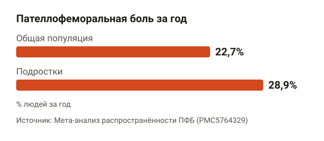<figcaption>ПФБ встречается часто, и приседания скорее проявляют её, чем вызывают.</figcaption></figure>

У боли спереди колена у тех, кто приседает, две частые причины: пателлофеморальная боль (дальше ПФБ) и тендинопатия надколенникового сухожилия. Про обе ниже.

ПФБ встречается часто. В мета-анализе [распространённость за год](https://pmc.ncbi.nlm.nih.gov/articles/PMC5764329/) оценили в 22,7% в общей популяции и в 28,9% у подростков. То есть почти каждый пятый взрослый хотя бы раз за год с ней сталкивается, и приседания тут не главный виновник, а скорее то, что её проявляет.

Систематический обзор 2022 года пришёл к выводу, что [все варианты приседаний нагружают пателлофеморальный сустав](https://www.ncbi.nlm.nih.gov/pmc/articles/PMC9367913/) и могут вызвать или усилить ПФБ. Оговорка: вывод опирается в основном на биомеханику. То есть учёные мерили силы в суставе, а не наблюдали годами, у кого из приседающих колено заболит. В одном обзоре упоминается, что нагрузка заметно растёт примерно с 60° сгибания колена, но эта цифра слабая и требует проверки.

### Пателлофеморальная боль: спереди, вокруг надколенника

<figure class="step">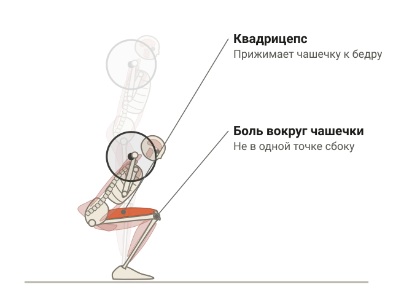<figcaption>Чем глубже и тяжелее присед, тем сильнее квадрицепс прижимает чашечку к бедру.</figcaption></figure>

Пателлофеморальный сустав — место, где надколенник (коленная чашечка) скользит по желобку бедренной кости. Когда ты сгибаешь колено под весом, квадрицепс прижимает чашечку к бедру, и чем глубже и тяжелее, тем сильнее давление.

Как понять, что это она:

- болит за надколенником или вокруг него, а не в одной точке сбоку;
- боль появляется в самом приседе, часто и при спуске по лестнице;
- приседание без боли делает ПФБ маловероятной.

Последние два пункта — не моя догадка. Рекомендации Американской ассоциации физиотерапевтов (APTA) используют [боль вокруг надколенника при приседании как диагностический тест](https://www.guidelinecentral.com/guideline/8381/), а если присед не болит, ПФБ считают маловероятной. Диагноз ставит врач, но ориентир понятный.

### Тендинопатия надколенникового сухожилия: ниже чашечки

<figure class="step">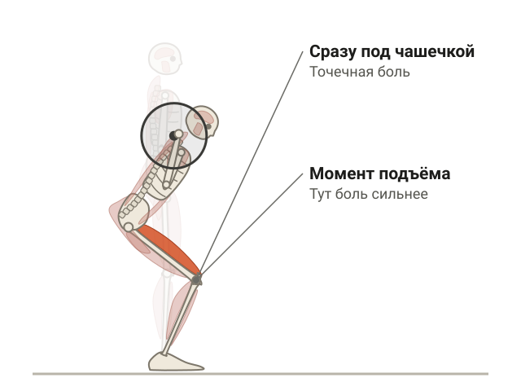<figcaption>Боль точечная под надколенником и усиливается, когда встаёшь из приседа.</figcaption></figure>

Надколенниковое сухожилие идёт от нижнего края чашечки к бугристости голени. Тендинопатия — это когда сухожилие раздражено нагрузкой, которую оно не успевает переварить. Боль обычно точечная, сразу под надколенником, и усиливается в момент, когда ты встаёшь из приседа или прыгаешь.

Stronger By Science советует при такой боли [начинать с приседа на бокс](https://www.strongerbyscience.com/squatting-with-patellar-tendinopathy/), держать боль на низком уровне и при сохраняющейся боли идти к врачу. Это экспертный обзор, а не мета-анализ, но совет совпадает с клиническими рекомендациями: нагрузку не убирают, а дозируют.

## Когда это травма, а не перегрузка

<figure class="step">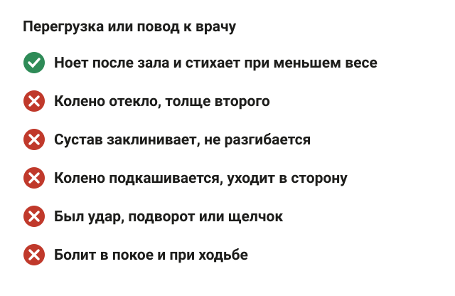<figcaption>Хотя бы один тревожный признак — это к врачу, а не в зал.</figcaption></figure>

Перегрузка ноет после тренировки и стихает, когда снижаешь вес. Травма ведёт себя иначе. Иди к врачу, а не в зал, если есть хотя бы одно:

1. Колено отекло, стало толще второго.
2. Сустав заклинивает: нога «застревает» в согнутом положении и не разгибается до конца.
3. Колено подкашивается или ощущается нестабильным, будто уходит в сторону.
4. Была конкретная травма: удар, подворот, щелчок с резкой болью.
5. Болит и вне зала: в покое, при обычной ходьбе.

Домашние упражнения из этой статьи в таких случаях не замена осмотру. Если врач нашёл повреждение мениска или связок, тебе ближе статья про [реабилитацию после травмы колена](/stati/reabilitaciya-posle-travmy-kolena/).

## Приседания со штангой: что поменять, чтобы колено не болело

<figure class="step">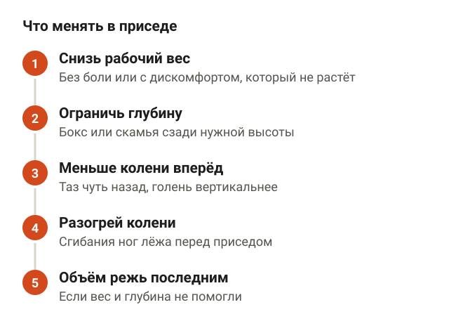<figcaption>Ищешь вариант приседа, который колено переносит, и двигаешься от него.</figcaption></figure>

Stronger By Science формулирует правило коротко: [если упражнение вызывает боль, это уже чрезмерно](https://www.strongerbyscience.com/how-to-squat/). Соответственно, задача — найти вариант приседа, который колено переносит, и от него двигаться дальше. Порядок действий:

1. **Снизь рабочий вес.** До такого, с которым присед проходит без боли или с лёгким дискомфортом, который не растёт от подхода к подходу.
2. **Ограничь глубину.** Приседай до той глубины, где ещё не болит. Проще всего поставить сзади бокс или скамью нужной высоты.
3. **Меньше выводи колени вперёд.** При уже существующей боли вынос колен далеко за носки, по мнению Stronger By Science, может усиливать проблему. Чуть больше таз назад, чуть вертикальнее голень. Систематических данных тут нет, а эксперты расходятся, так что это временная мера на период боли.
4. **Разогрей колени до приседа.** Джефф Ниппард советует при «капризных» коленях [начинать тренировку со сгибаний ног лёжа](https://generationiron.com/jeff-nippard-reverse-nordics/). Это практический совет без проверки в исследованиях, но он ничего не ломает.
5. **Объём режь последним.** Сначала вес и глубина, потом количество подходов, если первые два шага не помогли.

<figure class="step move">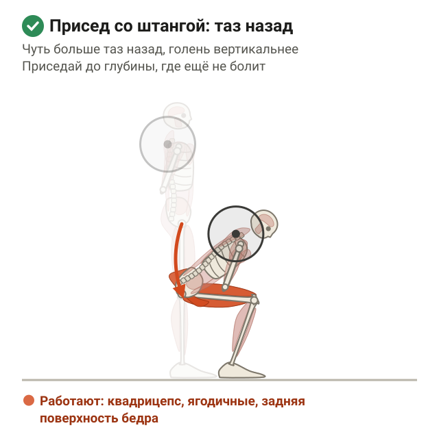</figure>

Про саму технику — постановку стоп, дыхание, гриф на спине — подробно в статье [как правильно приседать со штангой](/stati/kak-pravilno-prisedat-so-shtangoy/).

### Глубокий присед вреден для колен?

<figure class="step">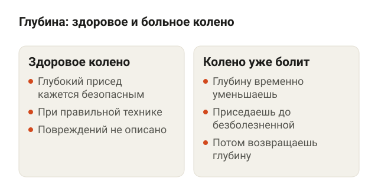<figcaption>Глубина сама по себе не враг, но при боли её временно уменьшают.</figcaption></figure>

Для здорового колена — по имеющимся данным, нет. Scoping-обзор 2024 года заключает, что [глубокий присед кажется безопасным для коленного сустава](https://www.frontiersin.org/journals/sports-and-active-living/articles/10.3389/fspor.2024.1477796/full) при правильной технике, и ни одно из вошедших исследований не сообщило о повреждении сустава от глубокого приседа.

Ограничения такие:

- обзор не систематический, боль оценивали по опросникам;
- в обзоре упоминаются работы, где частичная амплитуда давала больше дискомфорта в колене, чем полная, но вывод о глубине пока спорный;
- данных о том, как разный вес на штанге влияет на боль у здоровых людей, я не нашёл.

По сути: глубина сама по себе не враг. Но если колено уже болит, глубину временно уменьшаешь, а потом возвращаешь.

## Что делать, если болит колено после приседаний: упражнения

<figure class="step">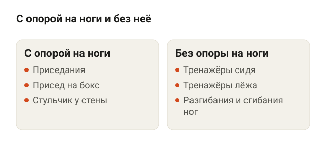<figcaption>Оба варианта работают примерно одинаково, выбираешь те, что сейчас не болят.</figcaption></figure>

Клинические рекомендации JOSPT 2019 называют лучшим подходом при ПФБ [лечебную нагрузку на бедро и колено с постепенной прогрессией](https://www.jospt.org/doi/10.2519/jospt.2019.0302). Мета-анализ рандомизированных исследований показал, что [укрепление бедра вместе с коленом](https://www.jospt.org/doi/10.2519/jospt.2018.0502) лучше снижает боль и возвращает активность, чем одно колено. А упражнения с опорой на ноги (приседания) и без неё (тренажёры сидя или лёжа) по тем же рекомендациям работают примерно одинаково. Значит, выбираешь те, что сейчас не болят.

Дозировка простая: боль во время упражнения низкая, не растёт от подхода к подходу и не усиливается на следующий день. Если усилилась, на следующей тренировке уменьшаешь вес или амплитуду.

### Упражнения на колено

<figure class="step">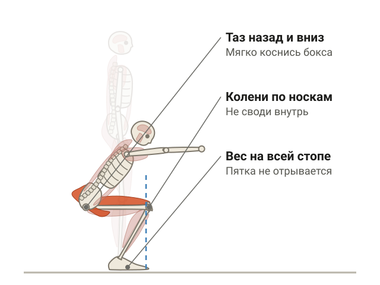<figcaption>В приседе на бокс таз уходит назад и вниз, колени идут по линии носков.</figcaption></figure>

**Присед на бокс.** Встань перед скамьёй или боксом такой высоты, чтобы садиться без боли. Стопы на ширине плеч, носки слегка развёрнуты. Уводи таз назад и вниз, мягко коснись бокса ягодицами, не плюхаясь, и встань. Колени идут по линии носков, вес распределён по всей стопе. Когда 3 подхода проходят без боли, понижаешь бокс на одну ступень.

**Разгибания ног в тренажёре.** Сядь, прижми спину к спинке, валик на нижней части голени над стопой. Разгибай колени до прямой ноги, опускай за 2–3 секунды. Работай в той части амплитуды, где не болит, и расширяй её постепенно. Таз не отрывается от сиденья.

**Изометрия у стены («стульчик»).** Встань спиной к стене, стопы на шаг впереди. Сползи вниз до угла в колене, где нет боли, и удерживай позу, пока не устанут бёдра. Спина прижата к стене, колени над стопами, а не сведены внутрь. Ожидания скромные: в РКИ у людей с артрозом колена такой присед [снизил болевую чувствительность, но не интенсивность боли](https://pubmed.ncbi.nlm.nih.gov/41381113/). Это вариант нагрузить квадрицепс без движения, а не волшебная таблетка.

<figure class="step move">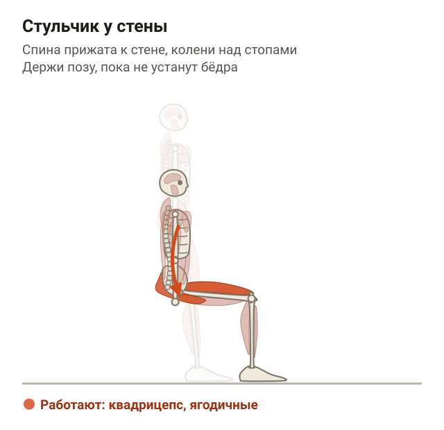</figure>

### Упражнения на бедро

<figure class="step">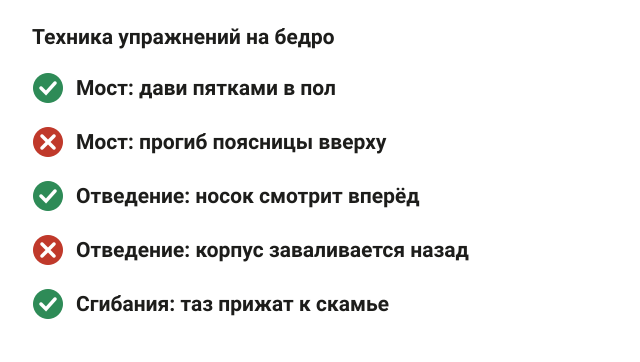<figcaption>Ягодичные и отводящие мышцы держат колено по траектории.</figcaption></figure>

Мышцы бедра и таза — ягодичные, отводящие — держат колено по траектории. В приседе квадрицепс обычно пашет, а ягодичные у многих просто постояли рядом.

**Ягодичный мост.** Ляг на спину, колени согнуты, стопы на полу на ширине таза. Давя пятками в пол, подними таз до прямой линии плечи — таз — колени, задержись на секунду и опустись. Поясница не прогибается вверху, рёбра опущены.

<figure class="step move">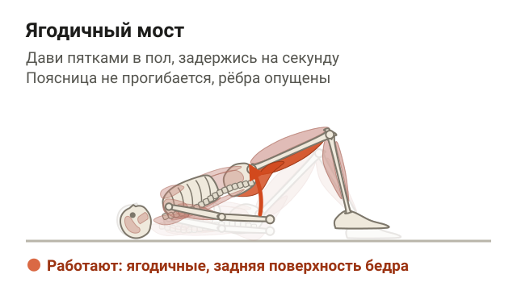</figure>

**Отведение бедра лёжа на боку.** Ляг на бок, нижняя нога согнута для устойчивости, верхняя прямая. Поднимай верхнюю ногу вверх чуть выше линии таза и медленно опускай. Носок смотрит вперёд, а не в потолок, корпус не заваливается назад.

**Сгибания ног лёжа.** Ляг на живот в тренажёре, валик над пятками. Сгибай колени, подтягивая валик к ягодицам, и опускай под контролем. Таз прижат к скамье, поясница не выгибается. Это то самое упражнение, которое Ниппард ставит перед приседом при капризных коленях.

## Как вернуться к приседаниям со штангой

<figure class="step">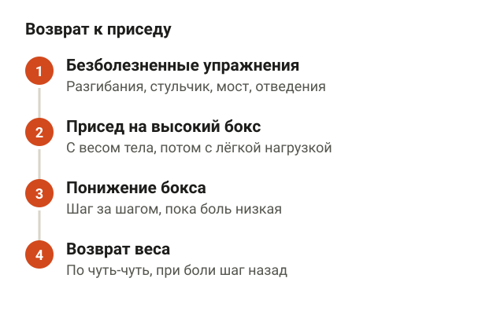<figcaption>Ориентир — не календарь, а реакция колена на следующий день.</figcaption></figure>

Сроков, через сколько недель боль уходит, в данных нет, и придумывать их я не буду. Ориентир — не календарь, а реакция колена. Последовательность такая:

1. **Безболезненные упражнения.** Разгибания, стульчик, мост, отведения. Колено и бедро нагружены, боль низкая.
2. **Присед на высокий бокс.** С весом тела, потом с лёгкой нагрузкой.
3. **Понижение бокса.** Шаг за шагом до привычной глубины, пока боль остаётся низкой и не растёт на следующий день.
4. **Возврат веса.** Прибавляю по чуть-чуть, как в обычной прогрессии. Застреваешь на каком-то весе из-за боли — откатываешься на шаг назад, а не терпишь.

Добивать объём для роста мышц стоит, когда колено спокойно переносит рабочий вес. Сколько подходов нужно для роста, разобрано в статье [сколько подходов делать для роста мышц](/stati/skolko-podhodov-dlya-rosta-myshc/).

## Наколенники, тейпы и процедуры: что работает

<figure class="step">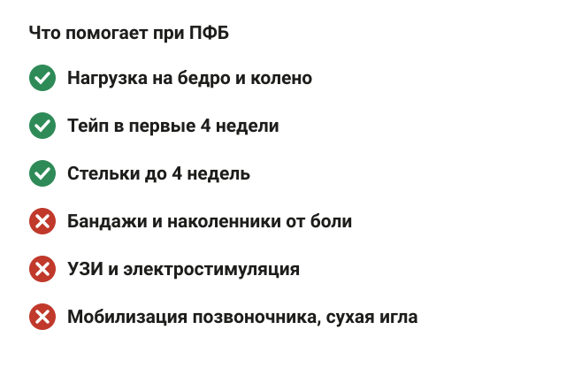<figcaption>Тейп и стельки — помощь на старте, основа — лечебная нагрузка.</figcaption></figure>

Ниже — что говорят рекомендации APTA и JOSPT про популярные средства при ПФБ.

| Средство | Что говорят рекомендации |
|---|---|
| Лечебная нагрузка на бедро и колено | Лучший подход, первая линия |
| Тейпирование | Может снизить боль сразу и помочь упражнениям в первые 4 недели |
| Стельки | Краткосрочная польза, до 4 недель |
| Коленные бандажи и наколенники | Назначать при ПФБ не рекомендуется |
| УЗИ, электростимуляция | Не помогают, применять не рекомендуется |
| Мобилизация позвоночника, сухая игла | Не помогают, применять не рекомендуется |

Источник по пассивным методам и бандажам — [обзор рекомендаций APTA](https://www.aafp.org/afp/2020/1001/p442). Голландское руководство 2024 года по передней боли в колене тоже [советует начинать с лечебной нагрузки](https://www.ncbi.nlm.nih.gov/pmc/articles/PMC11792096/) и при ПФБ, и при тендинопатии, хотя опирается в основном на мнение экспертов.

То есть тейп и стельки — костыль на старте, чтобы спокойнее делать упражнения. Сами по себе они колено не укрепят. Наколенник никто не запрещает надеть для тепла, но рассчитывать на него как на средство от боли данных нет.

## Шпаргалка

<figure class="step">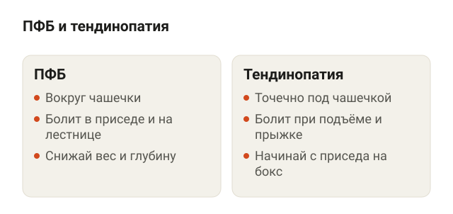<figcaption>Обе причины лечат дозированной нагрузкой, а не отказом от приседа.</figcaption></figure>

- Боль спереди колена после приседа — чаще всего ПФБ (вокруг чашечки) или тендинопатия (под чашечкой).
- Отёк, заклинивание, нестабильность, травма или боль вне зала — к врачу.
- Присед не бросаешь, а снижаешь вес и глубину до безболезненных. Удобно через бокс.
- При текущей боли меньше выводи колени вперёд, это временно.
- Укрепляй и колено, и бедро: вместе это работает лучше, чем одно колено.
- Боль на упражнениях низкая и не растёт на следующий день — значит, нагрузка подобрана.
- Тейп и стельки помогают в первые недели, бандажи и пассивные процедуры — нет.
- Глубокий присед для здорового колена, по имеющимся данным, безопасен при нормальной технике.
