---
{
  "title": "Болит плечо после жима лёжа: причины и что делать",
  "seo_title": "Болит плечо после жима лёжа: почему и что делать",
  "description": "Почему болит плечо после жима лёжа: ключица или вращательная манжета, какой хват и положение лопаток снижают нагрузку, чем заменить жим и когда к врачу.",
  "slug": "bolit-plecho-posle-zhima-lezha",
  "date": "2026-11-03",
  "category": "travmy",
  "keyword": "болит плечо после жима лежа",
  "tags": [
    "жим лёжа",
    "боль в плече",
    "вращательная манжета",
    "акромиально-ключичный сустав",
    "техника жима"
  ],
  "faq": [
    {
      "q": "Почему болит плечо после жима лёжа?",
      "a": "Чаще всего от перегрузки: сухожилий вращательной манжеты (боль спереди и сбоку) или сустава между ключицей и лопаткой (боль сверху). Факторы — широкий хват, разъезжающиеся лопатки, подходы до отказа и частые тяжёлые тренировки."
    },
    {
      "q": "После жима болит плечо спереди: что это?",
      "a": "Чаще всего это перегрузка вращательной манжеты. Но по месту боли диагноз не ставят: если за несколько недель с меньшим весом и более узким хватом не легче, покажи плечо врачу."
    },
    {
      "q": "Почему болит плечо после жима гантелей?",
      "a": "Механизмы те же: перегрузка манжеты и сустава у ключицы. Гантели позволяют поставить руки так, как удобно плечу, но исследований, что они безопаснее штанги, я не нашёл."
    },
    {
      "q": "Болит плечо после жима лёжа: как лечить?",
      "a": "Лечение назначает врач. При перегрузке манжеты основа — упражнения: мета-анализ 34 исследований показал, что они уменьшают боль при движении. Бросать зал обычно не нужно, нужно снизить вес и поменять технику."
    }
  ],
  "sources": [
    {
      "title": "Tung M. J. и соавт. Injuries in weightlifting and powerlifting: an updated systematic review (BMJ Open Sport & Exercise Medicine, 2024)",
      "url": "https://doi.org/10.1136/bmjsem-2023-001884"
    },
    {
      "title": "Daher M. и соавт. Shouldering the load: a scoping review of incidence, types, and risk factors of shoulder injuries in weight-lifting athletes (Shoulder & Elbow, 2025)",
      "url": "https://doi.org/10.1177/17585732241258743"
    },
    {
      "title": "Strömbäck E. и соавт. Prevalence and consequences of injuries in powerlifting: a cross-sectional study (Orthopaedic Journal of Sports Medicine, 2018)",
      "url": "https://doi.org/10.1177/2325967118771016"
    },
    {
      "title": "Wilkinson M. и соавт. Risk factors and management of atraumatic distal clavicular osteolysis: a scoping review (Shoulder & Elbow, 2026)",
      "url": "https://doi.org/10.1177/17585732261479715"
    },
    {
      "title": "Kolber M. J. и соавт. Shoulder joint and muscle characteristics among weight-training participants with and without impingement syndrome (JSCR, 2017)",
      "url": "https://doi.org/10.1519/jsc.0000000000001554"
    },
    {
      "title": "Kanto K. и соавт. Arthroscopic subacromial decompression versus placebo surgery: 10 year follow-up of the FIMPACT trial (BMJ, 2025)",
      "url": "https://doi.org/10.1136/bmj-2025-086201"
    },
    {
      "title": "Tena-Portilla A. и соавт. Effectiveness of exercise in rotator cuff-related shoulder pain: systematic review with meta-analysis (Physiotherapy Theory and Practice, 2026)",
      "url": "https://doi.org/10.1080/09593985.2026.2717392"
    },
    {
      "title": "Noteboom L. и соавт. Effects of bench press technique variations on musculoskeletal shoulder loads and potential injury risk (Frontiers in Physiology, 2024)",
      "url": "https://doi.org/10.3389/fphys.2024.1393235"
    },
    {
      "title": "Motlagh J. G., Lipps D. B. The contribution of muscular fatigue and shoulder biomechanics to shoulder injury incidence during the bench press: a narrative review (JSCR, 2024)",
      "url": "https://doi.org/10.1519/jsc.0000000000004973"
    },
    {
      "title": "Smith B. E. и соавт. Should exercises be painful in the management of chronic musculoskeletal pain? Systematic review and meta-analysis (BJSM, 2017)",
      "url": "https://doi.org/10.1136/bjsports-2016-097383"
    },
    {
      "title": "Magee R. M. и соавт. Complex intratendinous pectoralis major rupture after heavy bench press (Cureus, 2026)",
      "url": "https://doi.org/10.7759/cureus.112354"
    },
    {
      "title": "Zhiti C. и соавт. Chronic rupture of the pectoralis major: current concepts and surgical repair techniques, a mini review (J Orthop Case Rep, 2025)",
      "url": "https://doi.org/10.13107/jocr.2025.v15.i01.5182"
    }
  ]
}
---
Если болит плечо после жима лёжа, чаще всего это перегрузка: сухожилий вращательной манжеты или сустава между ключицей и лопаткой. Бросать тренировки обычно не нужно, нужно поменять хват, положение лопаток и вес. В исследовании шведских пауэрлифтеров травмированными себя назвали 70%, но полностью прекратили тренировки только 16% из них. Ниже разбираю, почему болит, что изменить в технике, чем заменить жим на время и с какими признаками сразу к врачу.

## Почему болит плечо после жима лёжа

<figure class="step">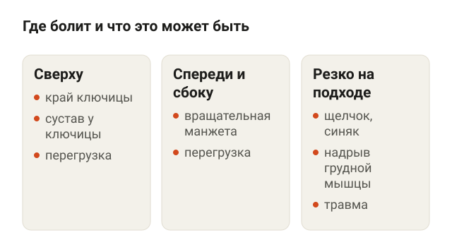<figcaption>Место боли — ориентир для тренировки, а не диагноз.</figcaption></figure>

Жим лёжа нагружает плечо сильнее, чем кажется. Штанга давит на руки, а держат её в плечевом суставе небольшие мышцы и связки. Систематический обзор травм в тяжёлой атлетике и пауэрлифтинге (17 работ) назвал плечо одним из самых частых мест травм, вместе с поясницей и локтем. Обзор травм плеча у штангистов пришёл к похожему выводу: чаще всего встречаются перегрузка и нестабильность сустава, а среди причин — неправильная техника, неудобное положение плеча под штангой и слишком большой объём.

По месту боли можно примерно понять, что перегружено:

- **Сверху, на краю ключицы.** Это акромиально-ключичный сустав, место, где ключица соединяется с лопаткой.
- **Спереди и сбоку плеча.** Чаще это сухожилия вращательной манжеты — группы небольших мышц, которые прижимают головку плеча к суставной впадине.
- **Резко, прямо на подходе, со щелчком.** Так бывает при надрыве большой грудной мышцы. Это уже травма, а не перегрузка, и про неё отдельный раздел ниже.

Но по месту боли диагноз не ставят. Обзор 2026 года про разрушение края ключицы прямо пишет: симптомы не отличаются от других проблем плеча. Это ориентир, чтобы понять, что менять в тренировке, а не замена врачу.

## Боль сверху на ключице: «плечо штангиста»

<figure class="step">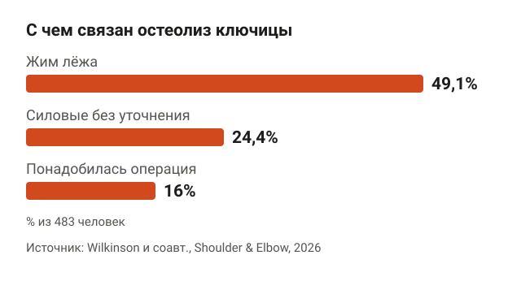<figcaption>Почти у половины людей с разрушением края ключицы причиной был жим лёжа.</figcaption></figure>

Есть состояние с длинным названием: нетравматический остеолиз дистального конца ключицы. Остеолиз — это когда кость на краю ключицы понемногу разрушается от повторяющейся нагрузки. В спортивной медицине его называют «плечом штангиста».

Обзор 2026 года собрал 8 исследований, 483 человека с таким диагнозом. Самой частой причиной из связанных с нагрузкой был жим лёжа — 49,1% случаев. Ещё в 24,4% случаев причиной назвали силовые тренировки без уточнения упражнения. Чаще всего у людей болел сам край ключицы и акромиально-ключичный сустав, это 69,9% случаев. Большинство восстановились без операции, 16% понадобилась операция, когда консервативное лечение не помогло.

Авторы называют возможными факторами риска частоту и интенсивность нагрузки. То есть дело не в одном тяжёлом подходе, а в том, что сустав не успевает восстановиться между тренировками.

## Боль спереди и сбоку: перегрузка вращательной манжеты

<figure class="step">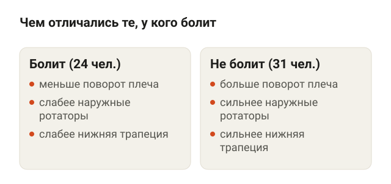<figcaption>У тренирующихся с болью в манжете слабее мышцы, которые держат лопатку и плечо.</figcaption></figure>

Раньше такую боль называли «импинджмент», то есть защемление. Сейчас в исследованиях чаще говорят «боль, связанная с вращательной манжетой», потому что версия про механическое защемление не подтвердилась: в финском исследовании FIMPACT операция, которая освобождает сухожилию место под костью, через 10 лет не дала преимуществ перед имитацией операции.

В американском исследовании сравнили 55 мужчин, которые тренируются в зале минимум 2 раза в неделю: 24 с такой болью и 31 без неё. У тех, у кого болело, было:

- меньше амплитуда поворота плеча внутрь и наружу;
- слабее мышцы, которые поворачивают плечо наружу;
- слабее нижняя часть трапециевидной мышцы, которая опускает и прижимает лопатку.

Исследование одномоментное, поэтому нельзя сказать, что было раньше: слабость или боль. Но картина знакомая по залу. Жим, разводки и отжимания на брусьях идут каждую неделю, а наружную ротацию и тяги к поясу делают «если останется время».

Хорошая новость: такая боль хорошо отвечает на упражнения. Мета-анализ 2026 года (34 исследования, 2019 человек) показал, что упражнения уменьшают боль при движении по сравнению с отсутствием лечения, хотя уверенность в данных низкая. Какие упражнения и в каком порядке, подробно разбирал в статье [о реабилитации после травмы плеча](/stati/reabilitaciya-posle-travmy-plecha/), там же про наружную ротацию с резинкой.

## Как жать, чтобы не болело плечо: хват и лопатки

<figure class="step">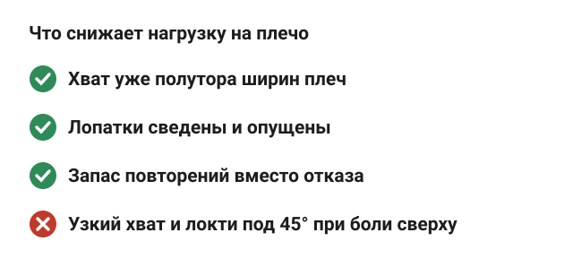<figcaption>Хват и лопатки влияют на нагрузку сильнее, чем угол локтей.</figcaption></figure>

Прямых исследований «поменял технику — травм стало меньше» нет. Есть биомеханика: в 2024 году 10 опытных силовиков сделали 21 вариант жима лёжа. Меняли ширину хвата, угол локтей и положение лопаток, а нагрузку на суставы плеча считали по компьютерной модели. Результаты такие:

- **Хват уже полутора ширин плеч** уменьшил сдавливание акромиально-ключичного сустава. Ширину плеч здесь меряют по костным выступам над плечом, это примерно расстояние между краями плеч. Тот же хват уменьшил сдвигающую нагрузку на плечевой сустав и работу вращательной манжеты.
- **Сведённые лопатки** тоже уменьшили сдвигающую нагрузку на плечевой сустав и работу манжеты.
- **Угол локтей** повлиял меньше, чем хват и лопатки. Локти, прижатые к корпусу под 45°, увеличивали нагрузку в верхней части сустава. Поэтому при боли сверху авторы не советуют жать одновременно с прижатыми локтями и узким хватом на ширине плеч.

Оговорки честные: 10 человек, вес штанги 16 кг, нагрузку считала модель, а не датчик внутри сустава. Но это лучшее, что есть, и оно совпадает с тем, что я вижу на тренировках. Сам жал 165 кг в софт-экипировке, и ширину хвата подбирал по ощущениям плеча, а не по максимальному весу.

**Жим штанги лёжа.** Ляг так, чтобы глаза были под грифом, стопы упираются в пол. Сведи и опусти лопатки, как будто прячешь их в задние карманы. Хват чуть шире плеч, но не на самых краях грифа. Опускай штангу к низу груди, локти уходят под углом к корпусу, а не строго в стороны. Ориентиры: лопатки не разъезжаются на подъёме, плечи не уходят вперёд к ушам.

<figure class="step move">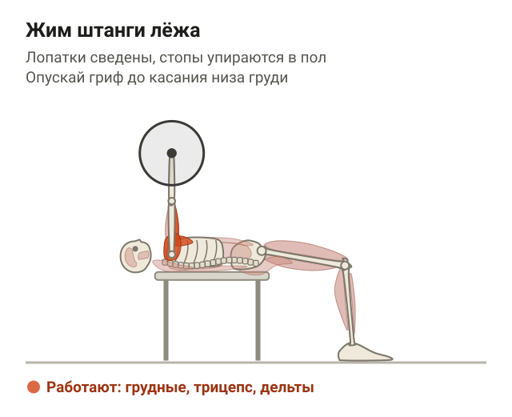</figure>

Ещё один фактор — усталость. Обзор 2024 года про жим лёжа советует планировать нагрузку с запасом повторений, а не жать каждый подход до отказа. Это обзор без новых данных, но логика простая: в последних повторениях техника плывёт, и именно тогда лопатки разъезжаются.

## Болит плечо после жима лёжа: что делать

<figure class="step">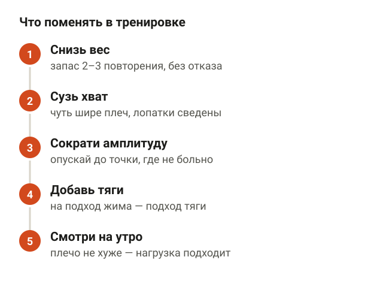<figcaption>Бросать зал не нужно: из травмированных пауэрлифтеров прекратили тренировки 16%.</figcaption></figure>

Бросать зал обычно не нужно. В шведском исследовании 104 пауэрлифтеров 70% назвали себя травмированными, 87% получали травму за последний год. При этом из травмированных полностью прекратили тренировки только 16%, остальные тренировались, поменяв нагрузку. Среди факторов, связанных с травмой, были частота тренировок и травма, начавшаяся на жиме лёжа.

Порядок, который использую сам:

1. **Снизь вес** так, чтобы оставался запас 2–3 повторения, и временно убери подходы до отказа.
2. **Сузь хват** до ширины чуть больше плеч и следи, чтобы лопатки оставались сведёнными.
3. **Сократи амплитуду**: опускай штангу не до груди, а до той точки, где ещё не больно.
4. **Добавь тяги** к каждой тренировке с жимом: на один подход жима — подход тяги.
5. **Смотри на утро**: если на следующий день плечо не хуже, чем было, нагрузка подходит.

Можно ли жать, если немного болит? Мета-анализ в British Journal of Sports Medicine (7 исследований, 385 человек с хронической болью в мышцах и суставах) не нашёл вреда от упражнений с терпимой болью на среднем и длинном сроке. Ориентир: боль во время подхода терпимая, не растёт от подхода к подходу и не держится на следующий день. Если растёт — снижай вес или амплитуду.

## Чем заменить жим, пока плечо болит

<figure class="step">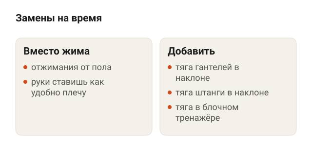<figcaption>Жим можно заменить отжиманиями, а тяги добавить к каждой тренировке.</figcaption></figure>

Пока плечо восстанавливается, жим штанги можно заменить упражнениями, где ты сам управляешь положением рук. Исследований, что эти замены безопаснее, я не нашёл, это практика: смотрю, какое движение не вызывает боли, и оставляю его.

**Отжимания от пола.** Упор лёжа, руки чуть шире плеч, тело ровное от макушки до пяток. Опускайся, пока грудь не окажется у пола, и выжимай себя вверх. Ориентиры: локти уходят назад под углом к корпусу, таз не провисает. Лопатки здесь двигаются свободно, и многим это комфортнее, чем жим со штангой.

<figure class="step move">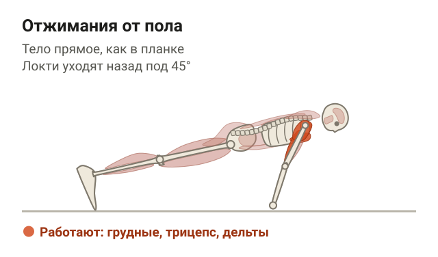</figure>

**Тяга гантелей в наклоне.** Наклонись вперёд с ровной спиной, колени слегка согнуты, гантели в опущенных руках. Тяни гантели к поясу, локти идут назад вдоль корпуса, лопатки сводятся. Опускай медленно. Работают широчайшие и трапециевидные мышцы, то есть те, что управляют лопаткой.

<figure class="step move"></figure>

**Тяга штанги в наклоне.** Тот же наклон, штанга в прямых руках хватом чуть шире плеч. Тяни гриф к низу живота и опускай под контролем. Ориентиры: спина не округляется, корпус не раскачивается ради веса.

<figure class="step move">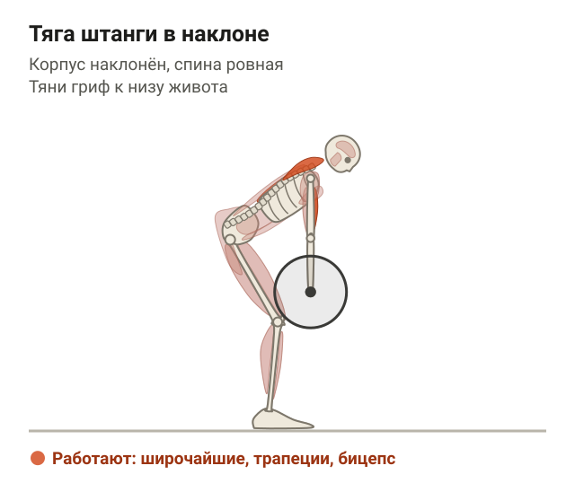</figure>

В «Континенте» вместо тяги в наклоне подойдёт горизонтальная тяга в блочном тренажёре, если поясница устаёт держать наклон. Сколько подходов в неделю давать, разбирал в статье [сколько подходов делать для роста мышц](/stati/skolko-podhodov-dlya-rosta-myshc/). Если плечи ещё и завалены вперёд от сутулости, пригодятся упражнения [на верх спины при сутулости](/stati/sutulost-uprazhneniya-v-trenazhernom-zale/).

## Когда с болью в плече идти к врачу

<figure class="step">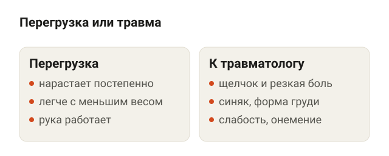<figcaption>Щелчок на подходе, синяк и слабость руки — повод сразу к травматологу.</figcaption></figure>

Перегрузка развивается постепенно. Травма выглядит иначе. Разрыв большой грудной мышцы описывают у молодых мужчин на тяжёлом жиме лёжа, в момент, когда штанга опускается. В описанном случае у пауэрлифтера на попытке на максимум была резкая боль в груди, отёк, синяк, изменилась форма грудной мышцы. Такая травма редкая, но ждать с ней нельзя: при полном разрыве обычно обсуждают операцию, а в застарелых случаях сшить сухожилие напрямую часто уже не получается.

Сразу к травматологу, если:

- на подходе был щелчок или рывок, и сразу появилась боль;
- через день-два на груди или плече синяк;
- изменилась форма груди или подмышки;
- рука ослабла и не поднимается;
- немеют пальцы.

К врачу без спешки, но обязательно, если плечо болит ночью и в покое или боль не уменьшается за несколько недель, хотя ты снизил вес и поменял технику.

## Шпаргалка

<figure class="step">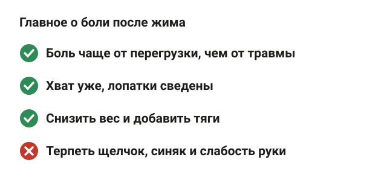<figcaption>Чаще всего это перегрузка, и её решают изменения в тренировке.</figcaption></figure>

- Боль в плече после жима чаще всего от перегрузки, а не от травмы.
- Боль сверху на ключице — акромиально-ключичный сустав. Среди людей с разрушением края ключицы почти у половины причиной был жим лёжа.
- Боль спереди и сбоку — обычно вращательная манжета. У тех, у кого болит, слабее мышцы, поворачивающие плечо наружу, и нижняя трапеция.
- Хват уже полутора ширин плеч и сведённые лопатки уменьшают нагрузку на плечо по данным биомеханики.
- Не бросай зал: снизь вес, сузь хват, сократи амплитуду, добавь тяги.
- Щелчок, синяк, изменение формы груди или слабость руки — сразу к травматологу.
