---
{
  "title": "Болит спина после тренировки: почему и что делать",
  "seo_title": "Болит спина после тренировки: причины и что делать",
  "description": "Почему после зала ноет поясница или спина между лопатками, сколько длится мышечная боль, как построить следующую тренировку и когда пора к врачу.",
  "slug": "bolit-spina-posle-trenirovki",
  "date": "2026-11-02",
  "category": "spina-i-osanka",
  "keyword": "болит спина после тренировки",
  "tags": [
    "боль в спине",
    "поясница",
    "мышечная боль после тренировки",
    "восстановление",
    "становая тяга",
    "приседания"
  ],
  "faq": [
    {
      "q": "Почему болит поясница через день после тренировки?",
      "a": "Обычно это отсроченная мышечная боль. Она появляется через 24–72 часа после непривычной или тяжёлой нагрузки, особенно после опускания штанги в становой и приседе."
    },
    {
      "q": "Сколько длится боль в спине после тренировки?",
      "a": "По мета-анализу пик бывает в первые сутки, дальше боль каждый день слабее. В исследовании на 52 добровольцах у 45 человек она прошла в течение недели."
    },
    {
      "q": "Можно ли тренироваться, если спина ещё болит?",
      "a": "Клинические рекомендации по боли в пояснице за сохранение активности и против постельного режима. Снизь рабочий вес в упражнениях на поясницу и убери то, что усиливает боль, а остальное тренируй как обычно."
    },
    {
      "q": "Помогает ли массаж при боли в мышцах после зала?",
      "a": "Мета-анализ показывает, что массаж может уменьшать мышечную боль и улучшать работу мышц, но исследования в нём разнородные. По акупунктуре единого мнения нет."
    },
    {
      "q": "Когда с болью в спине после зала идти к врачу?",
      "a": "Если боль появилась резко прямо в подходе, отдаёт в ногу, есть онемение или слабость, болит в покое или не проходит за неделю. Это ориентиры тренера: в найденных исследованиях тревожные признаки не разбирали."
    }
  ],
  "sources": [
    {
      "title": "Lumbar delayed onset muscle soreness: systematic review and meta-analysis (PubMed 41964504)",
      "url": "https://pubmed.ncbi.nlm.nih.gov/41964504/"
    },
    {
      "title": "Photobiomodulation for DOMS: systematic review and meta-analysis (PMC12286287)",
      "url": "https://pmc.ncbi.nlm.nih.gov/articles/PMC12286287/"
    },
    {
      "title": "DOMS model in healthy volunteers (BMC Musculoskeletal Disorders)",
      "url": "https://link.springer.com/article/10.1186/1471-2474-12-35"
    },
    {
      "title": "Massage therapy for DOMS: systematic review and meta-analysis (PMC5623674)",
      "url": "https://www.ncbi.nlm.nih.gov/pmc/articles/PMC5623674/"
    },
    {
      "title": "Acupuncture for DOMS: systematic review and meta-analysis (PMC7379881)",
      "url": "https://www.ncbi.nlm.nih.gov/pmc/articles/PMC7379881/"
    },
    {
      "title": "Recovery techniques for DOMS: flossing and IASTM (sportRxiv, препринт)",
      "url": "https://sportrxiv.org/index.php/server/preprint/view/252"
    },
    {
      "title": "Low back pain in gymnasts and weightlifters: clinical case series (PubMed 32789068)",
      "url": "https://pubmed.ncbi.nlm.nih.gov/32789068/"
    },
    {
      "title": "Low Back Pain Among Weightlifting Adolescents and Young Adults (ResearchGate)",
      "url": "https://www.researchgate.net/publication/342872570_Low_Back_Pain_Among_Weightlifting_Adolescents_and_Young_Adults"
    },
    {
      "title": "Lumbar degeneration in young weightlifters: 5-year cohort (PMC9242517)",
      "url": "https://www.ncbi.nlm.nih.gov/pmc/articles/PMC9242517/"
    },
    {
      "title": "Squat vs deadlift training: strength and jump performance (PMC7386153)",
      "url": "https://pmc.ncbi.nlm.nih.gov/articles/PMC7386153"
    },
    {
      "title": "Recent clinical practice guidelines for low back pain: global comparison (PMC11061926)",
      "url": "https://pmc.ncbi.nlm.nih.gov/articles/PMC11061926/"
    },
    {
      "title": "Clinical guidelines and physical activity for low back pain: systematic review (ScienceDirect)",
      "url": "https://www.sciencedirect.com/science/article/pii/S1440244024000203"
    },
    {
      "title": "Interventions for the Management of Acute and Chronic Low Back Pain: APTA Clinical Practice Guideline (JOSPT 2021)",
      "url": "https://www.jospt.org/doi/10.2519/jospt.2021.0304"
    },
    {
      "title": "Clinical practice guidelines to address low back pain (JOSPT 2021)",
      "url": "https://www.jospt.org/doi/10.2519/jospt.2021.0507"
    }
  ]
}
---
Если болит спина после тренировки, чаще всего это отсроченная мышечная боль. Она появляется через сутки–трое после непривычной или тяжёлой нагрузки и за несколько дней стихает сама. Бросать зал не нужно: снизь рабочий вес, убери упражнения, которые усиливают боль, и оставь те, что проходят спокойно. Если боль резкая, появилась прямо в подходе или не уходит за неделю, это уже к врачу.

Ниже разберу, что про такую боль известно из исследований, где данных мало и как построить следующую тренировку.

## Почему болит спина после тренировки

<figure class="step">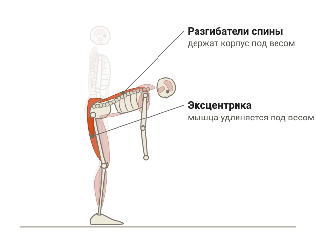<figcaption>В наклоне и при опускании штанги разгибатели спины держат корпус под весом.</figcaption></figure>

Самая частая причина — отсроченная мышечная болезненность. По-английски её называют DOMS. Это ноющая боль в мышцах, которая появляется не сразу, а через 24–72 часа после нагрузки ([систематический обзор, PMC](https://pmc.ncbi.nlm.nih.gov/articles/PMC12286287/)).

Когда она появляется:

- после непривычной нагрузки: новое упражнение, больше подходов, чем обычно, возвращение после перерыва;
- после тяжёлой тренировки, когда ты прибавил рабочий вес;
- после эксцентрической работы, то есть когда мышца удлиняется под весом: опускание штанги в становой тяге, спуск в приседе;
- после бега и прыжков.

Разгибатели спины держат корпус почти в каждом базовом упражнении. Соответственно, если нагрузка выросла резко, мышечная боль появляется и в пояснице.

### Сколько длится боль в пояснице после нагрузки

<figure class="step">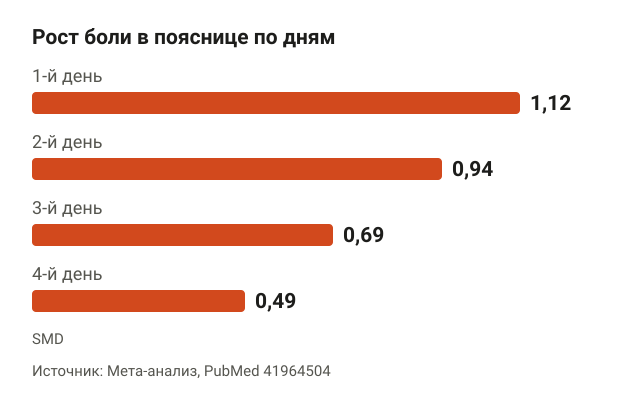<figcaption>Пик в первые сутки, дальше боль каждый день слабее, но уверенность в цифрах низкая.</figcaption></figure>

Есть мета-анализ, где у здоровых людей специально вызывали мышечную боль в пояснице и смотрели, как она меняется по дням ([PubMed 41964504](https://pubmed.ncbi.nlm.nih.gov/41964504/)). Эффект там считали в SMD — это стандартизированная разница средних. По сути, мера, которую можно сравнивать между разными исследованиями: чем больше число, тем сильнее боль выросла относительно исходного уровня.

| День после нагрузки | Рост боли (SMD) |
|---|---|
| 1-й | 1,12 |
| 2-й | 0,94 |
| 3-й | 0,69 |
| 4-й | 0,49 |

Картина понятная: пик в первые сутки, дальше боль каждый день слабее. Но уверенность в этих цифрах по шкале GRADE очень низкая, то есть это ориентир, а не точный прогноз.

В отдельном исследовании на 52 добровольцах у 45 человек боль после такой нагрузки ушла в ноль в течение недели ([BMC Musculoskeletal Disorders](https://link.springer.com/article/10.1186/1471-2474-12-35)).

Авторы мета-анализа отмечают, что такая мышечная боль похожа на обычную боль в пояснице: болит при движении, спина чувствительнее, мышцы работают слабее. Но они не утверждают, что это одно и то же.

## Мышечная боль или травма: как отличить

<figure class="step">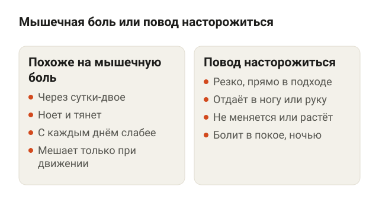<figcaption>Это ориентиры тренера, а не данные исследований.</figcaption></figure>

Честно: в найденных исследованиях чёткого теста нет, тревожные признаки там не разбирали. Поэтому таблица ниже — мои ориентиры как тренера, а не данные исследований.

| Признак | Похоже на мышечную боль | Повод насторожиться |
|---|---|---|
| Когда появилась | Через сутки-двое после тренировки | Резко, прямо во время подхода |
| Как болит | Ноет, тянет, болит при наклоне и нажатии на мышцы | Простреливает, отдаёт в ногу или руку |
| Как меняется | С каждым днём слабее | Не меняется или растёт |
| Вне зала | Мешает только при движении | Болит в покое, ночью, есть онемение или слабость |

Если твой случай попадает в правую колонку, это не к тренеру, а к врачу.

## Болит поясница после становой и приседаний

<figure class="step">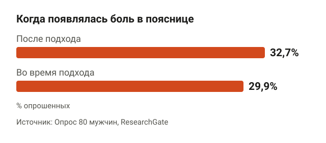<figcaption>В опросе 80 мужчин боль в пояснице чаще появлялась после подхода, чем во время.</figcaption></figure>

Поясница — самое частое место, где болит спина после силовой тренировки. Данные по этому есть, но небольшие.

- В опросе 80 мужчин, которые тренируются в зале, боль в пояснице чаще появлялась после подхода (32,7%), чем во время (29,9%) ([ResearchGate](https://www.researchgate.net/publication/342872570_Low_Back_Pain_Among_Weightlifting_Adolescents_and_Young_Adults)).
- В серии из 93 гимнастов и тяжелоатлетов, обратившихся в клинику, все 100% связывали начало боли с тренировкой ([PubMed 32789068](https://pubmed.ncbi.nlm.nih.gov/32789068/)). Но это люди, которые уже пришли к врачу, а не все атлеты подряд.
- В пятилетнем наблюдении за юными тяжелоатлетами признаки изменений в поясничных дисках нашли у всех участников ([PMC9242517](https://www.ncbi.nlm.nih.gov/pmc/articles/PMC9242517/)). Участников было 12, поэтому обобщать нельзя.

Полезнее всего для практики сравнение становой и приседаний ([PMC7386153](https://pmc.ncbi.nlm.nih.gov/articles/PMC7386153)). В группе становой у трёх участников заболела поясница, и их исключили из исследования. При этом сила ног и прыжок выросли в обеих группах похоже.

Вывод для зала: если становая сейчас отзывается в пояснице, замена её на время приседом не отнимет у тебя результат по силе. Главное — чтобы присед шёл с нормальной техникой, подробно она разобрана в статье [как правильно приседать со штангой](/stati/kak-pravilno-prisedat-so-shtangoy/).

## Почему ноет спина после дня ног

<figure class="step">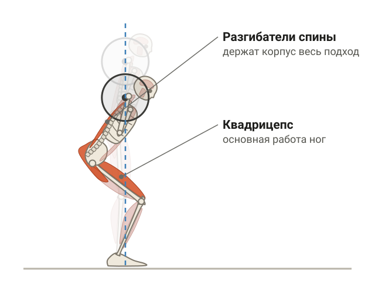<figcaption>Ноги работают, а разгибатели спины весь подход держат корпус под штангой.</figcaption></figure>

Отдельных исследований именно про спину после тренировки ног я не нашёл. Но логика простая. В приседе, становой, выпадах с гантелями разгибатели спины весь подход держат корпус под весом. Ноги ты тренировал, а спина просто держала штангу — и тоже устала.

Если ты добавил подходы, сменил упражнение или прибавил рабочий вес, разгибатели спины получили непривычную нагрузку. Отсроченная мышечная боль появляется там так же, как в бёдрах. Если она ведёт себя как в левой колонке таблицы выше и за несколько дней стихает, это нормальная реакция на новую нагрузку.

## Болит спина в области лопаток

<figure class="step">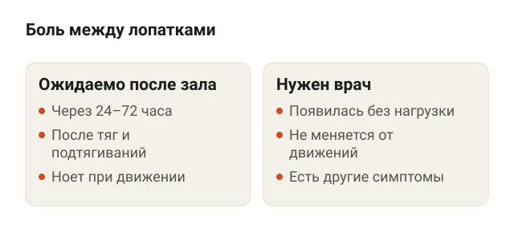<figcaption>Ноющая боль после новых тяг ожидаема, боль без нагрузки — повод к врачу.</figcaption></figure>

По боли между лопатками после зала научных источников я не нашёл, так что тут без цифр.

Определение мышечной боли работает для любой мышцы: непривычная нагрузка — боль через 24–72 часа. Между лопатками и над ними лежат трапециевидная и ромбовидные мышцы. Они работают в тягах к поясу, подтягиваниях, шрагах, удерживают лопатки в становой. Допустим, ты впервые сделал тягу штанги в наклоне или добавил подходы на спину — ноющая боль в этой зоне через день ожидаема.

Другое дело, если боль между лопатками появилась без нагрузки, не меняется от движений или идёт вместе с другими симптомами. Это не про зал, тут нужен врач.

## Что делать, если болит спина после тренировки

<figure class="step">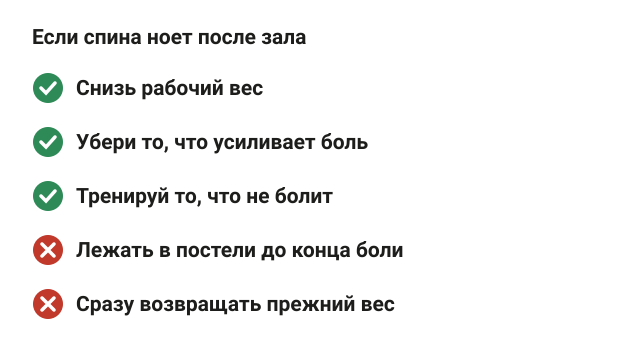<figcaption>Зал не бросай, а подстрой нагрузку под спину.</figcaption></figure>

### Не ложись: активность лучше покоя

<figure class="step">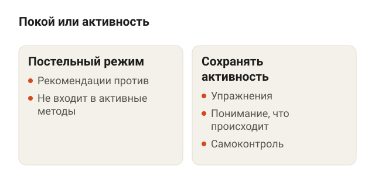<figcaption>Рекомендации по боли в пояснице ставят на первое место активные методы.</figcaption></figure>

Клинические рекомендации по боли в пояснице ставят на первое место активные методы: объяснение, что происходит, упражнения, сохранение активности, отказ от постельного режима и самоконтроль ([обзор рекомендаций, PMC](https://pmc.ncbi.nlm.nih.gov/articles/PMC11061926/)).

Две оговорки. Это рекомендации по боли в пояснице в целом, а не по мышечной боли после зала. И качество самих рекомендаций неровное: удовлетворительным его признали только у 27% из них ([ScienceDirect](https://www.sciencedirect.com/science/article/pii/S1440244024000203)), а качественных рандомизированных исследований по лечению боли в пояснице в целом мало ([JOSPT](https://www.jospt.org/doi/10.2519/jospt.2021.0507)). То есть направление ясное — двигаться, — а точных параметров нагрузки для тех, кто тренируется, в источниках нет.

### Как построить следующую тренировку

<figure class="step">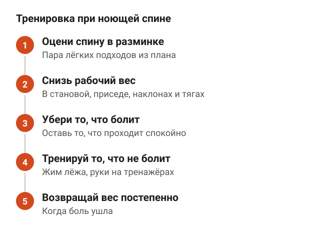<figcaption>Ориентир — вес и упражнения, которые не добавляют боли.</figcaption></figure>

1. Оцени спину в разминке. Сделай пару лёгких подходов того, что стоит в плане, и посмотри, усиливается ли боль.
2. Снизь рабочий вес в упражнениях, где нагружается поясница: становая, приседания со штангой, наклоны, тяги в наклоне. Ориентир — вес, при котором движение не добавляет боли.
3. Убери то, что усиливает боль, и оставь то, что переносится спокойно. Какие упражнения безопасны при боли в пояснице, исследования однозначно не говорят, так что ориентируйся на свои ощущения.
4. Тренируй то, что не болит. Жим лёжа или руки на тренажёрах никто не отменял.
5. Возвращай прежний вес постепенно, когда боль ушла.

### Упражнения, которые обычно переносятся легче

<figure class="step">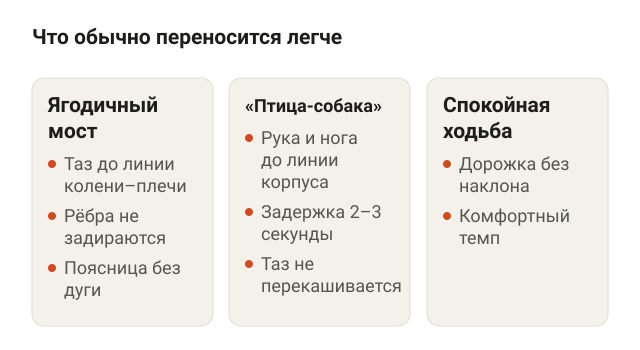<figcaption>Если какое-то движение усиливает боль, убирай его.</figcaption></figure>

Списка «безопасных» упражнений в исследованиях нет. Это движения из моей практики с маленькой нагрузкой на поясницу. Если какое-то из них усиливает боль — убирай.

**Ягодичный мост.** Ляг на спину, согни колени, стопы поставь на пол на ширине таза. Выдохни, слегка подкрути таз и подними его до прямой линии от колен до плеч, вверху сожми ягодицы. Ориентиры: рёбра не задираются вверх, поясница не прогибается дугой.

<figure class="step move">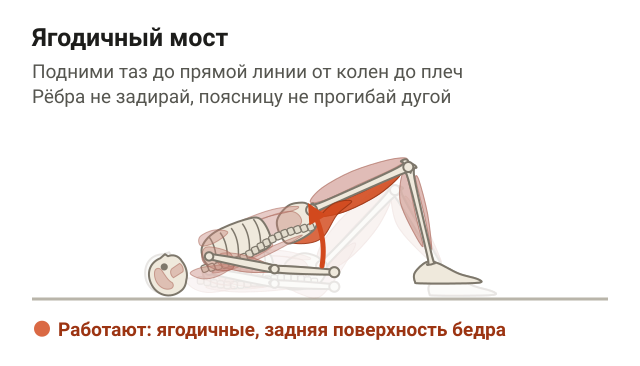</figure>

**«Птица-собака».** Встань на четвереньки: ладони под плечами, колени под тазом. Одновременно вытяни правую руку вперёд и левую ногу назад до линии корпуса, задержись на 2–3 секунды, вернись и смени сторону. Ориентиры: таз не перекашивается, поясница не проваливается вниз.

<figure class="step move">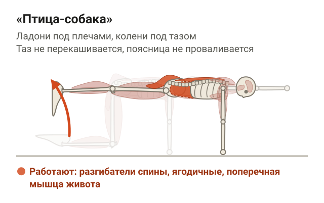</figure>

**Спокойная ходьба.** Дорожка без наклона или прогулка в комфортном темпе. Это та самая «сохранённая активность» из рекомендаций.

Больше упражнений для поясницы, в том числе при хронической боли, — в статье [боль в пояснице: упражнения при острой и хронической боли](/stati/bol-v-poyasnice-uprazhneniya/).

### Помогают ли массаж, лазер и акупунктура

<figure class="step">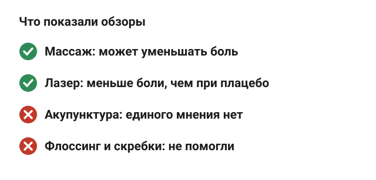<figcaption>Данные про мышечную боль в целом, не только в спине.</figcaption></figure>

Эти данные про мышечную боль в целом, не только в спине.

| Метод | Что показали обзоры | Насколько уверенно |
|---|---|---|
| Массаж | Может уменьшать мышечную боль и улучшать работу мышц ([PMC5623674](https://www.ncbi.nlm.nih.gov/pmc/articles/PMC5623674/)) | Мета-анализ, но исследования внутри разнородные |
| Фотомодуляция (низкоинтенсивный лазер) | Меньше боли и быстрее возвращается сила по сравнению с плацебо ([PMC12286287](https://pmc.ncbi.nlm.nih.gov/articles/PMC12286287/)) | Мета-анализ, выборки обычно маленькие |
| Акупунктура | Единого мнения нет ([PMC7379881](https://www.ncbi.nlm.nih.gov/pmc/articles/PMC7379881/)) | Результаты противоречат друг другу |
| Флоссинг (обмотка резиновой лентой) и мобилизация скребками | Не помогли ([sportRxiv](https://sportrxiv.org/index.php/server/preprint/view/252)) | Препринт, рецензию не проходил |

По сути, массаж — единственное из списка, что ты легко найдёшь и где данные скорее «за». Но это способ пережить пару дней комфортнее, а не замена разумной нагрузке.

## Силовая тренировка и спина: как снизить риск боли

<figure class="step">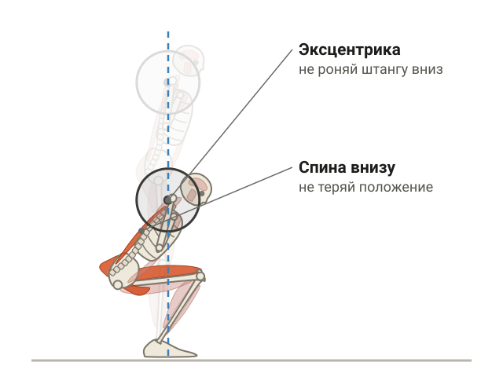<figcaption>При опускании штанги мышцы удлиняются под весом, и положение спины внизу важно не терять.</figcaption></figure>

Силовые не враг спины. Рекомендации Американской ассоциации физиотерапевтов предлагают при хронической боли в пояснице упражнения средней и высокой интенсивности для тех, у кого нет распространённой боли по всему телу ([JOSPT 2021](https://www.jospt.org/doi/10.2519/jospt.2021.0304)). Мой личный рекорд в становой — 202,5 кг, так что я точно не из тех, кто советует бояться тяги. Но тяжёлую тягу нужно заработать.

Что снижает шанс, что спина заболит после силовой тренировки:

- **Прибавляй постепенно.** Мышечную боль чаще всего вызывает непривычная нагрузка. Новое упражнение начинай с лёгкого веса, а после перерыва не возвращайся сразу к старым цифрам.
- **Не добавляй всё сразу.** Если в один день вырос и вес, и количество подходов, спина почувствует это первой.
- **Следи за техникой в эксцентрике.** Опускание штанги — та фаза, где мышца удлиняется под весом. Не роняй штангу и не теряй положение спины внизу.
- **Меняй упражнение, если оно не заходит.** Присед и становая в исследовании дали похожий прирост силы, а выбывали из-за поясницы только в группе становой. Не обязательно тянуть то, что сейчас отзывается болью.

Если спина болит неделями без явной связи с конкретной тренировкой, почитай про [неспецифическую боль в спине](/stati/nespecificheskaya-bol-v-spine/) — это отдельная история.

## Когда с болью в спине идти к врачу

<figure class="step">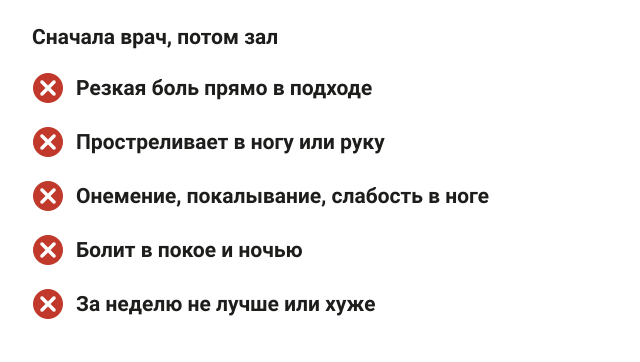<figcaption>Это границы тренера, а не клинический список.</figcaption></figure>

В найденных исследованиях тревожные признаки не разбирали, поэтому это честные границы тренера, а не клинический список:

- боль появилась резко, прямо во время подхода;
- простреливает или отдаёт в ногу или руку;
- есть онемение, покалывание или слабость в ноге;
- болит в покое и ночью, а не только при движении;
- за неделю не стало лучше или стало хуже;
- болит и вне зала, без связи с тренировками.

В этих случаях сначала врач, потом зал.

## Шпаргалка

<figure class="step">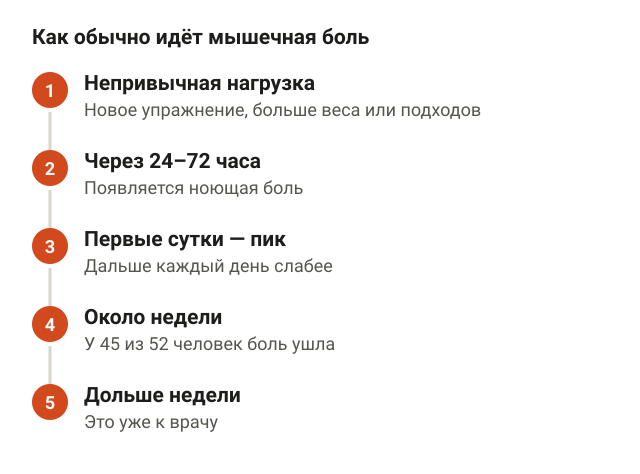<figcaption>Если боль не укладывается в эту картину, это повод к врачу.</figcaption></figure>

- Чаще всего спина болит после тренировки из-за отсроченной мышечной боли: она появляется через 24–72 часа после непривычной или тяжёлой нагрузки.
- Пик — в первые сутки, дальше слабее. В одном исследовании у 45 из 52 человек боль ушла за неделю.
- Поясница болит после становой и приседа, потому что разгибатели спины держат корпус под весом. После дня ног — по той же причине.
- По боли между лопатками исследований нет. Логика та же: непривычные тяги и подтягивания.
- Не ложись: рекомендации за сохранение активности. Снизь рабочий вес, убери то, что усиливает боль.
- Массаж может помочь, по акупунктуре единого мнения нет, флоссинг в препринте не помог.
- Резкая боль в подходе, прострел в ногу, онемение, боль в покое или дольше недели — к врачу.
