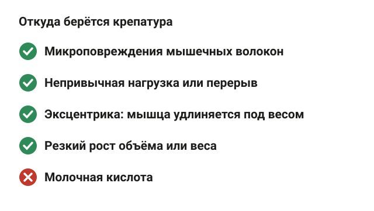
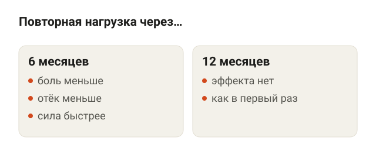
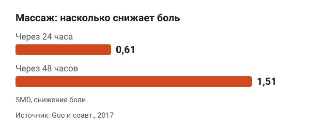
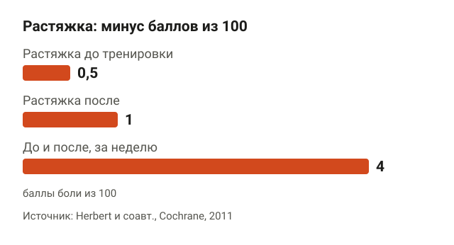
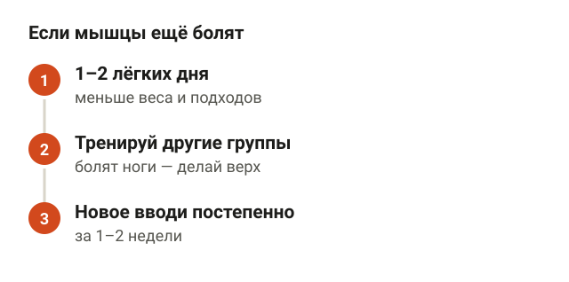
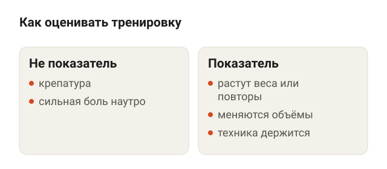
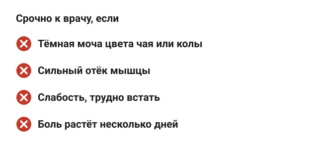
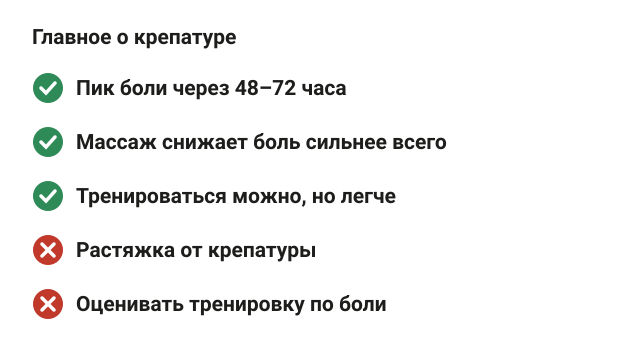

---
{
  "title": "Болят мышцы после тренировки: что делать и когда пройдёт",
  "seo_title": "Болят мышцы после тренировки: что делать и что не помогает",
  "description": "Почему болят мышцы после тренировки, сколько длится крепатура, что помогает (массаж, ролл, холод), а что нет и когда боль — повод идти к врачу.",
  "slug": "bolyat-myshcy-posle-trenirovki",
  "date": "2026-11-06",
  "category": "travmy",
  "keyword": "болят мышцы после тренировки что делать",
  "tags": [
    "крепатура",
    "мышечная боль",
    "восстановление",
    "массаж",
    "растяжка"
  ],
  "faq": [
    {
      "q": "Через сколько проходит боль в мышцах после тренировки?",
      "a": "Пик обычно через 48–72 часа после нагрузки, дальше боль слабеет и уходит за несколько дней. Если через неделю болит так же или сильнее, это уже не похоже на обычную крепатуру."
    },
    {
      "q": "Можно ли тренироваться, если болят мышцы после прошлой тренировки?",
      "a": "Можно. Лёгкая работа на время снижает боль примерно на 40%, но не ускоряет восстановление. Дай болящим мышцам 1–2 лёгких дня или тренируй другие группы."
    },
    {
      "q": "Помогает ли растяжка от крепатуры?",
      "a": "Почти нет. В кокрейновском обзоре растяжка после тренировки снижала боль через сутки в среднем на 1 балл из 100. Для подвижности растягиваться можно, от боли это не спасает."
    },
    {
      "q": "Если мышцы не болят, тренировка была плохой?",
      "a": "Нет. Боль больше говорит о новизне нагрузки, чем о росте мышц, и с регулярными тренировками она слабеет. Оценивай тренировки по росту рабочих весов и повторов."
    }
  ],
  "sources": [
    {
      "title": "Hotfiel T. и соавт. Advances in Delayed-Onset Muscle Soreness (DOMS): Part I: Pathogenesis and Diagnostics (Sportverletz Sportschaden, 2018)",
      "url": "https://doi.org/10.1055/a-0753-1884"
    },
    {
      "title": "Cheung K., Hume P., Maxwell L. Delayed onset muscle soreness: treatment strategies and performance factors (Sports Med, 2003)",
      "url": "https://doi.org/10.2165/00007256-200333020-00005"
    },
    {
      "title": "Nosaka K. и соавт. How long does the protective effect on eccentric exercise-induced muscle damage last? (Med Sci Sports Exerc, 2001)",
      "url": "https://doi.org/10.1097/00005768-200109000-00011"
    },
    {
      "title": "Dupuy O. и соавт. An Evidence-Based Approach for Choosing Post-exercise Recovery Techniques: A Systematic Review With Meta-Analysis (Front Physiol, 2018)",
      "url": "https://doi.org/10.3389/fphys.2018.00403"
    },
    {
      "title": "Guo J. и соавт. Massage Alleviates Delayed Onset Muscle Soreness after Strenuous Exercise: A Systematic Review and Meta-Analysis (Front Physiol, 2017)",
      "url": "https://doi.org/10.3389/fphys.2017.00747"
    },
    {
      "title": "Wiewelhove T. и соавт. A Meta-Analysis of the Effects of Foam Rolling on Performance and Recovery (Front Physiol, 2019)",
      "url": "https://doi.org/10.3389/fphys.2019.00376"
    },
    {
      "title": "Brown F. и соавт. Compression Garments and Recovery from Exercise: A Meta-Analysis (Sports Med, 2017)",
      "url": "https://doi.org/10.1007/s40279-017-0728-9"
    },
    {
      "title": "Batista N. P. и соавт. What Parameters Influence the Effect of Cold-Water Immersion on Muscle Soreness? Systematic Review and Meta-Analysis (Clin J Sport Med, 2023)",
      "url": "https://doi.org/10.1097/jsm.0000000000001081"
    },
    {
      "title": "Herbert R. D., de Noronha M., Kamper S. J. Stretching to prevent or reduce muscle soreness after exercise (Cochrane Database Syst Rev, 2011)",
      "url": "https://doi.org/10.1002/14651858.cd004577.pub3"
    },
    {
      "title": "Roberts L. A. и соавт. Post-exercise cold water immersion attenuates acute anabolic signalling and long-term adaptations in muscle to strength training (J Physiol, 2015)",
      "url": "https://doi.org/10.1113/jp270570"
    },
    {
      "title": "Zainuddin Z. и соавт. Light concentric exercise has a temporarily analgesic effect on delayed-onset muscle soreness (Appl Physiol Nutr Metab, 2006)",
      "url": "https://doi.org/10.1139/h05-010"
    },
    {
      "title": "Schoenfeld B. J., Contreras B. Is Postexercise Muscle Soreness a Valid Indicator of Muscular Adaptations? (Strength Cond J, 2013)",
      "url": "https://doi.org/10.1519/SSC.0b013e3182a61820"
    },
    {
      "title": "Masuda Y. и соавт. Clinical characteristics and outcomes of exertional rhabdomyolysis after indoor spinning: a systematic review (Phys Sportsmed, 2023)",
      "url": "https://doi.org/10.1080/00913847.2022.2049645"
    }
  ]
}
---
Если болят мышцы после тренировки, что делать — зависит от того, что именно болит. Если ноет вся поработавшая мышца через сутки-двое после непривычной нагрузки, это обычная отсроченная мышечная боль, крепатура. Она проходит сама за несколько дней. Ускорить это немного помогают массаж, ролл, компрессионная одежда и холодная вода, а лёгкое движение на время снимает боль. Растяжка почти ничего не меняет.

Ниже разберу, откуда берётся такая боль, сколько она длится, что помогает и что нет, можно ли тренироваться и когда мышечная боль — повод идти к врачу.

## Почему болят мышцы после тренировки

<figure class="step"><figcaption>Болит после непривычной нагрузки, и причина — микроповреждения волокон, а не кислота.</figcaption></figure>

Отсроченную мышечную болезненность по-английски называют DOMS (delayed onset muscle soreness). По сути, это микроповреждения мышечных волокон: в мышце идут распад белка, гибель части клеток и местное воспаление. Так описывает механизм обзор 2018 года в журнале Sportverletzung Sportschaden ([Hotfiel и соавт., 2018](https://doi.org/10.1055/a-0753-1884)).

Молочную кислоту часто называют причиной, но это лишь одна из шести гипотез, которые перечисляет обзор 2003 года в Sports Medicine ([Cheung и соавт., 2003](https://doi.org/10.2165/00007256-200333020-00005)). Более свежий обзор главным механизмом считает именно микроповреждения волокон, а не кислоту.

Когда боль появляется чаще всего:

- после непривычной нагрузки: первая тренировка, новое упражнение, возвращение после перерыва;
- после эксцентрической работы, то есть когда мышца удлиняется под весом: опускание штанги, спуск в приседе, бег под гору;
- после резкого роста объёма или интенсивности.

Отсюда классика жанра: первый день ног после отпуска, и на следующий день лестница в подъезде становится отдельной тренировкой.

## Сколько болят мышцы после тренировки

<figure class="step"><figcaption>Защита от повторной боли держится около 6 месяцев и пропадает к году.</figcaption></figure>

Боль появляется не сразу. Пик обычно бывает через 48–72 часа после нагрузки ([Hotfiel и соавт., 2018](https://doi.org/10.1055/a-0753-1884)). Дальше боль каждый день слабее и через несколько дней уходит.

Хорошая новость: второй раз болит меньше. Это называется эффект повторной нагрузки. Мышца после первого «урока» перестраивается и следующую такую же нагрузку переносит с меньшими повреждениями.

Как долго держится эта защита, проверили в исследовании на 35 студентах ([Nosaka и соавт., 2001](https://doi.org/10.1097/00005768-200109000-00011)). Они делали тяжёлую эксцентрическую нагрузку на бицепс, а потом повторяли её через 6, 9 или 12 месяцев:

- через 6 месяцев боль и отёк после второго раза были меньше, чем после первого;
- через 9 месяцев сила восстанавливалась быстрее, но по большинству показателей эффект слабел;
- через 12 месяцев эффекта не было совсем, мышца реагировала как в первый раз.

Соответственно, сильнее всего болит в начале и после долгого перерыва. Если ходишь в зал регулярно, такая боль бывает реже и слабее.

## Что делать, если болят мышцы после тренировки

<figure class="step"><figcaption>Через двое суток эффект массажа большой: 1,51 при пороге большого эффекта 0,8.</figcaption></figure>

Самый крупный разбор методов восстановления — мета-анализ 2018 года в Frontiers in Physiology: 99 исследований ([Dupuy и соавт., 2018](https://doi.org/10.3389/fphys.2018.00403)). Боль после нагрузки уменьшали шесть методов:

- активное восстановление, то есть лёгкое движение;
- массаж;
- компрессионная одежда;
- погружение в воду;
- контрастный душ или ванны;
- холодовые процедуры.

Сильнее всего сработал массаж: он лучше остальных снижал и боль, и ощущение усталости.

Массажу посвящён и отдельный мета-анализ: 11 работ, 504 участника ([Guo и соавт., 2017](https://doi.org/10.3389/fphys.2017.00747)). Эффект там считали в SMD, стандартизированной разнице средних. Это мера, которую можно сравнивать между разными исследованиями: 0,2 — маленький эффект, 0,5 — средний, 0,8 и больше — большой. Массаж снижал боль на 0,61 через сутки и на 1,51 через двое суток, то есть эффект от среднего до большого.

Ролл, то есть самомассаж на цилиндре, тоже работает, но слабее. В мета-анализе 21 исследования ролл после нагрузки снижал ощущение боли в мышцах в среднем на 6% ([Wiewelhove и соавт., 2019](https://doi.org/10.3389/fphys.2019.00376)).

Компрессионная одежда в мета-анализе 23 исследований лучше всего помогала восстановить силу после силовой тренировки, особенно через сутки и позже ([Brown и соавт., 2017](https://doi.org/10.1007/s40279-017-0728-9)).

Холодная вода в мета-анализе 44 исследований уменьшала боль лучше, чем ничего, но работали только короткие и средние по длительности погружения, долгие — нет ([Batista и соавт., 2023](https://doi.org/10.1097/jsm.0000000000001081)).

Честная оговорка: обзор 2003 года не нашёл пользы от холода ([Cheung и соавт., 2003](https://doi.org/10.2165/00007256-200333020-00005)). Данные по холоду расходятся, а эффекты у всех методов — про то, чтобы болело чуть меньше, а не про то, чтобы мышца быстрее зажила.

## Что не помогает: растяжка и другие мифы

<figure class="step"><figcaption>Даже лучший результат — 4 балла из 100, это почти незаметно.</figcaption></figure>

Растяжку делают все, а данных в её пользу почти нет. Кокрейновский обзор, то есть один из самых строгих форматов обзора, собрал 12 исследований ([Herbert и соавт., 2011](https://doi.org/10.1002/14651858.cd004577.pub3)). Результат:

- растяжка после тренировки снижала боль через сутки в среднем на 1 балл из 100;
- растяжка до тренировки — на полбалла из 100;
- в самом большом исследовании, на 2377 человек, растяжка до и после снизила пик боли за неделю на 4 балла из 100.

Авторы прямо пишут: заметного для человека эффекта растяжка не даёт. Растягиваться ради подвижности можно, но не ради того, чтобы завтра не болело.

В мета-анализе 2018 года растяжка и электростимуляция тоже не уменьшили боль ([Dupuy и соавт., 2018](https://doi.org/10.3389/fphys.2018.00403)). Обзор 2003 года не нашёл эффекта у ультразвука и гомеопатии ([Cheung и соавт., 2003](https://doi.org/10.2165/00007256-200333020-00005)).

Отдельный момент про ледяные ванны, если ты тренируешься ради мышц. В исследовании на 21 мужчине все 12 недель занимались силовыми 2 раза в неделю ([Roberts и соавт., 2015](https://doi.org/10.1113/jp270570)). Одна группа после каждой тренировки 10 минут сидела в холодной воде, другая делала лёгкую активную заминку. Сила и мышечная масса выросли больше у тех, кто делал заминку. Площадь быстрых мышечных волокон выросла на 17% только у них. Исследование небольшое, но если цель — набрать мышцы, ледяную ванну после каждой тренировки лучше не делать привычкой.

Таблетки от боли — вопрос к врачу. Обезболивающие и противовоспалительные препараты в этой статье не разбираю.

## Можно ли тренироваться, если болят мышцы

<figure class="step"><figcaption>Лёгкая работа снимает боль на время, но восстановление не ускоряет.</figcaption></figure>

Можно, и даже лёгкая работа на время снимает боль. В исследовании на 14 людях после тяжёлой нагрузки на бицепс одна рука следующие 4 дня делала лёгкие сгибания почти без веса, 600 движений за раз ([Zainuddin и соавт., 2006](https://doi.org/10.1139/h05-010)). Сразу после них боль и болезненность при нажатии снижались примерно на 40%. Но эффект был временным: на скорость восстановления лёгкая работа не повлияла, обе руки восстановились одинаково.

То есть лёгкая тренировка — это обезболивание на время, а не лечение. И ещё деталь: сразу после лёгкой работы сила мышцы падала примерно на 15%, так что рекорды в этот день не ставят.

Что советует обзор 2003 года тем, кто тренируется часто ([Cheung и соавт., 2003](https://doi.org/10.2165/00007256-200333020-00005)):

1. 1–2 дня после тяжёлой непривычной нагрузки снизить интенсивность и длительность тренировок.
2. Или тренировать другие группы мышц, а болящие оставить в покое.
3. Новые упражнения и эксцентрическую работу вводить постепенно, в течение 1–2 недель.

Практически: болят ноги — сделай верх тела или спокойное кардио. Если в плане снова ноги, а они ещё болят, снизь рабочий вес и количество подходов, чтобы движение не добавляло боли. Как наращивать объём постепенно, разбирал в статье [сколько подходов делать для роста мышц](/stati/skolko-podhodov-dlya-rosta-myshc/).

## Значит ли боль, что тренировка удалась

<figure class="step"><figcaption>Боль говорит о новизне нагрузки, рост — о пользе.</figcaption></figure>

Нет. Брэд Шонфелд и Брет Контрерас в обзоре 2013 года в Strength and Conditioning Journal разбирали, можно ли оценивать тренировку по крепатуре, и пришли к выводу, что боль — ненадёжный показатель роста мышц ([Schoenfeld, Contreras, 2013](https://doi.org/10.1519/SSC.0b013e3182a61820)).

Логика простая. Из исследования Носаки видно, что при регулярных тренировках мышцы болят меньше. Если бы боль означала рост, у каждого, кто ходит в зал годами, рост бы прекращался. На деле боль больше говорит о новизне нагрузки, чем о её пользе.

Что смотреть вместо боли:

- растут ли рабочие веса или повторы в упражнениях;
- меняются ли объёмы тела и вес в нужную сторону;
- держишь ли ты технику, когда прибавляешь.

Можно ли тренироваться так, чтобы не болело совсем? Если нагрузка растёт постепенно, болит меньше. Совсем без боли после нового упражнения обычно не получается, и это нормально.

## Когда боль в мышцах — повод идти к врачу

<figure class="step"><figcaption>Тёмная моча, отёк и слабость после нагрузки — не крепатура.</figcaption></figure>

Обычная крепатура не требует врача. Но есть два случая, когда это уже не она.

**Травма мышцы.** Боль резкая, появилась прямо во время подхода, болит одна точка, которую можно найти пальцем. Это похоже на растяжение, то есть надрыв волокон. Как отличить его от крепатуры и что делать, разобрал в статье [растяжение мышцы: что делать](/stati/rastyazhenie-myshcy-chto-delat/). Если болит спина, есть отдельный разбор: [болит спина после тренировки](/stati/bolit-spina-posle-trenirovki/).

**Рабдомиолиз.** Это тяжёлое повреждение мышц, когда содержимое разрушенных клеток попадает в кровь и может повредить почки. Систематический обзор собрал 97 таких случаев после сайкл-тренировок ([Masuda и соавт., 2023](https://doi.org/10.1080/00913847.2022.2049645)):

- чаще всего это были здоровые женщины на своей первой сайкл-тренировке;
- в больницу попадали в среднем через 3 дня;
- главные признаки: сильная боль в мышцах, тёмная моча, слабость в бёдрах;
- у 7,2% было острое повреждение почек.

Тёмная моча цвета чая или колы, сильный отёк, слабость, из-за которой трудно встать, боль, которая через несколько дней только растёт, — это повод срочно к врачу, а не к тренеру.

## Шпаргалка

<figure class="step"><figcaption>Проходит сама, массаж помогает лучше всего, растяжка почти нет.</figcaption></figure>

- Крепатура — микроповреждения мышцы после непривычной нагрузки, а не молочная кислота.
- Пик боли через 48–72 часа, дальше она слабеет и уходит.
- Сильнее всего болит в начале и после перерыва. Защита от повторной боли держится около 6 месяцев.
- Лучше всего боль снимает массаж. Ролл, компрессионная одежда и холодная вода помогают слабее.
- Растяжка снижает боль на 1 балл из 100, то есть почти никак.
- Ледяная ванна после каждой силовой может тормозить рост мышц.
- Тренироваться можно: дай болящим мышцам 1–2 лёгких дня или тренируй другие группы.
- Боль — не показатель хорошей тренировки. Смотри на рабочие веса и повторы.
- Тёмная моча, сильный отёк и слабость — срочно к врачу.
