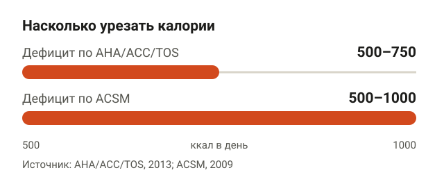
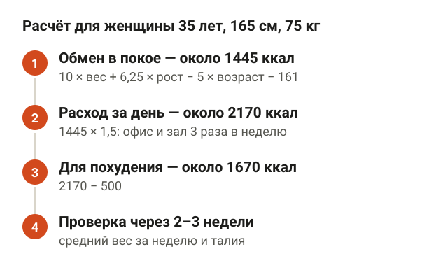
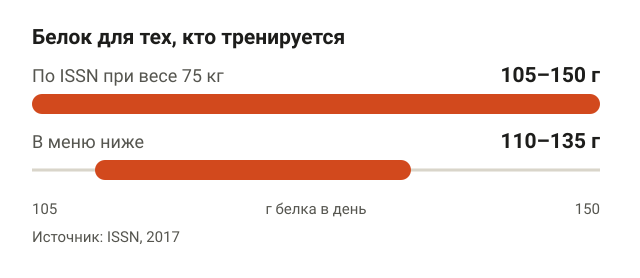
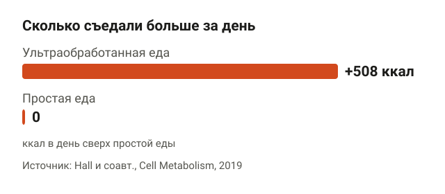
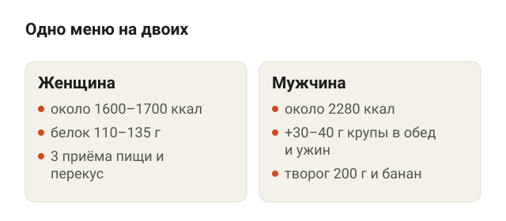
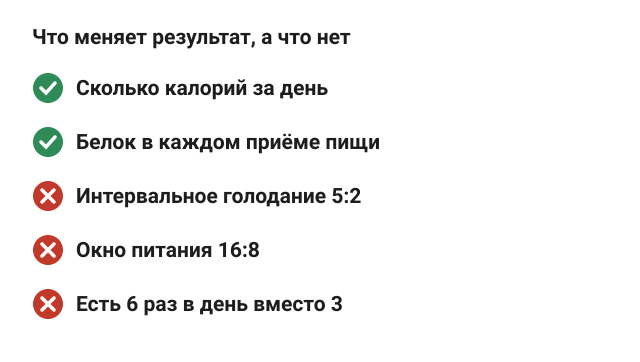
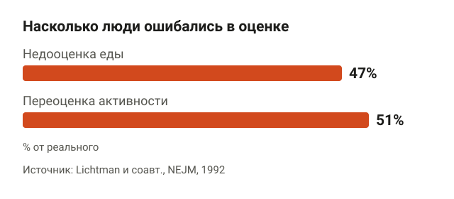
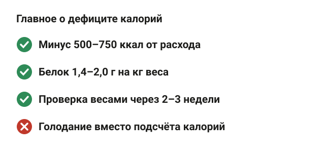

---
{
  "title": "Дефицит калорий: меню на неделю и как рассчитать свою норму",
  "seo_title": "Дефицит калорий: меню на неделю и расчёт своей нормы",
  "description": "Дефицит калорий для похудения: как рассчитать норму по формуле, сколько нужно белка, меню на неделю на 1600–1700 ккал и почему вес иногда стоит.",
  "slug": "deficit-kaloriy-menyu-na-nedelyu",
  "date": "2026-11-05",
  "category": "pitanie",
  "keyword": "дефицит калорий меню на неделю",
  "tags": [
    "дефицит калорий",
    "питание",
    "похудение",
    "меню",
    "белок"
  ],
  "faq": [
    {
      "q": "Какой дефицит калорий нужен для похудения?",
      "a": "Рекомендации AHA/ACC/TOS — 500–750 ккал в день от твоего расхода, ACSM — 500–1000 ккал. Если не считать, ориентир — 1200–1500 ккал в день женщинам и 1500–1800 мужчинам."
    },
    {
      "q": "Как рассчитать дефицит калорий для похудения женщине?",
      "a": "Посчитай обмен в покое по формуле Миффлина — Сан Жеора: 10 × вес + 6,25 × рост − 5 × возраст − 161. Умножь на коэффициент активности, обычно 1,4–1,7, и вычти 500 ккал. Через 2–3 недели сверь результат с весами."
    },
    {
      "q": "Сколько белка есть, когда худеешь?",
      "a": "ISSN советует тем, кто тренируется, 1,4–2,0 г белка на кг веса в день. При весе 75 кг это 105–150 г. При болезнях почек норму обсуждай с врачом."
    },
    {
      "q": "Можно ли есть вечером, если сидишь на дефиците?",
      "a": "Можно. В РКИ TREAT окно питания с 12:00 до 20:00 не дало значимо большего похудения, чем три обычных приёма пищи, а частота еды почти не влияет на состав тела. Решает, сколько ты съел за день."
    }
  ],
  "sources": [
    {
      "title": "Mifflin M. D. и соавт. A new predictive equation for resting energy expenditure in healthy individuals (American Journal of Clinical Nutrition, 1990)",
      "url": "https://doi.org/10.1093/ajcn/51.2.241"
    },
    {
      "title": "Frankenfield D. и соавт. Comparison of predictive equations for resting metabolic rate in healthy nonobese and obese adults: a systematic review (Journal of the American Dietetic Association, 2005)",
      "url": "https://doi.org/10.1016/j.jada.2005.02.005"
    },
    {
      "title": "FAO/WHO/UNU. Human energy requirements: report of a joint expert consultation (2004)",
      "url": "https://www.fao.org/4/y5686e/y5686e07.htm"
    },
    {
      "title": "Jensen M. D. и соавт. 2013 AHA/ACC/TOS guideline for the management of overweight and obesity in adults (Circulation, 2014)",
      "url": "https://doi.org/10.1161/01.cir.0000437739.71477.ee"
    },
    {
      "title": "Donnelly J. E. и соавт. ACSM Position Stand: appropriate physical activity intervention strategies for weight loss and prevention of weight regain for adults (MSSE, 2009)",
      "url": "https://doi.org/10.1249/MSS.0b013e3181949333"
    },
    {
      "title": "Jäger R. и соавт. International Society of Sports Nutrition Position Stand: protein and exercise (JISSN, 2017)",
      "url": "https://doi.org/10.1186/s12970-017-0177-8"
    },
    {
      "title": "Helms E. R. и соавт. Evidence-based recommendations for natural bodybuilding contest preparation: nutrition and supplementation (JISSN, 2014)",
      "url": "https://doi.org/10.1186/1550-2783-11-20"
    },
    {
      "title": "Hall K. D. и соавт. Ultra-processed diets cause excess calorie intake and weight gain: an inpatient randomized controlled trial (Cell Metabolism, 2019)",
      "url": "https://doi.org/10.1016/j.cmet.2019.05.008"
    },
    {
      "title": "Cioffi I. и соавт. Intermittent versus continuous energy restriction on weight loss and cardiometabolic outcomes: a systematic review and meta-analysis of RCTs (Journal of Translational Medicine, 2018)",
      "url": "https://doi.org/10.1186/s12967-018-1748-4"
    },
    {
      "title": "Lowe D. A. и соавт. Effects of time-restricted eating on weight loss and other metabolic parameters: the TREAT randomized clinical trial (JAMA Internal Medicine, 2020)",
      "url": "https://doi.org/10.1001/jamainternmed.2020.4153"
    },
    {
      "title": "Schoenfeld B. J. и соавт. Effects of meal frequency on weight loss and body composition: a meta-analysis (Nutrition Reviews, 2015)",
      "url": "https://doi.org/10.1093/nutrit/nuu017"
    },
    {
      "title": "Lichtman S. W. и соавт. Discrepancy between self-reported and actual caloric intake and exercise in obese subjects (NEJM, 1992)",
      "url": "https://doi.org/10.1056/NEJM199212313272701"
    }
  ]
}
---
Дефицит калорий для похудения — это когда ты ешь на 500–750 ккал в день меньше, чем тратишь. Обычно это 1200–1500 ккал в день для женщины и 1500–1800 для мужчины, но точнее свою цифру лучше посчитать по формуле. Ниже — расчёт на примере, меню на неделю примерно на 1600–1700 ккал со 110–135 г белка и что делать, если вес стоит, хотя ты «вроде на дефиците».

Сразу оговорка: меню — образец, а не диета по назначению. При диабете, болезнях почек, беременности и любых хронических болезнях калорийность и белок обсуждай с врачом.

## Что такое дефицит калорий и сколько это в день

<figure class="step"><figcaption>Рекомендуют минус 500–750 ккал в день, ACSM допускает до 1000 ккал.</figcaption></figure>

Тело тратит энергию на три вещи: на обмен в покое (дыхание, сердце, мозг, тепло), на переваривание еды и на движение. Если еды поступает меньше, чем уходит, недостающее тело берёт из запасов, в основном из жира. Это и есть дефицит калорий. Без него вес не снижается, какие бы продукты ты ни выбирал.

Сколько урезать, говорят две позиции:

- **Американские кардиологи и общество по ожирению (AHA/ACC/TOS, 2013):** дефицит 500–750 ккал в день. Если не считать, ориентир — 1200–1500 ккал в день женщинам и 1500–1800 ккал мужчинам.
- **Американский колледж спортивной медицины (ACSM, 2009):** снизить калорийность на 500–1000 ккал в день и добавить движение.

Для расчётов часто берут правило «1 кг жира — около 7700 ккал». Тогда 500 ккал в день дают примерно 0,5 кг в неделю. Это арифметика, а не обещание: при похудении обмен в покое снижается, и вес обычно идёт медленнее расчётного. Почему похудеть на 10 кг за месяц так не получится, я разбирал в статье [как похудеть на 10 кг за месяц](/stati/kak-pohudet-na-10-kg-za-mesyac/).

## Как рассчитать дефицит калорий: формула и пример

<figure class="step"><figcaption>Обмен в покое × активность − 500 ккал, потом проверка весами.</figcaption></figure>

Считают в три шага: обмен в покое, расход за день с учётом активности, минус дефицит.

**Шаг 1. Обмен в покое.** Самая точная из популярных формул — Миффлина — Сан Жеора (1990). Систематический обзор 2005 года сравнил её с формулой Харриса — Бенедикта и другими: она чаще остальных попадала в пределах 10% от измеренного обмена и у людей с обычным весом, и при ожирении.

- Мужчины: 10 × вес (кг) + 6,25 × рост (см) − 5 × возраст (лет) + 5.
- Женщины: 10 × вес (кг) + 6,25 × рост (см) − 5 × возраст (лет) − 161.

**Шаг 2. Расход за день.** Обмен в покое умножают на коэффициент активности. В докладе ФАО/ВОЗ (2004) он такой: 1,4–1,69 при сидячей работе и малой активности, 1,7–1,99 при активном образе жизни, 2,0–2,4 при тяжёлой физической работе. Если сидишь в офисе и 3 раза в неделю ходишь в зал, начни с 1,5.

**Шаг 3. Минус 500 ккал.** Это и есть твоя калорийность для похудения.

Допустим, женщина 35 лет, рост 165 см, вес 75 кг, офис и зал 3 раза в неделю:

| Шаг | Расчёт | Результат |
|---|---|---|
| Обмен в покое | 750 + 1031 − 175 − 161 | около 1445 ккал |
| Расход за день | 1445 × 1,5 | около 2170 ккал |
| Калорийность для похудения | 2170 − 500 | около 1670 ккал |

Для мужчины 35 лет, 180 см и 90 кг выходит обмен около 1855 ккал, расход около 2780 ккал и около 2280 ккал для похудения.

Формула даёт прикидку. Даже лучшая из них у части людей ошибается больше чем на 10%, а это 150–200 ккал в день и больше. Поэтому расчёт — стартовая точка, а проверка — весы через 2–3 недели.

## Сколько белка нужно на дефиците

<figure class="step"><figcaption>При весе 75 кг диапазон ISSN — 105–150 г белка в день.</figcaption></figure>

Когда ешь меньше, тело тратит не только жир, но и мышцы. Белок и силовые тренировки этот процесс тормозят.

- **ISSN** (Международное общество спортивного питания, 2017): тем, кто тренируется, хватает 1,4–2,0 г белка на кг веса в день. Есть данные, что больше 3 г/кг у тренированных людей помогает терять жир, но это уже для тех, кто ест строго по плану.
- **Обзор Эрика Хелмса (2014)** для натуральных бодибилдеров перед соревнованиями: 2,3–3,1 г белка на кг сухой массы, то есть веса без жира. Это худые спортсмены на жёстком дефиците, обычному человеку столько не нужно. Лекцию Хелмса «Пирамида мышц и силы» я слушал, и логика у него простая: чем ты худее и чем жёстче дефицит, тем больше белка нужно, чтобы сохранить мышцы.

Для женщины из примера (75 кг) диапазон ISSN — 105–150 г белка в день. Меню ниже даёт 110–135 г. Если есть болезни почек, норму белка обсуждай с врачом.

Остальное — жиры и углеводы — делим по вкусу. Хелмс советует держать жиры на уровне 15–30% калорий, остальное отдать углеводам: на них легче тренироваться.

## Как собрать меню, чтобы не было голодно

<figure class="step"><figcaption>На ультраобработанной еде люди съедали на 508 ккал в день больше, чем на простой.</figcaption></figure>

Сытость зависит не от силы воли, а от того, что лежит в тарелке. Это хорошо показало исследование Кевина Холла из Национальных институтов здоровья США (2019). 20 взрослых жили в клинике и по 2 недели ели то ультраобработанную, то простую еду. Меню подобрали одинаковыми по калориям, белку, сахару и клетчатке, есть разрешали сколько хочется.

На ультраобработанной еде люди съедали в среднем на 508 ккал в день больше и за 2 недели набирали около 0,9 кг. На простой еде столько же теряли. Ультраобработанная еда — это колбасы, сладкие хлопья, снеки, готовые соусы, выпечка из магазина.

Отсюда правила для меню:

1. **Белок в каждом приёме пищи:** курица, рыба, яйца, творог, мясо, бобовые.
2. **Половина тарелки — овощи.** Их много по объёму и мало по калориям: 200 г огурцов и помидоров — около 40 ккал.
3. **Крупы и хлеб — отмерять.** Гречку, рис, овсянку и макароны взвешивай сухими: 60–70 г сухой крупы — это порция примерно на 200–250 ккал.
4. **Масло считать.** Столовая ложка растительного масла — около 90 ккал, в салате её не видно.
5. **Готовые колбасы, выпечку, сладкие напитки и соусы — по минимуму.** Это там прячутся лишние 500 ккал.

## Дефицит калорий: меню на неделю

<figure class="step"><figcaption>Мужчине из примера — больше крупы и ещё один перекус, примерно плюс 600 ккал.</figcaption></figure>

Меню посчитано по средним табличным значениям, примерно на 1600–1700 ккал в день, белка — 110–135 г. Это калорийность женщины из примера выше. Крупы и макароны указаны в сухом виде, мясо и рыба — в сыром. Овощи — огурцы, помидоры, капуста, перец, кабачки, свежие или тушёные.

**Понедельник** — около 1680 ккал, белок около 130 г.

- Завтрак: овсянка 60 г на молоке 150 мл, ягоды 100 г, орехи 15 г.
- Обед: куриная грудка 150 г, гречка 70 г, салат из овощей 200 г с ложкой масла.
- Ужин: треска 200 г, картофель 300 г, овощи 150 г, чайная ложка масла.
- Перекус: творог 5% 150 г, яблоко.

**Вторник** — около 1620 ккал, белок около 115 г.

- Завтрак: омлет из 3 яиц, 2 ломтика цельнозернового хлеба, овощи 150 г.
- Обед: говядина постная 130 г, рис 70 г, овощи 200 г с ложкой масла.
- Ужин: курица 150 г, картофель 200 г, овощи 300 г, чайная ложка масла.
- Перекус: кефир 1% 250 мл, банан.

**Среда** — около 1600 ккал, белок около 120 г.

- Завтрак: творог 5% 180 г, ягоды 100 г, чайная ложка мёда, ломтик хлеба.
- Обед: индейка 150 г, макароны из твёрдых сортов 70 г, овощи 200 г с ложкой масла.
- Ужин: 2 яйца, 2 ломтика хлеба, овощи 250 г, сыр 20 г.
- Перекус: кефир 250 мл, яблоко, орехи 15 г.

**Четверг** — около 1580 ккал, белок около 125 г.

- Завтрак: овсянка 60 г на молоке 150 мл, банан.
- Обед: суп или рагу из чечевицы 60 г с курицей 120 г, овощи 200 г, ложка масла.
- Ужин: треска 200 г, рис 60 г, овощи 200 г, чайная ложка масла.
- Перекус: творог 150 г, яблоко.

**Пятница** — около 1620 ккал, белок около 125 г.

- Завтрак: омлет из 3 яиц, 2 ломтика хлеба, сыр 20 г, овощи 150 г.
- Обед: курица 150 г, гречка 70 г, овощи 200 г с ложкой масла.
- Ужин: тунец в собственном соку 150 г, картофель 250 г, овощи 200 г, чайная ложка масла.
- Перекус: кефир 250 мл, яблоко.

**Суббота** — около 1680 ккал, белок около 120 г.

- Завтрак: овсянка 60 г на молоке, ягоды 100 г, орехи 15 г.
- Обед: говядина 130 г, картофель 300 г, овощи 200 г с ложкой масла.
- Ужин: индейка 150 г, 2 ломтика хлеба, салат из овощей 300 г со сметаной 10% 20 г.
- Перекус: творог 150 г, банан.

**Воскресенье** — около 1650 ккал, белок около 135 г.

- Завтрак: творог 180 г, банан, ломтик хлеба, орехи 15 г.
- Обед: курица 150 г, макароны 70 г, овощи 200 г с ложкой масла.
- Ужин: треска 200 г, гречка 60 г, овощи 200 г, чайная ложка масла.
- Перекус: кефир 250 мл, яблоко.

**Мужчине** из примера нужно около 2280 ккал. Добавь по 30–40 г сухой крупы или 150 г картофеля в обед и ужин и ещё один перекус: творог 200 г и банан. Это примерно плюс 600 ккал.

Меню можно перемешивать: курицу менять на индейку или рыбу, гречку — на рис, творог — на 2–3 яйца. Главное — чтобы за день набирались калории и белок. Цифры у разных производителей отличаются, поэтому, если считаешь в приложении, вноси вес своих продуктов.

## Голодание, частота еды и время ужина

<figure class="step"><figcaption>При тех же калориях режим питания на вес почти не влияет.</figcaption></figure>

Как распределить еду по дню, решай сам: на результат это почти не влияет.

- **Интервальное голодание.** Мета-анализ 11 РКИ (2018) сравнил режимы с разгрузочными днями (например, 5:2) с обычным ежедневным дефицитом. Вес уходил одинаково: разница −0,61 кг, и она статистически незначима.
- **Окно 16:8.** В РКИ TREAT (2020) на 116 людях с лишним весом группа «ешь с 12:00 до 20:00» за 12 недель похудела не больше, чем группа с тремя обычными приёмами пищи: разница 0,26 кг, тоже незначимая.
- **Частота еды.** Мета-анализ Брэда Шёнфельда (2015): после проверки на устойчивость результатов польза частого дробного питания для состава тела держалась на одном исследовании. То есть есть 3 раза или 6 — разницы почти нет.

Если тебе удобно не завтракать — не завтракай. Если вечером без ужина не уснёшь — оставь ужин. Работает то, что ты сможешь держать месяцами.

## Почему вес стоит, хотя ты на дефиците

<figure class="step"><figcaption>Еду недооценивали на 47%, активность переоценивали на 51%.</figcaption></figure>

Самая частая причина банальна: еды больше, чем кажется. Классическое исследование в журнале NEJM (1992) изучало людей, которые не худели, хотя, по их словам, ели меньше 1200 ккал в день. Обмен веществ у них оказался в пределах 5% от расчётного для их состава тела. Зато еду они недооценивали в среднем на 47%, а активность переоценивали на 51%.

Это не про обман, а про то, как работает память: ложка масла, кусочек сыра с ребёнком, кофе с сиропом. По отдельности мелочь, вместе — те самые 500 ккал.

Что делать, если вес не двигается:

1. **Две недели взвешивай еду** на кухонных весах и записывай всё, включая масло и напитки.
2. **Смотри средний вес за неделю,** а не утренние скачки. Вода и соль сдвигают весы на килограмм за день.
3. **Сверяй талию** раз в неделю.
4. **Если 2–3 недели стоят и вес, и талия,** убери ещё 100–200 ккал или добавь шагов.
5. **Темп** — около 0,5–1% веса в неделю, такой Хелмс советует для сохранения мышц. Для 75 кг это 0,4–0,75 кг. Если сила в зале падает от тренировки к тренировке, дефицит слишком жёсткий.

Силовые на дефиците нужны, чтобы вес уходил за счёт жира, а не мышц. С чего начать в зале, читай в статье [с чего начать похудение в тренажёрном зале](/stati/s-chego-nachat-pohudenie-v-zale/). А если цель именно живот, пригодится разбор [как убрать живот](/stati/kak-ubrat-zhivot/).

## Шпаргалка

<figure class="step"><figcaption>Посчитай, проверь весами, держи белок и не ищи волшебный режим.</figcaption></figure>

- Дефицит калорий для похудения — минус 500–750 ккал от расхода, обычно 1200–1500 ккал женщинам и 1500–1800 мужчинам.
- Обмен в покое считай по формуле Миффлина — Сан Жеора, умножай на коэффициент активности 1,4–1,7 и вычитай 500 ккал.
- Формула у части людей ошибается больше чем на 10%, поэтому проверяй себя весами через 2–3 недели.
- Белок — 1,4–2,0 г на кг веса в день, в каждом приёме пищи.
- Половина тарелки — овощи, крупы отмеряй сухими, масло считай.
- Ультраобработанная еда добавляла в среднем 508 ккал в день при свободном питании.
- Голодание и частота еды на результат почти не влияют, если калорий столько же.
- Вес стоит — сначала две недели честно взвешивай еду: недооценка достигала 47%.
