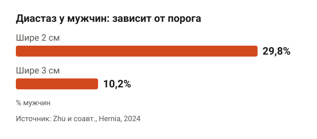
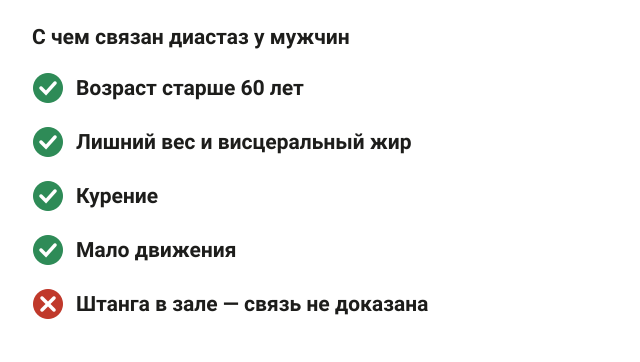
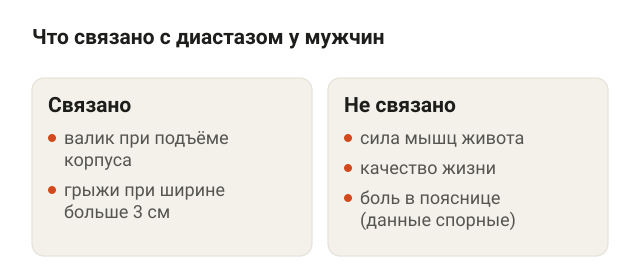
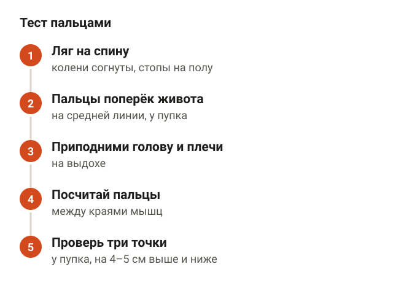
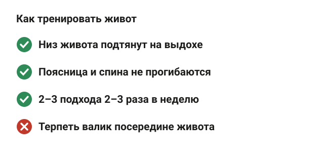
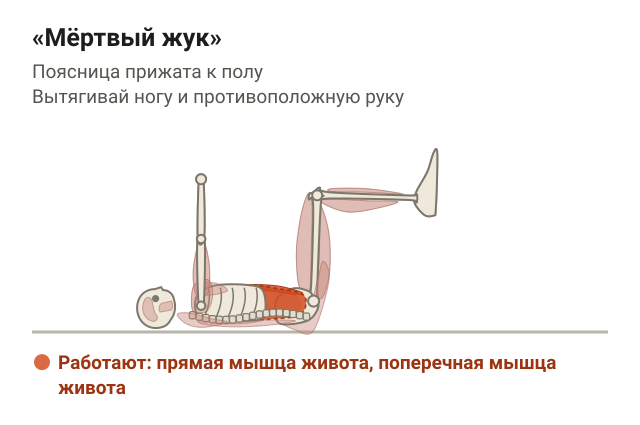
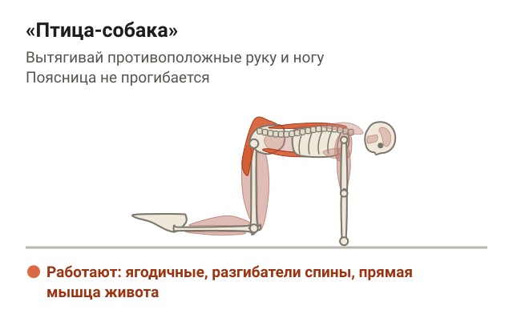
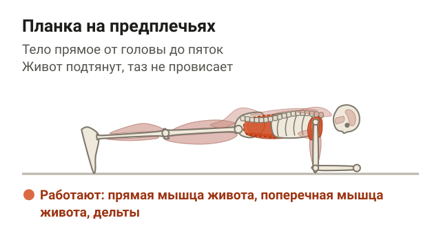
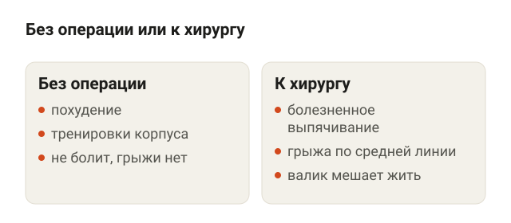
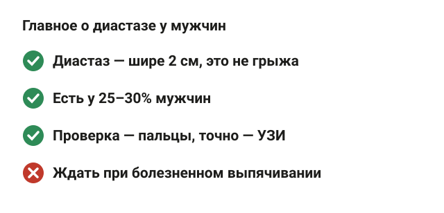

---
{
  "title": "Диастаз у мужчин: почему появляется и что с ним делать",
  "seo_title": "Диастаз у мужчин: причины, симптомы и упражнения",
  "description": "Диастаз у мужчин: как часто встречается, откуда берётся, как проверить живот самому, какие упражнения делать и когда нужен хирург. С данными исследований.",
  "slug": "diastaz-u-muzhchin",
  "date": "2026-11-04",
  "category": "diastaz",
  "keyword": "диастаз у мужчин",
  "tags": [
    "диастаз",
    "мужчины",
    "пресс",
    "живот",
    "грыжа"
  ],
  "faq": [
    {
      "q": "Бывает ли диастаз у мужчин?",
      "a": "Да. В исследовании на 1575 мужчинах расхождение прямых мышц шире 2 см было у 29,8%, шире 3 см — у 10,2%. Чаще его находят после 60 лет и при лишнем весе."
    },
    {
      "q": "Откуда берётся расхождение мышц живота без беременности?",
      "a": "С ним связаны возраст, лишний вес и жир вокруг внутренних органов, курение и малая активность. В тканях белой линии при диастазе меньше коллагена, поэтому она легче растягивается."
    },
    {
      "q": "Можно ли убрать диастаз у мужчин без операции?",
      "a": "Обзоры советуют начинать с похудения и тренировок мышц корпуса. Насколько это сужает диастаз именно у мужчин, в исследованиях не измеряли. Операцию обсуждают при грыже или если валик мешает."
    },
    {
      "q": "Можно ли качаться в зале при диастазе?",
      "a": "Прямого запрета в найденных источниках нет. Если при подъёме тяжести на животе вылезает валик или появляется боль, снизь вес и поработай над напряжением живота."
    }
  ],
  "sources": [
    {
      "title": "Zhu C. и соавт. Prevalence, risk factors, and adverse outcomes of diastasis of rectus abdominis in men: a cross-sectional study (Hernia, 2024)",
      "url": "https://doi.org/10.1007/s10029-024-03225-3"
    },
    {
      "title": "Nienhuijs S. и соавт. Rectus diastasis in males: a narrative review (Hernia, 2025)",
      "url": "https://doi.org/10.1007/s10029-025-03404-w"
    },
    {
      "title": "Henriksen N. A. и соавт. Rectus diastasis in men (Ugeskrift for Laeger, 2025)",
      "url": "https://doi.org/10.61409/v04250320"
    },
    {
      "title": "Diastasis recti in male patients: a literature review and proposed management (Hernia, 2026)",
      "url": "https://doi.org/10.1007/s10029-025-03571-w"
    },
    {
      "title": "Hernández-Granados P. и соавт. European Hernia Society guidelines on management of rectus diastasis (BJS, 2021)",
      "url": "https://doi.org/10.1093/bjs/znab128"
    },
    {
      "title": "The Anatomy of the Human Linea Alba: A Systematic Review and Meta-analysis (Plastic and Reconstructive Surgery Global Open, 2026)",
      "url": "https://doi.org/10.1097/gox.0000000000007935"
    },
    {
      "title": "Cavalli M. и соавт. Prevalence and risk factors for diastasis recti abdominis: a review (Hernia, 2021)",
      "url": "https://doi.org/10.1007/s10029-021-02468-8"
    },
    {
      "title": "Conservative interventions may have little effect on reducing diastasis of the rectus abdominis in postnatal women: systematic review and meta-analysis (Physiotherapy, 2023)",
      "url": "https://www.sciencedirect.com/science/article/abs/pii/S0031940623000135"
    }
  ]
}
---
Диастаз у мужчин встречается чаще, чем принято думать: в китайском исследовании на 1575 мужчинах расхождение прямых мышц шире 2 см нашли у 29,8%, шире 3 см — у 10,2%. Чаще он бывает после 60 лет, при лишнем весе, курении и малой активности. Обычно он не болит и не мешает, а заметен как валик посередине живота, когда ты поднимаешь корпус. Первый шаг — похудеть и тренировать мышцы живота, к хирургу идут при грыже или если валик мешает жить.

Ниже разберу, откуда он берётся, как проверить живот самому, какие упражнения делать и когда пора к врачу. Сразу честно: исследований про мужчин в разы меньше, чем про женщин после родов, и РКИ с упражнениями именно на мужчинах я не нашёл.

## Что такое диастаз и как часто он встречается

<figure class="step"><figcaption>При пороге 2 см диастаз находят почти у трети мужчин, при пороге 3 см — у каждого десятого.</figcaption></figure>

Прямая мышца живота состоит из двух продольных половинок. Посередине их соединяет белая линия — полоса соединительной ткани. При диастазе половинки расходятся, белая линия становится шире и тоньше. Мышцы при этом не рвутся, дырки в апоневрозе нет. Этим диастаз и отличается от грыжи.

Европейское общество герниологов в рекомендациях 2021 года предложило считать диастазом расстояние между прямыми мышцами больше 2 см. Авторы китайского исследования на мужчинах предлагают порог 3 см: при нём диастаз уже связан с грыжами.

От порога сильно зависит ответ на вопрос «у меня диастаз или нет»:

- больше 2 см — 29,8% мужчин в исследовании;
- больше 3 см — 10,2%.

Обзор 2025 года собрал 21 работу про мужчин. Там диастаз находили у 25–30% мужчин в целом. Среди мужчин с другой грыжей живота — у 47%, среди мужчин с аневризмой брюшной аорты — у 67%. Оперируют, по оценке авторов, от 4 до 14% таких мужчин. То есть у большинства диастаз просто есть и никак себя не проявляет.

## Почему появляется диастаз без беременности

<figure class="step"><figcaption>Беременности нет, зато есть возраст, вес, курение и малоподвижность.</figcaption></figure>

Беременности у мужчин нет, поэтому главная «женская» причина отпадает. В исследованиях с диастазом у мужчин связаны такие факторы:

- **Возраст.** Обзоры 2025 и 2026 годов пишут, что чаще диастаз бывает у мужчин старше 60 лет.
- **Лишний вес и висцеральный жир**, то есть жир вокруг внутренних органов, который распирает живот изнутри. В обзоре 2025 года висцеральное ожирение названо среди факторов, которые ухудшают белую линию.
- **Курение.** Оно тоже связано с диастазом и с худшим качеством белой линии.
- **Мало движения.** Низкая физическая активность в обзорах идёт в одном ряду с весом и возрастом.
- **Диабет.** В обзоре 2021 года его называют вероятным фактором риска вместе с весом, но этот обзор не только про мужчин.

В тканях белой линии при диастазе меньше коллагена I и III типа. Это показал метаанализ 2026 года по анатомии белой линии. По сути, полоса между мышцами становится менее прочной и легче растягивается под давлением живота.

Про тяжёлые тренировки в зале прямых данных я не нашёл. Китайское исследование нашло связь диастаза с физическими нагрузками, но в кратком изложении не видно, в какую сторону, а авторы советуют «заниматься правильно» как профилактику. Так что винить в диастазе штангу пока не на чем.

## Симптомы: что даёт диастаз, а что нет

<figure class="step"><figcaption>Чаще всего диастаз виден, но не болит. Грыжи чаще при ширине больше 3 см.</figcaption></figure>

Типичная картина у мужчин — валик или «гребень» посередине живота, который вылезает, когда ты поднимаешь голову и плечи лёжа или встаёшь с кровати. Датский обзор 2025 года пишет: кроме внешнего вида, другие жалобы у мужчин бывают редко.

В китайском исследовании на 1575 мужчинах диастаз не был связан с силой мышц живота, болью в пояснице и качеством жизни. Зато при пороге 3 см он был связан с грыжами. В обзоре 2025 года, наоборот, упоминается связь со стабильностью корпуса и болью в пояснице. Данные противоречат друг другу, поэтому, если болит поясница, искать причину только в диастазе не стоит. Подробнее о том, что обычно стоит за такой болью, — в статье про [боль в пояснице и упражнения](/stati/bol-v-poyasnice-uprazhneniya/).

Признаки, с которыми лучше не ждать и показаться хирургу:

- выпячивание у пупка или на белой линии, которое болит;
- живот болит и вне тренировок.

Это может быть грыжа, а при ней тактика другая.

## Как определить диастаз у мужчин самому

<figure class="step"><figcaption>Пальцы дают прикидку, точную ширину и грыжу покажет УЗИ.</figcaption></figure>

Грубо оценить ширину можно пальцами:

1. Ляг на спину, колени согни, стопы на полу.
2. Положи пальцы поперёк живота на среднюю линию у пупка.
3. На выдохе приподними голову и плечи, мышцы живота напрягутся.
4. Посчитай, сколько пальцев помещается между краями мышц.
5. Повтори на 4–5 см выше пупка и на 4–5 см ниже.

Ширина пальцев у всех разная, поэтому это прикидка, а не измерение. Метаанализ по анатомии показывает: белая линия шире всего у пупка и уже всего у лобка, поэтому одна точка не говорит обо всём животе. Точную ширину в сантиметрах покажет УЗИ. С ним же видно, нет ли рядом грыжи.

У мужчин с животом есть ловушка. Под толстым слоем подкожного жира края мышц прощупать трудно, а валик посередине бывает просто складкой. Если сомневаешься, лучше УЗИ, чем гадать пальцами.

## Диастаз у мужчин: упражнения и с чего начать

<figure class="step"><figcaption>Подтяни низ живота на выдохе и следи, чтобы не вылезал валик.</figcaption></figure>

Датский обзор 2025 года называет первым выбором похудение и тренировки с упором на поперечную мышцу живота — глубокую мышцу, которая опоясывает живот как корсет. Обзор 2026 года тоже перечисляет тренировки корпуса с физиотерапевтом среди вариантов лечения. Рандомизированных исследований упражнений на мужчинах с диастазом в найденных работах нет, поэтому схема ниже — разумный старт, а не проверенный протокол.

Общее правило для всех упражнений: перед движением на выдохе слегка подтяни низ живота к позвоночнику, как будто застёгиваешь тугие джинсы. Следи за валиком посередине: если он выпирает, упрости вариант.

**«Мёртвый жук».** Ляг на спину, руки вытяни вверх, ноги подними и согни в коленях под прямым углом. На выдохе медленно опускай противоположные руку и ногу к полу и возвращай. Поясница прижата к полу всё время, живот не выпирает.

<figure class="step move"></figure>

**«Птица-собака».** Встань на четвереньки: ладони под плечами, колени под тазом. Вытяни вперёд руку, а назад противоположную ногу и задержись на 2–3 секунды. Спина ровная, таз не заваливается вбок, поясница не прогибается.

<figure class="step move"></figure>

**Планка на предплечьях.** Локти под плечами, тело от головы до пяток в одну линию. Держи 15–30 секунд и дыши спокойно. Таз не провисает, ягодицы не задираешь, живот подтянут, валика посередине нет.

<figure class="step move"></figure>

Делай 2–3 подхода каждого упражнения 2–3 раза в неделю. Когда валик перестал появляться в лёгком варианте, усложняй: дольше держи, медленнее опускай руку и ногу. Про скручивания и обычный пресс при диастазе подробно — в статье [можно ли качать пресс при диастазе](/stati/mozhno-li-kachat-press-pri-diastaze/). Учти, что там данные про женщин после родов.

## Как убрать диастаз: похудение, тренировки или операция

<figure class="step"><figcaption>Начинают с похудения и тренировок, операцию обсуждают при грыже или выраженных жалобах.</figcaption></figure>

Чего ждать от каждого пути:

- **Похудение.** Висцеральный жир и вес связаны с диастазом во всех обзорах про мужчин, и датский обзор ставит похудение на первое место. Как сбросить живот без крайностей, я разбирал в статье [как убрать живот](/stati/kak-ubrat-zhivot/).
- **Тренировки корпуса.** Делают мышцы живота сильнее и учат держать давление. Сколько сантиметров они убирают у мужчин, никто не измерял. У женщин после родов метаанализ 2023 года дал в среднем минус 0,4 см.
- **Операция.** Европейские рекомендации предлагают сшивать белую линию (пликацию), если грыжи нет, и ставить сетку, если рядом есть грыжа по средней линии. Обзоры по мужчинам пишут, что у них чаще выбирают сетку. Результаты операций в целом хорошие, но данных о долгих сроках мало.

Силовые упражнения в зале диастаз не запрещает. Ориентир простой: если при подъёме тяжести на животе вылезает валик или болит, снизь вес и поработай над дыханием и напряжением живота.

## Шпаргалка

<figure class="step"><figcaption>Частая и чаще безобидная находка, первый шаг — вес и тренировки.</figcaption></figure>

- Диастаз — расхождение прямых мышц шире 2 см. Грыжей он не является.
- Он есть у 25–30% мужчин, чаще после 60, при лишнем весе, курении и малой активности.
- Чаще всего он не болит. Связь с болью в пояснице в исследованиях спорная.
- Пальцами проверь у пупка, выше и ниже. Точно и с проверкой на грыжу — УЗИ.
- Начинай с похудения и упражнений на корпус: «мёртвый жук», «птица-собака», планка.
- К хирургу — при болезненном выпячивании или если валик мешает жить.
