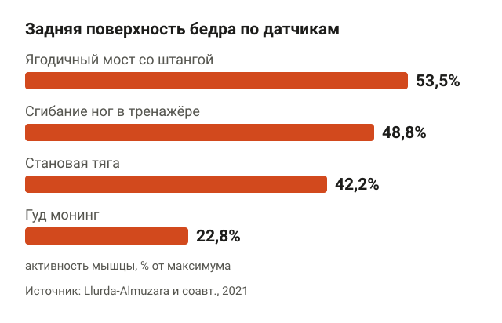
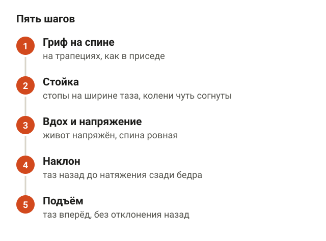
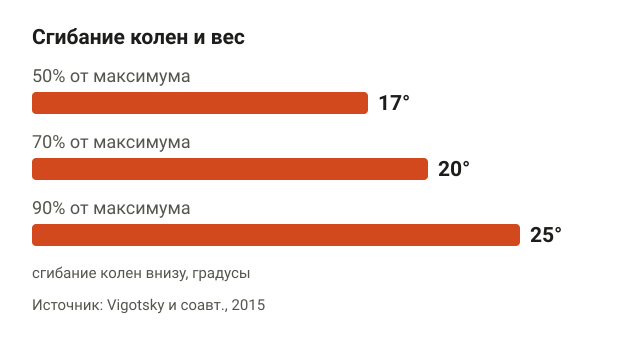
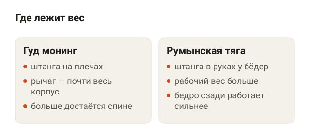
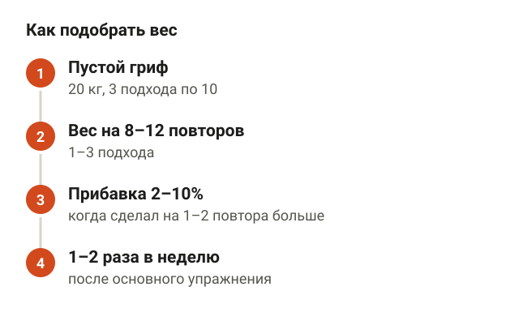
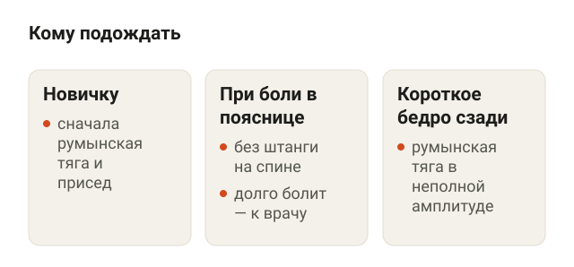
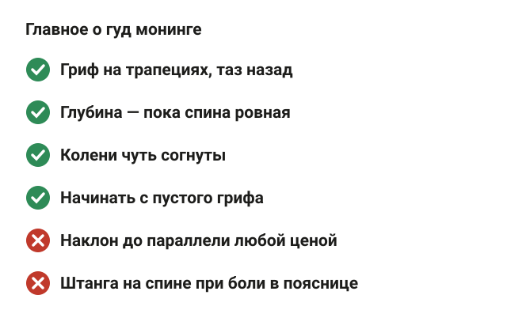

---
{
  "title": "Гуд монинг: техника упражнения и частые ошибки",
  "seo_title": "Гуд монинг: техника упражнения, мышцы и ошибки",
  "description": "Техника упражнения гуд монинг по шагам: положение грифа, колени и глубина наклона, какие мышцы работают, отличие от румынской тяги и как подобрать вес.",
  "slug": "gud-moning-tehnika-uprazhneniya",
  "date": "2026-11-10",
  "category": "trenirovki",
  "keyword": "техника упражнения гуд монинг",
  "tags": [
    "гуд монинг",
    "техника",
    "задняя поверхность бедра",
    "разгибатели спины",
    "румынская тяга"
  ],
  "faq": [
    {
      "q": "Какие мышцы работают в гуд монинге?",
      "a": "Разгибатели спины, задняя поверхность бедра и ягодичные. По датчикам поясничные разгибатели работали на 51–73% от максимума, задняя поверхность бедра — на 26–40%, поэтому спине в этом упражнении достаётся заметная доля нагрузки."
    },
    {
      "q": "Нужно ли держать ноги прямыми в гуд монинге?",
      "a": "Нет, колени чуть согнуты и почти не меняют угол. В исследовании 2015 года колени сгибались на 17° при 50% от максимума и почти на 25° при 90%. Если колени сгибаются всё сильнее, вес слишком большой."
    },
    {
      "q": "Что лучше: гуд монинг или румынская тяга?",
      "a": "Для задней поверхности бедра — румынская тяга: по датчикам она нагружает её сильнее. Гуд монинг больше нагружает спину и ягодичные. Новичку лучше начать с румынской тяги."
    },
    {
      "q": "Какой вес брать в гуд монинге?",
      "a": "Начни с пустого грифа 20 кг и 10 повторов. Рабочий вес — тот, что ты поднимаешь 8–12 раз с ровной спиной. Прибавляй 2–10%, когда делаешь на 1–2 повтора больше плана."
    }
  ],
  "sources": [
    {
      "title": "Vigotsky A. D. и соавт. Effects of load on good morning kinematics and EMG activity (PeerJ, 2015)",
      "url": "https://doi.org/10.7717/peerj.708"
    },
    {
      "title": "Llurda-Almuzara L. и соавт. Biceps femoris activation during hamstring strength exercises: a systematic review (Int J Environ Res Public Health, 2021)",
      "url": "https://doi.org/10.3390/ijerph18168733"
    },
    {
      "title": "McAllister M. J. и соавт. Muscle activation during various hamstring exercises (J Strength Cond Res, 2014)",
      "url": "https://doi.org/10.1519/JSC.0000000000000302"
    },
    {
      "title": "Jaeggi J. S., Achermann B., Lorenzetti S. R. Female lower body muscle forces: a musculoskeletal modeling comparison of back squats, split squats and good mornings (J Funct Morphol Kinesiol, 2024)",
      "url": "https://doi.org/10.3390/jfmk9020068"
    },
    {
      "title": "Ebben W. P. и соавт. Using squat repetition maximum testing to determine hamstring resistance training exercise loads (J Strength Cond Res, 2010)",
      "url": "https://doi.org/10.1519/JSC.0b013e3181cbabd5"
    },
    {
      "title": "American College of Sports Medicine. Progression models in resistance training for healthy adults (Med Sci Sports Exerc, 2009)",
      "url": "https://doi.org/10.1249/MSS.0b013e3181915670"
    }
  ]
}
---
Техника упражнения гуд монинг держится на трёх вещах: гриф лежит на верхней части спины, как в приседе, колени чуть согнуты и почти не меняют угол, а наклон идёт за счёт того, что таз уходит назад, при ровной спине. Опускаешься до натяжения сзади бедра или до момента, когда спина начинает округляться, и выпрямляешься, толкая таз вперёд. Начинать стоит с пустого грифа и 8–12 повторов, а вес прибавлять, только когда спина остаётся ровной во всех повторах.

Ниже разбираю гуд монинг по шагам, какие мышцы в нём работают по данным исследований, чем он отличается от румынской тяги, какие ошибки встречаются чаще всего и как подобрать рабочий вес.

## Что такое гуд монинг и какие мышцы в нём работают

<figure class="step"><figcaption>Длинная головка двуглавой мышцы бедра: гуд монинг 22,8% от максимума, становая тяга 42,2%, сгибание ног 48,8%, ягодичный мост 53,5%.</figcaption></figure>

Гуд монинг, или «доброе утро», — наклон вперёд со штангой на плечах. Название от того, что движение похоже на поклон при встрече. По сути это та же работа тазом, что в румынской тяге, только вес лежит на спине, а не висит в руках.

Работают три группы мышц: разгибатели спины, задняя поверхность бедра и ягодичные. Какая из них нагружена сильнее, видно по исследованиям с датчиками на коже, то есть электромиографии (ЭМГ). Датчик показывает, насколько мышца возбуждена, а не насколько она вырастет.

- **Разгибатели спины.** В работе Vigotsky и соавторов (2015) 15 тренированных мужчин делали гуд монинг с весом от 50 до 90% от максимума. Средняя активность поясничных разгибателей по датчикам была 51–73% от максимального напряжения, а внутренней части задней поверхности бедра — 26–40%. То есть спина в этом упражнении держит заметную долю работы.
- **Задняя поверхность бедра.** В систематическом обзоре 2021 года (Llurda-Almuzara и соавторы, 29 исследований, 507 человек) длинная головка двуглавой мышцы бедра в гуд монинге работала на 22,8% от максимума. Это меньше, чем в становой тяге (42,2%), сгибании ног в тренажёре (48,8%) и ягодичном мосте со штангой (53,5%). Больше всего в обзоре было в «нордическом» сгибании, выше 60%.
- **Ягодичные.** В работе 2024 года (Jaeggi и соавторы) восемь женщин делали гуд монинг, присед и выпады со штангой. По расчётной модели самые большие усилия большой ягодичной мышцы были как раз в гуд монинге и в передней ноге выпада.

Получается, что гуд монинг — упражнение на всю заднюю поверхность тела, а не только «на бицепс бедра». Если цель — именно задняя поверхность бедра, румынская тяга и сгибания ног по датчикам нагружают её сильнее.

## Техника упражнения гуд монинг по шагам

<figure class="step"><figcaption>Гриф на трапециях, колени чуть согнуты, вдох и напряжение живота, таз назад до натяжения сзади бедра, подъём толчком таза вперёд.</figcaption></figure>

Гуд монинг удобнее всего делать в стойке для приседаний: снимаешь гриф с крюков на нужной высоте и не поднимаешь штангу с пола.

1. **Гриф на спине.** Положи гриф на верхнюю часть трапеций, как в приседе со штангой. Хват чуть шире плеч, локти смотрят вниз. Сними штангу со стоек и сделай шаг назад.
2. **Стойка.** Стопы на ширине таза, носки прямо или чуть врозь. Колени согни на несколько градусов и оставь так на весь подход.
3. **Вдох и напряжение.** Вдохни, напряги живот, как перед ударом. Спина ровная от таза до шеи, взгляд в пол на пару метров перед собой.
4. **Наклон.** Отводи таз назад, будто закрываешь дверь ягодицами, а корпус наклоняется вперёд сам. Гриф остаётся над серединой стопы. Опускайся, пока сзади бедра ощущается натяжение, а спина ещё ровная.
5. **Подъём.** Толкни таз вперёд и выпрямись. Вверху колени и таз выпрямлены, плечи над тазом, без отклонения назад.

Движение медленное и подконтрольное: 2–3 секунды вниз и чуть быстрее вверх. Рывков и пружинящих покачиваний внизу нет, потому что штанга на спине усиливает любой рывок.

## Как глубоко наклоняться и насколько сгибать колени

<figure class="step"><figcaption>С ростом веса колени сгибались сильнее: 17° на 50% от максимума, 20° на 70% и почти 25° на 90%.</figcaption></figure>

Глубина наклона зависит от гибкости задней поверхности бедра, а не от того, получилось ли лечь корпусом параллельно полу. Ориентир простой: опускаешься, пока спина ровная. Как только поясница начинает округляться, это и есть твоя нижняя точка на сегодня.

С коленями интереснее. В исследовании Vigotsky колени сгибались сильнее с ростом веса: 17° на 50% от максимума, 20° на 70% и почти 25° на 90%. Наклон в тазобедренном суставе при этом почти не менялся, около 75°, и поясница во всех подходах сгибалась примерно на 25–28°.

По расчётам авторов, из-за согнутых колен задняя поверхность бедра на тяжёлых подходах растягивалась меньше. Тело само «сокращает» рычаг, когда вес растёт. В работе Jaeggi участницы с весом 25% от массы тела тоже не держали ноги прямыми, колени были согнуты примерно на 40°.

Вывод для зала: немного согнутые колени — это нормально и даже удобнее, чем прямые. Но если колени сгибаются всё сильнее и сильнее, наклон превращается в полуприсед, а вес, скорее всего, уже слишком большой.

## Гуд монинг или румынская тяга: в чём разница

<figure class="step"><figcaption>В гуд монинге штанга на плечах и рычаг длиннее. В румынской тяге штанга в руках, вес больше, задняя поверхность бедра работает сильнее.</figcaption></figure>

Оба упражнения — наклон за счёт таза с ровной спиной. Разница в том, где вес. В гуд монинге штанга на плечах, и рычаг от таза до грифа — почти весь корпус. В румынской тяге штанга в руках у бёдер, рычаг короче, поэтому и рабочий вес в ней больше.

В исследовании McAllister и соавторов (2014) 12 тренированных мужчин делали гуд монинг, румынскую тягу, сгибание ног и подъём корпуса на станке для бицепса бедра с весом 85% от максимума. Задняя поверхность бедра по датчикам работала сильнее всего в румынской тяге и подъёме на станке.

Для новичка порядок такой: сначала румынская тяга, потом гуд монинг. В румынской тяге проще научиться отводить таз назад, а штангу можно просто опустить на пол, если не получается.

**Румынская тяга со штангой.** Встань прямо, штанга в прямых руках у бёдер, стопы на ширине таза, колени чуть согнуты. Отводи таз назад и наклоняйся, гриф скользит вдоль бёдер. Опускайся, пока спина ровная и сзади бедра чувствуется натяжение, и выпрямляйся, толкая таз вперёд. Ориентиры: таз уходит назад, а не вниз; гриф идёт вдоль ног.

<figure class="step move"></figure>

Подробнее о положении грифа и спины в тягах — в статье [«Становая тяга: техника и ошибки новичков»](/stati/stanovaya-tyaga-tehnika-i-oshibki/).

## Частые ошибки в гуд монинге

<figure class="step"><figcaption>Таз назад, ровная спина, гриф на трапециях. Ошибки: круглая спина, колени вперёд, гриф на шее, рывок внизу.</figcaption></figure>

Большинство ошибок видно сбоку за один подход. Вот что я поправляю чаще всего.

- **Круглая спина.** Самая частая ошибка. Наклон идёт не за счёт таза, а за счёт сгибания поясницы. Исправление — меньше глубина и меньше вес, пока спина не станет ровной во всех повторах.
- **Колени уходят вперёд.** Таз опускается вниз, а не назад, и получается присед с наклоном. Колени согнуты чуть-чуть и почти не двигаются.
- **Гриф на шее.** Если штанга давит на шейные позвонки, она лежит слишком высоко. Её место — на трапециях, как в приседе. Как положить гриф, подробно разобрано в статье [«Как правильно приседать со штангой»](/stati/kak-pravilno-prisedat-so-shtangoy/).
- **Рывок внизу.** Пружинящее движение в нижней точке со штангой на спине превращает наклон в бросок, и контроль над спиной теряется. Пауза на долю секунды и спокойный подъём.
- **Отклонение назад вверху.** Наверху достаточно выпрямиться: таз и колени выпрямлены, плечи над тазом. Прогиб в пояснице назад к упражнению ничего не добавляет.

## Какой вес брать и сколько повторов

<figure class="step"><figcaption>Пустой гриф 3 подхода по 10, затем вес на 8–12 повторов, прибавка 2–10%, 1–2 раза в неделю после основного упражнения.</figcaption></figure>

Гуд монинг — вспомогательное упражнение, рекорды в нём не ставят. В исследовании Vigotsky средний максимум у тренированных мужчин весом около 85 кг был 76 кг. Для сравнения: мой рекорд в становой — 202,5 кг, а в гуд монинге я работаю с весами в разы меньше, и это нормально.

Есть и формула. Ebben и соавторы (2010) вывели её для мужчин-спортсменов: вес для 6 повторов в гуд монинге ≈ 0,96 × вес для 6 повторов в приседе − 105,5 кг. Допустим, ты приседаешь 140 кг на 6 раз, тогда гуд монинг на 6 раз — около 29 кг. У женщин в той же работе формула не сработала, поэтому ориентируйся на технику, а не на расчёт.

Как подбирать вес по шагам:

1. **Пустой гриф.** Начни с 20-килограммового грифа, 3 подхода по 10 повторов. С такой разминки начинали все участники исследования Vigotsky.
2. **Вес на 8–12 повторов.** По рекомендациям Американского колледжа спортивной медицины (ACSM, 2009) новичкам подходит вес, который ты поднимаешь 8–12 раз, 1–3 подхода.
3. **Прибавка 2–10%.** Когда делаешь на 1–2 повтора больше плана с ровной спиной, добавляй 2–10% веса.
4. **1–2 раза в неделю.** Ставь гуд монинг после основного упражнения, например после приседа, когда спина уже размята, но ещё не устала от тяжёлой тяги.

## Кому гуд монинг стоит отложить

<figure class="step"><figcaption>Новичку — сначала румынская тяга и присед. При боли в пояснице сейчас — без штанги на спине. При короткой задней поверхности бедра — румынская тяга.</figcaption></figure>

Поясничные разгибатели в гуд монинге работают на высоком уровне, а поясница всё-таки немного сгибается даже у опытных: в исследовании Vigotsky — на 25–28° внизу. Поэтому упражнение не для всех и не с первой тренировки.

- **Новичкам.** Сначала румынская тяга и присед со штангой. Гуд монинг — когда ты уверенно держишь спину ровной в этих упражнениях.
- **При боли в пояснице.** Если поясница болит сейчас, со штангой на спине не наклоняйся. Начни с упражнений из статьи [«Боль в пояснице: упражнения при острой и хронической боли»](/stati/bol-v-poyasnice-uprazhneniya/). Если боль отдаёт в ногу или не проходит неделями, это к врачу.
- **С короткой задней поверхностью бедра.** Если спина округляется уже на небольшом наклоне, гуд монинг пока не даст ничего, кроме нагрузки на поясницу. Румынская тяга с неполной амплитудой подойдёт лучше.

## Шпаргалка

<figure class="step"><figcaption>Гриф на трапециях, колени чуть согнуты, глубина — пока спина ровная, начинать с пустого грифа.</figcaption></figure>

- Гриф на трапециях, колени чуть согнуты, таз уходит назад.
- Глубина — пока спина ровная, а не до параллели с полом.
- Колени сгибаются сильнее с ростом веса: 17° на 50% и почти 25° на 90% от максимума.
- Задняя поверхность бедра работает сильнее в румынской тяге, в гуд монинге больше достаётся спине и ягодичным.
- Начинай с пустого грифа, потом 8–12 повторов и прибавка 2–10%.
- При боли в пояснице сейчас — отложи упражнение.
