---
{
  "title": "Как набрать массу худому парню: питание и тренировки",
  "seo_title": "Как набрать массу худому парню: калории, белок, тренировки",
  "description": "Почему худой парень не набирает вес, сколько есть калорий и белка, как тренироваться и как корректировать план по весам раз в 2–4 недели.",
  "slug": "kak-nabrat-massu-hudomu-parnyu",
  "date": "2026-11-02",
  "category": "nabor-massy",
  "keyword": "как набрать массу худому парню",
  "tags": [
    "набор массы",
    "худой парень",
    "быстрый метаболизм",
    "белок",
    "профицит калорий",
    "силовые тренировки",
    "базовые упражнения"
  ],
  "faq": [
    {
      "q": "Нужен ли протеин-порошок, чтобы набрать массу?",
      "a": "Нет. Белок из обычной еды работает, если суточная норма набрана. Порошок — это удобство, когда не получается добрать белок продуктами."
    },
    {
      "q": "Сколько белка нужно худому парню для набора массы?",
      "a": "ISSN рекомендует 1,4–2,0 г на килограмм веса в сутки. Мета-анализы показывают, что выше примерно 1,6 г/кг прирост мышц почти не увеличивается, поэтому ориентир — 1,6–2,0 г/кг."
    },
    {
      "q": "Какой профицит калорий нужен для набора массы?",
      "a": "Обзоры описывают около 200–300 ккал сверх поддержания, но точной цифры для худых новичков нет. Начни с этого диапазона и корректируй по среднему весу раз в 2–4 недели."
    },
    {
      "q": "Мешает ли быстрый метаболизм набрать массу?",
      "a": "Убедительных данных за эту идею нет. Даже при сильных изменениях питания расход энергии сдвигается на единицы процентов, поэтому чаще причина в том, что еды или тренировочной нагрузки мало."
    },
    {
      "q": "Сколько раз в неделю тренировать каждую мышцу?",
      "a": "Мета-анализ 2019 года показал, что при равном недельном объёме частота мало влияет на рост мышц. Более ранний мета-анализ 2016 года поддерживал 2 раза в неделю, и это удобный практический вариант."
    }
  ],
  "sources": [
    {
      "title": "Сетевой мета-анализ: силовые тренировки, белок и безжировая масса (2025)",
      "url": "https://www.ncbi.nlm.nih.gov/pmc/articles/PMC12862422/"
    },
    {
      "title": "Schoenfeld, Grgic, Krieger, 2019 — частота тренировок при равном объёме",
      "url": "https://www.semanticscholar.org/paper/How-many-times-per-week-should-a-muscle-be-trained-Schoenfeld-Grgic/5f3b9845fdfd15200bdac0f7b9b36da457c48025"
    },
    {
      "title": "Schoenfeld, Ogborn, Krieger, 2016, Sports Medicine — частота тренировок и гипертрофия",
      "url": "https://link.springer.com/article/10.1007/s40279-016-0543-8"
    },
    {
      "title": "ISSN Position Stand: protein and exercise (2017)",
      "url": "https://www.ncbi.nlm.nih.gov/pmc/articles/PMC5477153/"
    },
    {
      "title": "Morton et al., 2018 — мета-анализ добавок белка при силовых тренировках",
      "url": "https://www.researchgate.net/publication/318368028_A_systematic_review_meta-analysis_and_meta-regression_of_the_effect_of_protein_supplementation_on_resistance_training-induced_gains_in_muscle_mass_and_strength_in_healthy_adults"
    },
    {
      "title": "Мета-анализ «доза-ответ» белка и силы при тренировках (2022)",
      "url": "https://www.ncbi.nlm.nih.gov/pmc/articles/PMC9441410/"
    },
    {
      "title": "Систематический обзор и мета-анализ потребления белка для мышц (J Cachexia Sarcopenia Muscle, 2022)",
      "url": "https://pmc.ncbi.nlm.nih.gov/articles/PMC8978023/"
    },
    {
      "title": "ISSN Position Stand: nutrient timing (2017)",
      "url": "https://link.springer.com/article/10.1186/s12970-017-0189-4"
    },
    {
      "title": "ISSN Position Stand: nutrient timing (2017), PMC",
      "url": "https://www.ncbi.nlm.nih.gov/pmc/articles/PMC5596471/"
    },
    {
      "title": "Iraki et al., 2019, Sports — питание атлетов в межсезонье",
      "url": "https://elementssystem.com/wp-content/uploads/2019/07/iraki-nutrition-bodybuilders-2019-sports-07-00154.pdf"
    },
    {
      "title": "Slater et al., 2019 — нужен ли профицит энергии для роста мышц",
      "url": "https://www.semanticscholar.org/paper/Is-an-Energy-Surplus-Required-to-Maximize-Skeletal-Slater-Dieter/bb2b8686f9517b60d1bbd2e0afc83285b4a77696"
    },
    {
      "title": "On adaptive thermogenesis: just another weight-loss tale? (AJCN)",
      "url": "https://ajcn.nutrition.org/article/S0002-9165(22)00885-1/fulltext"
    },
    {
      "title": "Обзор адаптивного термогенеза при снижении веса (Obesity)",
      "url": "https://onlinelibrary.wiley.com/doi/full/10.1002/oby.20027"
    },
    {
      "title": "Диссертация о факторах базового обмена (University of Nebraska–Lincoln)",
      "url": "https://digitalcommons.unl.edu/cgi/viewcontent.cgi?article=1075&context=nutritiondiss"
    }
  ]
}
---
Чтобы набрать массу худому парню, нужны три вещи: силовые тренировки с прогрессией рабочих весов, небольшой профицит калорий и достаточно белка, около 1,6 г на килограмм веса тела. «Быстрый метаболизм» в исследованиях редко оказывается причиной. Чаще человек ест меньше, чем ему кажется, или тренируется без роста нагрузки. Калории подбираются по весам: стартуешь с небольшого плюса и раз в 2–4 недели корректируешь.

Ниже разберу, как посчитать еду, сколько белка нужно, как тренироваться и что делать, если вес стоит. Общая схема для мужчин есть в статье [Набор мышечной массы для мужчин: питание и тренировки по шагам](/stati/nabor-myshechnoy-massy-dlya-muzhchin/). Здесь речь именно про худых, у которых «ничего не лезет».

## Почему худой парень не набирает вес

<figure class="step">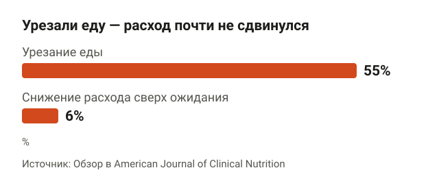<figcaption>Даже при урезании еды на 55% суточный расход снизился лишь на 6% сверх ожидаемого.</figcaption></figure>

Суточный расход энергии складывается из трёх частей: базовый обмен (энергия на жизнь в покое), пищевой термогенез (энергия на переваривание еды) и физическая активность. Это описано в обзоре в American Journal of Clinical Nutrition. Все три части подстраиваются под количество еды, но слабо.

В исследованиях здоровых людей еду урезали на 55% на 4 недели, а суточный расход снизился всего на 6% сверх ожидаемого. То есть даже при огромном изменении питания метаболизм сдвигается на единицы процентов. Оговорка: эти данные получены при снижении веса. Как организм подстраивается при наборе, изучено меньше.

Соответственно, если вес стоит месяцами, в первую очередь проверь, сколько ты на самом деле ешь и растут ли рабочие веса в зале.

### Как набрать массу, если быстрый метаболизм

<figure class="step">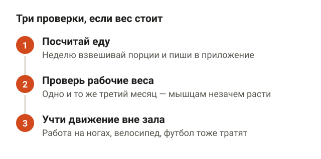<figcaption>Прежде чем винить метаболизм, проверь еду, рабочие веса и активность вне зала.</figcaption></figure>

Я не встречал рецензируемых исследований, где «быстрый метаболизм» выделяли бы как отдельный тип телосложения и проверяли, мешает ли он набору массы. Есть данные, что базовый обмен в основном определяется безжировой массой, то есть мышцами, органами и костями. Но это вывод из диссертации, а не крупного исследования, так что считай его гипотезой.

На практике проверь три вещи:

1. **Сколько ты ешь.** Неделю записывай всю еду в приложение, взвешивая порции. Часто «ем как не в себя» на деле значит один плотный ужин и кофе вместо завтрака.
2. **Растут ли рабочие веса.** Если третий месяц жмёшь одно и то же, мышцам незачем расти.
3. **Сколько ты двигаешься вне зала.** Работа на ногах, велосипед, футбол по выходным тоже съедают калории. Это не повод всё бросать, просто это нужно учесть в питании.

## Сколько калорий нужно, чтобы набрать массу

<figure class="step">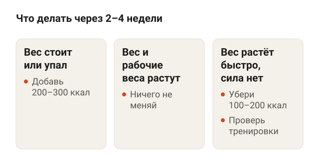<figcaption>Смотри на средний вес за неделю и правь калории по ситуации.</figcaption></figure>

Одной точной цифры нет. Обзор Iraki с соавторами (2019) для атлетов в межсезонье описывает профицит около 200–300 ккал в день как основу для набора. Это нарративный обзор, без мета-анализа, и сделан он не на худых новичках. Обзор Slater с соавторами (2019) вообще разбирает вопрос, нужен ли профицит для максимального роста мышц, и однозначного ответа не даёт.

Поэтому я не считаю калории по формуле, а подбираю их по весам:

1. Две недели ешь как обычно, записывай всё в приложение и взвешивайся утром натощак 3–4 раза в неделю.
2. Если средний вес не меняется, эта калорийность примерно равна твоему поддержанию.
3. Добавь к ней 200–300 ккал.
4. Через 2–4 недели сравни средний вес с прошлым и действуй по таблице ниже.

| Что видишь за 2–4 недели | Что делать |
|---|---|
| Вес стоит или упал | Добавить ещё 200–300 ккал |
| Вес плавно растёт, рабочие веса тоже | Ничего не менять |
| Вес растёт быстро, талия заметно прибавляет, а силовые нет | Убрать 100–200 ккал, проверить тренировки |

Смотри на среднее за неделю, а не на одно взвешивание. Вес за день прыгает от воды и соли, и реагировать на каждый скачок нет смысла.

## Сколько белка нужно худому парню

<figure class="step">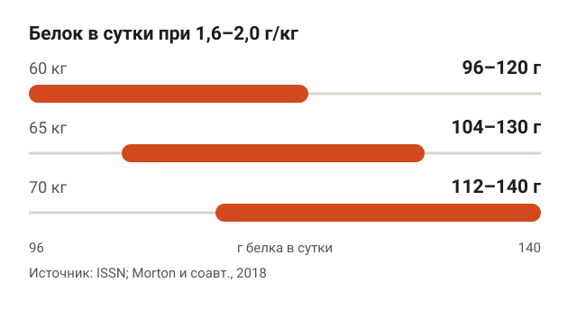<figcaption>Ориентир по белку в граммах в зависимости от веса тела.</figcaption></figure>

Позиция Международного общества спортивного питания (ISSN) рекомендует большинству тренирующихся 1,4–2,0 г белка на килограмм веса в сутки. Мета-анализ Morton с соавторами (2018) показал, что выше примерно 1,6 г/кг дополнительный белок уже не добавлял безжировой массы при силовых тренировках. Мета-анализ 2022 года по силе нашёл похожую картину: сила росла примерно на 0,72% на каждые 0,1 г/кг белка, но только до 1,5 г/кг, дальше прироста не было.

Данные расходятся в деталях. Другой мета-анализ 2022 года (журнал JCSM) нашёл, что дополнительный белок даёт лишь небольшую прибавку безжировой массы и силы ног. Сходятся все в одном: суточную норму нужно добирать, а дальше эффект скромный.

Практический ориентир — 1,6–2,0 г/кг. Вот что это значит в граммах:

| Вес тела | 1,6 г/кг | 2,0 г/кг |
|---|---|---|
| 60 кг | 96 г | 120 г |
| 65 кг | 104 г | 130 г |
| 70 кг | 112 г | 140 г |

### Как распределить белок по приёмам пищи

<figure class="step">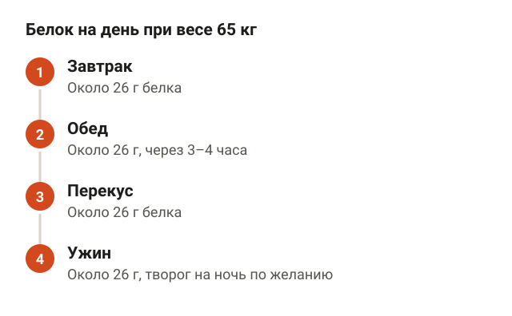<figcaption>Четыре приёма по 26 г дают 104 г, то есть 1,6 г/кг.</figcaption></figure>

ISSN указывает, что приём 20–40 г качественного белка (0,25–0,40 г/кг) каждые 3–4 часа, по всей видимости, лучше всего стимулирует синтез мышечного белка, то есть процесс сборки новых мышечных волокон. Это консенсус экспертов, а не жёсткое правило.

Допустим, ты весишь 65 кг. 0,4 г/кг — это 26 г белка за приём. Четыре таких приёма дают 104 г, то есть ровно 1,6 г/кг. Завтрак, обед, ужин и один перекус закрывают норму.

Про белок перед сном. Казеин, медленный молочный белок, перед сном повышает синтез мышечного белка и расход энергии ночью. Но это острый эффект за одну ночь, долгосрочного влияния на массу он не доказывает. Если удобно, творог на ночь подойдёт: основной белок в нём как раз казеин.

## Питание: как набрать массу худому парню

<figure class="step">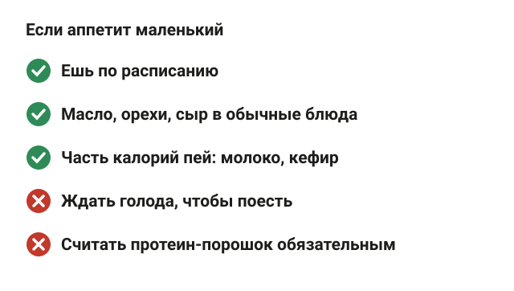<figcaption>Главное — физически съесть нужное количество, а не искать особые продукты.</figcaption></figure>

Самая частая проблема у худых не в выборе продуктов, а в том, что физически не получается съесть нужное количество. Аппетит маленький, после обеда «наелся до вечера». Вот что помогает:

- **Есть по расписанию, а не по голоду.** Если ждать чувства голода, приём пищи легко пропустить.
- **Добавлять калории к обычной еде.** Сливочное или растительное масло в кашу, орехи, сыр, арахисовая паста. Объём почти не растёт, калорий заметно больше.
- **Пить часть калорий.** Молоко, кефир, домашний коктейль из молока, банана и овсянки. Жидкость легче проходит, чем ещё одна тарелка.
- **Основа рациона остаётся обычной.** Мясо, птица, рыба, яйца, творог для белка. Крупы, картофель, хлеб, макароны для углеводов. Овощи и фрукты по желанию.

Протеин-порошок необязателен. Белок из обычной еды работает, если суточная норма набрана. Прямых исследований «еда против порошка» на набор массы я не нашёл, так что порошок — это вопрос удобства, а не эффективности.

## Как тренироваться, чтобы набрать массу

<figure class="step"><figcaption>При равном недельном объёме частота почти не влияет, но 2 раза в неделю удобнее.</figcaption></figure>

Сетевой мета-анализ 2025 года называет силовые тренировки основным стимулом роста силы и безжировой массы. Питание и белок играют поддерживающую роль. Без тренировок профицит просто уйдёт в жир.

Про частоту данные расходятся. Мета-анализ Schoenfeld с соавторами 2016 года пришёл к выводу, что две тренировки мышцы в неделю дают больше роста, чем одна. Но в большинстве включённых исследований объём не выравнивали. Мета-анализ 2019 года тех же авторов показал: при одинаковом недельном объёме частота на рост мышц почти не влияет. Практический вывод: тренировать каждую мышцу 2 раза в неделю удобно, потому что так проще набрать подходы и не убиваться за одну тренировку. Сколько подходов нужно, я разбирал в статье [Сколько подходов делать для роста мышц](/stati/skolko-podhodov-dlya-rosta-myshc/).

### Базовые упражнения для набора массы

<figure class="step">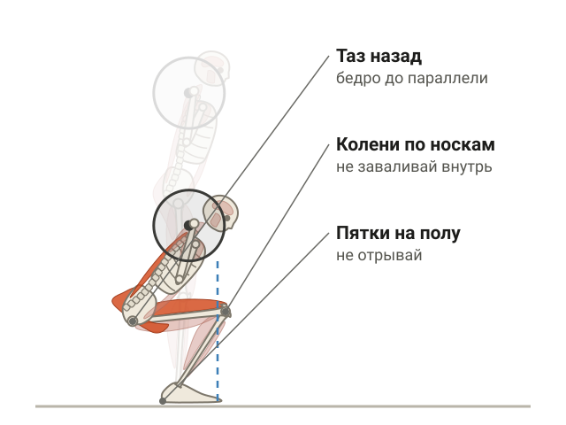<figcaption>В приседе со штангой работают сразу бёдра, ягодицы и мышцы спины.</figcaption></figure>

Новичку проще расти на многосуставных упражнениях: в них работает много мышц сразу и рабочий вес растёт быстрее.

**Приседания со штангой.** Штанга на верхней части трапеций, стопы чуть шире плеч, носки слегка развёрнуты. Садись, одновременно сгибая колени и отводя таз назад, до параллели бедра с полом или ниже, если спина остаётся ровной. Колени идут по линии носков, пятки не отрываются от пола. Подробно по шагам — в статье [Как правильно приседать со штангой](/stati/kak-pravilno-prisedat-so-shtangoy/).

<figure class="step move">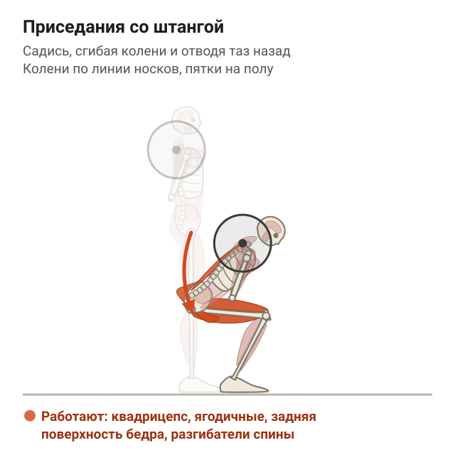</figure>

**Жим штанги лёжа.** Ляг на скамью, лопатки сведи и опусти, стопы упри в пол. Хват чуть шире плеч. Опускай штангу на низ груди, локти под углом примерно 45° к корпусу, затем выжимай вверх. Таз не отрывается от скамьи, лопатки остаются сведёнными всё движение.

**Румынская тяга.** Стоя со штангой в руках, колени слегка согнуты. Отводи таз назад, штанга скользит вдоль бёдер вниз примерно до середины голени. Спина прямая, поясница не округляется. Вставай за счёт ягодиц и задней поверхности бедра, а не рывком поясницы.

<figure class="step move">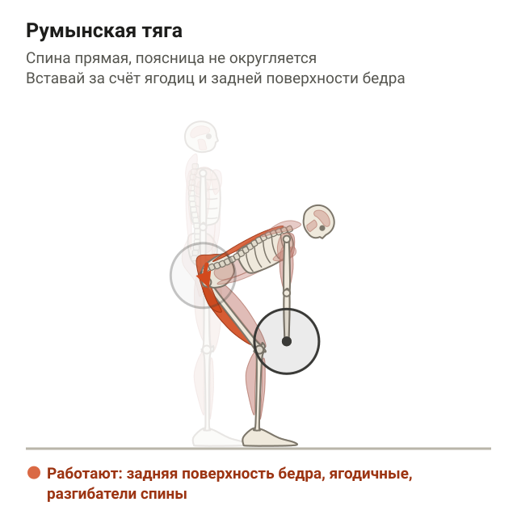</figure>

**Тяга штанги в наклоне.** Наклонись вперёд с прямой спиной примерно до 45°, колени слегка согнуты, штанга в прямых руках. Тяни штангу к низу живота, сводя лопатки. Корпус не раскачивается, локти идут назад вдоль тела.

<figure class="step move">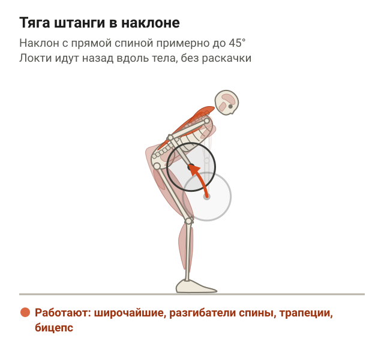</figure>

**Жим штанги стоя.** Штанга на уровне ключиц, хват чуть шире плеч, ягодицы и пресс напряжены. Выжимай штангу вверх над головой, голова слегка уходит назад, пропуская гриф, а наверху возвращается под штангу. Поясница не прогибается дугой, корпус стоит ровно.

<figure class="step move">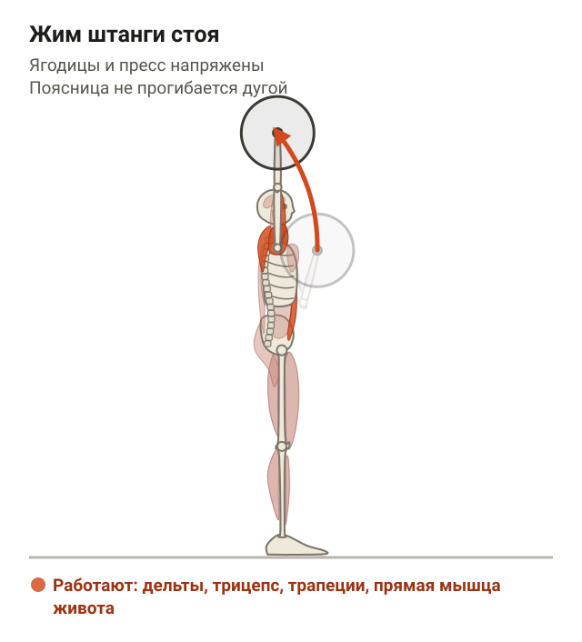</figure>

**Тяга верхнего блока.** Сядь в тренажёр, бёдра зафиксированы валиками, хват чуть шире плеч. Тяни рукоять к верху груди, опуская лопатки вниз и сводя их. Корпус почти вертикальный, без раскачки назад.

### Как прибавлять рабочий вес

<figure class="step">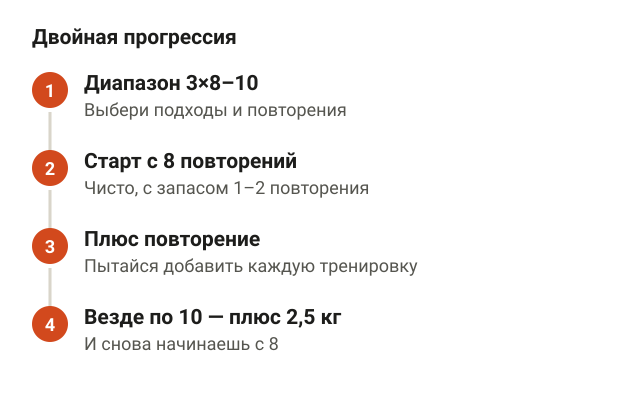<figcaption>Сначала добавляешь повторения, потом вес.</figcaption></figure>

Прогрессия означает, что со временем ты делаешь больше: больше веса или больше повторений. Самый простой способ — двойная прогрессия.

1. Выбери диапазон повторений, условно 3 подхода по 8–10.
2. Начни с веса, с которым делаешь 8 повторений чисто, с запасом 1–2 повторения.
3. Каждую тренировку пытайся добавить повторение.
4. Когда во всех подходах вышло по 10, прибавляю 2,5 кг и снова начинаю с 8.

Записывай веса и повторения в дневник или заметки в телефоне. Без записей через месяц уже не вспомнишь, что делал. Если застреваешь на одном весе 2–3 тренировки подряд, проверь сначала сон и калории, а уже потом программу.

### Пример тренировочной недели

<figure class="step">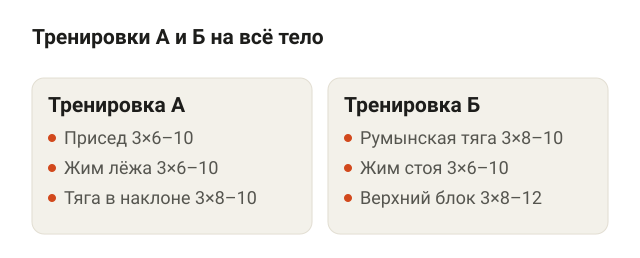<figcaption>Чередуй А и Б 3 раза в неделю: А–Б–А, потом Б–А–Б.</figcaption></figure>

Две тренировки на всё тело, которые чередуются 3 раза в неделю. В одну неделю получится А–Б–А, в следующую Б–А–Б.

| Тренировка А | Тренировка Б |
|---|---|
| Приседания со штангой, 3×6–10 | Румынская тяга, 3×8–10 |
| Жим штанги лёжа, 3×6–10 | Жим штанги стоя, 3×6–10 |
| Тяга штанги в наклоне, 3×8–10 | Тяга верхнего блока, 3×8–12 |

Это пример стартовой программы, а не единственный правильный вариант. Если нравится сплит, тоже работает, лишь бы недельный объём был сопоставим и веса росли.

## Когда с весом нужно идти к врачу

<figure class="step"><figcaption>При этих признаках программа питания проблему не решит.</figcaption></figure>

Всё выше касается здоровых людей, которые просто мало едят и мало тренируются. Если вес падает без видимой причины, есть постоянная слабость, проблемы с пищеварением, аппетит пропал или резко изменился — это вопрос к врачу, а не к тренеру. Программа питания здесь проблему не решит.

## Шпаргалка

<figure class="step">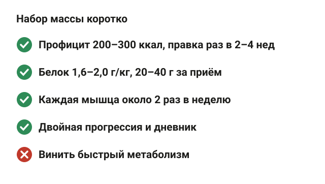<figcaption>Тренировки с прогрессией, профицит и белок — основа набора.</figcaption></figure>

- Набор массы стоит на трёх вещах: силовые тренировки с прогрессией, профицит калорий, достаточно белка.
- «Быстрый метаболизм» почти никогда не объясняет, почему вес стоит. Сначала посчитай еду и проверь рабочие веса.
- Калории: найди поддержание по весам, добавь 200–300 ккал, корректируй раз в 2–4 недели.
- Белок: 1,6–2,0 г/кг в сутки, по 20–40 г за приём каждые 3–4 часа.
- Протеин-порошок необязателен, обычная еда работает.
- Если аппетит маленький: еда по расписанию, масло и орехи в блюда, часть калорий в жидком виде.
- Тренировки: базовые упражнения, каждая мышца около 2 раз в неделю, двойная прогрессия, дневник.
- Резкая потеря веса, слабость, проблемы с ЖКТ — к врачу.
