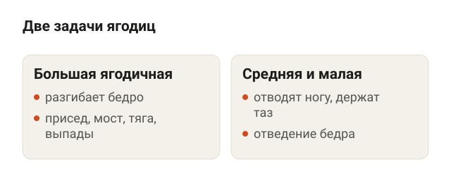
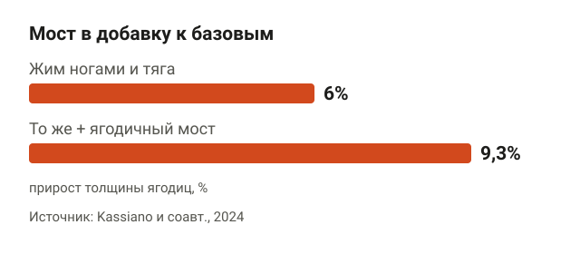
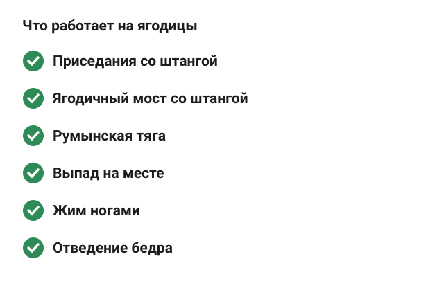
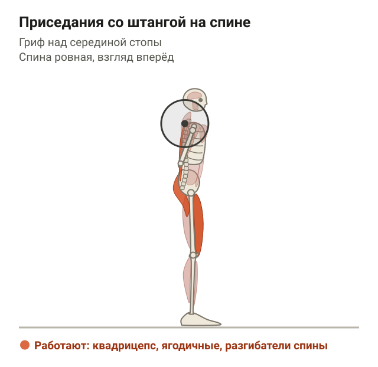
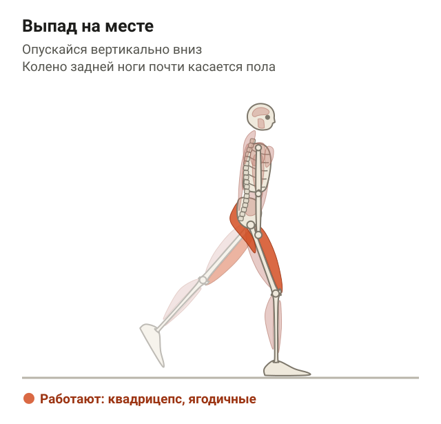
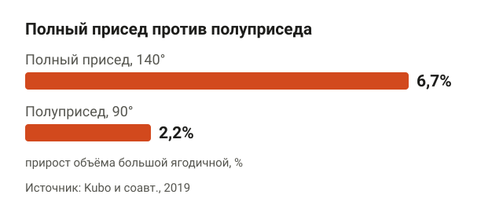
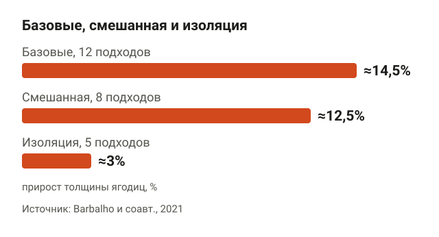
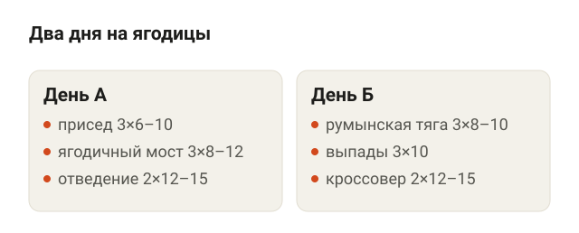
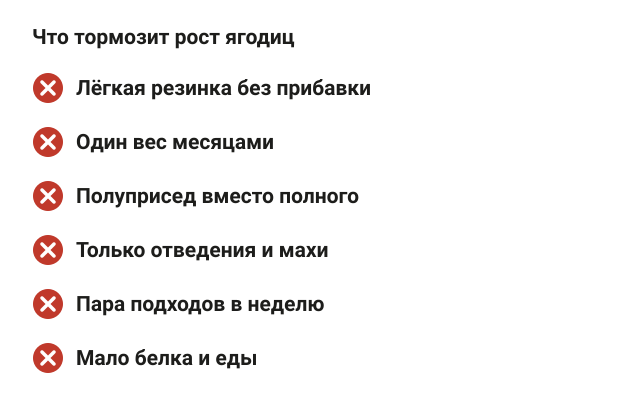
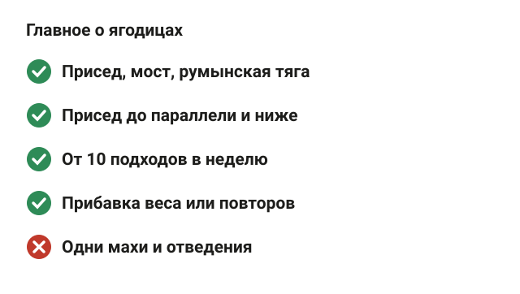

---
{
  "title": "Как накачать ягодицы в зале: упражнения и программа",
  "seo_title": "Как накачать ягодицы в зале: упражнения, подходы и программа",
  "description": "Как накачать ягодицы в зале: какие упражнения растят ягодицы по данным исследований, насколько глубоко приседать, сколько подходов и программа на 2 дня.",
  "slug": "kak-nakachat-yagodicy-v-zale",
  "date": "2026-11-11",
  "category": "trenirovki",
  "keyword": "как накачать ягодицы в зале",
  "tags": [
    "ягодицы",
    "ягодичный мост",
    "присед",
    "румынская тяга",
    "выпады",
    "программа тренировок"
  ],
  "faq": [
    {
      "q": "Какое упражнение лучше всего качает ягодицы?",
      "a": "Одного лучшего нет. В исследовании 2023 года присед и ягодичный мост за 9 недель вырастили ягодицы одинаково, а обзор 2025 года по 12 исследованиям показал рост и от отдельных упражнений, и от их сочетаний. Превосходство сочетания этот анализ не доказывает."
    },
    {
      "q": "Сколько раз в неделю тренировать ягодицы?",
      "a": "Обычно хватает 2 тренировок в неделю, если за неделю набирается от 10 рабочих подходов на ягодицы. Между тренировками ног — минимум день отдыха."
    },
    {
      "q": "Через сколько вырастут ягодицы?",
      "a": "В исследованиях заметный рост по МРТ и УЗИ видели через 9–12 недель: толщина ягодиц у девушек выросла на 6–9,3% за 10 недель. На глаз разница обычно видна позже, и многое зависит от питания."
    },
    {
      "q": "Как накачать попу девушке: нужна ли особая программа?",
      "a": "Нет. Ягодицы у женщин растут от тех же упражнений и того же объёма, что и у мужчин: присед, мост, румынская тяга, выпады, от 10 подходов в неделю и постепенная прибавка веса."
    }
  ],
  "sources": [
    {
      "title": "Krause Neto W., Krause T. L. V., Gama E. F. The impact of resistance training on gluteus maximus hypertrophy: a systematic review and meta-analysis (Front Physiol, 2025)",
      "url": "https://doi.org/10.3389/fphys.2025.1542334"
    },
    {
      "title": "Plotkin D. L. и соавт. Hip thrust and back squat training elicit similar gluteus muscle hypertrophy and transfer similarly to the deadlift (Front Physiol, 2023)",
      "url": "https://doi.org/10.3389/fphys.2023.1279170"
    },
    {
      "title": "Kassiano W. и соавт. Addition of the barbell hip thrust elicits greater increases in gluteus maximus muscle thickness in untrained young women (Int J Strength Cond, 2024)",
      "url": "https://doi.org/10.47206/ijsc.v4i1.284"
    },
    {
      "title": "Barbalho M. и соавт. Back squat vs. hip thrust resistance-training programs in well-trained women (Int J Sports Med, 2020)",
      "url": "https://doi.org/10.1055/a-1082-1126"
    },
    {
      "title": "Barbalho M. и соавт. The effects of resistance exercise selection on muscle size and strength in trained women (Int J Sports Med, 2021)",
      "url": "https://doi.org/10.1055/a-1121-7736"
    },
    {
      "title": "Kubo K., Ikebukuro T., Yata H. Effects of squat training with different depths on lower limb muscle volumes (Eur J Appl Physiol, 2019)",
      "url": "https://doi.org/10.1007/s00421-019-04181-y"
    },
    {
      "title": "Schoenfeld B. J., Ogborn D., Krieger J. W. Dose-response relationship between weekly resistance training volume and increases in muscle mass: a systematic review and meta-analysis (J Sports Sci, 2017)",
      "url": "https://doi.org/10.1080/02640414.2016.1210197"
    }
  ]
}
---
Чтобы накачать ягодицы в зале, нужны упражнения с разгибанием бедра под весом: присед до параллели и ниже, ягодичный мост, румынская тяга, выпады. Делай их 2 раза в неделю, набирай от 10 рабочих подходов на ягодицы за неделю и постепенно прибавляй вес. Мета-анализ 2025 года по 12 исследованиям показал, что ягодицы растут и от приседа, и от моста, и от программ с несколькими упражнениями. Это не доказывает, что сочетание всегда лучше одного упражнения. Отдельный «секретный» тренажёр не нужен.

Ниже разберу, какие упражнения в тренажёрном зале работают на ягодицы, насколько глубоко приседать, сколько подходов делать и как собрать программу на 2 дня.

## Как устроены ягодицы и что их нагружает

<figure class="step"><figcaption>Большая ягодичная разгибает бедро — присед, мост, тяга, выпады. Средняя и малая отводят ногу и держат таз — отведение бедра.</figcaption></figure>

Ягодицы — это три мышцы. Большая ягодичная — самая крупная, она и даёт форму. Её главная работа — разгибать бедро: выпрямляться из приседа, толкать таз вперёд в мосте, вставать из наклона. Средняя и малая ягодичные лежат сбоку и сверху. Они отводят ногу в сторону и держат таз ровно, когда ты стоишь на одной ноге.

Отсюда простое правило. Если упражнение разгибает бедро против веса, большая ягодичная работает. Присед, выпад, ягодичный мост, румынская тяга, жим ногами, разгибание бедра в кроссовере — всё это про неё. Для средней ягодичной нужны движения в сторону: отведение бедра в тренажёре или с резиной.

## Что показали исследования: какие упражнения растят ягодицы

<figure class="step"><figcaption>За 10 недель толщина ягодиц выросла на 6% от жима ногами и тяги на прямых ногах и на 9,3%, когда к ним добавили ягодичный мост.</figcaption></figure>

В 2025 году Krause Neto и соавторы собрали 12 исследований, где рост большой ягодичной мерили по МРТ или УЗИ. Вывод — силовые тренировки растят ягодицы с умеренным эффектом, и работают разные упражнения: присед со штангой, ягодичный мост, жим ногами, разгибание бедра на четвереньках. Рост наблюдали и в программах с одним упражнением, и в комбинированных. Сравнение подгрупп разных исследований не устанавливает превосходство сочетания при одинаковом объёме.

Теперь конкретные сравнения.

- **Присед против ягодичного моста.** В исследовании Plotkin и соавторов (2023) 34 нетренированных студента 9 недель делали либо присед, либо ягодичный мост, 2 раза в неделю. По МРТ ягодицы выросли одинаково. Присед дополнительно растил квадрицепс и приводящие мышцы бедра, а мост — почти только ягодицы.
- **Мост в добавку к базовым упражнениям.** У Kassiano и соавторов (2024) нетренированные девушки 10 недель делали жим ногами и тягу на прямых ногах. Половина группы добавила ягодичный мост. Толщина ягодиц выросла на 6% без моста и на 9,3% с мостом.
- **Тренированные женщины.** У Barbalho и соавторов (2020) за 12 недель ягодицы выросли на 9,4% от приседа и на 3,7% от моста. Но мост там делали с неполной амплитудой, и авторы обзора 2025 года отметили, что технику в этом исследовании описали плохо.

То есть данные пока не выбирают одного победителя. Присед даёт ягодицам столько же, сколько мост, плюс нагружает бёдра. Мост позволяет нагрузить ягодицы, не перегружая колени и квадрицепс. Сочетать упражнения удобно, чтобы распределять нагрузку и тренировать другие мышцы ног, но обязательного преимущества для роста ягодиц не доказано.

## Упражнения в тренажёрном зале на ягодицы

<figure class="step"><figcaption>Присед, ягодичный мост, румынская тяга, выпады, жим ногами и отведение бедра — упражнения, которые есть в любом зале.</figcaption></figure>

Ниже упражнения, которые есть в любом зале. Для каждого — как делать и на что смотреть.

**Приседания со штангой на спине.** Гриф на верхе спины, стопы на ширине плеч, носки чуть развёрнуты. Вдохни, напряги корпус и опускайся, отводя таз назад и вниз, колени идут по линии носков. Опускайся до параллели, когда бедро горизонтально полу, или ниже, если спина остаётся ровной. Ориентиры: пятки на полу, грудь не падает вперёд.

<figure class="step move"></figure>

**Ягодичный мост со штангой.** Сядь на пол, лопатками упрись в край скамьи, штанга на сгибе бёдер, под грифом мягкая накладка. Стопы на полу на ширине таза. Толкай таз вверх, пока корпус и бёдра не выстроятся в линию, задержись на секунду и опускайся. Ориентиры: голени вверху почти вертикальны, поясница не прогибается дугой, подбородок слегка опущен.

**Румынская тяга со штангой.** Встань прямо, штанга в прямых руках у бёдер, колени чуть согнуты. Отводи таз назад и наклоняйся, гриф скользит вдоль ног. Опускайся, пока спина ровная и сзади бедра тянет, и выпрямляйся, толкая таз вперёд. Ориентиры: таз уходит назад, а не вниз; спина не круглится.

<figure class="step move"></figure>

**Выпад на месте.** Встань в разножку, одна нога впереди, другая сзади на носке. Опускайся вниз, пока заднее колено почти не коснётся пола, и поднимайся, толкаясь передней ногой. Ориентиры: опускайся вертикально вниз, переднее колено идёт по линии носка.

<figure class="step move"></figure>

**Жим ногами.** Стопы ставь выше и шире на платформе, опускай платформу так низко, как получается без отрыва таза от спинки. Ориентир: поясница прижата к спинке весь подход.

**Разгибание бедра в кроссовере.** Манжета на щиколотке, встань лицом к блоку, держись за стойку. Уводи прямую ногу назад, пока таз не начнёт разворачиваться, и возвращай под контролем. Ориентир: двигается только нога, поясница не прогибается.

**Отведение бедра в тренажёре.** Сядь, подушки снаружи коленей, разводи ноги в стороны и медленно своди обратно. Это упражнение для средней и малой ягодичных. В исследовании Plotkin они почти не выросли ни от приседа, ни от моста. Сколько добавляет отведение, прямых исследований роста пока мало.

## Насколько глубоко приседать для ягодиц

<figure class="step"><figcaption>За 10 недель объём большой ягодичной вырос на 6,7% в полном приседе и на 2,2% в полуприседе.</figcaption></figure>

Глубина в приседе для ягодиц важна. Kubo и соавторы (2019) 10 недель сравнивали у 17 мужчин полный присед, где колени сгибаются до 140°, и полуприсед до 90°. Объём большой ягодичной вырос на 6,7% в полном приседе и на 2,2% в полуприседе. Квадрицепс при этом рос одинаково.

Логика простая: в глубоком приседе бедро сильнее сгибается, ягодица растягивается под весом и работает на большей длине.

Глубина — та, на которой ты держишь ровную спину и ничего не болит. Если внизу поясница подкручивается, сначала поработай с меньшим весом. Технику приседа по шагам смотри в статье [«Как правильно приседать со штангой: техника по шагам»](/stati/kak-pravilno-prisedat-so-shtangoy/).

## Сколько подходов на ягодицы в неделю

<figure class="step"><figcaption>За 24 недели толщина ягодиц выросла примерно на 14,5% от базовых упражнений, на 12,5% от смешанной программы и на 3% от одних изолирующих.</figcaption></figure>

Считай рабочие подходы на ягодицы за неделю, а не за тренировку. Мета-анализ Schoenfeld и соавторов (2017) по 15 исследованиям показал: чем больше рабочих подходов на мышцу в неделю, тем больше она растёт. Практический ориентир — от 10 подходов в неделю. Подробно про подсчёт — в статье [«Сколько подходов делать для роста мышц»](/stati/skolko-podhodov-dlya-rosta-myshc/).

Хорошо это видно в исследовании Barbalho и соавторов (2021) на тренированных женщинах. 24 недели одна группа делала только базовые упражнения — присед, становую, выпады, жим ногами, 12 подходов за тренировку. Вторая — базовые упражнения и изолирующие, 8 подходов. Третья — только изолирующие, ягодичный мост и разгибание бедра на четвереньках, 5 подходов. Толщина ягодиц выросла примерно на 14,5%, 12,5% и 3% соответственно.

Минус этого исследования — объём в группах был разный. Поэтому вывод не «изоляция не работает», а «одних изолирующих упражнений с малым объёмом мало». Базовые упражнения в программе на ягодицы нужны.

По весу: 6–15 повторов в подходе, последние повторы тяжёлые, 1–2 в запасе. Если вес перестал расти, добавь повтор или подход.

## Программа тренировок на ягодицы: 2 дня в неделю

<figure class="step"><figcaption>День А: присед, ягодичный мост, отведение бедра. День Б: румынская тяга, выпады, разгибание бедра в кроссовере.</figcaption></figure>

Это пример для человека, который уже знает технику приседа и тяги. Между тренировками — минимум день отдыха.

**День А**
1. Приседания со штангой — 3 подхода по 6–10.
2. Ягодичный мост со штангой — 3 подхода по 8–12.
3. Отведение бедра в тренажёре — 2 подхода по 12–15.

**День Б**
1. Румынская тяга — 3 подхода по 8–10.
2. Выпады — 3 подхода по 10 на каждую ногу.
3. Разгибание бедра в кроссовере — 2 подхода по 12–15 на каждую ногу.

Если считать все упражнения, получается около 16 подходов на ягодицы в неделю. Начинать можно с меньшего: 2 подхода вместо 3, через 3–4 недели добавить по подходу. Остальные мышцы — спину, грудь, плечи — тренируй в эти же дни или отдельно, ягодицам это не мешает.

Набор мышц у женщин подчиняется тем же правилам, что и у мужчин, подробнее — в статье [«Набор мышечной массы для женщин: питание и тренировки»](/stati/nabor-myshechnoy-massy-dlya-zhenshchin/). Ягодицы — одна из тем, с которыми я работаю чаще всего, и чаще всего проблема не в выборе упражнений, а в ошибках ниже.

## Почему ягодицы не растут: частые ошибки

<figure class="step"><figcaption>Мало веса, нет прогрессии, неглубокий присед, только изоляция, мало подходов и мало еды.</figcaption></figure>

- **Мало веса.** Десятки повторов с резинкой без прибавки нагрузки — это разминка, а не стимул для роста.
- **Нет прогрессии.** Один и тот же вес месяцами. Мышце не на что отвечать ростом.
- **Неглубокий присед.** В полуприседе ягодицы, судя по исследованию Kubo, растут втрое меньше.
- **Только изоляция.** Одни отведения и махи ногой с малым объёмом дали в исследовании Barbalho около 3% против 12–14,5% у программ с базовыми упражнениями.
- **Мало подходов.** Пара подходов моста раз в неделю — это меньше объёма, чем нужно для заметного роста. Ориентир — от 10 подходов в неделю.
- **Мало белка и еды.** Мышца растёт из того, что ты ешь. Нормы белка для набора массы — в статье про женщин выше.

## Шпаргалка

<figure class="step"><figcaption>Присед, мост и тяга, глубокий присед, от 10 подходов в неделю и прибавка веса. Одной изоляции мало.</figcaption></figure>

- Ягодицы растут от разгибания бедра под весом: присед, мост, румынская тяга, выпады, жим ногами.
- В исследовании Plotkin присед и ягодичный мост дали сопоставимый рост ягодиц. Выбирай упражнения под цели и переносимость нагрузки, а не по правилу «сочетание всегда лучше».
- Приседай до параллели и ниже, если держишь технику: в полном приседе ягодица выросла на 6,7%, в полуприседе на 2,2%.
- От 10 рабочих подходов на ягодицы в неделю, 2 тренировки.
- 6–15 повторов, 1–2 в запасе, прибавляй вес или повторы.
- Одни отведения и махи ногой без базовых упражнений дают мало.
