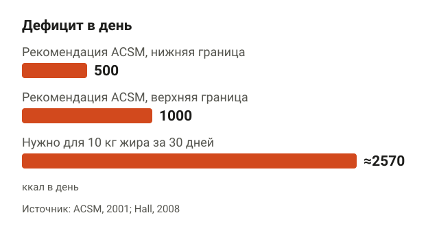
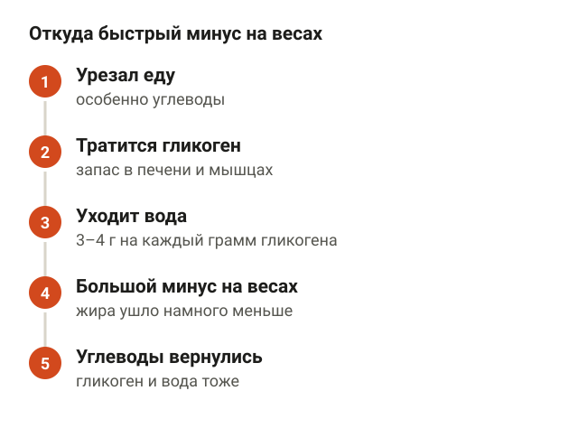
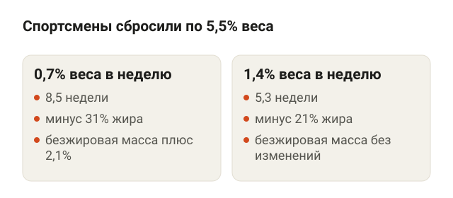
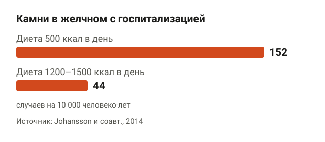
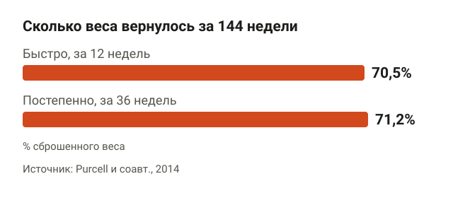
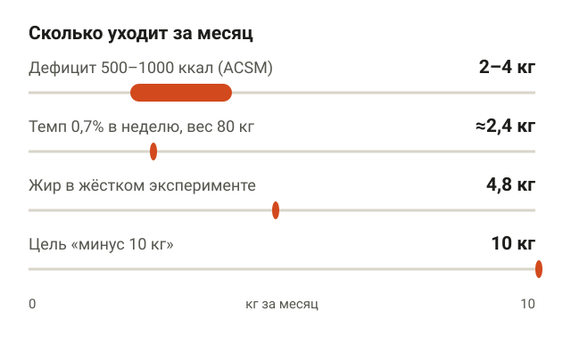
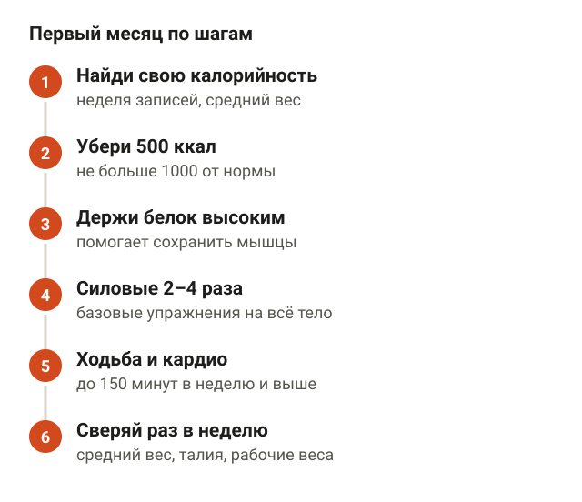
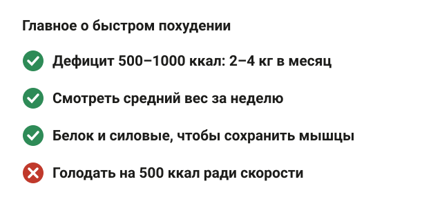

---
{
  "title": "Как похудеть на 10 кг за месяц: реально ли и сколько можно",
  "seo_title": "Как похудеть на 10 кг за месяц: сколько реально и без вреда",
  "description": "Реально ли похудеть на 10 кг за месяц: считаем дефицит калорий, разбираем воду, мышцы и риски голодных диет. Сколько можно сбросить без вреда и план.",
  "slug": "kak-pohudet-na-10-kg-za-mesyac",
  "date": "2026-11-04",
  "category": "pohudenie",
  "keyword": "как похудеть на 10 кг за месяц",
  "tags": [
    "похудение",
    "дефицит калорий",
    "быстрое похудение",
    "питание",
    "силовые тренировки"
  ],
  "faq": [
    {
      "q": "Можно ли похудеть на 10 кг за месяц?",
      "a": "За счёт жира почти нет: нужен дефицит около 2570 ккал каждый день. Цифра на весах бывает, но большая часть — вода из запасов гликогена, которая вернётся."
    },
    {
      "q": "Сколько кг можно сбросить за месяц без вреда?",
      "a": "Примерно 2–4 кг при дефиците 500–1000 ккал в день, который рекомендует ACSM. Человеку с большим лишним весом может уходить больше, но голодать ради скорости не стоит."
    },
    {
      "q": "Почему в первую неделю вес уходит быстро, а потом встаёт?",
      "a": "Сначала организм тратит гликоген, а каждый его грамм хранится с 3–4 граммами воды. Вода уходит быстро, жир медленнее, поэтому дальше темп снижается."
    },
    {
      "q": "Вернётся ли вес, если похудеть быстро?",
      "a": "В рандомизированном исследовании быстрая и постепенная группы через 144 недели вернули одинаково, около 70% сброшенного. Удержание зависит от того, что ты делаешь после диеты."
    },
    {
      "q": "Опасна ли диета 500 ккал в день?",
      "a": "В шведском исследовании на такой диете камни в желчном, из-за которых попадали в больницу, случались в 3,4 раза чаще, чем на 1200–1500 ккал. При болезнях желчного пузыря и диабете такую диету обсуждают с врачом."
    }
  ],
  "sources": [
    {
      "title": "Hall K. D. What is the required energy deficit per unit weight loss? (International Journal of Obesity, 2008)",
      "url": "https://doi.org/10.1038/sj.ijo.0803720"
    },
    {
      "title": "American College of Sports Medicine Position Stand. Appropriate intervention strategies for weight loss and prevention of weight regain for adults (MSSE, 2001)",
      "url": "https://pubmed.ncbi.nlm.nih.gov/11740312/"
    },
    {
      "title": "Donnelly J. E. и соавт. ACSM Position Stand. Appropriate physical activity intervention strategies for weight loss and prevention of weight regain for adults (MSSE, 2009)",
      "url": "https://doi.org/10.1249/MSS.0b013e3181949333"
    },
    {
      "title": "Kreitzman S. N. и соавт. Glycogen storage: illusions of easy weight loss, excessive weight regain, and distortions in estimates of body composition (AJCN, 1992)",
      "url": "https://doi.org/10.1093/ajcn/56.1.292S"
    },
    {
      "title": "Ashtary-Larky D. и соавт. Effects of gradual weight loss v. rapid weight loss on body composition and RMR: a systematic review and meta-analysis (British Journal of Nutrition, 2020)",
      "url": "https://doi.org/10.1017/S000711452000224X"
    },
    {
      "title": "Garthe I. и соавт. Effect of two different weight-loss rates on body composition and strength and power-related performance in elite athletes (IJSNEM, 2011)",
      "url": "https://doi.org/10.1123/ijsnem.21.2.97"
    },
    {
      "title": "Johansson K. и соавт. Risk of symptomatic gallstones and cholecystectomy after a very-low-calorie diet or low-calorie diet in a commercial weight loss program (International Journal of Obesity, 2014)",
      "url": "https://doi.org/10.1038/ijo.2013.83"
    },
    {
      "title": "Everhart J. E. Contributions of obesity and weight loss to gallstone disease (Annals of Internal Medicine, 1993)",
      "url": "https://doi.org/10.7326/0003-4819-119-10-199311150-00010"
    },
    {
      "title": "Festi D. и соавт. Gallbladder motility and gallstone formation in obese patients following very low calorie diets (International Journal of Obesity, 1998)",
      "url": "https://doi.org/10.1038/sj.ijo.0800634"
    },
    {
      "title": "Purcell K. и соавт. The effect of rate of weight loss on long-term weight management: a randomised controlled trial (Lancet Diabetes & Endocrinology, 2014)",
      "url": "https://doi.org/10.1016/S2213-8587(14)70200-1"
    },
    {
      "title": "Longland T. M. и соавт. Higher compared with lower dietary protein during an energy deficit combined with intense exercise promotes greater lean mass gain and fat mass loss: a randomized trial (AJCN, 2016)",
      "url": "https://doi.org/10.3945/ajcn.115.119339"
    }
  ]
}
---
Похудеть на 10 кг за месяц за счёт жира почти невозможно: для этого нужен дефицит около 2570 ккал каждый день, а рекомендация ACSM — 500–1000 ккал. Такой дефицит даёт примерно 2–4 кг жира за месяц. Цифра «минус 10 кг» на весах бывает, но в ней много воды, а резкие диеты чаще отнимают мышцы и в разы повышают риск желчных камней. Ниже считаю, сколько реально, почему первые килограммы обманывают и как построить первый месяц.

## Можно ли похудеть на 10 кг за месяц: считаем калории

<figure class="step"><figcaption>Для минус 10 кг жира за месяц нужен дефицит в 2,5–5 раз больше рекомендованного.</figcaption></figure>

Для расчётов используют старое правило: чтобы ушёл 1 кг веса, нужен суммарный дефицит около 7700 ккал. Кевин Холл, исследователь обмена веществ из Национальных институтов здоровья США, разобрал это правило в 2008 году. Оно примерно верно для людей с большим запасом жира, больше 30 кг. У худых часть сброшенного веса составляют мышцы, а в них меньше энергии, поэтому вес уходит «дешевле», но и мышц теряется больше.

Считаем для 10 кг:

- 10 кг × 7700 ккал = 77 000 ккал;
- 77 000 ккал за 30 дней — это примерно 2570 ккал дефицита каждый день.

Для сравнения, Американский колледж спортивной медицины (ACSM) в позиции по снижению веса рекомендует дефицит 500–1000 ккал в день за счёт питания. За 30 дней это 15 000–30 000 ккал, то есть примерно 2–4 кг. Нужный для 10 кг дефицит в 2,5–5 раз больше рекомендованного.

| Дефицит в день | За 30 дней | Примерно жира |
|---|---|---|
| 500 ккал | 15 000 ккал | 2 кг |
| 1000 ккал | 30 000 ккал | 4 кг |
| 2570 ккал | 77 000 ккал | 10 кг |

Важная оговорка: это арифметика, а не прогноз. При похудении снижается обмен веществ в покое, об этом ниже, поэтому реальный вес обычно идёт медленнее расчётного.

## Почему первые килограммы уходят быстро

<figure class="step"><figcaption>Первые килограммы во многом вода из запасов гликогена, и она возвращается вместе с углеводами.</figcaption></figure>

Первая неделя диеты часто радует: весы показывают заметный минус, и кажется, что 10 кг за месяц — вопрос дисциплины. Причина в гликогене. Это запас углеводов в печени и мышцах. Каждый грамм гликогена хранится вместе с 3–4 граммами воды, это описано в работе 1992 года в American Journal of Clinical Nutrition.

Когда ты резко урезаешь еду, особенно углеводы, организм сначала тратит гликоген. Уходит он вместе с водой, и весы показывают большую цифру. Жира за эти дни ушло намного меньше.

Обратная сторона: как только углеводы возвращаются в рацион, гликоген и вода тоже возвращаются. Те же авторы пишут про «преувеличенный набор веса», если после диеты налечь на углеводы. Человек видит плюс 2 кг за выходные и решает, что всё пропало, хотя жир не вернулся.

Как не обмануться:

1. Взвешивайся утром натощак 3–4 раза в неделю.
2. Смотри на среднее за неделю, а не на отдельный день.
3. Раз в неделю измеряй талию на уровне пупка.
4. Первую неделю не считай показательной: в ней больше всего воды.

## Быстро или медленно: что уходит вместе с весом

<figure class="step"><figcaption>При том же сброшенном весе медленная группа потеряла больше жира и прибавила безжировую массу.</figcaption></figure>

Вес на весах — это жир, мышцы, вода и содержимое кишечника. Цель — сбросить жир, а мышцы оставить. Темп здесь влияет.

Мета-анализ 2020 года в British Journal of Nutrition сравнил быстрое и постепенное похудение при одинаковом итоговом весе. Разница в сброшенных килограммах была 0,03 кг, то есть никакой. Но при постепенном похудении:

- жира уходило на 1 кг больше;
- процент жира снижался сильнее, на 0,83%;
- обмен веществ в покое падал меньше: разница 407 кДж, это около 97 ккал в день.

По безжировой массе, то есть мышцам, костям и воде, значимой разницы в мета-анализе не нашли.

Есть и исследование с силовыми тренировками. В норвежской работе 2011 года 24 спортсмена худели с разной скоростью: 0,7% веса в неделю или 1,4% в неделю. Все тренировались с весами 4 раза в неделю. Обе группы сбросили примерно одинаково, около 5,5% веса, но медленная группа потратила на это 8,5 недели, а быстрая — 5,3. Итог по мышцам разный: у медленной группы безжировая масса выросла на 2,1%, у быстрой не изменилась. Жира медленная группа потеряла 31%, быстрая — 21%.

Для человека весом 80 кг темп 0,7% в неделю — это около 0,56 кг в неделю, или примерно 2,4 кг за месяц. Темп 1,4% — около 4,8 кг за месяц. Оговорка: это спортсмены, и людей в исследовании мало. Но направление совпадает с мета-анализом.

## Как похудеть быстро и без вреда здоровью: где граница

<figure class="step"><figcaption>На диете 500 ккал в день риск камней в желчном был в 3,4 раза выше.</figcaption></figure>

Голодные диеты меньше 800 ккал в день называют очень низкокалорийными. Их главный известный риск — камни в желчном пузыре. Обзор 1993 года в Annals of Internal Medicine: у 10–25% людей с ожирением камни появляются в первые месяцы такой диеты, примерно у трети из них с симптомами. Сильнее всего риск у тех, кто худеет быстрее. Одна из причин — на голодной диете желчный пузырь хуже опорожняется, это показали на УЗИ в итальянском исследовании 1998 года.

Шведское исследование 2014 года сравнило 3320 человек на диете 500 ккал в день и 3320 человек на диете 1200–1500 ккал в день. Первые 3 месяца худели, следующие 9 удерживали вес. Результаты за год:

- **вес:** минус 11,1 кг на голодной диете и минус 8,1 кг на умеренной;
- **камни в желчном, из-за которых попали в больницу:** 152 и 44 случая на 10 000 человеко-лет, то есть риск выше в 3,4 раза;
- **операция по удалению желчного пузыря** понадобилась в 61% таких случаев.

Абсолютный риск небольшой: один лишний случай на 92 человека на голодной диете. Но обрати внимание на вес. Даже на 500 ккал в день за целый год люди сбросили в среднем 11,1 кг, а не 10 кг за месяц.

Без вреда здоровью — значит без голодания. Если у тебя есть болезни желчного пузыря, сахарный диабет или ты принимаешь лекарства, жёсткую диету обсуждай с врачом, а не с подругой в раздевалке.

## Вернётся ли вес, если худеть быстро

<figure class="step"><figcaption>Быстрая и постепенная группы вернули одинаково, около 70% сброшенного.</figcaption></figure>

Частый аргумент против быстрого похудения: «всё вернётся». Данные здесь интереснее.

Австралийское рандомизированное исследование 2014 года в Lancet Diabetes & Endocrinology взяло 200 человек с ожирением. Цель у всех — минус 15% веса. Одна группа худела быстро, за 12 недель, другая постепенно, за 36 недель. Результаты:

- минус 12,5% и больше смогли сбросить 81% в быстрой группе и 50% в постепенной;
- через 144 недели удержания вернули большую часть веса обе группы: 70,5% и 71,2% сброшенного.

То есть скорость похудения не повлияла на то, сколько вернулось. Вернулось много в обеих группах. Проблема не в темпе, а в том, что после диеты человек возвращается к прежней жизни. В быстрой группе один участник попал на операцию из-за воспаления желчного пузыря, это к предыдущему разделу.

Позиция ACSM 2009 года добавляет: по наблюдательным данным, вес после похудения лучше удерживают те, кто двигается больше 250 минут в неделю. Рандомизированных исследований на это нет. Поэтому месяц на диете — это начало, а не весь план.

## Сколько можно похудеть за месяц без вреда

<figure class="step"><figcaption>Реальный ориентир — 2–4 кг в месяц, а 10 кг выходят примерно за 3–5 месяцев.</figcaption></figure>

Если собрать цифры вместе:

- **2–4 кг** — дефицит 500–1000 ккал в день по рекомендации ACSM;
- **около 2,4 кг** — темп 0,7% в неделю для человека 80 кг, при котором спортсмены сохранили и нарастили мышцы;
- **около 5 кг жира** — потолок в исследовании, где для этого очень постарались.

Про последний пункт подробнее. В канадском исследовании 2016 года 40 молодых мужчин 4 недели сидели на дефиците около 40% и тренировались 6 раз в неделю: силовые плюс интервалы. Группа, которая ела 2,4 г белка на кг веса, потеряла 4,8 кг жира и прибавила 1,2 кг безжировой массы. Группа с 1,2 г/кг потеряла 3,5 кг жира, а безжировая масса почти не изменилась. Это молодые мужчины, еду им выдавали готовой. Обычной жизни с работой и детьми это не очень похоже.

Так что «как похудеть на 5 кг за месяц» — уже амбициозная, но реальная цель для человека с лишним весом. «Минус 10 кг» реальны примерно за 3–5 месяцев.

Ради чего всё это: позиция ACSM пишет, что риски для здоровья снижаются уже при потере 3–5% веса. Для человека весом 90 кг это 2,7–4,5 кг, примерно один-два месяца нормального темпа.

## План на первый месяц: питание и тренировки

<figure class="step"><figcaption>Умеренный дефицит, белок и силовые: вес уходит в основном за счёт жира.</figcaption></figure>

1. **Найди свою калорийность.** Неделю ешь как обычно и записывай всё в счётчик калорий. Если средний вес стоит, это твоя норма поддержания.
2. **Убери 500 ккал**, а если вес не двигается 2 недели, ещё немного, но не больше 1000 ккал от нормы.
3. **Держи белок высоким.** В исследовании с жёстким дефицитом 2,4 г на кг веса помогли сохранить мышцы лучше, чем 1,2 г. При болезнях почек норму белка обсуждай с врачом.
4. **Делай силовые 2–4 раза в неделю.** По позиции ACSM силовые сами по себе вес не ускоряют, но помогают сохранить мышцы и терять больше жира. Начни с базовых упражнений на всё тело.
5. **Добавляй ходьбу и кардио** постепенно до 150 минут в неделю и выше. В «Континенте» для этого есть кардио-зона, но быстрая ходьба по улице работает так же.
6. **Сверяй цифры раз в неделю:** средний вес, талия, рабочие веса в зале. Если сила падает тренировку за тренировкой, дефицит слишком жёсткий.

Как собрать программу в зале для новичка, разбирал в статье [с чего начать похудение в тренажёрном зале](/stati/s-chego-nachat-pohudenie-v-zale/). Если цель именно живот, читай [как убрать живот](/stati/kak-ubrat-zhivot/): там про то, почему пресс не сжигает жир на животе. Женщинам после 40 пригодится отдельная статья [как похудеть после 40 лет](/stati/kak-pohudet-posle-40-zhenshchine/).

## Шпаргалка

<figure class="step"><figcaption>Минус 10 кг реальны, но примерно за 3–5 месяцев, а не за один.</figcaption></figure>

- 10 кг жира за 30 дней — это дефицит около 2570 ккал каждый день, в 2,5–5 раз больше рекомендованного.
- Дефицит 500–1000 ккал в день по ACSM даёт примерно 2–4 кг за месяц.
- Первые килограммы — во многом вода из запасов гликогена. Смотри на среднее за неделю.
- Медленное похудение при том же итоговом весе сохраняет больше мышц и обмена веществ.
- Голодная диета 500 ккал в день повысила риск камней в желчном в 3,4 раза.
- Быстро или медленно — вес возвращается одинаково часто. Удерживают его движение и привычки.
- Реальный план: умеренный дефицит, много белка, силовые 2–4 раза в неделю, 150+ минут активности.
