---
{
  "title": "Как похудеть после 40 лет женщине: план тренировок и питания",
  "seo_title": "Как похудеть после 40 лет женщине: тренировки и питание",
  "description": "Что меняется в теле после 40, сколько белка и калорий нужно, как тренироваться в зале и что реально работает с животом. Только данные исследований.",
  "slug": "kak-pohudet-posle-40-zhenshchine",
  "date": "2026-11-02",
  "category": "pohudenie",
  "keyword": "как похудеть после 40 лет женщине",
  "tags": [
    "похудение после 40",
    "женщины",
    "силовые тренировки",
    "белок",
    "менопауза",
    "программа тренировок"
  ],
  "faq": [
    {
      "q": "Сколько раз в неделю заниматься силовыми женщине после 40?",
      "a": "В исследовании на женщинах 50+ процент жира снижался и при 2, и при 3 тренировках в неделю: на 1,7% и 2,7%. Начни с двух занятий, а когда втянешься, добавь третье."
    },
    {
      "q": "Можно ли убрать живот только упражнениями на пресс?",
      "a": "Подтверждения точечного сжигания жира в зоне живота в исследованиях нет. Живот уменьшается вместе с общим жиром: дефицит калорий, силовые и кардио."
    },
    {
      "q": "Сколько белка нужно женщине после 40?",
      "a": "ESPEN рекомендует здоровым пожилым не меньше 1,0–1,2 г белка на кг массы тела, ISSN для тренирующихся — 1,4–2,0 г/кг. При болезнях почек норму обсуждай с врачом."
    },
    {
      "q": "Почему после 45 вес стоит, хотя ем меньше?",
      "a": "Исследования фиксируют потерю мышц и перераспределение жира с возрастом, но единой причины для всех женщин пока нет. Сначала проверь, сколько реально ешь и двигаешься, и следи за талией, а не только за весами."
    },
    {
      "q": "Помогает ли гормональная терапия похудеть после 45?",
      "a": "Есть данные, что терапия эстрогенами может частично сдерживать изменения состава тела при менопаузе, но кому она поможет, пока неясно. Это решение принимает врач, а не часть плана похудения."
    }
  ],
  "sources": [
    {
      "title": "ACSM Position Stand: Appropriate intervention strategies for weight loss and prevention of weight regain for adults",
      "url": "https://pubmed.ncbi.nlm.nih.gov/11740312/"
    },
    {
      "title": "ACSM Consensus: Physical Activity and Excess Body Weight and Adiposity for Adults",
      "url": "https://pubmed.ncbi.nlm.nih.gov/39277776/"
    },
    {
      "title": "Systematic review and meta-analysis: resistance exercise during dietary weight loss",
      "url": "https://pmc.ncbi.nlm.nih.gov/articles/PMC12406911/"
    },
    {
      "title": "Systematic review and meta-analysis: resistance training in women across the lifespan (J Sci Med Sport)",
      "url": "https://www.jsams.org/article/S1440-2440(26)00096-4/abstract"
    },
    {
      "title": "Meta-analysis: exercise training and body composition in postmenopausal women (Front Endocrinol)",
      "url": "https://www.frontiersin.org/journals/endocrinology/articles/10.3389/fendo.2023.1183765/full"
    },
    {
      "title": "Lahav et al., Resistance training for high-quality weight loss (Front Endocrinol, 2026)",
      "url": "https://www.frontiersin.org/journals/endocrinology/articles/10.3389/fendo.2025.1725500/full"
    },
    {
      "title": "Scoping review: Resistance training and weight loss in older adults",
      "url": "https://pmc.ncbi.nlm.nih.gov/articles/PMC10393929/"
    },
    {
      "title": "20-week RCT: Resistance training in middle-aged women depending on menopause",
      "url": "https://www.ncbi.nlm.nih.gov/pmc/articles/PMC10559623/"
    },
    {
      "title": "Meta-analysis: Influence of resistance exercise on lean body mass in aging adults",
      "url": "https://pmc.ncbi.nlm.nih.gov/articles/PMC2995836"
    },
    {
      "title": "Meta-analysis: resistance training in older females with sarcopenic obesity",
      "url": "https://www.ncbi.nlm.nih.gov/pmc/articles/PMC12075210/"
    },
    {
      "title": "Home-based RT during weight loss, randomised pilot trial",
      "url": "https://pmc.ncbi.nlm.nih.gov/articles/PMC12323239/"
    },
    {
      "title": "Meta-analysis: Fat mass changes during menopause (AJOG)",
      "url": "https://www.ajog.org/article/S0002-9378(19)30588-5/abstract"
    },
    {
      "title": "Review: Understanding weight gain at menopause (Climacteric, 2012)",
      "url": "https://pubmed.ncbi.nlm.nih.gov/22978257/"
    },
    {
      "title": "Systematic review: Lifestyle interventions during the menopause transition",
      "url": "https://www.ncbi.nlm.nih.gov/pmc/articles/PMC4058255/"
    },
    {
      "title": "Descriptive review: visceral fat in postmenopausal women (Clin Exp Obstet Gynecol)",
      "url": "https://www.imrpress.com/journal/CEOG/52/2/10.31083/CEOG26194"
    },
    {
      "title": "Survey: Weight loss resistance across menopause (preliminary)",
      "url": "https://www.ncbi.nlm.nih.gov/pmc/articles/PMC12445185/"
    },
    {
      "title": "ISSN Position Stand: Protein and exercise (2007)",
      "url": "https://pmc.ncbi.nlm.nih.gov/articles/PMC2117006/"
    },
    {
      "title": "ESPEN expert group: Protein intake and exercise for muscle function with aging",
      "url": "https://www.espen.org/files/PIIS0261561414001113.pdf"
    },
    {
      "title": "RCT: Pre-sleep vs post-exercise protein in older adults (2025)",
      "url": "https://www.ncbi.nlm.nih.gov/pmc/articles/PMC12897527/"
    },
    {
      "title": "Meta-analysis: creatine in older adults",
      "url": "https://www.ncbi.nlm.nih.gov/pmc/articles/PMC8229907/"
    }
  ]
}
---
Чтобы похудеть после 40 лет женщине, нужны три вещи вместе: умеренный дефицит калорий, силовые тренировки 2–3 раза в неделю и достаточно белка. Дефицит снижает вес. Силовые помогают сохранить мышцы, чтобы уходил в основном жир. Белок даёт мышцам материал. Обещания «быстро» и «убрать только живот» исследования не подтверждают, а вот похудеть без потери мышц — вполне реально.

Ниже разберём, что меняется в теле после 40, сколько есть белка, как собрать программу в зале и что делать с животом.

## Что меняется в теле женщины после 40

<figure class="step">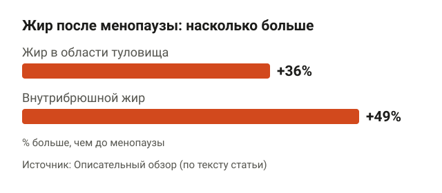<figcaption>После менопаузы жир чаще откладывается в центре тела, особенно вокруг органов.</figcaption></figure>

Менопауза — период, когда прекращаются месячные. Её часто винят во всём, но данные осторожнее.

Мета-анализ по изменениям жировой массы показал: жир с годами прибавляется в основном из-за возраста, а сама менопауза значимо к этому не добавляет. Зато меняется распределение: на ногах жира становится меньше, в центре тела — больше.

Нарративный обзор 2012 года пишет похоже: набор веса менопаузой не объясняется, но гормональные изменения связаны с ростом общего жира и жира на животе. В описательном обзоре приводят цифры: у женщин после менопаузы на 36% больше жира в области туловища и на 49% больше внутрибрюшного жира. Внутрибрюшной, или висцеральный, жир лежит вокруг органов, а не под кожей. Описательный обзор — слабый тип доказательств, но направление совпадает с мета-анализом.

То есть ощущение «раньше худела в ногах, теперь всё на животе» не выдумка. Но механизм похудения остался тем же, что и в 25: тратить больше, чем получаешь с едой.

### Почему после 45 вес стоит на месте

Опрос 2025 года: от 67% до 80% женщин, которые тренируются с отягощениями, говорят, что худеть стало труднее. Цифра зависит от стадии менопаузы. Это самооценка, а не измерения, и авторы сами пишут, что нужны дополнительные исследования.

Систематический обзор добавляет: исследований именно на женщинах в переходный период менопаузы мало. Честный вывод такой: единой причины, почему «диета перестала работать», для всех женщин пока нет. На практике, если вес стоит, сначала проверь цифры: сколько реально ешь и сколько двигаешься.

## Питание: дефицит калорий и белок

<figure class="step">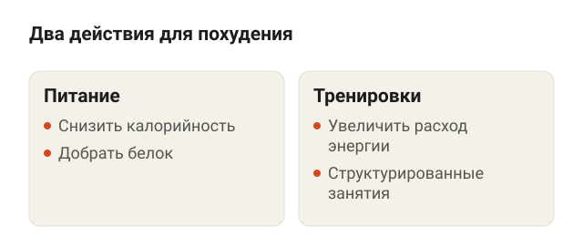<figcaption>ACSM советует сочетать оба действия, а не выбирать одно.</figcaption></figure>

Американская коллегия спортивной медицины (ACSM) рекомендует для похудения сочетать два действия: снизить калорийность рациона и увеличить расход энергии через структурированные тренировки. Не что-то одно, а оба.

### Какой дефицит калорий нужен после 40

<figure class="step">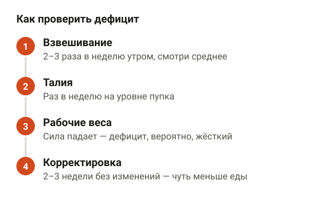<figcaption>Ориентируйся на средние цифры за неделю, талию и силу в зале.</figcaption></figure>

Дефицит — это когда ешь меньше, чем тратишь. Данных о безопасном темпе похудения именно для женщин 40+ в обзорах, на которые я опираюсь, нет. Поэтому цифру с потолка называть не буду.

Практические ориентиры умеренного дефицита:

1. Взвешивайся 2–3 раза в неделю утром и смотри среднее за неделю, а не скачки за день.
2. Раз в неделю измеряй талию на уровне пупка.
3. Следи за рабочими весами в зале. Если сила падает тренировку за тренировкой, дефицит, скорее всего, слишком жёсткий.
4. Если 2–3 недели подряд не меняется ни вес, ни талия, убирай немного еды или добавляй движения.

### Сколько белка есть

<figure class="step">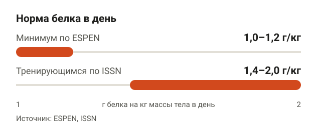<figcaption>При болезнях почек норму белка обсуждай с врачом.</figcaption></figure>

Две экспертные позиции дают такие диапазоны:

- **ESPEN** (Европейское общество клинического питания): здоровым пожилым людям — не меньше 1,0–1,2 г белка на кг массы тела в день.
- **ISSN** (Международное общество спортивного питания): тем, кто тренируется, — примерно 1,4–2,0 г/кг в день.

Допустим, ты весишь 70 кг. Тогда минимум по ESPEN — 70–84 г белка в день, а диапазон для тренирующихся по ISSN — 98–140 г. Если есть болезни почек или другие ограничения, норму белка обсуждай с врачом.

Про время приёма: в рандомизированном исследовании 2025 года у пожилых людей тренировки и дневная норма белка оказались важнее, чем то, когда именно его съесть. Так что «белковое окно» после тренировки можно не караулить с шейкером наперевес.

### Нужен ли креатин

<figure class="step">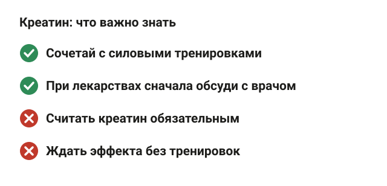<figcaption>Креатин — дополнение к силовым, а не обязательная часть плана.</figcaption></figure>

Мета-анализ на пожилых людях: креатин вместе с силовыми тренировками прибавлял около 1,2 кг мышечной массы. Отдельных данных для женщин 40–50 лет нет. Это не обязательная часть плана. Если принимаешь лекарства или есть хронические болезни, сначала обсуди с врачом.

## Как похудеть быстро и без вреда здоровью после 40

<figure class="step">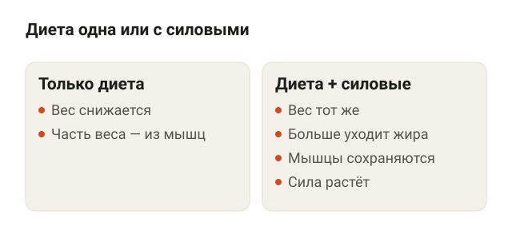<figcaption>Вес уходит одинаково, но с силовыми больше уходит жира и сохраняются мышцы.</figcaption></figure>

Данных о том, с какой скоростью безопасно худеть женщине после 40, в найденных обзорах нет. Зато хорошо изучено, что делает похудение «качественным», то есть за счёт жира, а не мышц.

- Мета-анализ: когда к диете добавляли силовые, итоговый вес не менялся, но жира уходило больше, безжировая масса сохранялась лучше, а сила росла. Безжировая масса — всё, кроме жира: мышцы, кости, вода. Авторы оценивают доказательства как высокие для потери жира и умеренные для сохранения безжировой массы.
- У пожилых людей с ожирением силовые во время похудения уменьшали потерю мышц: разница 0,8 кг. Доверительный интервал — 0,4–1,3 кг, то есть реальный эффект с высокой вероятностью лежит в этих границах.
- Мета-анализ по женщинам с саркопеническим ожирением показал, что силовые тренировки улучшают физическую функцию. Саркопения — возрастная потеря мышц и силы. Физическая функция — это, по сути, как легко встать со стула, подняться по лестнице, донести пакеты.

Соответственно, «без вреда» после 40 означает в первую очередь «без потери мышц». Худеть на одной диете можно, но часть веса уйдёт из мышц, которые с возрастом и так восстанавливать сложнее.

## Силовые или кардио: что работает лучше

<figure class="step">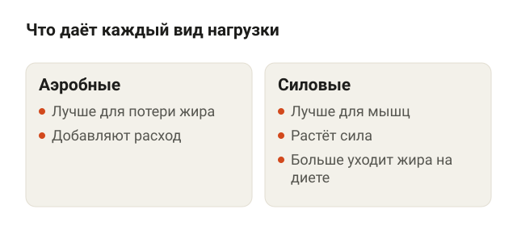<figcaption>На весы вид нагрузки влияет мало, а на состав тела — заметно.</figcaption></figure>

Исследования отвечают на этот вопрос по-разному в зависимости от того, что измеряют: вес, жир или мышцы.

| Что сравнивали | Результат |
|---|---|
| 101 исследование, 5 697 женщин после менопаузы | Аэробные нагрузки лучше для потери жира, силовые — для набора мышц |
| Диета с силовыми и без них | Вес одинаковый, но с силовыми больше уходит жира и сохраняются мышцы |
| Без упражнений, аэробика, силовые (обзор 2026) | Вес снижался одинаково во всех группах |
| Силовые у женщин разного возраста | Меньше жира, больше мышц и силы |

Вывод: на весы вид нагрузки влияет мало, там решает дефицит. На состав тела влияет: силовые держат мышцы, аэробные добавляют расход и помогают снижать жир. Поэтому нужны оба вида.

### Сколько кардио нужно в неделю

<figure class="step">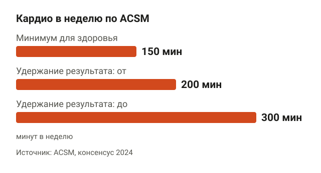<figcaption>Умеренная нагрузка — когда говорить можешь, а петь уже нет.</figcaption></figure>

ACSM считает минимумом для здоровья 150 минут умеренной нагрузки в неделю. Для удержания результата выгоднее постепенно выйти на 200–300 минут. Консенсус ACSM 2024 года уточняет: эффект для похудения появляется при постепенном доведении активности минимум до 150 минут, и чем больше, тем больше польза.

Умеренная нагрузка — когда можешь говорить, но петь уже не получится. 150 минут — это, например, 5 раз по 30 минут быстрой ходьбы. Ходьба до зала тоже считается.

## Программа тренировок в тренажёрном зале для женщин после 40

<figure class="step">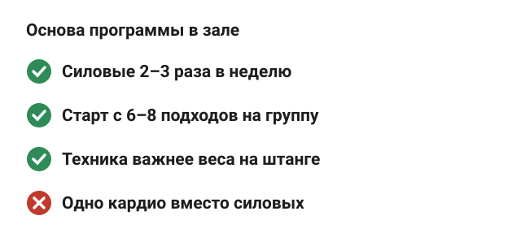<figcaption>Программу собирают из простых базовых упражнений и постепенного роста нагрузки.</figcaption></figure>

Если ты только начинаешь, сначала прочитай, [с чего начать похудение в тренажёрном зале](/stati/s-chego-nachat-pohudenie-v-zale/). Здесь — цифры и упражнения.

### Сколько раз в неделю и сколько подходов

<figure class="step">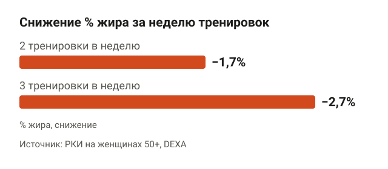<figcaption>И две, и три силовые тренировки в неделю снизили процент жира у женщин 50+.</figcaption></figure>

В рандомизированном исследовании на женщинах 50+ процент жира измеряли методом DEXA. Это сканирование, которое отдельно считает жир, мышцы и кости. И 2, и 3 силовые тренировки в неделю снизили процент жира: на 1,7% и 2,7% соответственно.

По объёму: в 20-недельном исследовании авторы предполагают, что для роста мышц после менопаузы, вероятно, нужно больше 6–8 подходов на мышечную группу в неделю. Участниц было 31, так что это скорее гипотеза. Старый мета-анализ по пожилым людям тоже показывает, что программы с большим объёмом давали больше мышечной массы. Подробнее про объём — в статье [сколько подходов делать для роста мышц](/stati/skolko-podhodov-dlya-rosta-myshc/).

Практически: начни с 2 тренировок в неделю и 6–8 подходов на группу. Когда втянешься, добавляй подходы или третью тренировку.

### Упражнения и техника

<figure class="step">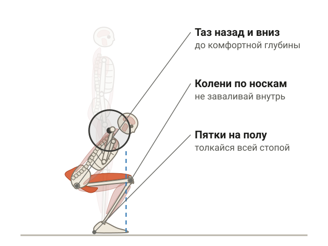<figcaption>В гоблет-приседе таз уходит назад и вниз, пятки остаются на полу.</figcaption></figure>

**Гоблет-присед.** Встань, стопы чуть шире плеч, носки слегка развёрнуты. Держи гантель вертикально у груди, локти смотрят вниз. Садись вниз, отводя таз назад и вниз, до комфортной глубины, затем вставай, толкаясь всей стопой. Пятки не отрываются от пола, колени идут по линии носков.

<figure class="step move">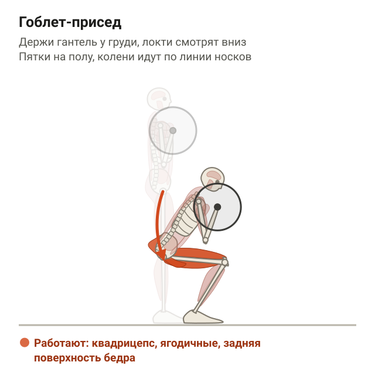</figure>

**Румынская тяга с гантелями.** Встань прямо, гантели перед бёдрами, колени слегка согнуты. Отводи таз назад, гантели скользят вдоль ног примерно до середины голени. Возвращайся вверх, двигая таз вперёд. Поясница не округляется, гантели держатся близко к ногам.

<figure class="step move">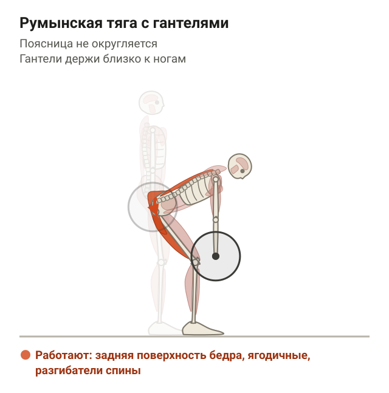</figure>

**Ягодичный мост со штангой.** Сядь на пол, лопатки упираются в край скамьи, штанга с мягкой подкладкой лежит на тазе, стопы на полу. Поднимай таз, пока тело от коленей до плеч не выстроится в линию, задержись на секунду и опускайся. Подбородок слегка прижат, рёбра не задираются, поясница вверху не прогибается.

**Тяга верхнего блока к груди.** Сядь в тренажёр, бёдра зафиксированы валиками, возьмись за рукоять хватом чуть шире плеч. Тяни рукоять к верху груди, опуская лопатки вниз. Корпус почти вертикальный, с небольшим наклоном назад, без раскачки.

**Жим гантелей лёжа.** Ляг на горизонтальную скамью, стопы на полу, гантели над грудью. Опускай гантели к груди, локти под углом около 45° к корпусу, затем выжимай вверх. Лопатки сведены, плечи не тянутся к ушам.

**Тяга гантели одной рукой в наклоне.** Поставь колено и ладонь одной стороны на скамью, спина ровная, в свободной руке гантель. Тяни гантель к поясу, локоть идёт вдоль корпуса. Корпус не разворачивается, поясница не провисает.

### Пример недели

<figure class="step">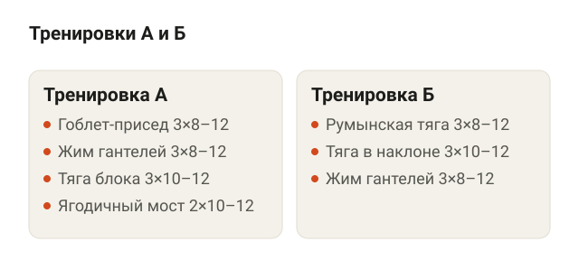<figcaption>Чередуй А и Б, вес подбирай так, чтобы последние 1–3 повтора шли тяжело.</figcaption></figure>

Чередуй тренировки А и Б. При 2 тренировках в неделю выходит 6–8 подходов на группу.

| Тренировка А | Подходы × повторы | Тренировка Б | Подходы × повторы |
|---|---|---|---|
| Гоблет-присед | 3 × 8–12 | Румынская тяга | 3 × 8–12 |
| Жим гантелей лёжа | 3 × 8–12 | Тяга гантели в наклоне | 3 × 10–12 |
| Тяга верхнего блока | 3 × 10–12 | Жим гантелей лёжа | 3 × 8–12 |
| Ягодичный мост | 2 × 10–12 | — | — |

Это пример, а не программа под конкретного человека. Вес подбирай так, чтобы последние 1–3 повтора давались тяжело, но техника не ломалась.

### Как прибавлять нагрузку

<figure class="step">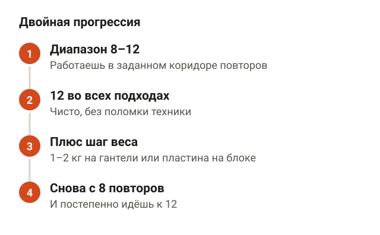<figcaption>Сначала растут повторы, потом вес.</figcaption></figure>

Самый простой способ — двойная прогрессия:

1. Работаешь в диапазоне, например 8–12 повторов.
2. Когда во всех подходах сделала 12 чисто, прибавляешь вес на шаг: 1–2 кг на гантели или следующая пластина на блоке.
3. С новым весом снова начинаешь с 8 повторов и идёшь к 12.

Если застреваешь на одном весе 3–4 тренировки подряд, проверь сон, еду и не слишком ли жёсткий дефицит.

## Как убрать живот женщине после 50

<figure class="step">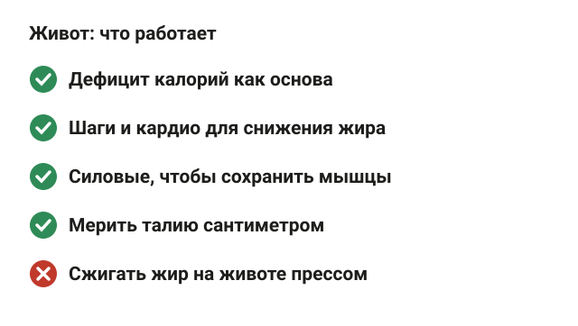<figcaption>Живот уходит вместе с общим жиром, точечно его не сжечь.</figcaption></figure>

В источниках, на которые я опираюсь, нет подтверждения, что жир можно сжечь точечно в зоне живота. Данные говорят о снижении общего жира и о том, что с возрастом жир смещается к центру тела.

Что это значит на практике:

- Живот уходит вместе с общим жиром. Дефицит калорий — основа.
- Аэробная нагрузка у женщин после менопаузы по мета-анализу лучше снижает жир. Шаги и кардио здесь помогают.
- Силовые сохраняют мышцы, чтобы худела не «в никуда», а за счёт жира.
- Упражнения на пресс укрепляют мышцы живота, но данных, что они сжигают жир именно там, нет. Пресс под жиром есть у всех, просто пока он работает в режиме инкогнито.
- Отслеживай талию сантиметром: она часто меняется раньше, чем заметно в зеркале.

Подробнее о том, что работает с животом, а что нет, — в статье [как убрать живот](/stati/kak-ubrat-zhivot/).

## Когда нужен врач, а не тренер

<figure class="step">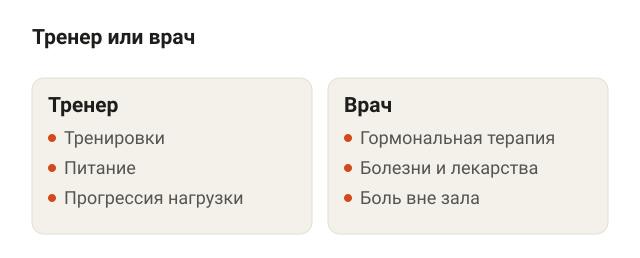<figcaption>Гормоны, болезни и боль вне зала — вопросы к врачу.</figcaption></figure>

Тренер помогает с тренировками и питанием. Но есть вопросы, которые решает только врач.

- **Гормональная терапия.** Обзор 2012 года говорит о сильных данных, что терапия эстрогенами может частично предотвращать изменения состава тела при менопаузе. Но кому именно она поможет, пока неясно. Я проходил семинар «Тренировка женщин по рекомендациям эндокринолога», и назначать или отменять гормоны всё равно не дело тренера.
- **Хронические болезни и лекарства.** Дефицит калорий и количество белка согласуй с лечащим врачом.
- **Боль.** Если сустав или спина болят и вне зала, это к врачу, а не к новой программе.

## Шпаргалка

<figure class="step">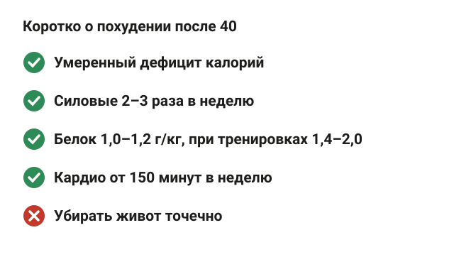<figcaption>Главное — дефицит, силовые и белок вместе.</figcaption></figure>

- Чтобы похудеть после 40 лет женщине, нужны умеренный дефицит калорий, силовые 2–3 раза в неделю и достаточно белка.
- Жир с возрастом смещается к животу, но механизм похудения тот же: тратить больше, чем ешь.
- Безопасного темпа «для 40+» исследования не дают. Ориентируйся на талию, средний вес за неделю и силу в зале.
- Белок: не меньше 1,0–1,2 г/кг, при тренировках — 1,4–2,0 г/кг. Время приёма менее значимо, чем дневная норма.
- Силовые на вес почти не влияют, но сохраняют мышцы и усиливают потерю жира.
- Кардио: минимум 150 минут умеренной нагрузки в неделю, для удержания результата — 200–300.
- Начинай с 6–8 подходов на мышечную группу в неделю и прибавляй вес по двойной прогрессии.
- Точечно убрать живот нельзя: он уходит вместе с общим жиром.
- Гормоны, болезни, боль вне зала — к врачу.
