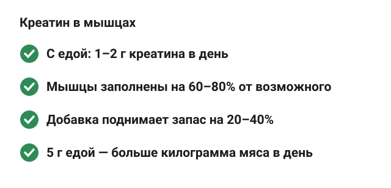
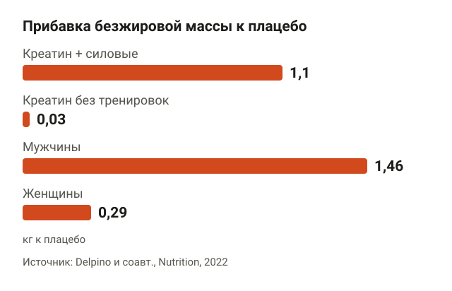
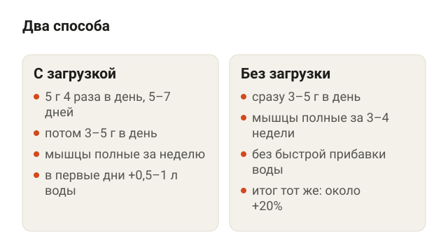
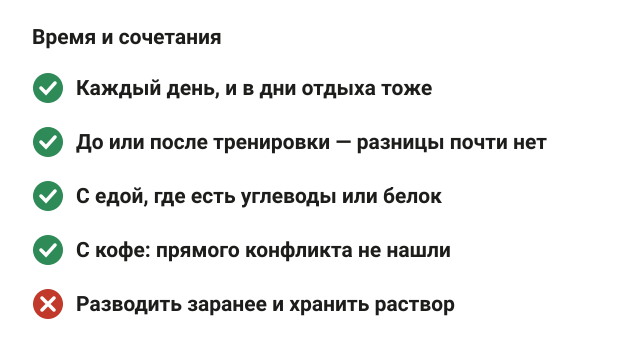
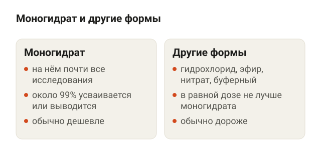
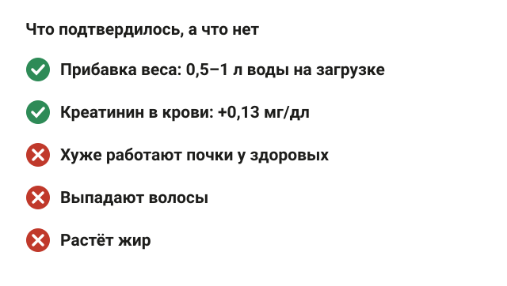
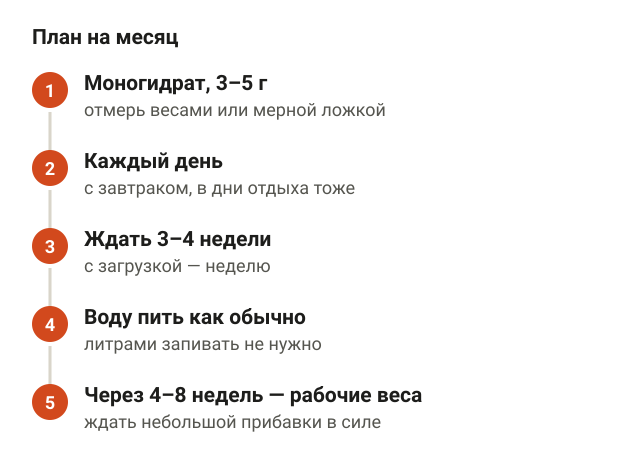
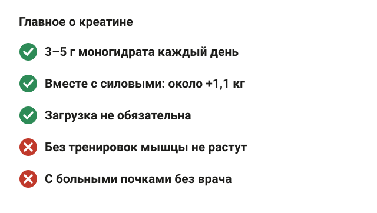

---
{
  "title": "Креатин: польза и как принимать моногидрат",
  "seo_title": "Креатин: польза и как принимать, нужна ли загрузка",
  "description": "Сколько креатин прибавляет к мышцам и силе, как принимать моногидрат с загрузкой и без, когда пить и что с водой, почками и волосами. По данным исследований.",
  "slug": "kreatin-polza-i-kak-prinimat",
  "date": "2026-11-07",
  "category": "pitanie",
  "keyword": "креатин польза и как принимать",
  "tags": [
    "креатин",
    "добавки",
    "набор массы",
    "сила",
    "спортивное питание"
  ],
  "faq": [
    {
      "q": "Сколько креатина пить в день?",
      "a": "3–5 г моногидрата в день, каждый день. Крупным спортсменам с тяжёлыми тренировками, по позиции Международного общества спортивного питания, может понадобиться 5–10 г."
    },
    {
      "q": "Нужна ли загрузка креатином?",
      "a": "Нет. 20 г в день 6 дней и 3 г в день 28 дней подняли запас креатина в мышцах одинаково, примерно на 20%. Загрузка только ускоряет насыщение и добавляет 0,5–1 л воды в первые дни."
    },
    {
      "q": "Когда пить креатин: до или после тренировки?",
      "a": "Разницы почти нет: в исследованиях приём до и после тренировки дал похожий прирост силы и мышц. Важнее пить его каждый день, включая дни отдыха."
    },
    {
      "q": "Вредит ли креатин почкам?",
      "a": "У здоровых людей мета-анализы не нашли изменений скорости фильтрации почек. Креатинин в анализе крови растёт, поэтому врачу стоит сказать, что пьёшь креатин. При болезнях почек — только после консультации нефролога."
    },
    {
      "q": "Будут ли расти мышцы от креатина без тренировок?",
      "a": "Нет. В мета-анализе 35 исследований без тренировок прибавка безжировой массы была 0,03 кг, с силовыми — 1,1 кг."
    }
  ],
  "sources": [
    {
      "title": "Kreider R. B. и соавт. International Society of Sports Nutrition position stand: safety and efficacy of creatine supplementation in exercise, sport, and medicine (J Int Soc Sports Nutr, 2017)",
      "url": "https://doi.org/10.1186/s12970-017-0173-z"
    },
    {
      "title": "Antonio J. и соавт. Common questions and misconceptions about creatine supplementation: what does the scientific evidence really show? (J Int Soc Sports Nutr, 2021)",
      "url": "https://doi.org/10.1186/s12970-021-00412-w"
    },
    {
      "title": "Antonio J. и соавт. Part II. Common questions and misconceptions about creatine supplementation (J Int Soc Sports Nutr, 2025)",
      "url": "https://doi.org/10.1080/15502783.2024.2441760"
    },
    {
      "title": "Hultman E. и соавт. Muscle creatine loading in men (J Appl Physiol, 1996)",
      "url": "https://doi.org/10.1152/jappl.1996.81.1.232"
    },
    {
      "title": "Delpino F. M. и соавт. Influence of age, sex, and type of exercise on the efficacy of creatine supplementation on lean body mass: a systematic review and meta-analysis (Nutrition, 2022)",
      "url": "https://doi.org/10.1016/j.nut.2022.111791"
    },
    {
      "title": "Burke R. и соавт. The Effects of Creatine Supplementation Combined with Resistance Training on Regional Measures of Muscle Hypertrophy: A Systematic Review with Meta-Analysis (Nutrients, 2023)",
      "url": "https://doi.org/10.3390/nu15092116"
    },
    {
      "title": "Kazeminasab F. и соавт. The Effects of Creatine Supplementation on Upper- and Lower-Body Strength and Power: A Systematic Review and Meta-Analysis (Nutrients, 2025)",
      "url": "https://doi.org/10.3390/nu17172748"
    },
    {
      "title": "Naddafha S. и соавт. Creatine monohydrate for lean mass, strength, and bone density in postmenopausal women: a systematic review and meta-analysis (J Int Soc Sports Nutr, 2026)",
      "url": "https://doi.org/10.1080/15502783.2026.2668435"
    },
    {
      "title": "Tsiaras A. и соавт. The Effect of Creatine Supplementation on Kidney Function: A Systematic Review and Meta-Analysis of Randomized Controlled Trials (J Ren Nutr, 2026)",
      "url": "https://doi.org/10.1053/j.jrn.2026.04.010"
    },
    {
      "title": "Naeini E. K. и соавт. Effect of creatine supplementation on kidney function: a systematic review and meta-analysis (BMC Nephrol, 2025)",
      "url": "https://doi.org/10.1186/s12882-025-04558-6"
    },
    {
      "title": "van der Merwe J. и соавт. Three weeks of creatine monohydrate supplementation affects dihydrotestosterone to testosterone ratio in college-aged rugby players (Clin J Sport Med, 2009)",
      "url": "https://doi.org/10.1097/jsm.0b013e3181b8b52f"
    },
    {
      "title": "Lak M. и соавт. Does creatine cause hair loss? A 12-week randomized controlled trial (J Int Soc Sports Nutr, 2025)",
      "url": "https://doi.org/10.1080/15502783.2025.2495229"
    }
  ]
}
---
Креатин — самая изученная спортивная добавка, и польза у него конкретная: вместе с силовыми тренировками он прибавляет в среднем около 1 кг безжировой массы и немного силы в базовых упражнениях. Как принимать: 3–5 г моногидрата в день, каждый день, в любое время. Загрузка по 20 г не обязательна, она только ускоряет насыщение мышц. Без тренировок креатин мышц не прибавляет.

Ниже разберу, как креатин работает, сколько он реально даёт, нужна ли загрузка, когда пить, какой выбрать и что с водой, почками и волосами.

## Что такое креатин и зачем он мышцам

<figure class="step"><figcaption>С едой — 1–2 г креатина в день, мышцы заполнены на 60–80%. Добавка поднимает запас на 20–40%.</figcaption></figure>

Креатин — вещество, которое организм делает сам в печени и почках из аминокислот, а ещё получает с мясом и рыбой. В мышце он хранится в основном как фосфокреатин — быстрый запас энергии. Когда ты делаешь тяжёлый подход, фосфокреатин в первые секунды восстанавливает АТФ, то есть «топливо» для сокращения мышц.

По позиции Международного общества спортивного питания (ISSN), с обычной едой человек получает 1–2 г креатина в день, и мышцы заполнены на 60–80% от возможного ([Kreider и соавт., 2017](https://doi.org/10.1186/s12970-017-0173-z)). Добавка поднимает запас креатина и фосфокреатина в мышцах на 20–40%. Для сравнения: в полкило сырой говядины или лосося примерно 1–2 г креатина. Чтобы набрать 5 г едой, мяса нужно съесть больше килограмма в день.

У вегетарианцев запас креатина в мышцах ниже, поэтому от добавки они, по данным того же обзора, могут получить больше.

## Польза креатина: сколько он прибавляет к мышцам и силе

<figure class="step"><figcaption>С силовыми тренировками — 1,1 кг, без тренировок — 0,03 кг. У мужчин 1,46 кг, у женщин 0,29 кг.</figcaption></figure>

Здесь важна формулировка: креатин не строит мышцы сам. Он позволяет сделать в подходе чуть больше, а тренировка уже даёт рост.

Самый наглядный разбор — мета-анализ 35 рандомизированных исследований, 1192 человека ([Delpino и соавт., 2022](https://doi.org/10.1016/j.nut.2022.111791)). Прибавка безжировой массы к плацебо:

- креатин плюс силовые тренировки — 1,1 кг, в любом возрасте;
- креатин без тренировок — 0,03 кг, то есть ничего;
- у мужчин — 1,46 кг, у женщин — 0,29 кг, и у женщин разница с плацебо статистически не подтвердилась.

Безжировая масса — это всё, кроме жира: мышцы, вода, кости. Часть прибавки — вода внутри мышц. Поэтому отдельно посмотрели толщину мышц на УЗИ и МРТ: 10 исследований, прибавка 0,10–0,16 см к тренировкам без креатина ([Burke и соавт., 2023](https://doi.org/10.3390/nu15092116)). Авторы назвали эффект маленьким, у молодых он был чуть больше, чем у пожилых.

По силе мета-анализ 69 исследований (1937 человек) показал прибавку к плацебо: в жиме лёжа — 1,43 кг, в приседе — 5,64 кг ([Kazeminasab и соавт., 2025](https://doi.org/10.3390/nu17172748)). Стабильнее всего эффект был у молодых и у мужчин, у женщин и пожилых — меньше или не подтвердился.

Для женщин после менопаузы есть отдельный мета-анализ 7 исследований: +0,37 кг безжировой массы и +7,5 кг в жиме ногами, когда креатин в дозе от 5 г в день шёл вместе с силовыми ([Naddafha и соавт., 2026](https://doi.org/10.1080/15502783.2026.2668435)). Подробнее про женщин — в статье [набор мышечной массы для женщин](/stati/nabor-myshechnoy-massy-dlya-zhenshchin/).

По сути, креатин — это прибавка к хорошей программе, а не её замена. Если ты пока не наладил тренировки и белок, начинать стоит с них: как это сделать, разобрано в статье [набор мышечной массы для мужчин](/stati/nabor-myshechnoy-massy-dlya-muzhchin/).

## Как принимать креатин: с загрузкой или без

<figure class="step"><figcaption>Загрузка насыщает мышцы за неделю, 3–5 г в день — за 3–4 недели. Итог одинаковый.</figcaption></figure>

Есть два рабочих способа, и оба приводят к одному результату.

**Загрузка.** 5 г четыре раза в день (около 0,3 г на кг веса) 5–7 дней, потом 3–5 г в день ([Kreider и соавт., 2017](https://doi.org/10.1186/s12970-017-0173-z)). Мышцы насыщаются за неделю.

**Без загрузки.** Сразу 3–5 г в день. Мышцы насыщаются за 3–4 недели.

Это сравнили напрямую ещё в 1996 году ([Hultman и соавт., 1996](https://doi.org/10.1152/jappl.1996.81.1.232)). 20 г в день 6 дней подняли запас креатина в мышцах примерно на 20%. 3 г в день дали те же 20%, только за 28 дней. После 20 г запас держался на 2 г в день ещё 30 дней.

Что выбрать. Обзор экспертов ISSN советует загрузку, если результат нужен быстро, меньше чем за месяц. Если принимаешь долго или не хочешь быстрой прибавки веса на первой неделе, хватит 3–5 г без загрузки ([Antonio и соавт., 2021](https://doi.org/10.1186/s12970-021-00412-w)). Я бы для зала без соревнований выбрал второй вариант: проще и без лишнего килограмма воды на весах в первые дни.

Крупным спортсменам с тяжёлыми тренировками, по позиции ISSN, может понадобиться 5–10 г в день для поддержания запаса.

Если бросить приём, запас креатина в мышцах возвращается к исходному за 4–6 недель. Ниже исходного он не падает: собственная выработка не «ломается».

## Когда пить креатин и с чем

<figure class="step"><figcaption>Время приёма почти не важно, важно пить каждый день. С едой и кофе можно, раствор заранее не готовить.</figcaption></figure>

Время приёма почти не важно. Одна порция 5 г выходит на пик в крови до 2 часов, а тренировка длится 40–90 минут. Поэтому выпить креатин прямо перед тренировкой или сразу после — разница, скорее всего, незаметная ([Antonio и соавт., 2025](https://doi.org/10.1080/15502783.2024.2441760)). В исследовании, где одна группа пила креатин до тренировки, а другая после, через 8 недель прирост силы и толщины мышц был похожий. Хороших исследований по времени приёма мало, и они маленькие.

Что работает лучше времени — регулярность. Креатин копится в мышцах, поэтому пить его нужно каждый день, включая дни без тренировок.

С чем пить:

- с едой, где есть углеводы или белок: так креатин задерживается в мышцах стабильнее, хотя на силе это, по позиции ISSN, сказывается не больше, чем просто креатин с водой;
- с кофе можно: прямого конфликта в исследованиях не нашли. Порция кофеина перед тренировкой после загрузки креатином даже добавляла результат в аэробной нагрузке. Данных мало, около 10 исследований;
- порошок размешивай перед питьём: в растворе креатин со временем распадается.

## Какой креатин выбрать

<figure class="step"><figcaption>Почти все исследования — на моногидрате. Другие формы в равной дозе не дали больше креатина в мышцах.</figcaption></figure>

Моногидрат креатина. Почти все исследования, на которых держатся цифры выше, сделаны на нём. Почти весь проглоченный моногидрат, около 99%, либо уходит в ткани, либо выводится с мочой — то есть он и так хорошо усваивается ([Antonio и соавт., 2021](https://doi.org/10.1186/s12970-021-00412-w)).

Другие формы продают как более сильные: гидрохлорид, этиловый эфир, буферный креатин, нитрат, «креатин с транспортной системой». По тому же обзору, ни одна из них в равной дозе не дала больше креатина в мышцах или больше силы, чем моногидрат. Стоят они при этом обычно дороже.

На что смотреть на банке: в составе один моногидрат креатина, без «матриц» и смесей, где не указано, сколько там креатина на порцию.

## Побочные эффекты креатина: вода, почки, волосы

<figure class="step"><figcaption>Подтвердилась только прибавка веса и рост креатинина в анализе. Почки и волосы — без изменений.</figcaption></figure>

Единственный стабильно подтверждённый эффект — прибавка веса ([Kreider и соавт., 2017](https://doi.org/10.1186/s12970-017-0173-z)). Остальные страхи разберу по очереди.

**Вода.** В первые дни загрузки организм задерживает примерно 0,5–1 л воды, отсюда и прибавка на весах. В исследованиях на 5–10 недель с тренировками общая вода в теле не росла ([Antonio и соавт., 2021](https://doi.org/10.1186/s12970-021-00412-w)). Жира креатин не добавляет: в исследованиях от недели до двух лет этого не нашли. Судорог, обезвоживания и проблем с желудком у принимающих креатин спортсменов было не больше, чем без него.

**Почки.** Мета-анализ 20 рандомизированных исследований: креатинин в крови вырос в среднем на 0,13 мг/дл, а скорость фильтрации почек и мочевина не изменились ([Tsiaras и соавт., 2026](https://doi.org/10.1053/j.jrn.2026.04.010)). Креатинин — продукт распада креатина, поэтому при приёме добавки его в анализе просто больше. Другой мета-анализ пришёл к тому же: креатинин немного выше, фильтрация без изменений ([Naeini и соавт., 2025](https://doi.org/10.1186/s12882-025-04558-6)). Оговорка авторов: исследований дольше года мало.

Практический вывод: если сдаёшь анализ на креатинин, скажи врачу, что пьёшь креатин, иначе цифра может напугать. Если почки уже больные, креатин — только после разговора с нефрологом.

**Волосы.** Страх идёт от одного исследования 2009 года на 20 регбистах: после загрузки по 25 г в день дигидротестостерон, гормон, связанный с облысением, вырос на 56% ([van der Merwe и соавт., 2009](https://doi.org/10.1097/jsm.0b013e3181b8b52f)). Выпадение волос там не измеряли, и повторить результат никто не смог. В 2025 году провели исследование на 38 мужчинах, которые 12 недель пили 5 г креатина или плацебо ([Lak и соавт., 2025](https://doi.org/10.1080/15502783.2025.2495229)). Ни дигидротестостерон, ни густота и толщина волос не отличались от плацебо.

Кому стоит быть осторожнее: при болезнях почек, при беременности и кормлении грудью (данных на людях мало), подросткам — по согласованию с врачом.

## Как начать пить креатин: план на месяц

<figure class="step"><figcaption>Моногидрат 3–5 г каждый день, эффект без загрузки — к 3–4 неделе, проверка по рабочим весам.</figcaption></figure>

1. Проверь банку: в составе только моногидрат креатина. Отмерь 3–5 г кухонными весами или мерной ложкой из банки.
2. Пей каждый день в удобное время, например с завтраком. В дни отдыха тоже.
3. Не делаешь загрузку — эффект жди к концу 3–4 недели. Делаешь — через неделю, но с прибавкой воды на весах.
4. Пей воду как обычно. Специально «запивать литрами» не нужно.
5. Через 4–8 недель сравни рабочие веса в базовых упражнениях. Ждать стоит небольшой прибавки в силе, а не нового тела.
6. Тренировки и белок важнее креатина. Если прогресса нет и без добавки, смотри объём нагрузки: сколько подходов делать, разобрано в статье [сколько подходов делать для роста мышц](/stati/skolko-podhodov-dlya-rosta-myshc/).

## Шпаргалка

<figure class="step"><figcaption>3–5 г моногидрата каждый день вместе с силовыми. Без тренировок мышцы от креатина не растут.</figcaption></figure>

- Креатин поднимает запас энергии в мышцах на 20–40%.
- С силовыми тренировками он прибавляет около 1,1 кг безжировой массы, без тренировок — ничего.
- Сила: +1,43 кг в жиме лёжа и +5,64 кг в приседе к плацебо.
- Доза: 3–5 г моногидрата в день, каждый день. Загрузка 20 г в день 5–7 дней ускоряет насыщение, но не обязательна.
- Время приёма почти не важно, важна регулярность.
- Моногидрат не хуже дорогих форм.
- В первые дни загрузки +0,5–1 л воды. Жир креатин не добавляет.
- Креатинин в анализе растёт, работа почек — нет. С больными почками — сначала к врачу.
- Связь с выпадением волос в исследованиях не подтвердилась.
