---
{
  "title": "«Мёртвый жук»: техника упражнения и частые ошибки",
  "seo_title": "Техника упражнения «мёртвый жук»: по шагам и без ошибок",
  "description": "Как делать «мёртвый жук»: исходное положение, движение по шагам, дыхание, частые ошибки, сколько повторов и как усложнять. Поможет ли при боли в спине.",
  "slug": "mertvyy-zhuk-tehnika-uprazhneniya",
  "date": "2026-11-09",
  "category": "trenirovki",
  "keyword": "техника упражнения мертвый жук",
  "tags": [
    "мёртвый жук",
    "кор",
    "пресс",
    "боль в спине",
    "новичкам"
  ],
  "faq": [
    {
      "q": "Какие мышцы работают в упражнении «мёртвый жук»?",
      "a": "В первую очередь мышцы живота: поперечная, прямая и косые. В исследовании Tsartsapakis и соавторов (2023) толщина поперечной мышцы живота на УЗИ росла в «мёртвом жуке» сильнее, чем в четырёх других упражнениях пилатеса."
    },
    {
      "q": "Почему в «мёртвом жуке» отрывается поясница?",
      "a": "Нога опускается ниже, чем мышцы живота могут удержать таз. Опускай ногу только до той точки, где поясница ещё прижата, или сгибай её в колене."
    },
    {
      "q": "Что лучше: «мёртвый жук» или планка?",
      "a": "Они дополняют друг друга: «мёртвый жук» учит держать корпус, пока двигаются руки и ноги, планка — держать его в упоре. По сумме глубоких мышц корпуса разница между «мёртвым жуком», «птицей-собакой» и боковой планкой в исследовании 2024 года была недостоверной."
    },
    {
      "q": "Можно ли делать «мёртвый жук» при боли в пояснице?",
      "a": "Да, это одно из упражнений на контроль корпуса, и нагрузка на поясницу в нём маленькая. По Кокрейновскому обзору 2016 года такие упражнения помогают при хронической боли так же, как другие упражнения. Если боль отдаёт в ногу или нога немеет, сначала к врачу."
    },
    {
      "q": "Чем «мёртвый жук» отличается от упражнения «тазовые часы»?",
      "a": "В «тазовых часах» двигается сам таз, а в «мёртвом жуке» таз и поясница неподвижны, двигаются руки и ноги. Это разные задачи: подвижность таза и удержание корпуса."
    }
  ],
  "sources": [
    {
      "title": "Tsartsapakis I. и соавт. Transversus abdominis ultrasound thickness during popular trunk-Pilates exercises in young and middle-aged women (J Funct Morphol Kinesiol, 2023)",
      "url": "https://doi.org/10.3390/jfmk8030110"
    },
    {
      "title": "Tsartsapakis I. и соавт. A comparison between core stability exercises and muscle thickness using two different activation maneuvers (J Funct Morphol Kinesiol, 2024)",
      "url": "https://doi.org/10.3390/jfmk9020070"
    },
    {
      "title": "Grenier S. G., McGill S. M. Quantification of lumbar stability by using 2 different abdominal activation strategies (Arch Phys Med Rehabil, 2007)",
      "url": "https://doi.org/10.1016/j.apmr.2006.10.014"
    },
    {
      "title": "Saragiotto B. T. и соавт. Motor control exercise for chronic non-specific low-back pain (Cochrane Database Syst Rev, 2016)",
      "url": "https://doi.org/10.1002/14651858.CD012004"
    },
    {
      "title": "Wang X. Q. и соавт. A meta-analysis of core stability exercise versus general exercise for chronic low back pain (PLoS One, 2012)",
      "url": "https://doi.org/10.1371/journal.pone.0052082"
    },
    {
      "title": "Hayden J. A. и соавт. Exercise therapy for chronic low back pain (Cochrane Database Syst Rev, 2021)",
      "url": "https://doi.org/10.1002/14651858.CD009790.pub2"
    },
    {
      "title": "Short S. и соавт. A critical review of trunk and hip exercise prescription: applying evidence for a modern approach (Int J Sports Phys Ther, 2025)",
      "url": "https://doi.org/10.26603/001c.129972"
    }
  ]
}
---
Техника упражнения «мёртвый жук» простая: лёжа на спине, руки вверх, бёдра и голени под прямым углом. Медленно вытягиваешь одну ногу и противоположную руку, поясница всё время прижата к полу, потом возвращаешься и меняешь стороны. Главная задача — не сама нога, а то, чтобы корпус не шевелился, пока двигаются конечности.

Ниже разбираю, какие мышцы работают, технику по шагам, частые ошибки, как дышать и напрягать живот, сколько делать и как усложнять. Отдельно — что исследования говорят про «мёртвого жука» при боли в спине и чем его дополнить.

## Что за упражнение и какие мышцы работают

<figure class="step">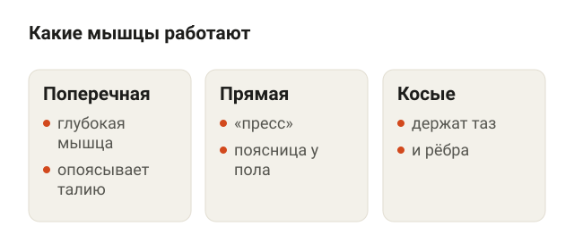<figcaption>Поперечная мышца живота держит талию, прямая не даёт пояснице оторваться, косые держат таз и рёбра.</figcaption></figure>

Название звучит мрачно, но смысл простой: ты лежишь на спине с поднятыми руками и ногами, как жук, которого перевернули. Упражнение относится к стабилизирующим, то есть учит держать корпус неподвижным, пока работают руки и ноги.

Работают в первую очередь мышцы живота:

- **поперечная мышца живота** — глубокая, опоясывает талию как пояс;
- **прямая мышца живота** — тот самый «пресс», не даёт пояснице оторваться от пола;
- **косые мышцы живота** — держат таз и рёбра, когда рука и нога уходят в разные стороны.

Насколько сильно включается глубокая мышца, проверяли на УЗИ. В исследовании Tsartsapakis и соавторов (2023) 44 женщины с опытом пилатеса от трёх лет делали пять упражнений: базовое положение, «сотню», подъём таза, боковую планку и «мёртвого жука». Толщина поперечной мышцы живота сильнее всего росла именно в «мёртвом жуке». Авторы связывают это с тем, что руки и ноги в воздухе заставляют корпус работать больше, чем упражнения, где спина лежит на полу и конечности не двигаются.

Год спустя те же авторы сравнили семь упражнений у 44 молодых людей. По сумме глубоких мышц живота и спины первыми оказались «птица-собака» и боковая планка, «мёртвый жук» и «медвежья походка» — следом, но достоверной разницы между этими четырьмя упражнениями не было. То есть «мёртвый жук» — одно из рабочих упражнений на корпус, а не волшебное.

## Техника упражнения «мёртвый жук» по шагам

<figure class="step">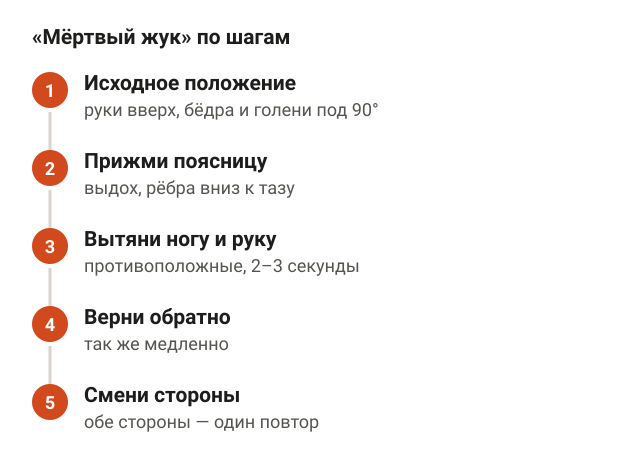<figcaption>Руки вверх, бёдра и голени под 90 градусов, поясница прижата, нога и противоположная рука вытягиваются за 2–3 секунды.</figcaption></figure>

Делается на коврике, никакого инвентаря не нужно.

1. **Исходное положение.** Ляг на спину. Подними прямые руки вертикально над грудью, ладони смотрят друг на друга. Подними ноги так, чтобы бёдра стояли вертикально, а голени были параллельны полу: в тазобедренных и коленных суставах примерно 90 градусов.
2. **Прижми поясницу.** Выдохни и мягко прижми поясницу к полу, рёбра опусти вниз к тазу. Между поясницей и ковриком не должна пролезать ладонь.
3. **Движение.** Медленно, за 2–3 секунды, вытягивай правую ногу вперёд и вниз, почти до пола, а левую руку — за голову. Нога и рука не касаются пола, останавливаются в паре сантиметров.
4. **Возврат.** Так же медленно верни руку и ногу в исходное положение.
5. **Смена сторон.** Повтори с левой ногой и правой рукой. Одна сторона плюс другая — это один повтор.

«Мёртвый жук» на схеме: в начале руки вверх, бёдра и голени под прямым углом, в конце нога и противоположная рука вытянуты, поясница остаётся прижатой к полу.

<figure class="step move">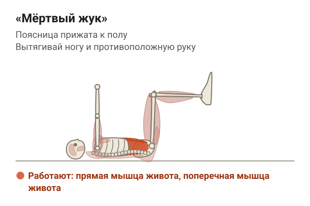</figure>

Ориентир один: опускай ногу ровно до той точки, где поясница ещё прижата. Если она начинает отрываться, это твоя граница на сегодня. Через пару недель она сдвинется ниже.

## Частые ошибки в «мёртвом жуке»

<figure class="step">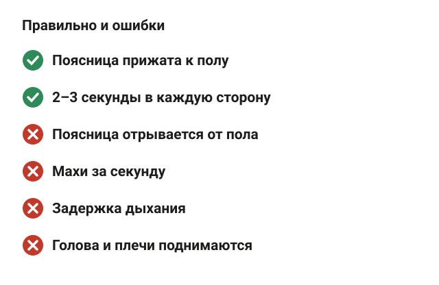<figcaption>Поясница прижата, темп медленный, дыхание идёт. Ошибки: поясница отрывается, спешка, задержка дыхания, голова поднимается.</figcaption></figure>

Я вижу одни и те же ошибки у новичков в зале, и почти все про то, что корпус перестаёт держаться.

- **Поясница отрывается от пола.** Самая частая. Нога ушла слишком низко, пресс не удержал таз, и поясница прогнулась. Не опускай ногу так низко или сгибай её в колене.
- **Спешка.** Если махать руками и ногами за секунду, работает инерция, а не корпус. Медленно — 2–3 секунды в каждую сторону.
- **Задержка дыхания.** Лицо красное, шея напряжена. Дыхание должно идти, про это ниже.
- **Голова и плечи поднимаются.** Это уже скручивание, а не «мёртвый жук». Затылок и лопатки лежат на полу.
- **Рёбра торчат вверх.** Живот надулся, грудная клетка раскрылась. Опусти рёбра к тазу на выдохе.
- **Рука и нога одной стороны.** Работают противоположные: правая нога — левая рука.

## Как дышать и напрягать живот

<figure class="step">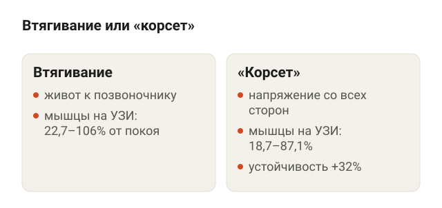<figcaption>С втягиванием мышцы на УЗИ толще, но «корсет» в модели даёт позвоночнику на 32% больше устойчивости.</figcaption></figure>

Есть два способа включить живот, и о них давно спорят.

**Втягивание** — живот втягиваешь к позвоночнику, как будто застёгиваешь тесные джинсы. Так больше работает глубокая поперечная мышца.

**«Корсет»**, или брейсинг, — живот не втягиваешь, а напрягаешь со всех сторон, как перед лёгким ударом в живот. Работают все мышцы живота сразу.

В исследовании Tsartsapakis и соавторов (2024) с втягиванием глубокие мышцы на УЗИ утолщались сильнее: от 22,7% до 106% от покоя против 18,7–87,1% с «корсетом». Но толщина мышцы на УЗИ — это не жёсткость позвоночника. Grenier и McGill (2007) посчитали на модели, что «корсет» повышает устойчивость поясничного отдела на 32% при росте сжатия позвоночника на 15%, а отдельно поперечная мышца даёт меньше 1% устойчивости. Их вывод: механических причин предпочитать втягивание нет.

Что я советую на практике:

- для «мёртвого жука» хватает мягкого «корсета»: живот плотный, но разговаривать можно;
- выдох — когда вытягиваешь руку и ногу, вдох — когда возвращаешь;
- если не получается выдыхать и держать живот одновременно, сделай 2–3 медленных вдоха-выдоха в исходном положении, а потом начинай движение.

Тот же «корсет», только сильнее, пригодится в приседе и становой тяге. Как держать корпус под штангой, я разбирал в статье [как правильно приседать со штангой](/stati/kak-pravilno-prisedat-so-shtangoy/).

## Сколько делать и как усложнять

<figure class="step">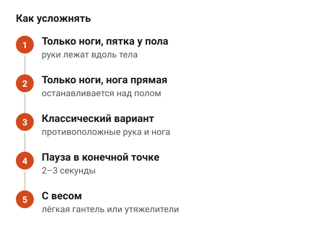<figcaption>Следующий шаг — когда текущий получается 3 подхода по 10 повторов на сторону без отрыва поясницы.</figcaption></figure>

Отдельных исследований о том, сколько повторов «мёртвого жука» нужно, я не нашёл. Поэтому ниже рабочий ориентир из практики, а не цифра из исследования:

- **новичку** — 2–3 подхода по 6–8 повторов на каждую сторону;
- **темп** — 2–3 секунды на вытягивание, 2–3 на возврат;
- **отдых** — 30–60 секунд между подходами;
- **частота** — 2–3 раза в неделю, в разминке или в конце тренировки.

Подход заканчивается, когда поясница начинает отрываться, даже если до плана осталась пара повторов.

Усложнять лучше по шагам. Переходи на следующий, когда текущий получается 3 подхода по 10 повторов на сторону без отрыва поясницы.

1. **Только ноги, пятка касается пола.** Руки лежат на полу вдоль тела, нога согнута, ты опускаешь её и касаешься пола пяткой.
2. **Только ноги, нога выпрямляется.** Руки по-прежнему на полу, нога вытягивается и останавливается над полом.
3. **Классический вариант.** Противоположные рука и нога, как в технике выше.
4. **Медленнее и с паузой.** 2–3 секунды задержки в конечной точке.
5. **С весом.** Лёгкая гантель или блин в руках, лёгкие утяжелители на ногах.

## Поможет ли «мёртвый жук» при боли в спине

<figure class="step">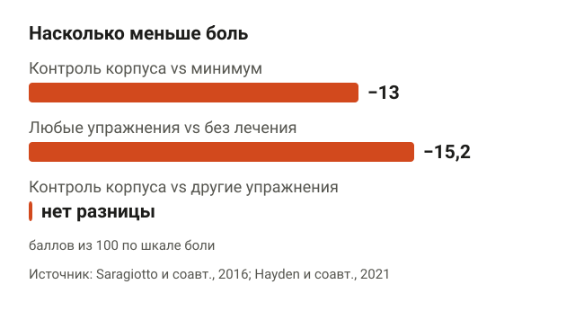<figcaption>Упражнения на контроль корпуса — минус 13 баллов из 100 против минимального вмешательства, любые упражнения — минус 15,2 против отсутствия лечения.</figcaption></figure>

Его часто дают при боли в пояснице, поэтому разберу честно.

«Мёртвый жук» относится к упражнениям на контроль корпуса. В Кокрейновском обзоре Saragiotto и соавторов (2016) собрали 29 рандомизированных исследований, 2431 человек с хронической неспецифической болью в пояснице. По сравнению с минимальным вмешательством такие упражнения снижали боль: через год и дольше в среднем на 13 баллов из 100. Но по сравнению с другими упражнениями разницы не было. Авторы прямо пишут: выбор упражнений стоит делать по предпочтениям, цене и безопасности.

Похожая картина в мета-анализе Wang и соавторов (2012): упражнения на стабилизацию корпуса снижали боль сильнее обычных через 3 месяца, но через 6 и 12 месяцев разницы уже не было.

А самый большой обзор, Hayden и соавторов (2021), — 249 исследований любых упражнений. Упражнения в целом снижали боль в среднем на 15,2 балла из 100 по сравнению с отсутствием лечения.

В клиническом обзоре Short и соавторов (2025) отдельно отмечено, что исследования механизмов «стабильности» корпуса противоречат друг другу, а выводы о них часто преувеличены. По сути, «мёртвый жук» помогает при боли в спине так же, как другие упражнения: не лучше и не хуже. Его плюс — нагрузка на поясницу маленькая, поэтому с него удобно начинать. Если боль отдаёт в ногу, есть онемение или слабость в ноге, это к врачу, а не в зал. Подробнее про упражнения при такой боли — в статье [боль в пояснице: упражнения при острой и хронической боли](/stati/bol-v-poyasnice-uprazhneniya/).

## Чем дополнить: «птица-собака» и планка

<figure class="step">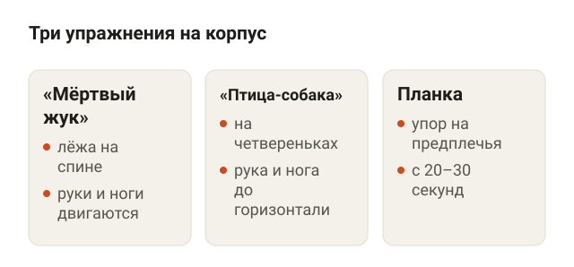<figcaption>«Мёртвый жук» — лёжа на спине, «птица-собака» — на четвереньках, планка — в упоре на предплечьях.</figcaption></figure>

«Мёртвый жук» держит корпус лёжа на спине. В жизни и в зале корпус работает в других положениях, поэтому одного упражнения мало. Вот два, которые хорошо дополняют его.

**«Птица-собака».** Встань на четвереньки, ладони под плечами, колени под тазом. Одновременно вытяни назад одну ногу и вперёд противоположную руку до горизонтали. Спина ровная, поясница не прогибается. Задержись на 2–3 секунды и вернись. В исследовании Tsartsapakis и соавторов (2024) «птица-собака» с втягиванием живота дала самый большой прирост толщины глубоких мышц живота и спины из семи упражнений.

<figure class="step move">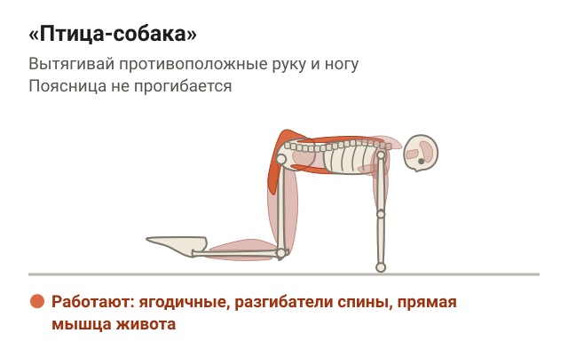</figure>

**Планка на предплечьях.** Упор на предплечья и носки, локти под плечами. Тело прямое от головы до пяток: таз не провисает и не задирается вверх. Начни с 20–30 секунд и прибавляй по 5–10 секунд.

<figure class="step move">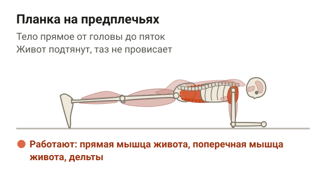</figure>

Если ты занимаешься после родов и есть расхождение мышц живота, сначала посмотри статью [можно ли качать пресс при диастазе](/stati/mozhno-li-kachat-press-pri-diastaze/): там разобрано, с каких упражнений начинать.

## Шпаргалка

<figure class="step">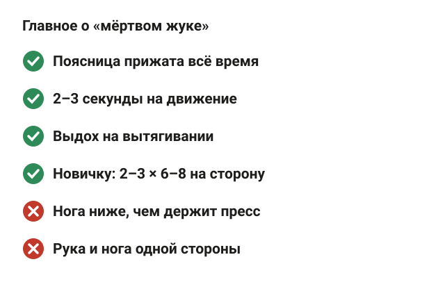<figcaption>Поясница прижата, медленно, выдох на вытягивании, 2–3 подхода по 6–8 повторов на сторону для новичка.</figcaption></figure>

- Исходное положение: лёжа на спине, руки вверх, бёдра и голени под 90 градусов.
- Вытягивай ногу и противоположную руку, медленно, 2–3 секунды.
- Поясница прижата к полу всё время. Оторвалась — нога ушла слишком низко.
- Выдох на вытягивании, живот плотный, но не до потери дыхания.
- Ориентир для новичка: 2–3 подхода по 6–8 повторов на сторону.
- Не получается — упрости: только ноги, пятка касается пола.
- При боли в спине помогает так же, как другие упражнения, не лучше.
- Дополняй «птицей-собакой» и планкой.
