---
{
  "title": "Можно ли качать пресс при диастазе: что изучено и с чего начать",
  "seo_title": "Можно ли качать пресс при диастазе после родов",
  "description": "Можно ли качать пресс при диастазе после родов: что показали метаанализы, какие упражнения изучены, как их делать и где у науки пока пробелы.",
  "slug": "mozhno-li-kachat-press-pri-diastaze",
  "date": "2026-11-01",
  "category": "diastaz",
  "keyword": "можно ли качать пресс при диастазе",
  "tags": [
    "диастаз",
    "пресс",
    "после родов",
    "скручивания",
    "упражнения на пресс",
    "гипопрессивы"
  ],
  "faq": [
    {
      "q": "Можно ли качать пресс при диастазе 1 степени?",
      "a": "Прямых исследований для такой ширины нет, а единой шкалы степеней тоже нет. В послеродовых работах упражнения на мышцы живота в среднем не расширяли диастаз, поэтому начинать с лёгких вариантов можно после осмотра у врача или физиотерапевта."
    },
    {
      "q": "Пройдёт ли диастаз сам?",
      "a": "У многих женщин он сужается со временем: через 6 недель после родов диастаз есть у 60%, через 6 месяцев у 45,4%, через 12 месяцев у 32,6%. Но у части он сохраняется годами: через 30 лет при пороге больше 2 см его находили у 30%."
    },
    {
      "q": "Скручивания при диастазе вредны?",
      "a": "В РКИ Gluppe и соавторов программа со скручиваниями не ухудшила ширину диастаза и увеличила силу и толщину мышц живота. Это одно исследование, поэтому однозначного вывода по всем видам скручиваний нет."
    },
    {
      "q": "Можно ли качать пресс при диастазе мужчинам?",
      "a": "В найденных научных источниках данных про мужчин и людей без беременности и родов нет. Выводы послеродовых работ переносить на них можно только с осторожностью."
    }
  ],
  "sources": [
    {
      "title": "Beamish N. F. и соавт. Impact of postpartum exercise on pelvic floor disorders and diastasis recti abdominis: a systematic review and meta-analysis (BJSM, 2025)",
      "url": "https://pmc.ncbi.nlm.nih.gov/articles/PMC12013572/"
    },
    {
      "title": "Conservative interventions may have little effect on reducing diastasis of the rectus abdominis in postnatal women (Physiotherapy, 2023)",
      "url": "https://www.sciencedirect.com/science/article/abs/pii/S0031940623000135"
    },
    {
      "title": "Effects of conservative approaches for treating diastasis recti abdominis in postpartum women: systematic review and meta-analysis",
      "url": "https://pmc.ncbi.nlm.nih.gov/articles/PMC12151038/"
    },
    {
      "title": "Benjamin D. R. и соавт. Effects of exercise on diastasis of the rectus abdominis muscle in the antenatal and postnatal periods (2014)",
      "url": "https://www.sciencedirect.com/science/article/abs/pii/S0031940613000837"
    },
    {
      "title": "Diastasis Recti Abdominis Rehabilitation in the Postpartum Period: A Scoping Review (2024)",
      "url": "https://www.ncbi.nlm.nih.gov/pmc/articles/PMC11023973/"
    },
    {
      "title": "Hypopressive exercises for diastasis recti and pelvic floor symptoms in postpartum women: RCT",
      "url": "https://pmc.ncbi.nlm.nih.gov/articles/PMC12961203/"
    },
    {
      "title": "Effect of hypopressive and conventional abdominal exercises on postpartum diastasis recti: RCT (PLoS ONE, 2024)",
      "url": "https://journals.plos.org/plosone/article?id=10.1371%2Fjournal.pone.0314274"
    },
    {
      "title": "Gluppe и соавт. Curl-up exercises improve abdominal muscle strength without worsening inter-recti distance in women with diastasis recti abdominis postpartum (2023)",
      "url": "https://www.researchgate.net/publication/387210633_Impact_of_postpartum_exercise_on_pelvic_floor_disorders_and_diastasis_recti_abdominis_a_systematic_review_and_meta-analysis"
    },
    {
      "title": "Impact of Exercising on Pelvic Symptom Severity, Pelvic Floor Muscle Strength, and DRA After Pregnancy: prospective cohort (PTJ, 2024)",
      "url": "https://academic.oup.com/ptj/article/104/4/pzad171/7477810"
    },
    {
      "title": "Prevalence and risk factors of DRA in the long-term postpartum: cross-sectional study (Scientific Reports, 2024)",
      "url": "https://www.nature.com/articles/s41598-024-76974-x"
    },
    {
      "title": "Women with DRA and pelvic floor/back pain: ClinicalTrials.gov record",
      "url": "https://clinicaltrials.gov/study/NCT07389993"
    }
  ]
}
---
Можно ли качать пресс при диастазе? Строгого запрета в исследованиях нет. В метаанализах упражнения на мышцы живота после родов в среднем немного уменьшали расстояние между прямыми мышцами. В одном РКИ скручивания не расширили диастаз и сделали пресс сильнее. Но эффект небольшой, а данные почти все про женщин после родов. Поэтому начинать стоит с осмотра у врача или физиотерапевта, с лёгких упражнений и с контролем того, как ведёт себя живот.

Ниже разберу, что именно изучали, какие упражнения с какой техникой делать и где у науки пока пробелы.

## Что такое диастаз и как его измеряют

<figure class="step">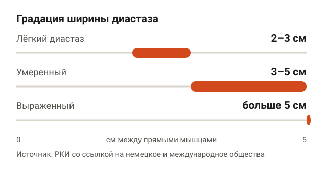<figcaption>Единой шкалы степеней нет, поэтому уточняй ширину в сантиметрах и способ измерения.</figcaption></figure>

Прямая мышца живота состоит из двух продольных половинок. По центру их соединяет белая линия, то есть полоса соединительной ткани. При диастазе половинки расходятся, и расстояние между ними становится шире. Во время беременности живот растягивается, поэтому после родов это частая история.

Ширину оценивают пальцами или ультразвуком. Авторы обзоров отмечают, что в работах используют разные способы оценки и разные пороги: где-то диастазом считают больше 2 см, где-то больше 3 см. Соответственно, цифры из разных исследований сравнивать нужно осторожно.

Одна из РКИ приводит такую градацию со ссылкой на немецкое и международное профессиональные общества:

| Ширина между прямыми мышцами | Как называют |
|---|---|
| 2–3 см | лёгкий диастаз |
| 3–5 см | умеренный |
| больше 5 см | выраженный |

Единой официальной шкалы «1, 2, 3 степени» в найденных источниках нет. Когда тебе говорят «диастаз 1 степени», уточни ширину в сантиметрах и способ, которым её измерили.

## Можно ли качать пресс при диастазе после родов

<figure class="step">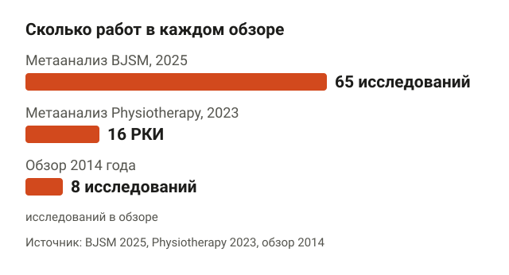<figcaption>Свежие обзоры опираются на гораздо больше данных, чем обзор 2014 года.</figcaption></figure>

Здесь есть три обзора, и они дают похожую картину.

- **Метаанализ в British Journal of Sports Medicine, 2025.** 65 исследований, 21 334 участницы из 24 стран. Вывод: упражнения на мышцы живота после родов уменьшают расстояние между прямыми мышцами. Достоверность части выводов авторы оценили как низкую.
- **Метаанализ РКИ в журнале Physiotherapy, 2023.** 16 рандомизированных исследований, 698 участниц. С умеренной достоверностью упражнения немного уменьшают диастаз: в среднем на 0,4 см. При диастазе шире 2,2 см такая разница, по мнению авторов, вероятно, клинически незначима.
- **Обзор 2014 года.** 8 исследований, из них только одно РКИ. Данных тогда не хватило, чтобы рекомендовать упражнения для профилактики или уменьшения диастаза.

По сути, качать пресс при диастазе после родов в исследованиях не вредило, а скорее немного помогало. Допустим, у тебя 3 см. Минус 0,4 см даёт 2,6 см: изменение есть, но живот от этого сам не соберётся. Свежие данные выглядят лучше старых, а консенсуса о самой эффективной программе авторы пока не видят.

## Диастаз уменьшается и без упражнений

<figure class="step">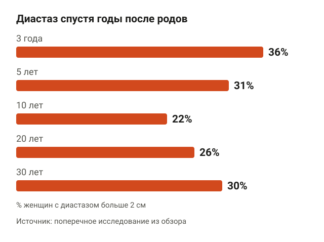<figcaption>У части женщин диастаз шире 2 см сохраняется даже через десятилетия.</figcaption></figure>

Эту часть часто упускают. По данным обзора, диастаз есть у 60% женщин через 6 недель после родов, у 45,4% через 6 месяцев и у 32,6% через 12 месяцев. То есть у многих он сужается со временем.

В проспективном когортном исследовании, где женщин наблюдали без случайного распределения по группам, ширина диастаза уменьшалась во всех группах, независимо от уровня физической активности. Поэтому история «делала упражнения, и всё прошло» отчасти про упражнения, а отчасти про время.

У части женщин диастаз держится годами. Поперечное исследование оценивало ширину спустя десятилетия после родов, критерий больше 2 см:

| Сколько прошло после родов | Доля женщин с диастазом |
|---|---|
| 3 года | 36% |
| 5 лет | 31% |
| 10 лет | 22% |
| 20 лет | 26% |
| 30 лет | 30% |

Если взять порог больше 3 см, через 3 года диастаз был у 13%. Ещё одна деталь: по когортным данным Vesting и соавторов, низкоударная активность в первые 3 месяца после родов была связана с уменьшением диастаза. Связь не доказывает, что именно нагрузка его уменьшила, но и вреда от неё в этих данных не видно.

## Скручивания при диастазе: вредят или нет

<figure class="step">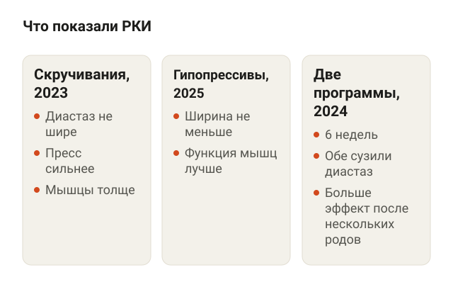<figcaption>Ни одна из изученных программ не расширила диастаз.</figcaption></figure>

В интернете скручивания при диастазе часто запрещают. Прямых данных за этот запрет в научных источниках я не нашёл. Исследований о том, какое давление в животе создают скручивания при диастазе, в найденных работах тоже нет.

Что есть:

- **Скручивания, РКИ Gluppe и соавторов, 2023.** Программа со скручиваниями не ухудшила расстояние между прямыми мышцами, а сила и толщина мышц живота выросли.
- **Гипопрессивные упражнения, РКИ 2025 года.** Диастаз они не уменьшили, но функцию мышц улучшили.
- **Сравнение двух программ, РКИ 2024 года.** Гипопрессивная и обычная программа на мышцы живота длились 6 недель, обе уменьшили диастаз. Больше всего выиграли женщины после нескольких родов.

Авторы метаанализа BJSM отдельно пишут, что их результаты расходятся с популярным клиническим мнением, будто диастаз уменьшают только мягкие упражнения на глубокие мышцы живота. Это не значит, что можно сразу делать подъёмы ног в висе. Это значит, что скручивания не стоит записывать в запрещённые, а выбирать нагрузку лучше по тому, как реагирует твой живот.

## Диастаз: упражнения на пресс и техника

<figure class="step">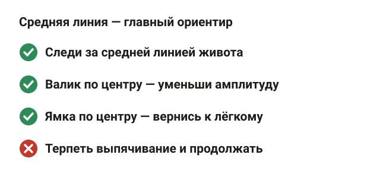<figcaption>Реакция живота подсказывает, какую нагрузку выбрать.</figcaption></figure>

Эти упражнения встречаются в исследованиях и в работе физиотерапевтов. Это не программа лечения, а набор вариантов, которые обычно стоят в начале. Главный ориентир во всех: средняя линия живота. Если вдоль неё выпирает валик или проваливается ямка, уменьши амплитуду или вернись к более лёгкому варианту и обсуди это со специалистом.

### Втягивание живота лёжа

<figure class="step">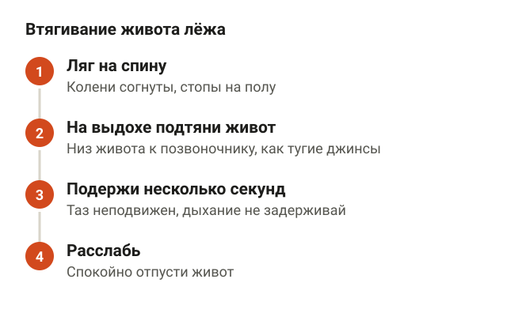<figcaption>Упражнение учит включать поперечную мышцу живота.</figcaption></figure>

Поперечная мышца живота лежит глубже остальных и обхватывает талию, как пояс. Это упражнение учит её включать.

Ляг на спину, колени согни, стопы на полу. На выдохе мягко подтяни низ живота внутрь, к позвоночнику, как будто застёгиваешь тугие джинсы. Таз и поясница не двигаются, дыхание не задерживай. Подержи несколько секунд и расслабь.

<figure class="step move">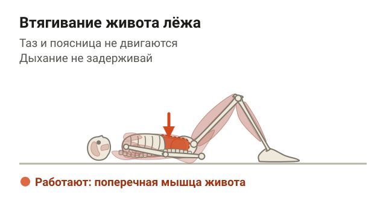</figure>

### Скручивание (curl-up)

<figure class="step"><figcaption>Поднимайся до отрыва лопаток и опускайся медленно.</figcaption></figure>

Ляг на спину, колени согнуты, стопы на полу на ширине таза. Руки вдоль корпуса или пальцы у висков без давления на голову. На выдохе подними голову и плечи: спина округляется, позвоночник сгибается по позвонку, поясница остаётся прижатой к полу. Поднимайся, пока лопатки не оторвутся от пола, и медленно опускайся.

<figure class="step move">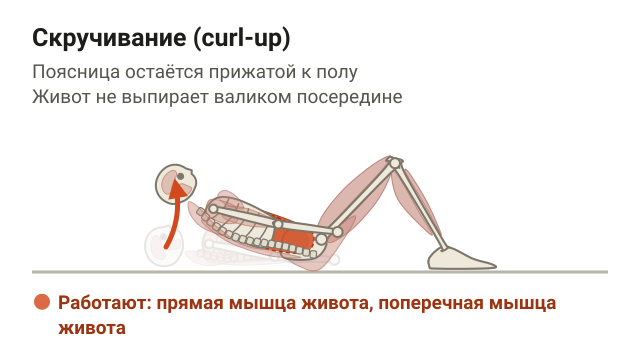</figure>

Ориентиры: подбородок не тянется к груди рывком, живот не выпирает валиком посередине.

### Гипопрессивное упражнение

<figure class="step">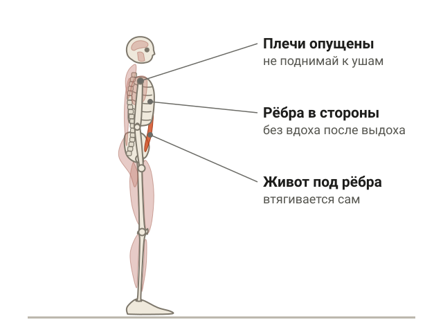<figcaption>После полного выдоха раскрой рёбра, не впуская воздух, и живот втянется сам.</figcaption></figure>

Встань прямо или ляг на спину с согнутыми коленями. Сделай спокойный вдох и полный выдох. Задержи дыхание и раскрой рёбра в стороны, как будто вдыхаешь, но не впускаешь воздух. Живот при этом сам втягивается под рёбра. Подержи несколько секунд и спокойно вдохни.

<figure class="step move">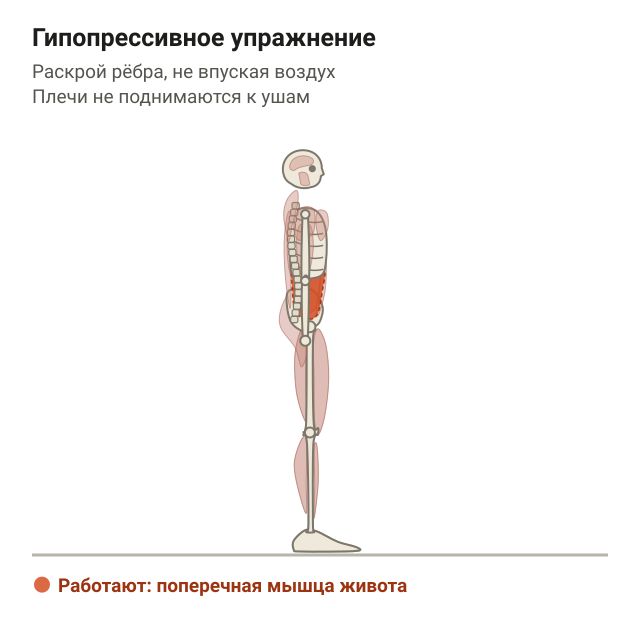</figure>

Ориентиры: плечи не поднимаются к ушам, если кружится голова, остановись.

### Планка с колен

<figure class="step">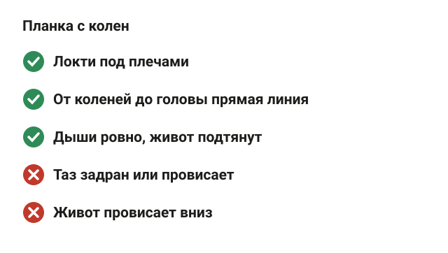<figcaption>Если средняя линия выпирает с первых секунд, вернись к упражнениям лёжа.</figcaption></figure>

Планка тоже входила в изученные программы. Встань на предплечья и колени, локти под плечами. Тело от коленей до головы образует прямую линию, таз не задран и не провисает. Дыши ровно, живот подтянут и не провисает вниз.

<figure class="step move">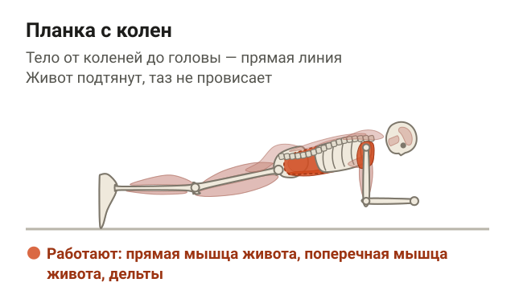</figure>

Ориентир: если средняя линия живота выпирает уже на первых секундах, вернись к упражнениям лёжа.

## Можно ли качать пресс при небольшом диастазе и 1 степени

<figure class="step">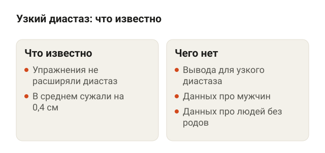<figcaption>Прямых исследований для ширины 2–3 см в найденных работах нет.</figcaption></figure>

Если считать «1 степенью» лёгкий диастаз 2–3 см, то это моё допущение, а не установленный факт: единой шкалы нет. Прямых исследований, что разрешено именно при такой ширине, в найденных работах нет.

Что можно сказать честно:

- в исследованиях упражнения на мышцы живота в среднем не расширяли диастаз, а немного сужали;
- про эффект 0,4 см авторы оговаривают, что при ширине больше 2,2 см он, вероятно, мало что меняет. Для узкого диастаза отдельного вывода нет;
- данные про людей без беременности и родов, в том числе про мужчин, в найденных источниках отсутствуют. Переносить на них выводы послеродовых работ можно только с осторожностью.

Про боль. В одной работе, описанной в реестре ClinicalTrials.gov, у женщин с диастазом мышцы живота были слабее, а боли в животе больше. При этом дисфункция тазового дна, боль в пояснице и тазовом поясе встречались не чаще. Это одна работа, так что вывод слабый. Если спина всё же беспокоит, загляни в статью [упражнения при боли в пояснице](/stati/bol-v-poyasnice-uprazhneniya/).

## Как начать: план по шагам

<figure class="step">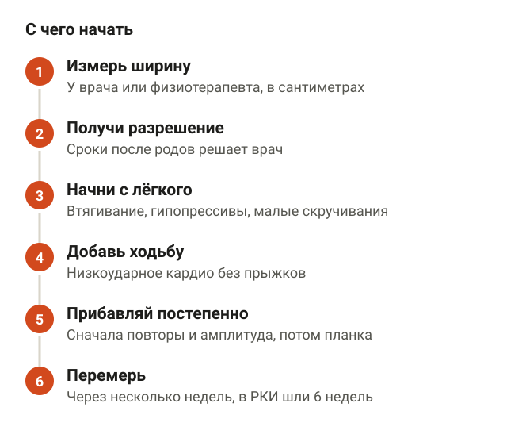<figcaption>Выпячивание, которое не уходит в покое, или боль вне зала — повод идти к врачу.</figcaption></figure>

1. **Измерь ширину у врача или физиотерапевта.** Узнай сантиметры и способ измерения. Это точка отсчёта.
2. **Получи разрешение на нагрузку.** После родов сроки зависят от того, как прошли роды и восстановление, и это решает врач.
3. **Начни с лёгкого.** Втягивание лёжа, гипопрессивы, скручивания с небольшой амплитудой.
4. **Добавь низкоударную активность.** Ходьба и спокойные кардио-нагрузки без прыжков.
5. **Прибавляй постепенно.** Сначала повторы и амплитуду, потом более сложные варианты вроде планки. Средняя линия живота остаётся главным ориентиром.
6. **Перемерь через несколько недель.** Для ориентира: в одном РКИ программы шли 6 недель.
7. **Знай границу.** Если по средней линии появилось выпячивание, которое не уходит в покое, или живот болит и вне зала, это к врачу, а не к тренеру.

Подробнее про порядок упражнений после родов я писал в статье [диастаз: упражнения после родов и с чего начать](/stati/diastaz-uprazhneniya-posle-rodov/). А если цель ещё и плоский живот, это отдельная задача про питание и жир, разбор здесь: [как убрать живот](/stati/kak-ubrat-zhivot/).

## Шпаргалка

<figure class="step">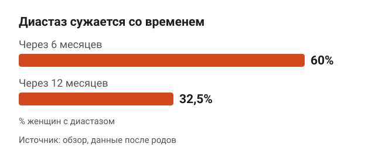<figcaption>Часть диастазов уходит сама, поэтому не всё изменение заслуга упражнений.</figcaption></figure>

- Строгого запрета качать пресс при диастазе в исследованиях нет, но данные почти все про женщин после родов.
- Упражнения на мышцы живота в среднем уменьшают диастаз на 0,4 см. Эффект реальный, но небольшой.
- Диастаз часто сужается сам: 60% через 6 недель, 32,6% через 12 месяцев.
- Скручивания в одном РКИ не расширили диастаз и усилили пресс.
- Гипопрессивы улучшили функцию мышц, но ширину не уменьшили.
- Единой шкалы степеней нет, спрашивай ширину в сантиметрах.
- Про мужчин и людей без родов данных в найденных работах нет.
- Начинай с осмотра у специалиста и лёгких упражнений, следи за средней линией живота.
