---
{
  "title": "Можно ли тренироваться при грыже позвоночника: что изучено",
  "seo_title": "Можно ли тренироваться при грыже позвоночника и как",
  "description": "Можно ли тренироваться при грыже позвоночника: что показывают МРТ и исследования, какие упражнения делать в зале, что отложить и когда сначала к врачу.",
  "slug": "mozhno-li-trenirovatsya-pri-gryzhe-pozvonochnika",
  "date": "2026-11-03",
  "category": "spina-i-osanka",
  "keyword": "можно ли тренироваться при грыже позвоночника",
  "tags": [
    "грыжа позвоночника",
    "грыжа диска",
    "ишиас",
    "поясница",
    "упражнения при грыже"
  ],
  "faq": [
    {
      "q": "Можно ли тренироваться при грыже поясничного отдела?",
      "a": "Да, если нет онемения в паху, проблем с мочеиспусканием и нарастающей слабости в ноге, а врач не запретил нагрузку. Постельный режим при ишиасе в исследованиях не лучше обычной активности."
    },
    {
      "q": "Какие упражнения в тренажёрном зале нельзя делать при грыже?",
      "a": "Прямых запретов исследования не дают. Пока болит нога, разумно отложить становую тягу с пола, наклоны с весом и присед со штангой: вес далеко от тела и круглая спина сильнее всего нагружают диск."
    },
    {
      "q": "Что делать при грыже L5–S1 или L4–L5?",
      "a": "Это самые частые уровни грыж. Упражнения подбирают по симптомам: что усиливает боль в ноге, то пока убирают, остальное делают с постепенной прибавкой."
    },
    {
      "q": "Может ли грыжа рассосаться сама?",
      "a": "Да, и чаще у крупных грыж. По обзорам, секвестр уменьшается в 93–96% случаев, экструзия — в 70%, протрузия — в 41–53%."
    }
  ],
  "sources": [
    {
      "title": "Brinjikji W. и соавт. Systematic literature review of imaging features of spinal degeneration in asymptomatic populations (AJNR, 2015)",
      "url": "https://doi.org/10.3174/ajnr.A4173"
    },
    {
      "title": "Chiu C. C. и соавт. The probability of spontaneous regression of lumbar herniated disc: a systematic review (Clinical Rehabilitation, 2015)",
      "url": "https://doi.org/10.1177/0269215514540919"
    },
    {
      "title": "Systematic review and meta-analysis of predictive factors for spontaneous regression in lumbar disc herniation (Journal of Neurosurgery: Spine, 2023)",
      "url": "https://doi.org/10.3171/2023.6.SPINE23367"
    },
    {
      "title": "Hagen K. B. и соавт. Bed rest for acute low-back pain and sciatica (Cochrane Database of Systematic Reviews, 2004)",
      "url": "https://doi.org/10.1002/14651858.CD001254.pub2"
    },
    {
      "title": "Fernandez M. и соавт. Advice to stay active or structured exercise in the management of sciatica: systematic review and meta-analysis (Spine, 2015)",
      "url": "https://doi.org/10.1097/BRS.0000000000001036"
    },
    {
      "title": "Clinical efficacy of exercise therapy for lumbar disc herniation: systematic review and meta-analysis of RCTs (Frontiers in Medicine, 2025)",
      "url": "https://doi.org/10.3389/fmed.2025.1531637"
    },
    {
      "title": "Effects of physical exercise on pain in patients with lumbar disc herniation: systematic review and meta-analysis of RCTs (Musculoskeletal Care, 2026)",
      "url": "https://doi.org/10.1002/msc.70231"
    },
    {
      "title": "Peul W. C. и соавт. Surgery versus prolonged conservative treatment for sciatica (NEJM, 2007)",
      "url": "https://doi.org/10.1056/NEJMoa064039"
    },
    {
      "title": "Lequin M. B. и соавт. Surgery versus prolonged conservative treatment for sciatica: 5-year results of a randomised controlled trial (BMJ Open, 2013)",
      "url": "https://doi.org/10.1136/bmjopen-2012-002534"
    },
    {
      "title": "Wilke H. J. и соавт. New in vivo measurements of pressures in the intervertebral disc in daily life (Spine, 1999)",
      "url": "https://doi.org/10.1097/00007632-199904150-00005"
    },
    {
      "title": "NICE. Low back pain and sciatica in over 16s: assessment and management (NG59)",
      "url": "https://www.nice.org.uk/guidance/ng59"
    }
  ]
}
---
Тренироваться при грыже позвоночника можно, а в большинстве случаев и нужно: постельный режим при боли, отдающей в ногу, в исследованиях не лучше обычной активности, а упражнения немного уменьшают боль. Сама грыжа часто уменьшается без операции, особенно крупная. Ограничение одно: нагрузку подбирают по симптомам, а не по снимку. Ниже разбираю, что показывают исследования, какие упражнения делать в зале, что отложить и когда сначала к врачу.

## Можно ли тренироваться при грыже позвоночника: короткий ответ

<figure class="step">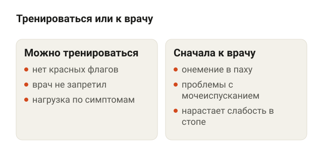<figcaption>Без «красных флагов» и запрета врача двигаться можно.</figcaption></figure>

Грыжа диска — это когда часть студенистого ядра межпозвонкового диска выходит за его границу через трещину в фиброзном кольце, то есть в плотной оболочке диска. Если грыжа давит на нервный корешок или раздражает его, боль уходит в ногу, может неметь стопа. Такую боль называют радикулопатией, в быту — ишиасом.

С точки зрения тренировок важны три вещи:

- **Как ты себя чувствуешь сейчас.** Острая боль в ноге в первые недели и спокойная поясница через полгода после обострения — это разные ситуации и разные тренировки.
- **Что провоцирует боль.** У одного боль в ноге усиливается от наклонов, у другого от долгого сидения. Это и задаёт, что пока убрать из программы.
- **Нет ли «красных флагов».** Онемение в паху, проблемы с мочеиспусканием, нарастающая слабость в стопе — это не про зал, это срочно к врачу. Подробнее в разделе о враче ниже.

Если флагов нет и врач не запретил нагрузку, двигаться можно. Британские клинические рекомендации NICE при боли в спине с ишиасом и без него советуют продолжать обычные дела и рассматривать программу упражнений. Корсеты, пояса и вытяжение позвоночника те же рекомендации назначать не советуют.

## Что такое грыжа диска и почему МРТ пугает зря

<figure class="step">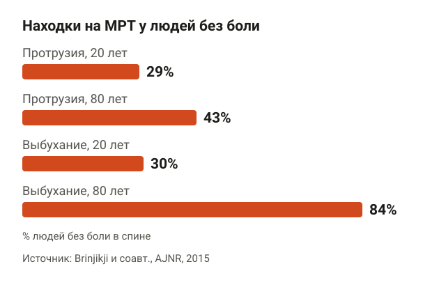<figcaption>Протрузия есть у 29% двадцатилетних, у которых спина не болит.</figcaption></figure>

Человек получает заключение МРТ со словами «протрузия», «экструзия», «грыжа L5–S1» и решает, что спина теперь хрустальная. Но изменения дисков есть и у людей, у которых спина не болит совсем.

Систематический обзор 2015 года в AJNR собрал 33 исследования, 3110 человек без боли в спине. Вот как часто у них находили изменения дисков:

- выбухание диска — у 30% в 20 лет и у 84% в 80 лет;
- протрузия, то есть небольшое выпячивание диска, — у 29% в 20 лет и у 43% в 80 лет;
- признаки износа диска — у 37% в 20 лет и у 96% в 80 лет.

Авторы делают вывод: многие такие находки — часть нормального старения и с болью не связаны. Поэтому снимок толкуют вместе с симптомами. Грыжа, которая не совпадает с тем, где и как болит, может быть просто находкой. NICE по той же причине не советует делать снимки всем подряд, если от результата не зависит лечение.

Про боль в спине без конкретной причины подробно писал в статье [о неспецифической боли в спине](/stati/nespecificheskaya-bol-v-spine/).

## Грыжа уменьшается сама: как часто это бывает

<figure class="step">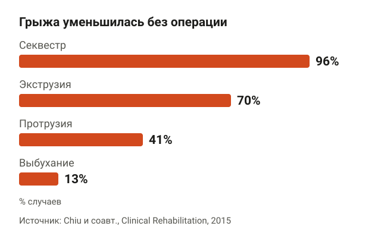<figcaption>Чем крупнее грыжа, тем чаще она уменьшается сама.</figcaption></figure>

Звучит странно, но чем крупнее выпавший фрагмент, тем выше шанс, что он уменьшится сам. Организм воспринимает выпавшую часть ядра как чужеродную ткань, и её постепенно рассасывают клетки иммунной системы.

Систематический обзор 2015 года в Clinical Rehabilitation собрал 31 исследование людей, которых лечили без операции и сделали им минимум два снимка. По 9 исследованиям с одинаковой классификацией посчитали долю, у кого грыжа уменьшилась:

- секвестр (отдельный фрагмент, оторвавшийся от диска) — 96%;
- экструзия (крупная грыжа, выступающая далеко за край диска) — 70%;
- протрузия — 41%;
- выбухание — 13%.

Полностью секвестр исчезал у 43%, экструзия — у 15%.

Мета-анализ 2023 года в Journal of Neurosurgery: Spine добавил новые работы: 16 исследований, 360 случаев, повторный снимок в среднем через 11,5 месяца. Цифры похожие: 93,0% для секвестра, 70,4% для экструзии, 52,5% для протрузии и 13,3% для выбухания. Уменьшение грыжи совпадало с улучшением симптомов. Чаще всего у участников были грыжи L4–L5 и L5–S1, то есть в самом низу поясницы.

## Покой или движение: что показывают исследования

<figure class="step">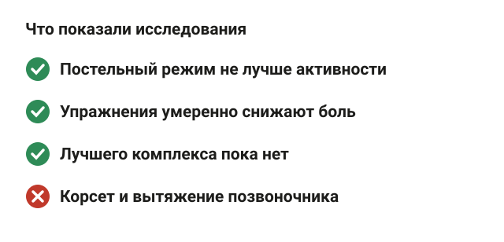<figcaption>Лежать при ишиасе не лучше, чем жить обычной жизнью.</figcaption></figure>

Самый частый совет при грыже — лежать. Его проверяли давно.

Кокрейновский обзор собрал 11 исследований, 1963 человека с острой болью в пояснице или ишиасом. При ишиасе постельный режим по боли и восстановлению функции почти не отличался от совета оставаться активным. По сравнению с лечебной физкультурой боль была такой же, а функция после занятий восстанавливалась немного лучше. То есть лежать можно, если иначе не получается, но лечебного смысла в лежании нет.

Дальше вопрос, нужны ли именно упражнения или достаточно просто жить обычной жизнью:

- мета-анализ 2015 года в Spine (5 исследований) сравнил структурированные упражнения с советом оставаться активным: на коротком сроке боль в ноге с упражнениями была ниже примерно на 11 баллов из 100, на ограничения в быту это не повлияло, а через полгода и год разницы не было;
- мета-анализ 2025 года в Frontiers in Medicine (8 исследований, 611 человек с грыжей поясничного отдела) показал, что с упражнениями лучше боль, функция и подвижность, чем без них;
- мета-анализ 2026 года в Musculoskeletal Care (13 рандомизированных исследований) тоже нашёл снижение боли от упражнений, но результаты исследований сильно расходятся между собой.

Честный итог: упражнения помогают, но эффект умеренный, и хорошего протокола «сколько и каких» пока нет. Авторы мета-анализа 2025 года прямо пишут, что рекомендаций по интенсивности и частоте не существует.

### Операция или упражнения

<figure class="step">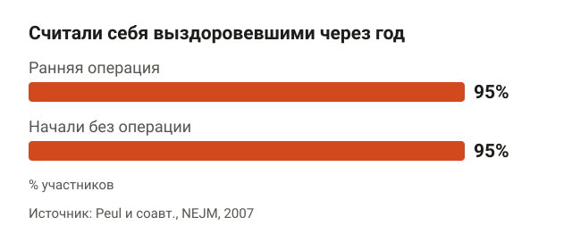<figcaption>Операция ускоряет облегчение, но через год результат одинаковый.</figcaption></figure>

Нидерландское исследование в NEJM разделило 283 человека с сильным ишиасом длительностью 6–12 недель на две группы: ранняя операция или лечение без операции с возможностью прооперироваться позже. Во второй группе за год прооперировали 39%. После операции нога переставала болеть быстрее, но через год выздоровевшими себя считали 95% в обеих группах. Через 5 лет разницы тоже не было, а операцию к этому сроку сделали 46% тех, кто начинал без неё.

То есть операция в основном ускоряет облегчение, а не меняет итог. Решение принимает нейрохирург, и при сильной боли в ноге, которая не уходит месяцами, этот разговор нужен.

## Упражнения в зале при грыже поясничного отдела

<figure class="step">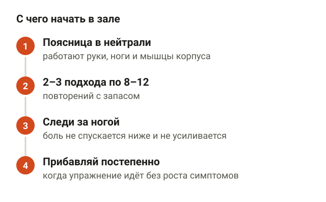<figcaption>Начинай с запасом и прибавляй, пока симптомы в ноге не растут.</figcaption></figure>

Исследования не называют лучший комплекс, поэтому ниже мой выбор как тренера. Логика простая: сначала упражнения, где поясница держит нейтральное положение, а работают руки, ноги и мышцы корпуса. Нейтральное положение — это естественный изгиб поясницы, без округления и без прогиба до упора.

Ориентир по симптомам такой: боль в пояснице во время подхода терпимая и не растёт, а боль в ноге не спускается ниже и не усиливается. Если онемение или боль уходят дальше по ноге — упражнение убирай или уменьшай амплитуду.

**«Мёртвый жук».** Ляг на спину, руки вытяни вверх над плечами, ноги согни под прямым углом в тазобедренных и коленных суставах. Медленно опусти одну руку за голову и противоположную ногу к полу, вернись и поменяй стороны. Ориентиры: поясница прижата к полу; ногу опускай только до точки, где поясница ещё не отрывается.

<figure class="step move">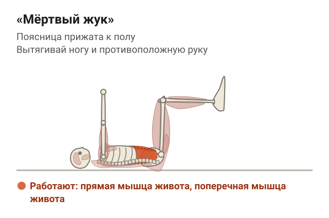</figure>

**«Птица-собака».** Встань на четвереньки: кисти под плечами, колени под тазом. Вытяни вперёд одну руку и назад противоположную ногу до линии с корпусом, задержись на 2–3 секунды, вернись. Ориентиры: таз не разворачивается в сторону, поясница не прогибается, когда нога уходит назад.

<figure class="step move">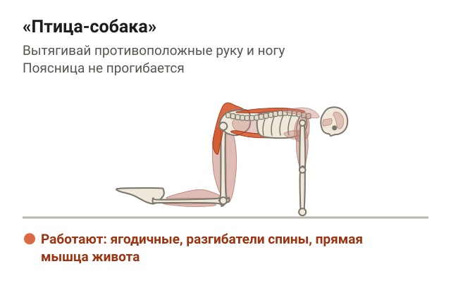</figure>

**Планка на предплечьях.** Упор на предплечья и носки, локти под плечами, тело прямое от головы до пяток. Держи 15–30 секунд, отдыхай столько же. Ориентиры: таз не провисает и не задирается вверх, живот и ягодицы напряжены.

<figure class="step move">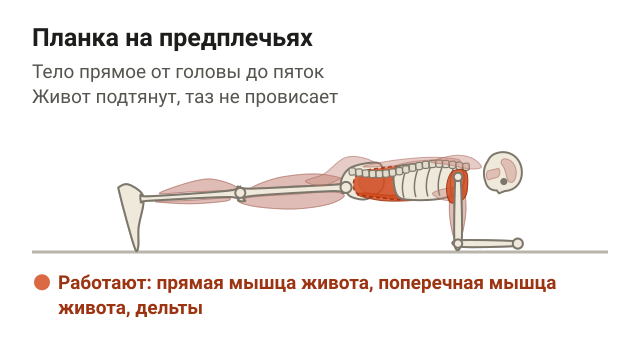</figure>

**Гоблет-присед с гантелью.** Встань чуть шире плеч, держи гантель вертикально у груди двумя руками. Опускайся вниз, отводя таз назад и разводя колени по направлению носков, затем встань. Ориентиры: спина ровная, гантель прижата к груди; глубину ограничивай точкой, где поясница начинает округляться.

<figure class="step move">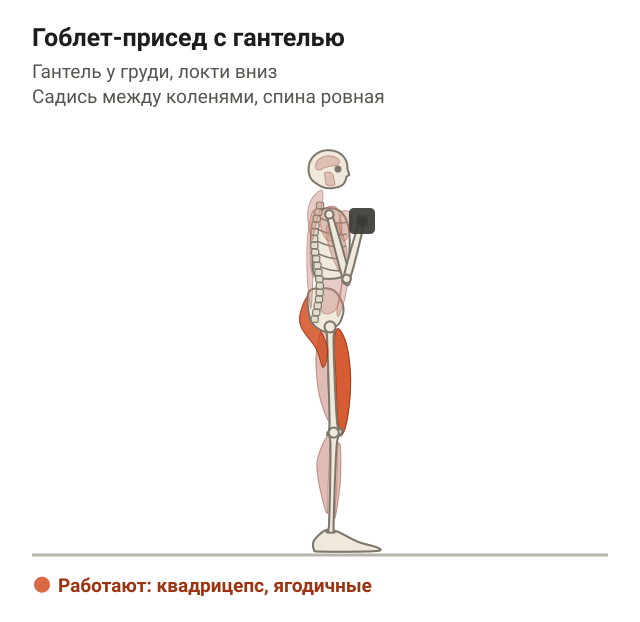</figure>

Начинай с 2–3 подходов по 8–12 повторений с запасом и прибавляй постепенно, когда упражнение идёт без роста симптомов. Ходьба тоже подходит: это та самая обычная активность, которую советуют рекомендации. Больше упражнений для поясницы с разбором исследований — в статье [боль в пояснице: упражнения](/stati/bol-v-poyasnice-uprazhneniya/).

## Какие упражнения при грыже позвоночника отложить

<figure class="step">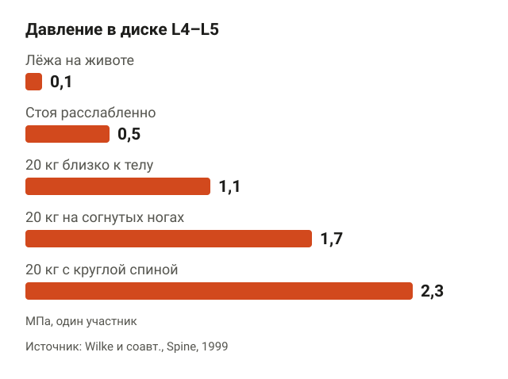<figcaption>Вес далеко от тела и круглая спина нагружают диск в 2 раза сильнее.</figcaption></figure>

Прямых исследований «вот это при грыже запрещено» нет. Есть данные о том, как разные положения нагружают диск. В известном исследовании 1999 года в Spine датчик давления вживили в диск L4–L5 мужчине 45 лет и замерили давление в разных положениях:

- лёжа на животе — 0,1 МПа;
- сидя без опоры — 0,46 МПа;
- стоя расслабленно — 0,5 МПа;
- стоя в наклоне вперёд — 1,1 МПа;
- подъём 20 кг близко к телу — 1,1 МПа;
- подъём 20 кг на согнутых ногах — 1,7 МПа;
- подъём 20 кг с круглой спиной — 2,3 МПа.

Человек был один, поэтому цифры — ориентир, а не закон. Но разница понятная: вес далеко от тела и круглая спина нагружают диск в 2 раза сильнее, чем тот же вес у корпуса.

Поэтому, пока нога болит, отложи:

- становую тягу с пола и наклоны с весом;
- присед со штангой на спине и жим ногами с глубоким опусканием, где таз подкручивается;
- скручивания с отрывом корпуса, если они усиливают боль в ноге;
- всё, что дало резкую «прострелившую» боль хотя бы раз.

Это не навсегда. Когда симптомы в ноге ушли, тяги и приседания со штангой возвращаются с малым весом и постепенной прибавкой. Технику, при которой спина держит нейтраль, разбирал в статье [как правильно приседать со штангой](/stati/kak-pravilno-prisedat-so-shtangoy/).

## Когда сначала к врачу, а не в зал

<figure class="step">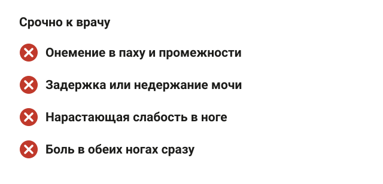<figcaption>Онемение в паху и проблемы с мочеиспусканием — экстренно.</figcaption></figure>

Большая часть грыж не требует срочных мер. Но есть симптомы, при которых сначала врач, а потом всё остальное:

- онемение в паху, промежности или на внутренней поверхности бёдер;
- задержка или недержание мочи и кала;
- нарастающая слабость в ноге: стопа шлёпает, не получается встать на носок или на пятку;
- боль в обеих ногах сразу;
- боль после падения или удара, температура, необъяснимое похудение.

Первые три пункта могут означать сдавление пучка нервов в конце позвоночного канала. Это экстренная ситуация, тут не ждут неделю.

Плановый повод к неврологу: боль в ноге сильная и не уменьшается за 6 недель, мешает спать и работать. Именно таких людей включали в исследование про операцию выше.

## Шпаргалка

<figure class="step">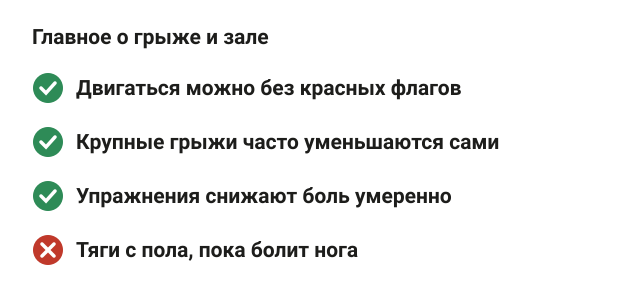<figcaption>Нагрузку подбирают по симптомам, а не по снимку.</figcaption></figure>

- Тренироваться при грыже можно, если нет «красных флагов» и врач не запретил нагрузку.
- Изменения дисков на МРТ есть у многих людей без боли: протрузия у 29% двадцатилетних.
- Крупные грыжи уменьшаются сами чаще мелких: секвестр — в 93–96% случаев, экструзия — в 70%.
- Постельный режим при ишиасе не лучше обычной активности.
- Упражнения уменьшают боль умеренно, лучшего комплекса нет.
- Операция ускоряет облегчение, но через год и 5 лет результат тот же.
- Пока болит нога, откладывай тяги с пола, наклоны с весом и присед со штангой.
- Онемение в паху и проблемы с мочеиспусканием — срочно к врачу.
