---
{
  "title": "Набор мышечной массы для женщин: питание и тренировки",
  "seo_title": "Набор мышечной массы для женщин: питание и программа",
  "description": "Сколько белка и калорий нужно женщине для набора мышц, сколько подходов делать, нужно ли учитывать цикл и что меняется после 40. Цифры из мета-анализов.",
  "slug": "nabor-myshechnoy-massy-dlya-zhenshchin",
  "date": "2026-11-04",
  "category": "nabor-massy",
  "keyword": "набор мышечной массы для женщин",
  "tags": [
    "набор массы",
    "женщины",
    "питание",
    "белок",
    "программа тренировок",
    "гипертрофия"
  ],
  "faq": [
    {
      "q": "Растут ли мышцы у женщин так же, как у мужчин?",
      "a": "В процентах от исходного размера да: по мета-анализу 29 исследований разница между полами 0,69% и незначимая. В килограммах мужчины прибавляют немного больше, в основном за счёт верха тела."
    },
    {
      "q": "Сколько белка нужно девушке для набора мышечной массы?",
      "a": "По позиции ISSN примерно 1,4–2,0 г на кг массы тела в сутки. При весе 60 кг это 84–120 г белка в день."
    },
    {
      "q": "Нужно ли тренироваться по фазам менструального цикла?",
      "a": "Не обязательно. Отдельные исследования показывают пользу тренировок в первой половине цикла, но обзор обзоров 2023 года называет такие выводы преждевременными."
    },
    {
      "q": "Можно ли набрать мышечную массу женщине после 40?",
      "a": "Да. В мета-анализе 30 исследований у людей старше 50 лет относительный прирост мышц у женщин и мужчин был одинаковым. Нужны те же силовые тренировки и достаточный белок."
    }
  ],
  "sources": [
    {
      "title": "Refalo M. C. и соавт. Sex differences in absolute and relative changes in muscle size following resistance training in healthy adults: a systematic review with Bayesian meta-analysis (PeerJ, 2025)",
      "url": "https://doi.org/10.7717/peerj.19042"
    },
    {
      "title": "Roberts B. M., Nuckols G., Krieger J. W. Sex Differences in Resistance Training: A Systematic Review and Meta-Analysis (J Strength Cond Res, 2020)",
      "url": "https://doi.org/10.1519/jsc.0000000000003521"
    },
    {
      "title": "Jones M. D. и соавт. Sex Differences in Adaptations in Muscle Strength and Size Following Resistance Training in Older Adults: A Systematic Review and Meta-analysis (Sports Medicine, 2021)",
      "url": "https://doi.org/10.1007/s40279-020-01388-4"
    },
    {
      "title": "ISSN Position Stand: Protein and exercise (Jäger et al., 2017)",
      "url": "https://link.springer.com/article/10.1186/s12970-017-0177-8"
    },
    {
      "title": "Dose–response relationship between protein intake and muscle mass increase: systematic review and meta-analysis (Nutrition Reviews)",
      "url": "https://academic.oup.com/nutritionreviews/article/79/1/66/5936522"
    },
    {
      "title": "Schoenfeld et al., The effect of protein timing on muscle strength and hypertrophy: a meta-analysis (2013)",
      "url": "https://www.ncbi.nlm.nih.gov/pmc/articles/PMC3879660/"
    },
    {
      "title": "Helms et al., Effect of Small and Large Energy Surpluses on Strength, Muscle, and Skinfold Thickness in Resistance-Trained Individuals (Sports Medicine – Open, 2023)",
      "url": "https://pubmed.ncbi.nlm.nih.gov/37914977/"
    },
    {
      "title": "Slater et al., Is an Energy Surplus Required to Maximize Skeletal Muscle Hypertrophy Associated With Resistance Training? (Frontiers in Nutrition, 2019)",
      "url": "https://www.researchgate.net/publication/335265607_Is_an_Energy_Surplus_Required_to_Maximize_Skeletal_Muscle_Hypertrophy_Associated_With_Resistance_Training"
    },
    {
      "title": "ACSM Position Stand: Resistance Training Prescription for Muscle Function, Hypertrophy, and Physical Performance in Healthy Adults: An Overview of Reviews (2026)",
      "url": "https://www.ovid.com/jnls/acsm-msse/fulltext/10.1249/mss.0000000000003897~american-college-of-sports-medicine-position-stand"
    },
    {
      "title": "Pelland et al., The Resistance Training Dose Response: Meta-Regressions (Sports Medicine, 2026)",
      "url": "https://pubmed.ncbi.nlm.nih.gov/41343037/"
    },
    {
      "title": "Kissow J. и соавт. Effects of Follicular and Luteal Phase-Based Menstrual Cycle Resistance Training on Muscle Strength and Mass (Sports Medicine, 2022)",
      "url": "https://doi.org/10.1007/s40279-022-01679-y"
    },
    {
      "title": "Thompson B. и соавт. The Effect of the Menstrual Cycle and Oral Contraceptives on Acute Responses and Chronic Adaptations to Resistance Training: A Systematic Review (Sports Medicine, 2020)",
      "url": "https://doi.org/10.1007/s40279-019-01219-1"
    },
    {
      "title": "Colenso-Semple L. M. и соавт. Current evidence shows no influence of women's menstrual cycle phase on acute strength performance or adaptations to resistance exercise training (Frontiers in Sports and Active Living, 2023)",
      "url": "https://doi.org/10.3389/fspor.2023.1054542"
    },
    {
      "title": "Chen K. H. и соавт. Nutritional Supplementation Combined with Exercise for Musculoskeletal Health in Women: A Systematic Review and Meta-Analysis (Int J Med Sci, 2026)",
      "url": "https://doi.org/10.7150/ijms.130435"
    },
    {
      "title": "Naddafha S. и соавт. Creatine monohydrate for lean mass, strength, and bone density in postmenopausal women: a systematic review and meta-analysis (JISSN, 2026)",
      "url": "https://doi.org/10.1080/15502783.2026.2668435"
    }
  ]
}
---
Набор мышечной массы для женщин держится на тех же трёх вещах, что и у мужчин: белок 1,4–2,0 г на кг массы тела в сутки, от 10 рабочих подходов на каждую группу мышц в неделю и умеренный профицит калорий, примерно 5–20% сверх поддержки. В процентах от исходного объёма мышцы у женщин растут так же, как у мужчин, это показал мета-анализ 29 исследований. Отдельные «женские» правила вроде тренировок по фазам цикла пока не доказаны. Ниже разберём питание, программу на 3 дня, упражнения и что меняется после 40.

## Растут ли мышцы у женщин так же, как у мужчин

<figure class="step">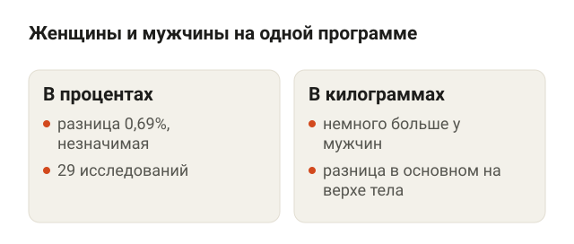<figcaption>В процентах от исходного размера мышцы растут одинаково, в килограммах у мужчин немного больше.</figcaption></figure>

Коротко: в процентах да, в килограммах чуть меньше.

**Мета-анализ Refalo и соавторов (2025)** собрал 29 исследований, где мужчины и женщины 18–45 лет делали одну и ту же программу. Относительный прирост мышц, то есть прибавка в процентах от исходного размера, у полов почти одинаковый: разница 0,69% и статистически незначимая. Абсолютный прирост немного в пользу мужчин, размер эффекта 0,19, и разница видна в основном на верхней части тела. Размер эффекта — мера того, насколько отличаются группы, и 0,19 — это небольшое отличие.

**Мета-анализ Roberts и соавторов (2020)** пришёл к тому же по гипертрофии, то есть росту мышц в объёме: разницы между полами не нашли. А по относительной силе верха тела женщины-новички прибавляли даже больше мужчин.

Что это значит на практике:

- Женщине не нужна отдельная «женская» методика. Работают те же принципы, что описаны в статье [набор мышечной массы для мужчин](/stati/nabor-myshechnoy-massy-dlya-muzhchin/).
- Мышцы у женщины исходно меньше, поэтому и в сантиметрах прибавка меньше. Бояться, что от гантелей «станешь как мужик», по этим данным не стоит: те же проценты от меньшей базы.
- Руки, плечи и спина растут медленнее ног в абсолютных цифрах, так что верху тела нужен свой объём, а не два подхода в конце тренировки.

Оговорка: большая часть данных по тренировкам всё-таки собрана на мужчинах. В мета-регрессии Pelland и соавторов (2026), на которую я опираюсь ниже по объёму, женщин было 20,9% участников.

## Сколько калорий нужно девушке для набора массы

<figure class="step">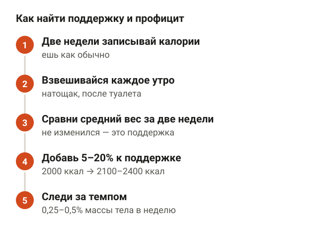<figcaption>Калькулятор даёт прикидку, точнее — две недели записей и взвешиваний.</figcaption></figure>

Мышцам нужен строительный материал и энергия сверх обычной жизни. Это и есть профицит — сколько ты ешь сверх поддержки. Поддержка — калорийность, на которой вес стоит на месте.

Онлайн-калькуляторы дают поддержку приблизительно. В обзоре Slater и соавторов (2019) отмечено, что формулы расчёта энергии не проверяли на людях, которые тренируются с отягощениями. Поэтому надёжнее найти поддержку самой:

1. Две недели ешь как обычно и записывай калории в приложение.
2. Каждое утро взвешивайся натощак после туалета.
3. Посчитай средний вес за первую и вторую неделю.
4. Если средний вес не изменился, средняя калорийность за эти дни и есть поддержка.

Вес у женщины в течение месяца колеблется из-за воды, поэтому сравнивай средние значения, а не отдельные утра. Одно утро на весах ничего не говорит.

Сколько добавлять сверху, лучше всего показывает рандомизированное испытание Helms и соавторов (2023). Атлетов со стажем на восемь недель разделили на три группы: поддержание веса, профицит около 5% и около 15%. Быстрый набор веса в основном добавлял жир, а не силу и толщину мышц. Авторы рекомендуют профицит 5–20% над поддержкой или темп набора 0,25–0,5% массы тела в неделю.

На цифрах:

- Поддержка 2000 ккал → профицит 5–20% → 2100–2400 ккал в день.
- Вес 60 кг → темп 0,25–0,5% → плюс 0,15–0,3 кг в неделю.

Я бы начинал с нижней половины диапазона. Набрать жир легко, а сгонять его потом — отдельный проект на несколько месяцев.

## Питание для набора мышечной массы: сколько белка женщине

<figure class="step">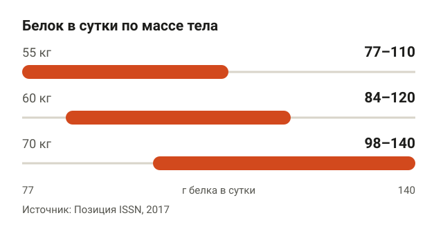<figcaption>Норма ISSN 1,4–2,0 г на кг массы тела, отдельной женской нормы нет.</figcaption></figure>

Позиция Международного общества спортивного питания (ISSN, 2017) рекомендует большинству занимающихся примерно 1,4–2,0 г белка на кг массы тела в сутки. Отдельной нормы для женщин там нет, считаем по тому же коэффициенту.

| Масса тела | Белок 1,4 г/кг | Белок 2,0 г/кг |
|---|---|---|
| 55 кг | 77 г | 110 г |
| 60 кг | 84 г | 120 г |
| 70 кг | 98 г | 140 г |

Мета-анализ 138 рандомизированных исследований (5866 человек) показал: при более высоком белке прирост безжировой массы в среднем на 0,51 кг больше. Безжировая масса — это всё, кроме жира: мышцы, вода, кости.

Жиры и углеводы закрывают оставшиеся калории. Точных процентов для набора массы в источниках нет, поэтому «идеальное соотношение» выдумывать не буду. Пример: девушка 60 кг, цель 2200 ккал. Белок 120 г × 4 ккал = 480 ккал, на жиры и углеводы остаётся 1720 ккал. Делишь их так, как тебе удобно есть и комфортно тренироваться.

Время приёма белка вторично. Мета-регрессия Schoenfeld и соавторов (2013) показала, что на рост мышц сильнее всего влияет белок за весь день, а не то, съела ты его через 30 минут после зала или через два часа. Удобно поделить норму на обычные приёмы пищи: 120 г — это, условно, 4 приёма по 30 г.

## Упражнения для набора массы: с чего начать девушке

<figure class="step">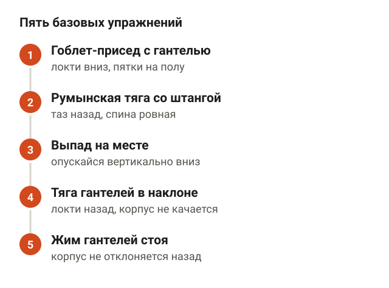<figcaption>Последние 1–3 повторения в подходе тяжёлые, техника не разваливается.</figcaption></figure>

Основу программы составляют базовые упражнения, где работает сразу несколько крупных мышц. Подборка ниже — моя, по биомеханике (я проходил курс N1 Education «Биомеханика упражнений в бодибилдинге»), исследования конкретный набор упражнений не задают. В «Континенте» для них хватает гантельного ряда, стоек и помоста для штанги.

**Гоблет-присед с гантелью.** Встань чуть шире плеч, держи гантель вертикально у груди двумя руками. Садись вниз, как будто между коленями, пока бёдра не станут примерно параллельны полу, затем вставай. Ориентир: локти смотрят вниз, спина ровная, пятки не отрываются от пола.

<figure class="step move">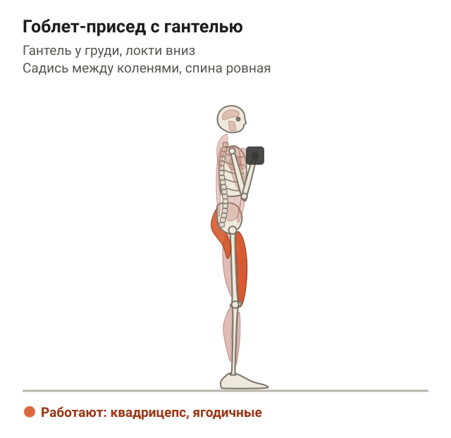</figure>

**Румынская тяга со штангой.** Встань прямо, штанга в опущенных руках у бёдер, колени чуть согнуты. Отводи таз назад и наклоняй корпус, гриф скользит вдоль ног примерно до середины голени. Вернись в стойку, толкая таз вперёд. Ориентир: спина ровная, колени почти не сгибаются сильнее, чем в начале.

<figure class="step move">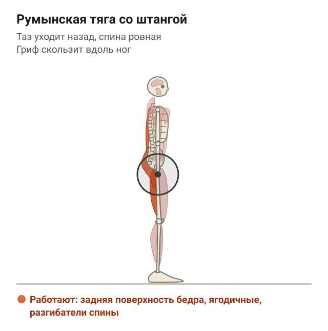</figure>

**Выпад на месте.** Сделай широкий шаг вперёд и останься в этой стойке, задняя нога на носке. Опускайся вертикально вниз, пока колено задней ноги почти не коснётся пола, затем поднимись. Ориентир: корпус почти вертикален, вес на передней ноге.

<figure class="step move">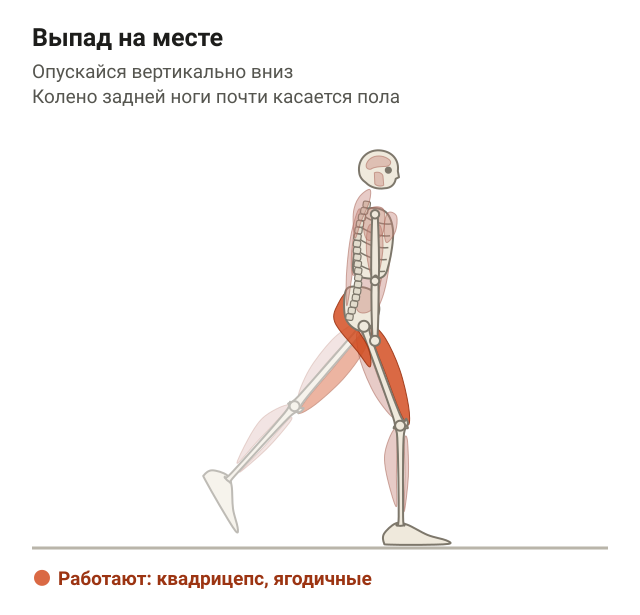</figure>

**Тяга гантелей в наклоне.** Возьми гантели, согни колени и наклонись вперёд с ровной спиной. Тяни гантели к поясу, отводя локти назад, затем опусти. Ориентир: корпус не раскачивается, плечи не поднимаются к ушам.

<figure class="step move"></figure>

**Жим гантелей стоя.** Встань прямо, гантели у плеч, ладони смотрят вперёд. Выжми их вверх над головой и опусти обратно к плечам. Ориентир: корпус не отклоняется назад, живот и ягодицы напряжены.

<figure class="step move">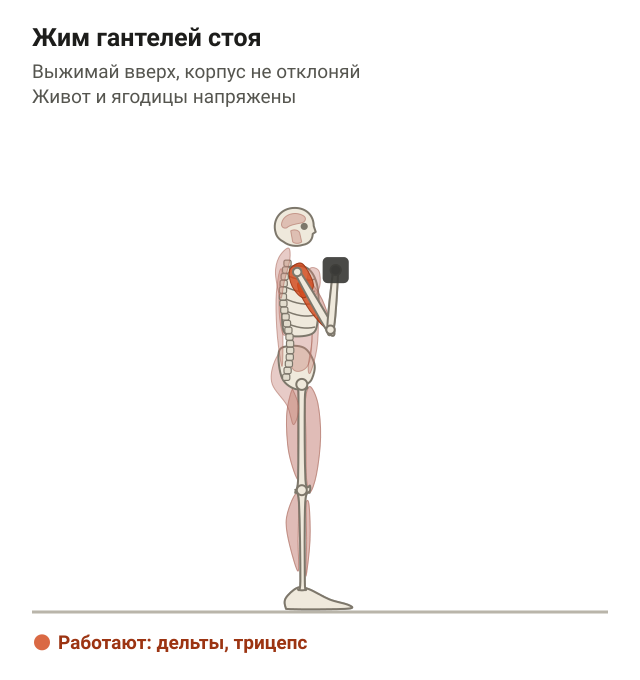</figure>

Последние 1–3 повторения в рабочем подходе должны даваться тяжело, но без развала техники. Как только делаешь верхнюю границу повторений во всех подходах, прибавляй вес.

## Программа тренировок для женщин на массу: 3 дня в неделю

<figure class="step">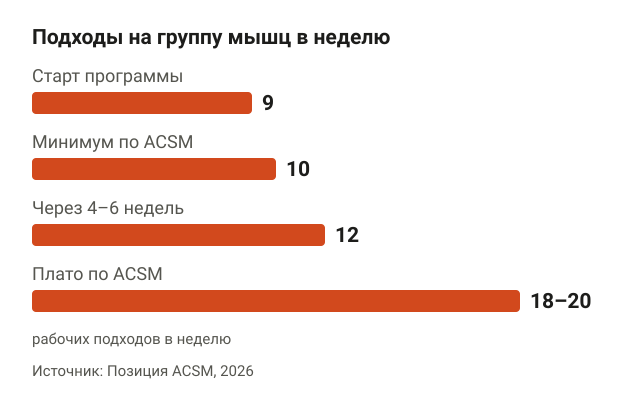<figcaption>Программа стартует с 9 подходов и через 4–6 недель выходит на 12. Плато по ACSM — около 18–20.</figcaption></figure>

Позиция Американского колледжа спортивной медицины (ACSM, 2026) — обзор обзоров. По ней рост мышц усиливает объём от 10 рабочих подходов на группу мышц в неделю, а отдача выходит на плато примерно к 18–20 подходам. Мета-регрессия Pelland и соавторов (2026) это подтверждает: больше объёма — больше прирост, но каждый следующий подход добавляет меньше. Частота при одинаковом объёме на рост мышц почти не влияет, так что 3 тренировки в неделю хватает.

Пример программы на 3 дня, всё в 3 подхода по 8–12 повторений:

| День | Упражнения |
|---|---|
| Понедельник | Гоблет-присед, тяга гантелей в наклоне, жим гантелей стоя, ягодичный мост, планка |
| Среда | Румынская тяга, тяга верхнего блока, жим гантелей лёжа, выпад на месте |
| Пятница | Приседания со штангой или гоблет-присед, тяга горизонтального блока, отжимания, румынская тяга, подъём на носки |

На старте это около 9 прямых подходов в неделю на переднюю поверхность бедра (гоблет-присед, выпад, присед), на ягодицы с задней поверхностью бедра (мост и две румынские тяги) и на спину (три тяги). Через 4–6 недель добавь по одному подходу в основные упражнения, и выйдешь на 12 подходов на группу. Если верх тела отстаёт, начни прибавку с тяг и жимов. Подробнее, как считать подходы и куда расти, разобрано в статье [сколько подходов делать для роста мышц](/stati/skolko-podhodov-dlya-rosta-myshc/).

## Менструальный цикл и набор массы: нужно ли подстраивать тренировки

<figure class="step">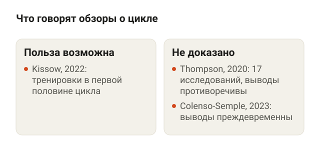<figcaption>Подстраивать программу под фазы цикла не обязательно: данные противоречивы.</figcaption></figure>

Популярный совет: тяжело тренироваться в первой половине цикла, после менструации, а во второй снижать нагрузку. Что говорят данные:

- **Обзор Kissow и соавторов (2022)** приводит исследования, где тренировки в фолликулярной фазе, то есть в первой половине цикла, давали больше силы и массы, чем в лютеиновой. Авторы называют это возможным преимуществом, а не доказанным.
- **Систематический обзор Thompson и соавторов (2020)** разобрал 17 исследований на 418 женщинах и назвал результаты противоречивыми: выборки маленькие, методика слабая.
- **Обзор обзоров Colenso-Semple и соавторов (2023)** делает вывод жёстче: говорить, что колебания гормонов по циклу заметно влияют на силу или рост мышц, пока преждевременно.

По гормональным контрацептивам картина такая же: отдельные исследования есть, единого вывода нет.

Практический вывод: планировать программу по календарю цикла не нужно. Если в какие-то дни самочувствие хуже, снизь вес или убери один подход. Это нормальная регулировка нагрузки, а не потерянная тренировка.

## Набор мышечной массы для женщин после 40

<figure class="step">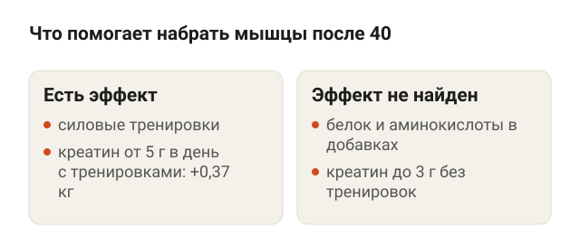<figcaption>Основа — силовые тренировки. Креатин дал небольшую прибавку только вместе с ними.</figcaption></figure>

Мышцы растут и после 40, и после 50. Мета-анализ Jones и соавторов (2021) собрал 30 исследований, 1410 человек старше 50 лет. Относительный прирост мышц у женщин и мужчин был одинаковым, а относительная сила ног у женщин росла даже больше.

С питанием после 40 честных данных меньше:

- **Белковые добавки.** Мета-анализ 2026 года (14 исследований, 763 женщины разного возраста) не нашёл, что белок, аминокислоты или креатин в добавках к тренировкам заметно прибавляют мышечную массу. Сила жима лёжа и хвата росла немного больше. То есть порошок не заменяет нормальное питание и тренировки.
- **Креатин после менопаузы.** Мета-анализ 7 исследований (608 женщин, средний возраст около 62 лет) показал прибавку безжировой массы на 0,37 кг и жима ногами на 7,5 кг. Эффект был, когда креатин от 5 г в день сочетали с силовыми тренировками. Без тренировок и при дозах до 3 г разницы не было. Побочные эффекты как у плацебо, но про добавки при хронических болезнях — сначала к врачу.

Я проходил семинар «Тренировка женщин по рекомендациям эндокринолога» и в работе с клиентками после 40 держусь простой логики: возраст — повод внимательнее следить за восстановлением, а не повод отказаться от рабочих весов. Про похудение в этом возрасте есть отдельная статья: [как похудеть после 40 лет женщине](/stati/kak-pohudet-posle-40-zhenshchine/).

## Шпаргалка

<figure class="step">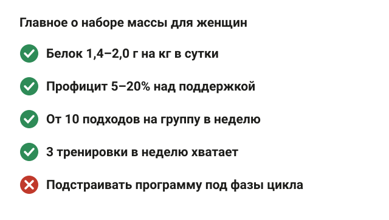<figcaption>Те же принципы, что у мужчин: белок, объём, умеренный профицит.</figcaption></figure>

- В процентах мышцы у женщин растут так же, как у мужчин. Отдельная «женская» методика не нужна.
- Белок 1,4–2,0 г на кг массы тела в сутки. При весе 60 кг это 84–120 г.
- Профицит 5–20% над поддержкой, вес растёт на 0,25–0,5% массы тела в неделю. Быстрее — в основном жир.
- От 10 рабочих подходов на группу мышц в неделю, плато около 18–20.
- 3 тренировки в неделю хватает. Основа — приседания, румынская тяга, выпады, тяги и жимы.
- Тренироваться по фазам цикла не обязательно, данные противоречивы.
- После 40 мышцы растут так же в процентах. Креатин от 5 г в день с тренировками дал небольшую прибавку после менопаузы.
