---
{
  "title": "Растяжение мышцы: что делать в первые дни и как восстановиться",
  "seo_title": "Растяжение мышцы: что делать и когда начинать упражнения",
  "description": "Растяжение мышцы бедра, икры, паха или спины: как отличить от крепатуры, что делать в первые дни, когда начинать упражнения и когда идти к врачу.",
  "slug": "rastyazhenie-myshcy-chto-delat",
  "date": "2026-11-05",
  "category": "travmy",
  "keyword": "растяжение мышцы что делать",
  "tags": [
    "растяжение мышцы",
    "травмы",
    "задняя поверхность бедра",
    "икра",
    "пах",
    "реабилитация"
  ],
  "faq": [
    {
      "q": "Растяжение мышцы: что делать в первый день?",
      "a": "Прекрати упражнение, снизь нагрузку на мышцу, но не обездвиживай её полностью. При отёке подними ногу и наложи эластичный бинт. Через 2 дня начинай аккуратные упражнения."
    },
    {
      "q": "Сколько заживает растяжение мышцы бедра?",
      "a": "Зависит от тяжести. В исследовании Askling футболисты с растяжением задней поверхности бедра возвращались к тренировкам в среднем за 28 дней при упражнениях в удлинённом положении и за 51 день при обычных упражнениях."
    },
    {
      "q": "Можно ли тренироваться при растяжении икроножной мышцы?",
      "a": "Да, но не саму мышцу на полную. В исследовании на 50 спортсменах-любителях с растяжением бедра или икры реабилитация с 2-го дня вернула к спорту на 3 недели быстрее, чем с 9-го. Начинай со статических напряжений и подъёмов на носки без веса."
    },
    {
      "q": "Помогает ли лёд при растяжении мышцы?",
      "a": "Лёд может немного уменьшить боль, но в обзоре 22 исследований не нашли доказательств, что он ускоряет заживление мышц. Уколы плазмы, обогащённой тромбоцитами, в двойном слепом исследовании тоже не ускорили возвращение к спорту."
    },
    {
      "q": "Когда с растяжением идти к врачу?",
      "a": "Если не можешь наступить на ногу, в мышце прощупывается провал, синяк большой и растёт, немеет ниже травмы или боль не уменьшается за неделю."
    }
  ],
  "sources": [
    {
      "title": "Bayer M. L., Magnusson S. P., Kjaer M. Early versus delayed rehabilitation after acute muscle injury: randomized trial (N Engl J Med, 2017)",
      "url": "https://doi.org/10.1056/NEJMc1708134"
    },
    {
      "title": "Ekstrand J., Hägglund M., Waldén M. Epidemiology of muscle injuries in professional football (Am J Sports Med, 2011)",
      "url": "https://doi.org/10.1177/0363546510395879"
    },
    {
      "title": "Askling C. M. и соавт. Acute hamstring injuries in Swedish elite football: RCT comparing two rehabilitation protocols (Br J Sports Med, 2013)",
      "url": "https://doi.org/10.1136/bjsports-2013-092165"
    },
    {
      "title": "Hickey J. T. и соавт. Pain-free versus pain-threshold rehabilitation following acute hamstring strain injury: RCT (JOSPT, 2020)",
      "url": "https://doi.org/10.2519/jospt.2020.8895"
    },
    {
      "title": "Pas H. I. и соавт. Efficacy of rehabilitation (lengthening) exercises, platelet-rich plasma injections and other conservative interventions in acute hamstring injuries: systematic review and meta-analysis (Br J Sports Med, 2015)",
      "url": "https://doi.org/10.1136/bjsports-2015-094879"
    },
    {
      "title": "Reurink G. и соавт. Platelet-rich plasma injections in acute hamstring muscle injury: 1-year follow-up of the Dutch Hamstring Injection Therapy study (Br J Sports Med, 2015)",
      "url": "https://doi.org/10.1136/bjsports-2014-094250"
    },
    {
      "title": "Bleakley C., McDonough S., MacAuley D. The use of ice in the treatment of acute soft-tissue injury: systematic review of RCTs (Am J Sports Med, 2004)",
      "url": "https://doi.org/10.1177/0363546503260757"
    },
    {
      "title": "Dubois B., Esculier J.-F. Soft-tissue injuries simply need PEACE and LOVE (Br J Sports Med, 2020)",
      "url": "https://doi.org/10.1136/bjsports-2019-101253"
    },
    {
      "title": "van Dyk N., Behan F. P., Whiteley R. Including the Nordic hamstring exercise in injury prevention programmes halves the rate of hamstring injuries: meta-analysis of 8459 athletes (Br J Sports Med, 2019)",
      "url": "https://doi.org/10.1136/bjsports-2018-100045"
    },
    {
      "title": "Harøy J. и соавт. The Adductor Strengthening Programme prevents groin problems among male football players: cluster-randomised controlled trial (Br J Sports Med, 2019)",
      "url": "https://doi.org/10.1136/bjsports-2017-098937"
    }
  ]
}
---
При растяжении мышцы в первые 1–2 дня снизь нагрузку на мышцу, но не обездвиживай её, а потом начинай упражнения: в рандомизированном исследовании на 50 спортсменах-любителях те, кто начал реабилитацию через 2 дня после травмы, вернулись к спорту на 3 недели раньше тех, кто ждал 9 дней. Чаще всего страдают задняя поверхность бедра, пах, передняя поверхность бедра и икра. Уколы плазмы восстановление не ускоряют, а вот упражнения на мышцу в удлинённом положении сокращают срок почти вдвое. Сильная боль, провал в мышце, огромный синяк или невозможность наступить на ногу — повод сначала показаться врачу.

Ниже разберу, как отличить растяжение от обычной боли после тренировки, что делать в первые дни, какие упражнения делать при растяжении мышцы бедра, икры, паха и спины и как не порвать мышцу снова.

## Растяжение мышцы или крепатура: как отличить

<figure class="step">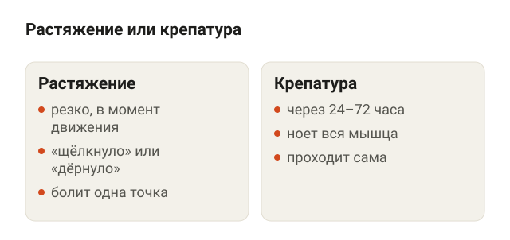<figcaption>Растяжение болит сразу и в одной точке, крепатура появляется через 1–3 дня и болит вся мышца.</figcaption></figure>

Растяжение мышцы — это бытовое название надрыва мышечных волокон. Мышца не «растягивается», как резинка, а получает микроразрывы или частичный разрыв. Обычно это случается в момент, когда мышца напряжена и одновременно удлиняется: рывок в спринте, широкий мах ногой, резкая остановка, тяжёлый подъём из глубокой позиции.

Крепатура — это отсроченная мышечная боль после непривычной нагрузки. Она появляется не сразу, а через 24–72 часа, и болит вся поработавшая мышца, а не одна точка.

Как отличить:

- **Растяжение.** Боль резкая, в момент движения, часто с ощущением «щёлкнуло» или «дёрнуло». Болит конкретное место, его можно найти пальцем. Мышцу больно напрягать и растягивать сразу после травмы.
- **Крепатура.** Ничего не случилось на тренировке, а на следующий день ноет вся мышца с двух сторон. Через несколько дней проходит сама.

Подробнее про мышечную боль после зала и про то, когда она уже не похожа на крепатуру, разбирал в статье [болит спина после тренировки](/stati/bolit-spina-posle-trenirovki/). Логика там одинаковая для любой мышцы.

## Где чаще всего бывает растяжение мышцы

<figure class="step">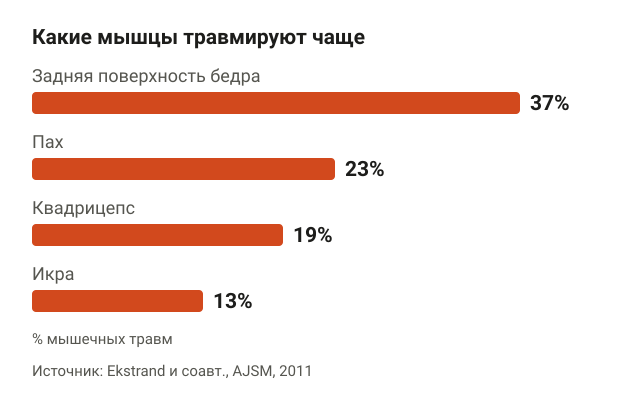<figcaption>92% мышечных травм у футболистов — четыре группы мышц ног.</figcaption></figure>

Лучше всего мышечные травмы изучены в футболе. Ekstrand и соавторы 9 сезонов наблюдали 2299 профессиональных футболистов из 51 команды и зарегистрировали 2908 мышечных травм. Они составили 31% всех травм.

92% мышечных травм пришлись на четыре группы мышц ног:

- задняя поверхность бедра — 37%;
- приводящие мышцы, то есть пах, — 23%;
- передняя поверхность бедра (квадрицепс) — 19%;
- икроножные мышцы — 13%.

16% травм были повторными, и восстанавливались после них дольше, чем после первой травмы. Икру с возрастом травмировали чаще, у остальных групп такой связи не было.

Это данные по профессионалам, у любителей точных цифр меньше. Но набор мышц тот же: в зале и на пробежке растяжение мышцы бедра, паха и икры встречается чаще всего. Растяжение мышц спины и ягодиц тоже бывает, но исследований про них в формате «травма мышцы» почти нет.

## Растяжение мышцы: что делать в первые 2–3 дня

<figure class="step">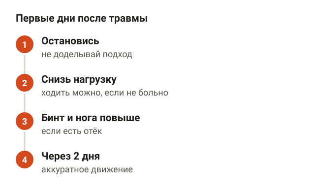<figcaption>Снизить нагрузку, но не обездвиживать, через 2 дня начинать движение.</figcaption></figure>

В исследованиях первых дней после травмы мало, поэтому дальше смесь данных и общих принципов, которыми пользуются спортивные врачи и реабилитологи. В 2020 году в British Journal of Sports Medicine их собрали в схему PEACE & LOVE. По сути, это рекомендации, а не результат одного эксперимента.

Первые 1–3 дня:

1. **Остановись и не терпи.** Если на тренировке что-то дёрнуло, заканчивай упражнение. Доделать подход «через боль» — лучший способ превратить надрыв в разрыв.
2. **Снизь нагрузку, но не ложись.** Ходить можно, если ходьба не вызывает сильной боли. Растягивать и нагружать больную мышцу пока не надо.
3. **Подними ногу и наложи эластичный бинт**, если есть отёк. Так советуют авторы PEACE & LOVE, чтобы отёк был меньше. Исследований, что это ускоряет заживление мышцы, нет.
4. **Через 2 дня начинай аккуратное движение.** Об этом — следующий раздел.

Про обезболивающие и противовоспалительные средства решает врач. Авторы PEACE & LOVE советуют не злоупотреблять ими в первые дни, потому что воспаление — часть заживления.

## Когда начинать упражнения: раньше — быстрее

<figure class="step">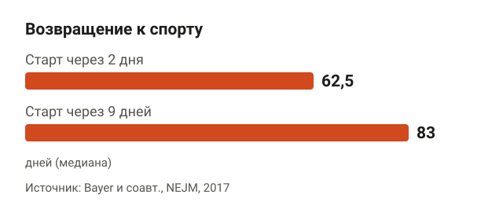<figcaption>Реабилитация со 2-го дня вернула к спорту на 3 недели раньше, чем с 9-го.</figcaption></figure>

Самый частый вопрос: сколько ждать. Данные здесь удивляют. В датском рандомизированном исследовании 2017 года (опубликовано в New England Journal of Medicine) было 50 спортсменов-любителей со свежим растяжением мышцы бедра или икры, подтверждённым на УЗИ и МРТ. Средний возраст — 34 года. Одна группа начинала реабилитацию через 2 дня после травмы, вторая — через 9 дней.

Программа у всех была одинаковая:

1. Неделя 1 — ежедневная статическая растяжка.
2. Недели 2–4 — ежедневные статические напряжения с растущей нагрузкой. Статическое напряжение — это когда мышца напрягается, но сустав не двигается: ты давишь стопой в стену.
3. Недели 5–8 — упражнения с весом 3 раза в неделю.
4. Недели 9–12 — тяжёлые силовые и упражнения, похожие на движения в спорте.

Срок возвращения к спорту в ранней группе составил 62,5 дня, в поздней — 83 дня (это медианы: у половины участников быстрее, у половины дольше). Разница — 3 недели. Повторная травма за год случилась у одного человека в ранней группе и ни у кого в поздней, то есть заметного роста риска не было.

Как понять, сколько терпеть. В австралийском исследовании 2020 года 43 мужчины с растяжением задней поверхности бедра делали одинаковую реабилитацию: одни строго без боли, другие допускали дискомфорт. Сроки возвращения почти не отличались: 15 и 17 дней. Зато у тех, кто допускал дискомфорт, сила мышцы восстановилась на 15% лучше. Повторных травм было по две в каждой группе. Ориентир, которым пользуюсь сам: во время упражнения терпимый дискомфорт, а на следующее утро мышца не хуже, чем была.

## Упражнения при растяжении мышцы бедра, икры и спины

<figure class="step">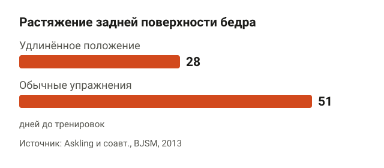<figcaption>С упражнениями в удлинённом положении мышцы футболисты вернулись почти вдвое быстрее.</figcaption></figure>

Какие упражнения лучше всего изучены на задней поверхности бедра. Askling и соавторы в 2013 году взяли 75 футболистов шведской высшей лиги с растяжением, подтверждённым МРТ. Половина делала упражнения, в которых мышца работает в удлинённом положении, вторая половина — обычные упражнения на силу и гибкость.

С упражнениями в удлинённом положении игроки вернулись к тренировкам в среднем через 28 дней, с обычными — через 51 день. Повторная травма за год была одна, в группе обычных упражнений. Мета-анализ 2015 года, где объединили это и похожее исследование, тоже показал преимущество таких упражнений.

Порядок ниже — это логика тренера после того, как прошли первые дни и обычная ходьба не болит. Начинай с веса, который позволяет сделать 12–15 повторений с запасом, и прибавляй, только если на следующий день мышца не хуже.

**Румынская тяга.** Подходит при растяжении задней поверхности бедра, когда ходьба уже не болит. Встань прямо, штанга у бёдер, колени чуть согнуты. Начинай с пустого грифа или с гантелей. Отводи таз назад и наклоняй корпус с ровной спиной, гриф скользит вдоль ног. Опускайся до лёгкого натяжения сзади бедра и возвращайся. Ориентиры: поясница не округляется, колени не уходят вперёд.

<figure class="step move"></figure>

**Подъём на носки.** Для икры. Встань носками на ступеньку, пятки свисают, держись за опору. Поднимись на носки как можно выше, задержись на секунду и медленно опусти пятки чуть ниже ступеньки. Ориентиры: колени прямые, вес на большом пальце, а не на мизинце. Первые тренировки делай на полу и без опускания ниже ступеньки, потом на ступеньке, потом на одной ноге и с весом.

<figure class="step move">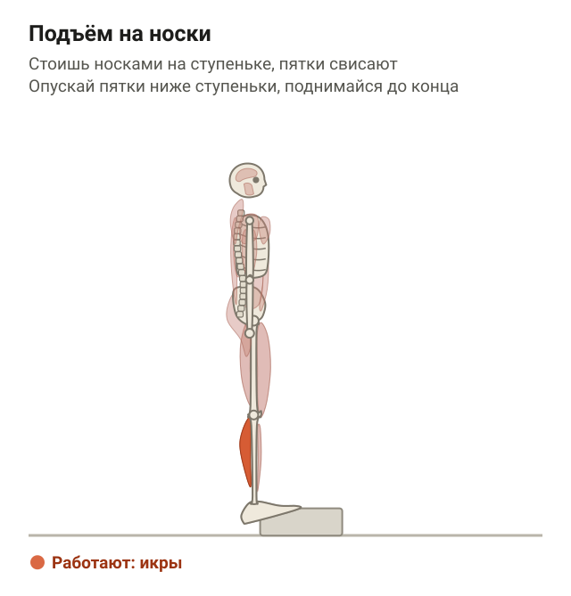</figure>

**Выпад на месте.** Для передней поверхности бедра и ягодиц. Встань в широкий шаг, задняя нога на носке. Опускайся вниз, пока заднее колено почти не коснётся пола, и поднимайся. Ориентиры: корпус ровный, переднее колено идёт по направлению носка. Сначала неглубоко, амплитуду увеличивай с каждой тренировкой.

<figure class="step move">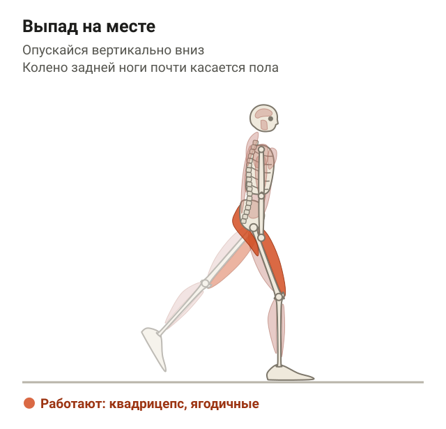</figure>

**«Птица-собака».** Для мышц спины, когда растянул поясницу. Встань на четвереньки, ладони под плечами, колени под тазом. Вытяни вперёд одну руку и назад противоположную ногу, задержись на 2–3 секунды и вернись. Ориентиры: поясница не прогибается, таз не заваливается в сторону.

<figure class="step move">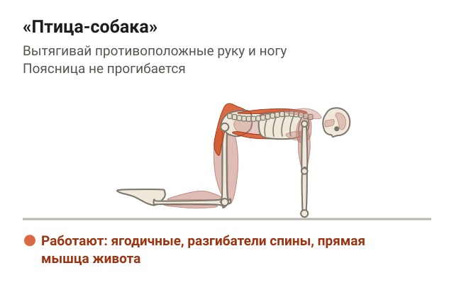</figure>

При растяжении паховой мышцы порядок тот же: статическое сжатие мяча между коленями лёжа, потом приведение ноги с резинкой или в тренажёре, потом упражнения с весом тела. Про боль в пояснице, которую в быту часто называют «растяжением спины», подробно писал в статье [неспецифическая боль в спине](/stati/nespecificheskaya-bol-v-spine/): там другие механизмы и другие данные.

## Лёд, уколы и мази: что не ускоряет восстановление

<figure class="step">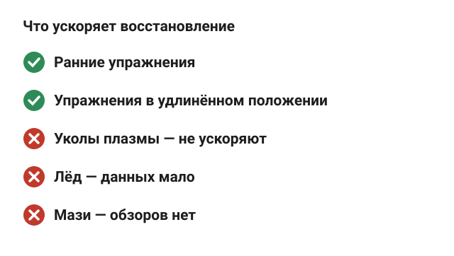<figcaption>В исследованиях срок сокращают только ранние и правильно подобранные упражнения.</figcaption></figure>

Отдельно про популярные способы, которые хочется попробовать.

- **Уколы плазмы, обогащённой тромбоцитами.** Это когда из твоей крови выделяют плазму и вводят в мышцу. В голландском двойном слепом исследовании на 80 спортсменах с растяжением задней поверхности бедра уколы не ускорили возвращение к спорту по сравнению с уколами физраствора. Через год разницы в повторных травмах тоже не было. Мета-анализ 2015 года пришёл к тому же выводу.
- **Лёд.** Систематический обзор 2004 года собрал 22 исследования, их среднее качество было низким. Были слабые данные, что лёд вместе с упражнениями помогает после растяжения связок голеностопа. Исследований про закрытые травмы мышц и других мягких тканей было мало. Лёд может немного снять боль, но доказательств, что он ускоряет заживление мышцы, нет.
- **Мази и пластыри.** Обзоров про их влияние на сроки возвращения к тренировкам я не нашёл.

То есть единственное, что в исследованиях заметно сокращает срок, — это ранние и правильно подобранные упражнения. Это не самый приятный ответ, зато его можно делать самому.

## Когда идти к врачу и как не порвать мышцу снова

<figure class="step">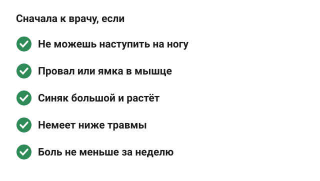<figcaption>При этих признаках сначала осмотр и УЗИ или МРТ, потом упражнения.</figcaption></figure>

Обычное растяжение восстанавливается упражнениями. Но есть признаки, при которых сначала нужен врач и УЗИ или МРТ. Это ориентиры тренера, а не данные одного исследования:

- не можешь наступить на ногу или пройти несколько шагов;
- в мышце прощупывается провал или ямка;
- синяк большой и растёт, сильный отёк;
- немеет или колет ниже места травмы;
- боль не становится меньше за неделю;
- травма у места, где мышца крепится к кости, например у седалищного бугра под ягодицей.

Разрыв у места крепления и полный разрыв иногда оперируют, и тянуть с этим нельзя.

Теперь про повтор. 16% мышечных травм у футболистов были повторными, поэтому после возвращения работа не заканчивается. Две программы профилактики хорошо изучены:

- **Скандинавские сгибания** для задней поверхности бедра. Мета-анализ 15 исследований и 8459 спортсменов: программы с этим упражнением снижают число травм задней поверхности бедра до 51%.
- **Копенгагенское упражнение** для паха, боковая планка с опорой ногой на скамью. В норвежском исследовании на 652 футболистах полупрофессиональных команд жалобы на пах в среднем за сезон были у 13,5% тех, кто его делал, и у 21,3% тех, кто тренировался как обычно. Риск ниже на 41%.

Это данные спортсменов-командников. Переносить их на посетителя зала напрямую нельзя, но логика понятная: сильная мышца в удлинённом положении рвётся реже. Как вернуть нагрузки после травмы колена, где те же мышцы бедра, разобрал в статье [реабилитация после травмы колена](/stati/reabilitaciya-posle-travmy-kolena/).

## Шпаргалка

<figure class="step">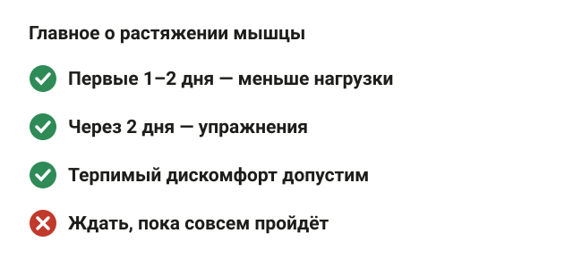<figcaption>Не обездвиживать, начинать упражнения рано, следить за признаками для врача.</figcaption></figure>

- Растяжение мышцы — это надрыв волокон: боль резкая, в момент движения, в конкретной точке. Крепатура появляется через 1–3 дня и болит вся мышца.
- 92% мышечных травм у футболистов — задняя поверхность бедра, пах, квадрицепс и икра.
- Первые 1–2 дня: снизь нагрузку, но не обездвиживай, не грей, при отёке — бинт и нога повыше.
- Начало реабилитации через 2 дня вместо 9 ускорило возвращение к спорту на 3 недели.
- Упражнения в удлинённом положении мышцы: возвращение через 28 дней вместо 51.
- Терпимый дискомфорт допустим, если на следующий день не хуже.
- Уколы плазмы не ускоряют восстановление, данных за лёд мало.
- К врачу: не можешь наступить, провал в мышце, большой синяк, онемение, боль не уменьшается за неделю.
- Профилактика повтора: скандинавские сгибания (до −51% травм бедра), копенгагенское упражнение (−41% жалоб на пах).
