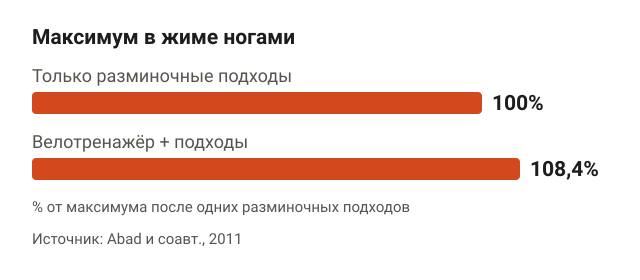
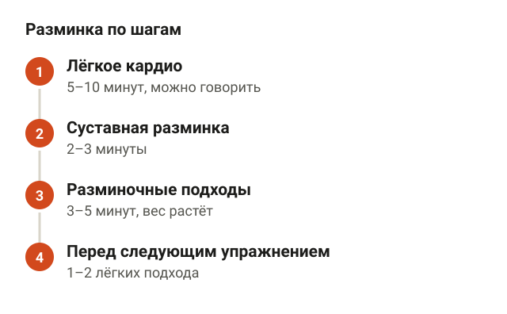
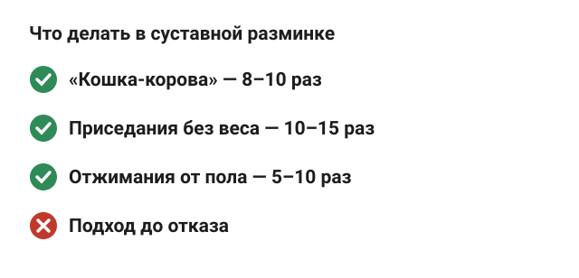
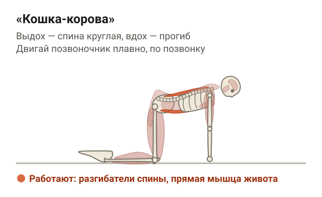
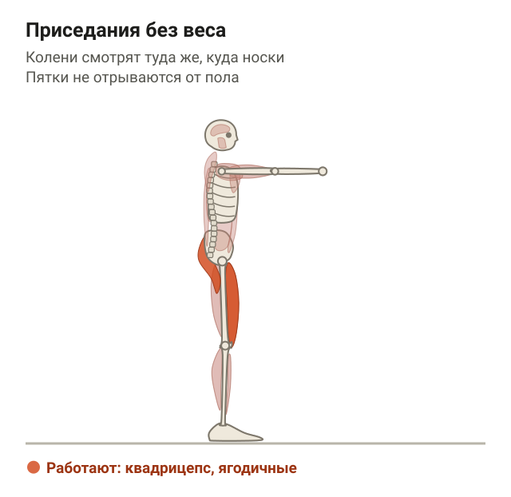
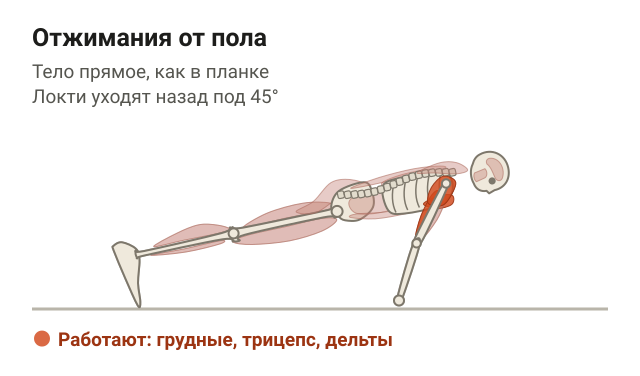
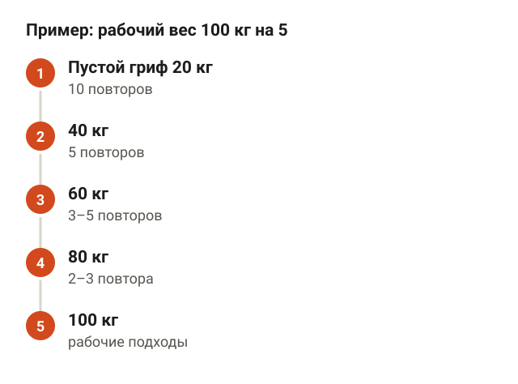
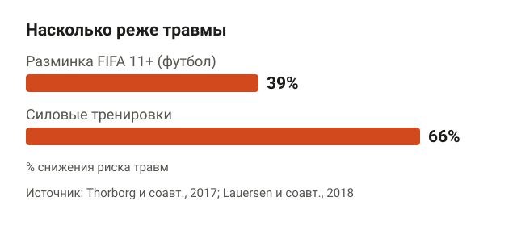
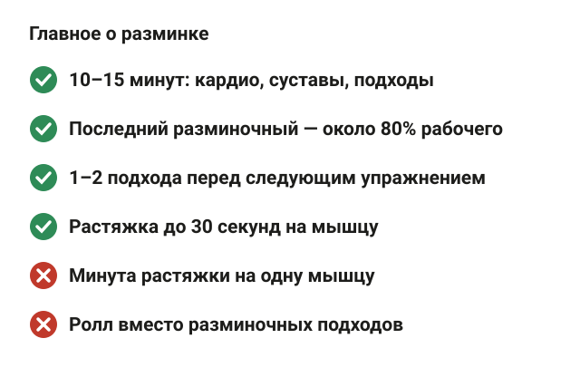

---
{
  "title": "Разминка перед силовой тренировкой: что делать и сколько",
  "seo_title": "Разминка перед силовой тренировкой: схема на 10–15 минут",
  "description": "Как размяться перед силовой: сколько кардио, нужна ли растяжка и ролл, сколько разминочных подходов и с каким весом. Схема на 10–15 минут по исследованиям.",
  "slug": "razminka-pered-silovoy-trenirovkoy",
  "date": "2026-11-09",
  "category": "trenirovki",
  "keyword": "разминка перед силовой тренировкой",
  "tags": [
    "разминка",
    "растяжка",
    "разминочные подходы",
    "травмы",
    "новичкам"
  ],
  "faq": [
    {
      "q": "Сколько должна длиться разминка перед силовой тренировкой?",
      "a": "10–15 минут. ACSM советует 5–10 минут лёгкой и умеренной нагрузки в начале тренировки, затем 2–3 минуты суставной разминки и несколько разминочных подходов первого упражнения."
    },
    {
      "q": "Можно ли делать растяжку перед силовой?",
      "a": "Динамическую — да, она в среднем немного улучшает результат. Статическую держи до 30 секунд на мышцу: по обзору Behm и соавторов 2016 года растяжка от 60 секунд снижает силу сразу после неё в среднем на 4,6%, а до 60 секунд — на 1,1%."
    },
    {
      "q": "Сколько разминочных подходов делать перед рабочими?",
      "a": "Обычно 2–4 с растущим весом и падающим числом повторов. Последний — около 80% рабочего веса на 2–5 повторов: в исследованиях такая разминка давала больше скорости и объёма, чем лёгкая и длинная."
    },
    {
      "q": "Можно ли тренироваться без разминки?",
      "a": "Можно, если веса умеренные: в исследовании Ribeiro и соавторов 2014 года число повторов с 80% от максимума без разминки не отличалось. Но перед тяжёлыми подходами разминка добавляет силы, в исследовании Abad и соавторов 2011 года максимум был на 8,4% выше."
    }
  ],
  "sources": [
    {
      "title": "Fradkin A. J., Zazryn T. R., Smoliga J. M. Effects of warming-up on physical performance: a systematic review with meta-analysis (J Strength Cond Res, 2010)",
      "url": "https://doi.org/10.1519/JSC.0b013e3181c643a0"
    },
    {
      "title": "Racinais S., Oksa J. Temperature and neuromuscular function (Scand J Med Sci Sports, 2010)",
      "url": "https://doi.org/10.1111/j.1600-0838.2010.01204.x"
    },
    {
      "title": "Abad C. C. и соавт. Combination of general and specific warm-ups improves leg-press one repetition maximum compared with specific warm-up in trained individuals (J Strength Cond Res, 2011)",
      "url": "https://doi.org/10.1519/JSC.0b013e3181e8611b"
    },
    {
      "title": "Ribeiro A. S. и соавт. Effect of different warm-up procedures on the performance of resistance training exercises (Percept Mot Skills, 2014)",
      "url": "https://doi.org/10.2466/25.29.PMS.119c17z7"
    },
    {
      "title": "Garber C. E. и соавт. American College of Sports Medicine position stand. Quantity and quality of exercise for developing and maintaining cardiorespiratory, musculoskeletal, and neuromotor fitness in apparently healthy adults (Med Sci Sports Exerc, 2011)",
      "url": "https://doi.org/10.1249/MSS.0b013e318213fefb"
    },
    {
      "title": "Behm D. G. и соавт. Acute effects of muscle stretching on physical performance, range of motion, and injury incidence in healthy active individuals: a systematic review (Appl Physiol Nutr Metab, 2016)",
      "url": "https://doi.org/10.1139/apnm-2015-0235"
    },
    {
      "title": "Wiewelhove T. и соавт. A meta-analysis of the effects of foam rolling on performance and recovery (Front Physiol, 2019)",
      "url": "https://doi.org/10.3389/fphys.2019.00376"
    },
    {
      "title": "Ribeiro B. и соавт. The role of specific warm-up during bench press and squat exercises: a novel approach (Int J Environ Res Public Health, 2020)",
      "url": "https://doi.org/10.3390/ijerph17186882"
    },
    {
      "title": "Viveiros L. и соавт. High-load and low-volume warm-up increases performance in a resistance training session (J Bodyw Mov Ther, 2024)",
      "url": "https://doi.org/10.1016/j.jbmt.2024.08.004"
    },
    {
      "title": "Neves P. P. и соавт. Impact of re-warm-up during resistance training: analysis of mechanical and physiological variables (Sports, 2025)",
      "url": "https://doi.org/10.3390/sports13050142"
    },
    {
      "title": "Thorborg K. и соавт. Effect of specific exercise-based football injury prevention programmes on the overall injury rate in football: a systematic review and meta-analysis of the FIFA 11 and 11+ programmes (Br J Sports Med, 2017)",
      "url": "https://doi.org/10.1136/bjsports-2016-097066"
    },
    {
      "title": "Lauersen J. B., Andersen T. E., Andersen L. B. Strength training as superior, dose-dependent and safe prevention of acute and overuse sports injuries: a systematic review, qualitative analysis and meta-analysis (Br J Sports Med, 2018)",
      "url": "https://doi.org/10.1136/bjsports-2018-099078"
    }
  ]
}
---
Разминка перед силовой тренировкой занимает 10–15 минут и состоит из трёх частей: 5–10 минут лёгкого кардио, пара минут движений для суставов и 2–4 разминочных подхода первого упражнения с весом, который растёт до рабочего. Долгая растяжка в ней не нужна: если тянуть одну мышцу минуту и дольше, сила сразу после этого падает в среднем на 4,6%. Перед каждым следующим базовым упражнением хватает 1–2 лёгких подходов.

Ниже разбираю, зачем вообще разминаться, сколько крутить педали, что делать с растяжкой и роллом, как подобрать вес для разминочных подходов и защищает ли всё это от травм.

## Зачем нужна разминка перед силовой тренировкой

<figure class="step"><figcaption>С 20 минутами велотренажёра перед разминочными подходами максимум был в среднем на 8,4% больше.</figcaption></figure>

Главное, что делает разминка, — греет мышцы. В обзоре Racinais и Oksa (2010) при коротких нагрузках результат растёт на 2–5% на каждый градус температуры мышцы. Тёплая мышца быстрее сокращается, а нервная система быстрее передаёт ей сигнал.

Насколько это заметно в зале, показали бразильские исследователи (Abad и соавторы, 2011). 13 тренированных людей проверяли максимум в жиме ногами два раза. В первый раз они делали только два подхода с лёгким весом: 8 повторов примерно с 50% от максимума и 3 повтора с 70%. Во второй раз перед теми же подходами было 20 минут на велотренажёре в спокойном темпе. После велотренажёра максимум оказался в среднем на 8,4% больше.

Общая картина тоже в пользу разминки. В мета-анализе Fradkin и соавторов (2010) собрали 32 исследования, и в 79% показателей результат после разминки был лучше, чем без неё. Признаков того, что разминка вредит, авторы почти не нашли.

Честно скажу и про обратные данные. В бразильском исследовании Ribeiro и соавторов (2014) 15 мужчин делали жим лёжа, присед и сгибание рук до отказа с 80% от максимума, и число повторов после разных разминок и без разминки не отличалось. То есть если ты опоздал и у тебя 40 минут на всё, мир не рухнет. Но для тяжёлых подходов и максимумов разминка даёт прибавку, а стоит 10 минут.

## Схема разминки на 10–15 минут

<figure class="step"><figcaption>Кардио 5–10 минут, суставная разминка 2–3 минуты, разминочные подходы 3–5 минут, 1–2 подхода перед следующими упражнениями.</figcaption></figure>

Американский колледж спортивной медицины (ACSM, 2011) советует начинать каждую тренировку с 5–10 минут лёгкой и умеренной нагрузки. На практике разминка выглядит так.

1. **Общая часть, 5–10 минут.** Велотренажёр, эллипс, дорожка или гребной тренажёр в темпе, при котором можно говорить. Цель — согреться и слегка вспотеть, а не устать.
2. **Суставная часть, 2–3 минуты.** Несколько движений в полной амплитуде для тех суставов, которые сегодня будут работать: спина, тазобедренные, колени, плечи. Об упражнениях ниже.
3. **Разминочные подходы, 3–5 минут.** Первое упражнение тренировки с пустым грифом или лёгким весом, потом 2–3 подхода с растущим весом и меньшим числом повторов.
4. **Перед следующими упражнениями.** 1–2 лёгких подхода перед каждым новым базовым упражнением, особенно если оно на другую часть тела.

По времени это 10–15 минут. В исследовании Абада общая часть шла 20 минут, но это проверка максимума. Для обычной тренировки хватает 5–10: дольше — значит, меньше сил на сами подходы.

## Суставная разминка: три упражнения

<figure class="step"><figcaption>«Кошка-корова», приседания без веса и отжимания по 8–15 повторов. Подход до отказа в разминке не нужен.</figcaption></figure>

Здесь не нужно 15 разных махов. Хватит трёх движений, которые проводят основные суставы через ту амплитуду, что будет в тренировке. Каждое — 8–15 повторов в спокойном темпе.

**«Кошка-корова».** Встань на четвереньки: ладони под плечами, колени под тазом. На выдохе округли спину вверх, подбородок к груди. На вдохе плавно прогнись, грудь вперёд, взгляд чуть вверх. Ориентир: двигается позвоночник по позвонку, руки и бёдра остаются на месте. Сделай 8–10 раз.

<figure class="step move"></figure>

**Приседания без веса.** Встань прямо, стопы чуть шире таза, носки слегка врозь, руки вытяни вперёд. Отводи таз назад и вниз, пока бёдра не станут примерно параллельны полу, и вставай. Ориентиры: колени смотрят туда же, куда носки, пятки не отрываются от пола. Сделай 10–15 раз. Это и разминка, и проверка: если сегодня присед без веса идёт туго, рабочий вес лучше набирать постепенно.

<figure class="step move"></figure>

**Отжимания от пола.** Упор лёжа: ладони чуть шире плеч, тело прямое от головы до пяток. Опускайся, пока грудь почти не коснётся пола, и выжимай себя вверх. Ориентиры: тело прямое, как в планке, локти уходят назад примерно под 45° к корпусу. Сделай 5–10 раз в лёгком темпе, это разминка плеч и груди перед днём жима, а не подход до отказа.

<figure class="step move"></figure>

В день ног отжимания можно пропустить, в день жима — присед. Если какое-то движение отдаёт болью, а не просто туго идёт, это сигнал не к растяжке, а к тому, чтобы снизить вес в тренировке или показать сустав врачу.

## Нужна ли растяжка перед силовой

<figure class="step"><figcaption>Динамическая растяжка — плюс 1,3% к результату. Статическая до 60 секунд — минус 1,1%, от 60 секунд — минус 4,6%.</figcaption></figure>

Нужна, но не та, о которой обычно думают. Есть два вида растяжки. Статическая — тянешь мышцу и держишь позу 20–60 секунд. Динамическая — двигаешь суставом в полной амплитуде без задержки, как в упражнениях выше.

Канадские и австралийские исследователи (Behm и соавторы, 2016) свели работы о том, как растяжка сразу влияет на силу и мощность. Результаты такие:

- динамическая растяжка — результат в среднем лучше на 1,3%;
- статическая меньше 60 секунд на мышцу — хуже на 1,1%, это почти ничего;
- статическая 60 секунд и дольше — хуже на 4,6%;
- на число травм статическая растяжка заметно не повлияла.

То есть растяжка с короткой задержкой силу почти не трогает, а минута и больше на одну мышцу уже отнимает несколько процентов. Если после растяжки идут динамические движения и разминочные подходы, разницы по силе почти нет. Поэтому если тебе нужна амплитуда, например в приседе тугие голеностопы, подержи позу 20–30 секунд и переходи к разминочным подходам.

С роллом похожая история. В мета-анализе Wiewelhove и соавторов (2019) ролл перед нагрузкой увеличивал гибкость в среднем на 4,0%, а силу — на 1,8%, и этот прирост авторы назвали пренебрежимо малым. Не вредит, но и силы не прибавляет. Хочется покатать бёдра пару минут — катай, но вместо разминочных подходов это не работает.

## Разминочные подходы: сколько и с каким весом

<figure class="step"><figcaption>Гриф 20 кг на 10, 40 кг на 5, 60 кг на 3–5, 80 кг на 2–3, затем рабочие подходы со 100 кг.</figcaption></figure>

Разминочные подходы — подходы с лёгким весом перед рабочими, в том же упражнении. Они нужнее всего, потому что разогревают именно те мышцы и то движение, которые сейчас пойдут в работу.

Вес в них важнее, чем кажется. Португальские исследователи (Ribeiro и соавторы, 2020) сравнили три разминки у 40 тренированных мужчин перед приседом и жимом лёжа. Рабочие подходы были 3 по 6 повторов с 80% от максимума. Разминка 6 повторами с 80% от рабочего веса дала в приседе более быстрые повторы, чем разминка 6 повторами с 40%. В исследовании Viveiros и соавторов (2024) 15 мужчин разминались перед жимом лёжа, жимом ногами и тягой верхнего блока тремя способами: 15 повторов с 40% от веса, который они поднимали 10 раз, 10 повторов с 60% или 5 повторов с 80%. Самая тяжёлая и короткая разминка дала больше всего суммарной работы за тренировку.

Вывод простой: последний разминочный подход должен быть близок к рабочему весу и коротким, чтобы не устать. Пример для приседа, если рабочий вес 100 кг на 5 повторов:

1. Пустой гриф 20 кг — 10 повторов.
2. 40 кг — 5 повторов.
3. 60 кг — 3–5 повторов.
4. 80 кг — 2–3 повтора.
5. 100 кг — рабочие подходы.

Отдых между разминочными подходами — сколько нужно, чтобы зарядить следующий вес, обычно 1–2 минуты. Чем тяжелее рабочий вес, тем больше ступенек. Если работаешь с весом на 12–15 повторов, хватит одного-двух подходов. Технику базовых упражнений, на которых это нужнее всего, я разбирал отдельно: [как правильно приседать со штангой](/stati/kak-pravilno-prisedat-so-shtangoy/) и [жим лёжа для начинающих](/stati/zhim-lezha-tehnika-dlya-nachinayushchih/).

## Разминка перед каждым упражнением

<figure class="step"><figcaption>Присед после жима с повторной разминкой был быстрее и мощнее. Жим после приседа почти не изменился.</figcaption></figure>

Полная разминка нужна один раз, в начале. Дальше всё зависит от того, переходишь ли ты на другую часть тела.

Это проверили в португальском исследовании Neves и соавторов (2025). 22 мужчины-любителя с опытом тренировок делали жим лёжа и присед в разном порядке, иногда с повторной разминкой перед вторым упражнением, иногда без. Когда присед шёл после жима, повторная разминка сделала присед быстрее и мощнее. Когда жим шёл после приседа, разницы почти не было. Логика понятная: после жима ноги остыли и ещё не работали, а после приседа всё тело уже горячее.

На практике это значит: перед вторым и третьим базовым упражнением на другую часть тела делай 1–2 подхода с лёгким и средним весом. Перед изолирующими упражнениями на ту же группу, например разгибаниями ног после приседа, отдельная разминка обычно не нужна.

## Защищает ли разминка от травм

<figure class="step"><figcaption>Разминка FIFA 11+ у футболистов — травм на 39% меньше, силовые тренировки — примерно на 66% меньше.</figcaption></figure>

Тут данных меньше, чем хотелось бы. Про силовые тренировки в зале исследований о разминке и травмах почти нет. Есть данные по спорту, и они в пользу разминки, но с оговорками.

В мета-анализе Thorborg и соавторов (2017) футболисты, которые делали разминку FIFA 11+ (бег, прыжки, силовые упражнения и упражнения на равновесие), травмировались на 39% реже, чем футболисты в контрольных группах. Но это особая программа, а не 5 минут на велотренажёре, и футбол с прыжками и рывками травмирует иначе, чем штанга.

Сильнее защищают сами силовые. В мета-анализе Lauersen и соавторов (2018) по 6 рандомизированным исследованиям и 7738 участникам от 12 до 40 лет силовые тренировки снизили риск травм примерно на 66%. А статическая растяжка, как выше, на травмы заметно не повлияла.

То есть разминка — не страховка от травм сама по себе. Она готовит мышцы к весу, а травмы чаще случаются из-за веса не по силам или сломанной техники на последних повторах. Если после тренировки болят мышцы, а не суставы, это обычно нормальная реакция, подробнее — в статье [болят мышцы после тренировки](/stati/bolyat-myshcy-posle-trenirovki/).

## Шпаргалка

<figure class="step"><figcaption>10–15 минут, суставная разминка, разминочные подходы до 80% рабочего веса, без долгой статической растяжки.</figcaption></figure>

- Разминка — 10–15 минут: 5–10 минут лёгкого кардио, 2–3 минуты суставной разминки, разминочные подходы.
- Суставная разминка: «кошка-корова», приседания без веса, отжимания, 8–15 повторов каждое.
- Статическую растяжку держи до 30 секунд на мышцу или переноси в конец тренировки: от минуты и дольше сила падает в среднем на 4,6%.
- Ролл перед тренировкой не вредит, но силу не прибавляет.
- Разминочные подходы: вес растёт, повторы падают, последний подход — около 80% рабочего веса на 2–5 повторов.
- Перед следующим базовым упражнением на другую часть тела — 1–2 лёгких подхода.
- От травм лучше всего защищают сами силовые тренировки и вес по силам.
