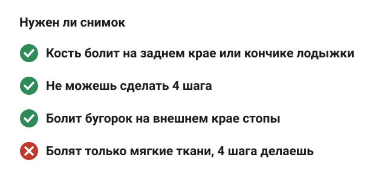
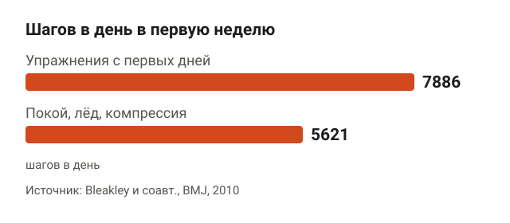
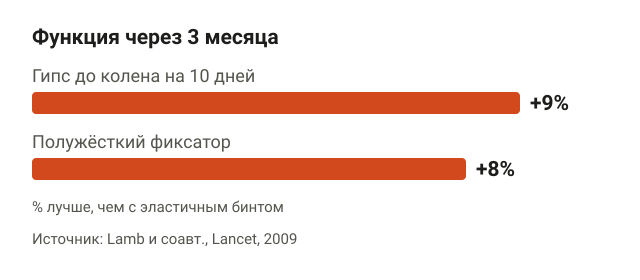
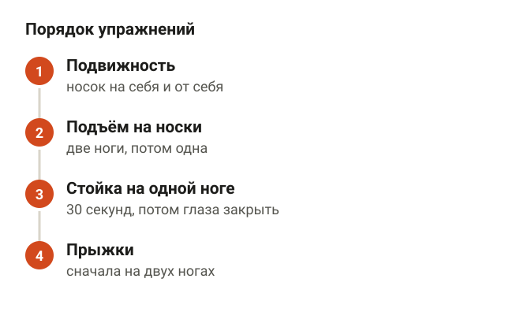
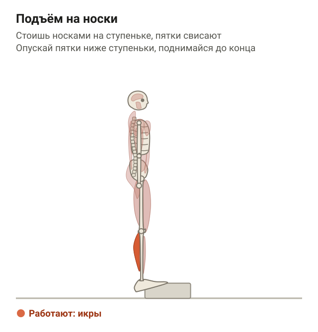
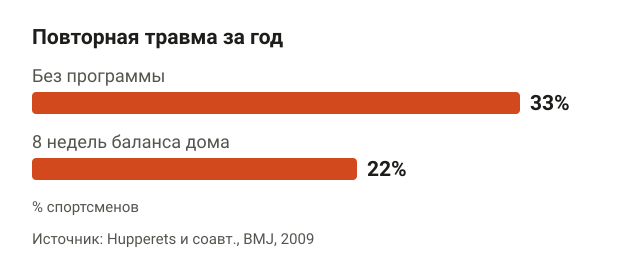
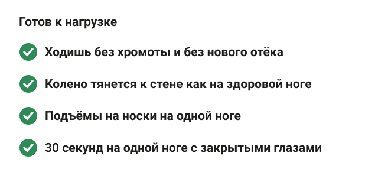
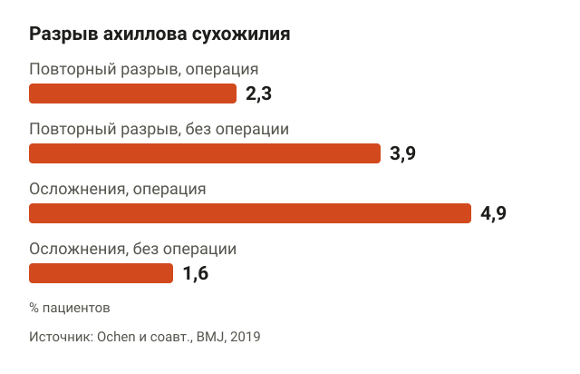
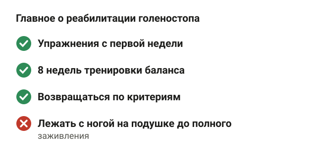

---
{
  "title": "Реабилитация после травмы голеностопа: упражнения и сроки",
  "seo_title": "Реабилитация после травмы голеностопа: упражнения по этапам",
  "description": "Растяжение связок голеностопа: когда нужен снимок, почему двигаться с первой недели, фиксатор или гипс, упражнения по этапам и как не подвернуть ногу снова.",
  "slug": "reabilitaciya-posle-travmy-golenostopa",
  "date": "2026-11-07",
  "category": "travmy",
  "keyword": "реабилитация после травмы голеностопа",
  "tags": [
    "голеностоп",
    "растяжение связок",
    "реабилитация",
    "баланс",
    "ахиллово сухожилие"
  ],
  "faq": [
    {
      "q": "Сколько длится реабилитация после растяжения связок голеностопа?",
      "a": "Боль обычно резко уменьшается за первые 2 недели. Программу упражнений на баланс лучше делать 8 недель: в исследовании на 522 спортсменах она снизила риск повторной травмы на 35%."
    },
    {
      "q": "Можно ли ходить при растяжении связок голеностопа?",
      "a": "Да, столько, сколько позволяет боль, в фиксаторе или с бинтом. В исследовании на 101 человеке упражнения с первой недели улучшили функцию голеностопа и не увеличили число повторных травм."
    },
    {
      "q": "Нужен ли гипс при растяжении голеностопа?",
      "a": "Обычно нет. При тяжёлом растяжении короткий гипс на 10 дней дал на 9% лучшую функцию через 3 месяца, чем эластичный бинт, полужёсткий фиксатор — на 8%. Вариант выбирает травматолог."
    },
    {
      "q": "Как понять, что при травме голеностопа нужен рентген?",
      "a": "По оттавским правилам снимок нужен, если болит в области лодыжки и кость болит при нажатии на задний край или кончик лодыжки, либо не можешь сделать 4 шага."
    },
    {
      "q": "Почему голеностоп подворачивается после старой травмы?",
      "a": "После растяжения связок у части людей остаётся хроническая нестабильность: повторная травма бывает у 3–34%. Риск снижают 8 недель тренировки баланса и полужёсткий фиксатор на тренировках."
    }
  ],
  "sources": [
    {
      "title": "Vuurberg G. и соавт. Diagnosis, treatment and prevention of ankle sprains: update of an evidence-based clinical guideline (Br J Sports Med, 2018)",
      "url": "https://doi.org/10.1136/bjsports-2017-098106"
    },
    {
      "title": "Doherty C. и соавт. Treatment and prevention of acute and recurrent ankle sprain: an overview of systematic reviews with meta-analysis (Br J Sports Med, 2017)",
      "url": "https://doi.org/10.1136/bjsports-2016-096178"
    },
    {
      "title": "Bachmann L. M. и соавт. Accuracy of Ottawa ankle rules to exclude fractures of the ankle and mid-foot: systematic review (BMJ, 2003)",
      "url": "https://doi.org/10.1136/bmj.326.7386.417"
    },
    {
      "title": "Bleakley C. M. и соавт. Effect of accelerated rehabilitation on function after ankle sprain: randomised controlled trial (BMJ, 2010)",
      "url": "https://doi.org/10.1136/bmj.c1964"
    },
    {
      "title": "Lamb S. E. и соавт. Mechanical supports for acute, severe ankle sprain: a pragmatic, multicentre, randomised controlled trial (Lancet, 2009)",
      "url": "https://doi.org/10.1016/S0140-6736(09)60206-3"
    },
    {
      "title": "van Rijn R. M. и соавт. What is the clinical course of acute ankle sprains? A systematic literature review (Am J Med, 2008)",
      "url": "https://doi.org/10.1016/j.amjmed.2007.11.018"
    },
    {
      "title": "Doherty C. и соавт. Recovery From a First-Time Lateral Ankle Sprain and the Predictors of Chronic Ankle Instability: A Prospective Cohort Analysis (Am J Sports Med, 2016)",
      "url": "https://doi.org/10.1177/0363546516628870"
    },
    {
      "title": "Hupperets M. D. и соавт. Effect of unsupervised home based proprioceptive training on recurrences of ankle sprain: randomised controlled trial (BMJ, 2009)",
      "url": "https://doi.org/10.1136/bmj.b2684"
    },
    {
      "title": "Janssen K. W. и соавт. Bracing superior to neuromuscular training for the prevention of self-reported recurrent ankle sprains: a three-arm randomised controlled trial (Br J Sports Med, 2014)",
      "url": "https://doi.org/10.1136/bjsports-2013-092947"
    },
    {
      "title": "Ochen Y. и соавт. Operative treatment versus nonoperative treatment of Achilles tendon ruptures: systematic review and meta-analysis (BMJ, 2019)",
      "url": "https://doi.org/10.1136/bmj.k5120"
    }
  ]
}
---
Реабилитация после травмы голеностопа начинается не через месяц, а в первые дни. Чаще всего это растяжение связок на внешней стороне лодыжки, и лучше всего изучено такое лечение: короткая защита фиксатором или тейпом, ходьба и упражнения с первой недели, потом 8 недель тренировки баланса. Лежать с ногой на подушке до полного заживления хуже: функция возвращается медленнее, а голеностоп чаще подворачивается снова.

Ниже разбираю, что делать по неделям, какие упражнения помогают, когда нужен снимок и почему у многих травма повторяется.

## Какая травма голеностопа бывает чаще и когда нужен снимок

<figure class="step"><figcaption>Снимок нужен, если кость болит при нажатии на край или кончик лодыжки или не можешь сделать 4 шага.</figcaption></figure>

Типичная история в зале: спрыгнул с тумбы, наступил на блин или на чужую ногу на площадке, стопа ушла внутрь, а снаружи лодыжки резкая боль и отёк. Это растяжение или надрыв наружных связок голеностопа. Почти всё, что ниже, про такую травму.

Первый вопрос — нет ли перелома. Для этого врачи используют оттавские правила. Снимок нужен, если болит в области лодыжки и есть хотя бы одно из двух:

- кость болит при нажатии на задний край или кончик наружной или внутренней лодыжки;
- не можешь сделать 4 шага, ни сразу после травмы, ни на приёме у врача.

Для стопы похожие точки: основание пятой плюсневой кости, это бугорок на внешнем крае стопы, и ладьевидная кость на внутренней стороне. Систематический обзор Bachmann и соавторов собрал 27 исследований на 15 581 пациенте. Чувствительность правил почти 100%: если ни одного признака нет, вероятность перелома ниже 1,4%. Правила сокращают ненужные снимки на 30–40%.

Ещё одна деталь из клинических рекомендаций 2018 года: тяжесть повреждения связок надёжнее всего оценивать на осмотре через 4–5 дней после травмы, когда спадёт первый отёк. В первый день и связки, и всё вокруг болит одинаково.

Если боль не по наружной стороне, а сзади над пяткой, и после травмы трудно оттолкнуться стопой, это может быть ахиллово сухожилие. Про него отдельный раздел в конце.

## Первые дни после травмы: двигаться или лежать

<figure class="step"><figcaption>С упражнениями с первых дней люди проходили 7886 шагов в день, при покое — 5621.</figcaption></figure>

Старая схема — покой, лёд, бинт и нога вверх, пока не пройдёт. Новые данные говорят, что покой нужен коротко, а потом движение.

Bleakley и соавторы в 2010 году взяли 101 человека с растяжением голеностопа первой или второй степени, то есть без полного разрыва. Одна группа неделю лечилась по старой схеме: защита, покой, лёд, компрессия. Вторая с первых дней делала упражнения на подвижность, силу и баланс. В группе упражнений функция голеностопа была лучше через 1 и 2 недели. И люди больше ходили: 7886 шагов в день против 5621. Повторная травма за 16 недель была у 4% в обеих группах, то есть ранние упражнения риск не увеличили.

Обзор 46 систематических обзоров, который сделали Doherty и соавторы в 2017 году, пришёл к тому же. Для боли, отёка и функции после свежей травмы сильные доказательства у ранней нагрузки и противовоспалительных препаратов, умеренные — у упражнений и мануальной терапии. Доказательств для ультразвука не хватает.

Про противовоспалительные препараты клинические рекомендации 2018 года предупреждают: они снимают боль и отёк, но у них есть осложнения, и они могут замедлять заживление. Принимать их или нет и какие — вопрос к врачу.

Как это выглядит на практике. Первые 2–3 дня можно держать ногу повыше и ходить столько, сколько позволяет боль, в фиксаторе или с эластичным бинтом. С первых дней — движения стопой без веса: тянешь носок на себя и от себя, рисуешь носком буквы алфавита в воздухе. Это не тренировка, а способ не дать голеностопу «застыть».

## Фиксатор, тейп или гипс: что выбрать

<figure class="step"><figcaption>Гипс на 10 дней — на 9% лучше эластичного бинта, фиксатор — на 8%, ботинок-ортез не дал ничего.</figcaption></figure>

Полностью обездвиживать ногу на недели не нужно. Клинические рекомендации 2018 года говорят так: короткая иммобилизация может снять боль и отёк, но больше всего человеку с разрывом наружной связки помогает тейп или фиксатор вместе с программой упражнений.

При тяжёлом растяжении есть интересное британское исследование Lamb и соавторов, 584 человека. Им дали одно из четырёх: короткий гипс до колена на 10 дней, полужёсткий фиксатор, высокий ботинок-ортез или трубчатый эластичный бинт. Через 3 месяца функция голеностопа с гипсом была на 9% лучше, чем с эластичным бинтом, с фиксатором — на 8% лучше. Ботинок-ортез не дал ничего по сравнению с бинтом, а сам эластичный бинт оказался слабее всех.

То есть при сильной травме, когда наступать тяжело, короткая надёжная фиксация на первые 10 дней лучше, чем просто бинт. Но речь именно о 10 днях, а не о шести неделях в гипсе. Какой вариант нужен тебе, решает травматолог после осмотра.

## Упражнения для реабилитации после травмы голеностопа

<figure class="step"><figcaption>Подвижность, подъёмы на носки, стойка на одной ноге, прыжки. Дальше — когда нет боли и отёка.</figcaption></figure>

Упражнения при растяжении связок голеностопа идут в таком порядке: подвижность, потом сила икры и мышц голени, потом баланс, потом прыжки. Переходить к следующему этапу можно, когда предыдущий делается без усиления боли и на следующий день отёк не больше обычного. Это логика тренера, а не жёсткий протокол из исследования: сроки у всех разные.

**Подвижность.** Сидя, нога на весу или на полу. Тяни носок на себя и от себя, потом поворачивай стопу внутрь и наружу, 15–20 раз в каждую сторону. Ориентир: двигаешься в диапазоне, где тянет, но не стреляет болью. Когда наступать уже не больно, добавь шаг вперёд с переносом колена к стене: стопа стоит на полу, пятка не отрывается, колено тянется вперёд.

**Подъём на носки.** Главное силовое упражнение для голеностопа. Встань прямо, ноги на ширине таза, держись рукой за опору. Поднимись на носки как можно выше, задержись на секунду и медленно опусти пятки. Ориентиры: колени прямые, вес на большом пальце, стопа не заваливается на мизинец. Начинай на двух ногах, потом переходи на одну ногу, потом на ступеньку, где пятка опускается ниже края, и только после этого бери гантель. На схеме ниже — как раз вариант на ступеньке, до него доходишь постепенно.

<figure class="step move"></figure>

**Стойка на одной ноге.** Это и есть та самая тренировка баланса, или проприоцептивная тренировка: ты учишь голеностоп чувствовать положение стопы и вовремя подстраиваться. Встань на травмированную ногу, вторая согнута в колене, руки на поясе. Держи 30 секунд. Ориентиры: таз ровный, стопа не перекатывается на внешний край. Когда 30 секунд даются легко, закрой глаза, потом встань на подушку или полусферу. В Hammer Fit «Континент», где я тренирую, для этого есть BOSU, но дома хватит свёрнутого полотенца.

**Прыжки.** Только когда 20–25 подъёмов на носки на одной ноге и стойка с закрытыми глазами даются без боли. Начинай с мелких прыжков на двух ногах на месте, потом вперёд-назад и в стороны, потом на одной ноге. Приземление мягкое, колено не заваливается внутрь.

Схема тренировок в зале на это время простая. Верх тела и вторую ногу тренируй как обычно, если это не требует опоры на больную ногу. Жим лёжа, тяги в тренажёрах, упражнения сидя можно делать почти сразу.

## Почему голеностоп подворачивается снова

<figure class="step"><figcaption>С 8 неделями тренировки баланса дома повторная травма была у 22% против 33% без неё.</figcaption></figure>

Самое неприятное в этой травме не первые две недели, а то, что бывает потом. Систематический обзор van Rijn и соавторов собрал 31 исследование. Боль резко уменьшается за первые 2 недели, но через год она остаётся у 5–33% людей. Полностью восстанавливаются за 3 года от 36 до 85%. Повторная травма была у 3–34%.

Когда голеностоп подворачивается снова и снова, а нога кажется ненадёжной, это называют хронической нестабильностью голеностопа. Doherty и соавторы наблюдали 82 человека после первого растяжения. Те, кто через 2 недели после травмы не мог выполнить приземление на одну ногу после спрыгивания и прыжок вверх со спрыгивания, чаще получали нестабильность к концу года.

Что снижает риск повтора. В исследовании Hupperets и соавторов 522 спортсмена после растяжения 8 недель делали дома программу на баланс, без тренера. За год повторная травма была у 22% против 33% в контрольной группе. Риск снизился на 35%, и чтобы предотвратить одну травму, программу должны были сделать 9 человек.

Фиксатор тоже работает. Janssen и соавторы сравнили три варианта на 384 спортсменах. Полужёсткий фиксатор на всех тренировках в течение года снизил повторные травмы до 15%, только упражнения дали 27%, фиксатор вместе с упражнениями на 8 недель — 19%. Обзор Doherty оценивает доказательства для фиксатора как сильные, для упражнений на баланс — как умеренные.

Вывод для зала: упражнения на баланс не бросай, когда перестало болеть, а доделай 8 недель. Если занимаешься игровыми видами или бегом по неровному, на это время подумай о фиксаторе.

## Когда возвращаться к тренировкам и бегу

<figure class="step"><figcaption>Без хромоты, колено к стене как на здоровой ноге, носки на одной ноге, баланс с закрытыми глазами.</figcaption></figure>

Точного числа дней в исследованиях нет: при лёгком растяжении человек ходит нормально через несколько дней, при надрыве — через несколько недель. Поэтому ориентируюсь не на календарь, а на то, что нога умеет.

Перед возвращением к приседаниям и выпадам с весом проверь:

1. Ходишь без хромоты, и на следующий день после нагрузки нет нового отёка.
2. Сгибаешь голеностоп так же, как на здоровой ноге: колено тянется к стене одинаково.
3. Делаешь подъёмы на носки на одной ноге почти столько же, сколько на здоровой.
4. Стоишь 30 секунд на одной ноге с закрытыми глазами.

Перед бегом, прыжками и игровыми видами добавь пятый пункт: мягко приземляешься на одну ногу после спрыгивания с небольшой ступеньки. Это как раз то, с чем в исследовании Doherty не справлялись люди, у которых потом появилась нестабильность.

Если через 6 недель голеностоп всё ещё подворачивается или болит при обычной ходьбе, это повод вернуться к травматологу. Операцию рекомендации 2018 года оставляют для случаев, когда не помогла полноценная программа упражнений. Похожая логика с этапами и критериями есть в статье про [реабилитацию после травмы колена](/stati/reabilitaciya-posle-travmy-kolena/).

## Если травма ахиллова сухожилия

<figure class="step"><figcaption>Повторный разрыв: 2,3% после операции и 3,9% без неё. Осложнения: 4,9% и 1,6%.</figcaption></figure>

Разрыв ахиллова сухожилия — другая травма. Часто человек чувствует удар сзади по пятке, будто кто-то пнул, и потом не может нормально оттолкнуться стопой. Это сразу к травматологу, без самостоятельных упражнений.

Лечат его операцией или без неё, в ортезе. Мета-анализ Ochen и соавторов объединил 29 исследований. После операции повторный разрыв был у 2,3% против 3,9% без операции, зато осложнений было больше: 4,9% против 1,6%, в основном инфекции. А в исследованиях, где после травмы рано начинали функциональную реабилитацию с движениями в голеностопе, разница в повторных разрывах между операцией и лечением без неё была незначимой.

То есть и здесь ранняя правильная нагрузка делает работу. Но программу ведёт врач и реабилитолог, а в зале на это время — верх тела и здоровая нога. Если у тебя растянута мышца икры, а не сухожилие, смотри статью [растяжение мышцы: что делать](/stati/rastyazhenie-myshcy-chto-delat/).

## Шпаргалка

<figure class="step"><figcaption>Двигаться с первой недели, 8 недель баланса, возвращаться по критериям, а не по календарю.</figcaption></figure>

- Чаще всего — растяжение наружных связок. Снимок нужен, если кость болит при нажатии на край или кончик лодыжки или не можешь сделать 4 шага.
- Полный покой на недели не нужен. Упражнения с первой недели улучшают функцию и не повышают риск повтора.
- При тяжёлой травме короткая фиксация на 10 дней лучше, чем эластичный бинт.
- Порядок упражнений: подвижность, подъёмы на носки, стойка на одной ноге, прыжки.
- 8 недель тренировки баланса снижают риск повторной травмы на 35%. Фиксатор на тренировках тоже снижает риск.
- Возвращайся к нагрузке по критериям: без хромоты, носки на одной ноге, баланс с закрытыми глазами.
- Разрыв ахиллова сухожилия — сразу к травматологу.
