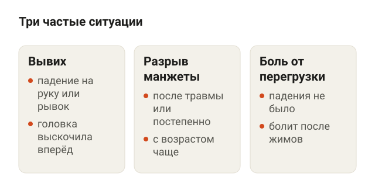
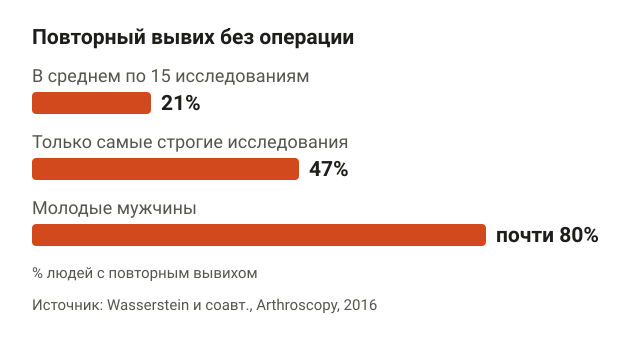
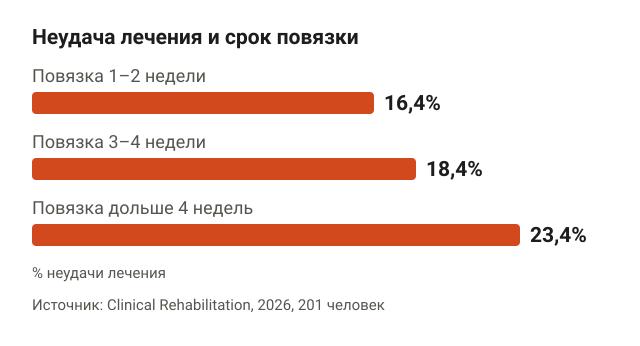
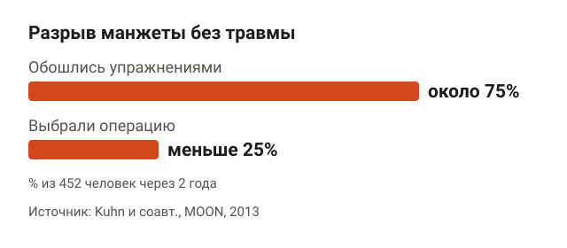
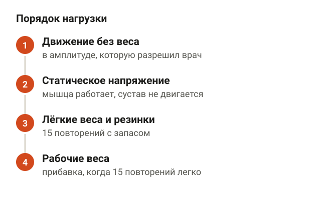
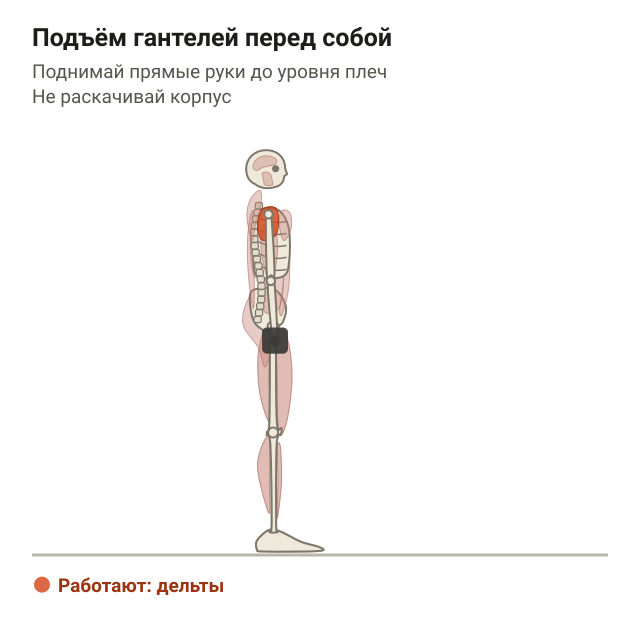
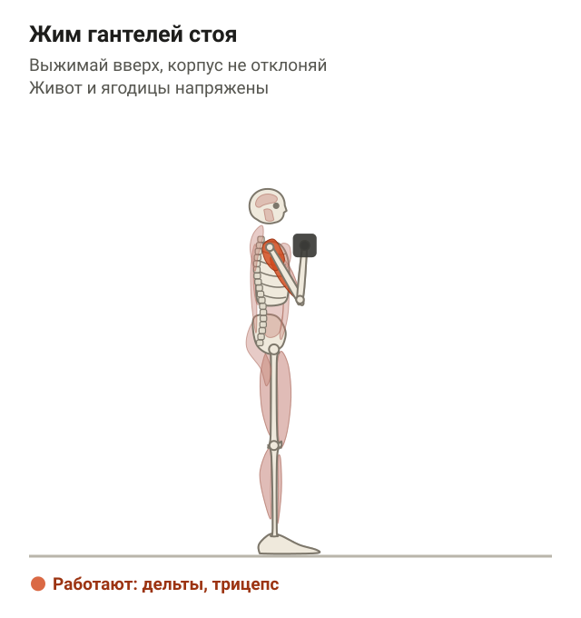
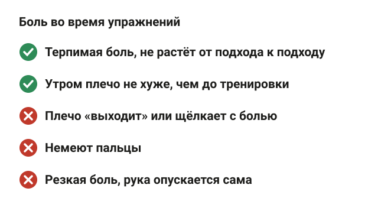
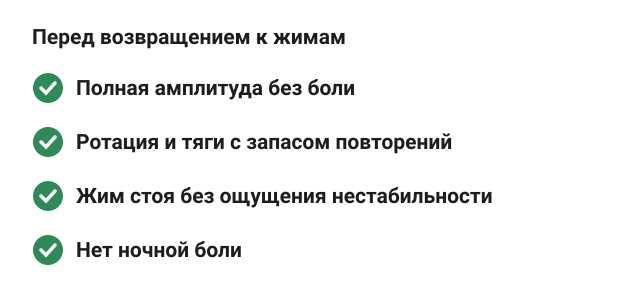
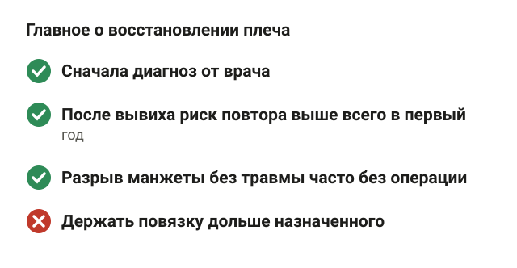

---
{
  "title": "Реабилитация после травмы плеча: вывих, манжета и упражнения",
  "seo_title": "Реабилитация после травмы плеча: упражнения и сроки",
  "description": "Как восстанавливать плечо после вывиха и разрыва вращательной манжеты: риск повтора, повязка, упражнения или операция и когда возвращаться к жимам.",
  "slug": "reabilitaciya-posle-travmy-plecha",
  "date": "2026-11-03",
  "category": "travmy",
  "keyword": "реабилитация после травмы плеча",
  "tags": [
    "травма плеча",
    "вывих плеча",
    "вращательная манжета",
    "реабилитация",
    "восстановление"
  ],
  "faq": [
    {
      "q": "Сколько длится реабилитация после травмы плеча?",
      "a": "Зависит от травмы и решения врача. В исследовании MOON при разрыве манжеты результат оценивали через 6 и 12 недель занятий, а после вывиха риск повтора выше всего в первый год."
    },
    {
      "q": "Можно ли качать плечи после вывиха?",
      "a": "Да, когда врач разрешил движения: укрепление мышц плеча и лопатки — основа восстановления. Жим лёжа, брусья и упражнения с руками за головой возвращают последними."
    },
    {
      "q": "Нужна ли операция при разрыве вращательной манжеты?",
      "a": "Не всегда. В исследовании MOON около 75% людей с разрывом без травмы через 2 года обходились программой упражнений. Свежий разрыв после падения у молодого человека — повод сразу к ортопеду."
    },
    {
      "q": "Можно ли делать упражнения, если плечо болит?",
      "a": "При хронической боли терпимый дискомфорт во время упражнений в мета-анализе не ухудшал результат. Ощущение, что плечо выходит, онемение и резкая боль — сигнал остановиться."
    }
  ],
  "sources": [
    {
      "title": "Wasserstein D. N. и соавт. The true recurrence rate and factors predicting recurrent instability after nonsurgical management of traumatic primary anterior shoulder dislocation: a systematic review (Arthroscopy, 2016)",
      "url": "https://doi.org/10.1016/j.arthro.2016.05.039"
    },
    {
      "title": "Jin H. и соавт. Surgical treatment is superior to conservative options in preventing recurrence of first-time anterior shoulder dislocation in adolescents and adults under 40: network meta-analysis (Arthroscopy, 2025)",
      "url": "https://doi.org/10.1016/j.arthro.2025.07.044"
    },
    {
      "title": "Whelan D. B. и соавт. Immobilization in external rotation versus internal rotation after primary anterior shoulder dislocation: a meta-analysis of RCTs (AJSM, 2016)",
      "url": "https://doi.org/10.1177/0363546515585119"
    },
    {
      "title": "Shinagawa K. и соавт. Immobilization in external rotation reduces the risk of recurrence after primary anterior shoulder dislocation: a meta-analysis (OJSM, 2020)",
      "url": "https://doi.org/10.1177/2325967120925694"
    },
    {
      "title": "Long-term outcomes of non-surgical treatment in first-time anterior shoulder dislocation: does immobilisation duration and rehabilitation timing matter? (Clinical Rehabilitation, 2026)",
      "url": "https://doi.org/10.1177/02692155251400260"
    },
    {
      "title": "Kuhn J. E. и соавт. Effectiveness of physical therapy in treating atraumatic full-thickness rotator cuff tears: a multicenter prospective cohort study, MOON (JSES, 2013)",
      "url": "https://doi.org/10.1016/j.jse.2013.01.026"
    },
    {
      "title": "Beard D. J. и соавт. Arthroscopic subacromial decompression for subacromial shoulder pain (CSAW): placebo-controlled trial (Lancet, 2018)",
      "url": "https://doi.org/10.1016/s0140-6736(17)32457-1"
    },
    {
      "title": "Kanto K. и соавт. Arthroscopic subacromial decompression versus placebo surgery: 10 year follow-up of the FIMPACT trial (BMJ, 2025)",
      "url": "https://doi.org/10.1136/bmj-2025-086201"
    },
    {
      "title": "Tena-Portilla A. и соавт. Effectiveness of exercise in rotator cuff-related shoulder pain: systematic review with meta-analysis (Physiotherapy Theory and Practice, 2026)",
      "url": "https://doi.org/10.1080/09593985.2026.2717392"
    },
    {
      "title": "Liu J. и соавт. Exercise therapy versus passive conservative treatments for rotator cuff-related shoulder pain: systematic review and meta-analysis (Musculoskeletal Science and Practice, 2026)",
      "url": "https://doi.org/10.1016/j.msksp.2026.103556"
    },
    {
      "title": "Zhang W. и соавт. Effects of seven types of exercise in rotator cuff-related shoulder pain: Bayesian network meta-analysis (J Orthop Surg Res, 2025)",
      "url": "https://doi.org/10.1186/s13018-025-06514-4"
    },
    {
      "title": "Smith B. E. и соавт. Should exercises be painful in the management of chronic musculoskeletal pain? Systematic review and meta-analysis (BJSM, 2017)",
      "url": "https://doi.org/10.1136/bjsports-2016-097383"
    }
  ]
}
---
Реабилитация после травмы плеча начинается с диагноза: вывих, разрыв вращательной манжеты и боль от перегрузки восстанавливают по-разному. При боли в манжете и многих разрывах без падения упражнения в исследованиях работают не хуже операции. После вывиха главная задача — не допустить повторного, а риск повтора у молодых мужчин высокий. Ниже разбираю, что известно про каждую ситуацию, какие упражнения делать и когда возвращаться к жимам.

## Реабилитация после травмы плеча: сначала понять, что случилось

<figure class="step"><figcaption>Вывих, разрыв манжеты и боль от перегрузки восстанавливают по-разному.</figcaption></figure>

Плечевой сустав самый подвижный в теле. Головка плечевой кости лежит в мелкой суставной впадине лопатки, а держат её связки, суставная губа и четыре мышцы вращательной манжеты. Вращательная манжета — это группа небольших мышц, которые обхватывают головку плеча и прижимают её к впадине, пока ты поднимаешь или вращаешь руку.

В зале и в быту чаще всего встречаются три ситуации:

- **Вывих.** Головка выскочила из впадины после падения на руку или рывка. Почти всегда вперёд, её вправляют в травмпункте.
- **Разрыв вращательной манжеты.** Бывает после травмы, а бывает без неё: сухожилие истончается с возрастом и рвётся постепенно.
- **Боль в манжете от перегрузки.** Падения не было, плечо заболело после жимов или работы руками над головой. В исследованиях это называют болью, связанной с вращательной манжетой, раньше говорили «импинджмент».

Перелом, разрыв после сильного удара, онемение руки — это к травматологу, а не в зал. Всё, что ниже, — для ситуаций, когда врач уже посмотрел плечо и разрешил двигаться.

## Вывих плеча: восстановление после травмы и риск повтора

<figure class="step"><figcaption>После вывиха без операции повтор в среднем у 21%, у молодых мужчин почти у 80%.</figcaption></figure>

После первого вывиха связки и суставная губа часто остаются растянутыми или надорванными. Поэтому главный вопрос не «когда пройдёт боль», а «выскочит ли снова».

Систематический обзор 2016 года в Arthroscopy собрал 15 исследований хорошего качества с наблюдением от 2 лет. Повторный вывих после лечения без операции:

- в среднем по всем исследованиям — 21%;
- только по самым строгим исследованиям — 47%;
- у молодых мужчин — почти 80%.

Повтор случался в среднем через 10,8 месяца. То есть плечо успевает перестать болеть, человек возвращается к нагрузкам, и тут вывих повторяется. У мужчин шансы повтора были в 2,68 раза выше, чем у женщин. А вот отрыв кусочка кости (большого бугорка плечевой кости) при первом вывихе, как ни странно, риск снижал.

Сетевой мета-анализ 2025 года сравнил 8 рандомизированных исследований, 439 человек моложе 40 лет. Операция по фиксации суставной губы снижала риск повтора примерно в 7 раз по сравнению с лечением повязкой. Оперированные чаще возвращались к спорту. Решение об операции принимает ортопед. Но если тебе 20–30 лет, ты тренируешься с весами и это не первый вывих, этот разговор стоит завести.

## Сколько носить повязку после вывиха

<figure class="step"><figcaption>Самая долгая фиксация чаще заканчивалась нестабильностью или операцией.</figcaption></figure>

Классика — повязка с рукой, прижатой к животу (внутренняя ротация). Позже придумали фиксировать руку повёрнутой наружу, чтобы надорванная губа прилегала к краю впадины. Исследования спорят:

- мета-анализ 2016 года (6 исследований, 632 человека) разницы в повторах не нашёл;
- мета-анализ 2020 года (9 исследований, 817 человек) нашёл: 21,5% повторов при руке, повёрнутой наружу, против 34,9% при обычной повязке, разница была у людей 20–40 лет;
- сетевой мета-анализ 2025 года снова разницы между двумя видами повязки не увидел.

Вывод честный: способ фиксации выбирает врач, данных за «правильную» повязку нет.

По срокам интереснее. В многоцентровом исследовании 201 человек после первого вывиха лечился без операции, наблюдали в среднем 42 месяца. Повторы были у 18,0% при повязке 1–2 недели, у 23,7% при 3–4 неделях и у 23,4% при повязке дольше 4 недель, разница незначимая. Неудача лечения (сохраняется нестабильность или понадобилась операция) была чаще при самой долгой фиксации: 23,4% против 16,4% и 18,4%. Исследование ретроспективное, то есть доказательство слабое. Но держать руку в повязке «на всякий случай» дольше назначенного смысла нет.

## Разрыв вращательной манжеты: упражнения или операция

<figure class="step"><figcaption>Через 2 года около 75% людей с разрывом манжеты обходились упражнениями.</figcaption></figure>

Здесь данные неожиданно хорошие для упражнений. В американском многоцентровом исследовании MOON 452 человека с полным разрывом манжеты без травмы прошли программу лечебной физкультуры. Через 6 и 12 недель каждый мог выбрать операцию. Выбрали меньше 25%, причём в основном в этот же период. Через 2 года около 75% обходились без операции.

С болью в манжете от перегрузки похожая история. Долго её лечили операцией, при которой спиливают край акромиона (костного выступа лопатки над плечом), чтобы сухожилию было свободнее. Потом её сравнили с имитацией:

- британское исследование CSAW: через 6 месяцев операция не дала преимуществ перед артроскопией без спиливания кости;
- финское исследование FIMPACT, 210 человек 35–65 лет: через 10 лет боль в покое и при движении рукой не отличалась ни от имитации операции, ни от лечебной физкультуры.

Важная оговорка: MOON — про разрывы без травмы. Если сухожилие оторвалось после падения у молодого человека и рука перестала подниматься, это срочно к ортопеду, там другая логика.

## Восстановление плеча после травмы: упражнения

<figure class="step"><figcaption>Вес прибавляется, когда 15 повторений даются легко.</figcaption></figure>

Мета-анализ 2026 года (34 исследования, 2019 человек) показал: при боли в манжете упражнения уменьшают боль при движении и ограничения в быту по сравнению с отсутствием лечения. Уверенность в данных низкая. Другой мета-анализ того же года (19 исследований, 1349 человек) не нашёл у упражнений преимущества перед пассивными методами вроде физиотерапии на коротком сроке. То есть упражнения не волшебные, но это то, что ты можешь делать сам и что восстанавливает силу.

Какие именно упражнения лучше, однозначного ответа нет. В сетевом мета-анализе 2025 года (15–16 исследований, около 900 человек) лучше всего по функции плеча выступило обычное силовое укрепление, когда мышца поднимает вес. Упражнения только на контроль лопатки были слабее.

Порядок обычно такой: сначала движение без веса в разрешённой амплитуде, потом статическое напряжение, потом лёгкие веса и резинки, потом рабочие веса. Ниже упражнения из силовой части. Начинай с весом, при котором делаешь 15 повторений с запасом.

**Наружная ротация с резинкой.** Встань боком к стойке, резинка закреплена на уровне пояса. Локоть прижат к боку, согнут под прямым углом. Поворачивай предплечье наружу, как открываешь дверь, и медленно возвращай. Ориентиры: локоть не отходит от корпуса, плечо не поднимается к уху.

**Тяга гантелей в наклоне.** Наклонись вперёд с ровной спиной, колени слегка согнуты, гантели в опущенных руках. Тяни гантели к поясу, локти уходят назад вдоль корпуса, лопатки сводятся. Опускай медленно. Работают широчайшие и трапециевидные мышцы: они управляют лопаткой, а лопатка — опора для плечевого сустава.

<figure class="step move"></figure>

**Подъём гантелей перед собой.** Встань прямо, гантели у бёдер. Поднимай прямые руки до уровня плеч и медленно опускай. Ориентиры: корпус не раскачивается, плечи не поднимаются к ушам. После вывиха и разрыва манжеты высоту подъёма ограничивает врач, начинай с половины амплитуды.

<figure class="step move"></figure>

**Жим гантелей стоя.** Это уже следующий этап, когда предыдущие упражнения идут без боли. Гантели у плеч, выжимай вверх, корпус не отклоняй, живот и ягодицы напряжены. Опускай до уровня плеч, не ниже.

<figure class="step move"></figure>

В «Континенте» для наружной ротации удобен блочный тренажёр, но резинки дома хватает. Прибавляй вес, когда 15 повторений даются легко. Как раскладывать подходы по неделе, разбирал в статье [сколько подходов делать для роста мышц](/stati/skolko-podhodov-dlya-rosta-myshc/). Если плечо после травмы ещё и тянет вперёд из-за сутулости, пригодятся упражнения на верх спины из статьи [про сутулость](/stati/sutulost-uprazhneniya-v-trenazhernom-zale/).

## Можно ли делать упражнения, если плечо болит

<figure class="step"><figcaption>Терпимый дискомфорт допустим, нестабильность и онемение — нет.</figcaption></figure>

Частый страх: болит — значит, делаю хуже. Мета-анализ в British Journal of Sports Medicine (7 исследований, 385 человек с хронической болью в мышцах и суставах) сравнил упражнения, где боль разрешали, с упражнениями строго без боли. На коротком сроке боль снижалась чуть сильнее, когда её допускали. На среднем и длинном сроке разницы не было.

То есть терпимый дискомфорт во время упражнения сам по себе не вредит. Но это про хроническую боль, а не про свежий вывих. Единого порога в исследованиях нет. Ориентир, которым пользуюсь сам: боль во время подхода терпимая, не растёт от подхода к подходу, и на следующее утро плечо не хуже, чем было до тренировки. Если хуже — снижаю вес или амплитуду.

Чего не терпеть никогда: ощущение, что плечо «выходит» или щёлкает с болью, онемение пальцев, резкая боль, от которой рука опускается сама.

## Тренировки после травмы плеча: когда возвращаться к жимам

<figure class="step"><figcaption>Жим лёжа и брусья возвращаются последними.</figcaption></figure>

Готовых сроков для всех травм нет, их называет врач. После вывиха риск повтора выше всего в первый год, поэтому возвращение к жиму штанги лёжа, отжиманиям на брусьях и работе с руками за головой идёт последним. Это положения, в которых рука отведена и развёрнута наружу, а именно так плечо чаще всего и вылетает.

Что я смотрю перед тем, как вернуть человека к обычной программе:

- полная амплитуда без боли, как на здоровой руке;
- наружная ротация с резинкой и тяги идут без боли с запасом повторений;
- жим гантелей стоя проходит без ощущения нестабильности;
- нет ночной боли.

Дальше рабочие веса прибавляются постепенно, как в любой программе. Похожая логика «сначала сила и контроль, потом спорт» есть и в статье [о реабилитации после травмы колена](/stati/reabilitaciya-posle-travmy-kolena/).

К врачу сразу, если рука не поднимается после травмы, плечо снова выскочило, болит ночью и в покое, немеют пальцы или боль не уменьшается за несколько недель занятий.

## Шпаргалка

<figure class="step"><figcaption>Сначала диагноз, потом силовая работа по шагам.</figcaption></figure>

- Сначала диагноз: вывих, разрыв манжеты и боль от перегрузки восстанавливают по-разному.
- После вывиха без операции повтор в среднем у 21%, у молодых мужчин почти у 80%. Повтор случается в среднем через 11 месяцев.
- Операция у людей моложе 40 лет снижает риск повтора, решение за ортопедом.
- Вид повязки: исследования спорят. Держать дольше назначенного смысла нет.
- Разрыв манжеты без травмы: около 75% обходятся упражнениями через 2 года.
- Спиливание акромиона при боли в манжете через 10 лет не лучше имитации операции и упражнений.
- Лучше всего по данным работает обычное силовое укрепление с весом.
- Терпимый дискомфорт допустим, нестабильность и онемение — нет.
- Жим лёжа и брусья возвращаются последними.
