---
{
  "title": "Сколиоз: упражнения в зале и как тренироваться взрослому",
  "seo_title": "Сколиоз: упражнения в зале, что можно и с чего начать",
  "description": "Можно ли в зал при сколиозе, выпрямят ли упражнения позвоночник, с каких упражнений начать и как строить тренировку. Разбор исследований и рекомендаций SOSORT.",
  "slug": "skolioz-uprazhneniya-v-zale",
  "date": "2026-11-06",
  "category": "spina-i-osanka",
  "keyword": "сколиоз упражнения в зале",
  "tags": [
    "сколиоз",
    "позвоночник",
    "осанка",
    "мышцы спины",
    "кор"
  ],
  "faq": [
    {
      "q": "Можно ли ходить в тренажёрный зал при сколиозе?",
      "a": "Можно. Рекомендации SOSORT советуют людям со сколиозом заниматься спортом, а по данным, на которые они ссылаются, спорт не влияет на появление и выраженность сколиоза. Подростку, который ещё растёт, и при большой дуге ограничения лучше обсудить с врачом."
    },
    {
      "q": "Какие упражнения делать в зале при сколиозе мужчинам и девушкам?",
      "a": "Одинаковые: у взрослых сколиоз встречается у мужчин и женщин с одинаковой частотой, а принципы тренировки не отличаются. Начинай с планки, «птицы-собаки», «мёртвого жука», тяги гантелей в наклоне и гоблет-приседа."
    },
    {
      "q": "Можно ли исправить сколиоз упражнениями у взрослого?",
      "a": "Заметно выпрямить дугу упражнениями не получается. В исследовании на 130 взрослых через год разница по углу Кобба была 4 градуса, меньше порога в 5 градусов. Зато программа упражнений уменьшила боль и ограничения в повседневной жизни."
    },
    {
      "q": "Можно ли приседать со штангой и делать становую при сколиозе?",
      "a": "Прямых исследований про тяжёлые приседания и становую при сколиозе нет. Разумно сначала освоить упражнения на корпус и гоблет-присед, а штангу вводить постепенно. Если спина болит и вне зала или боль отдаёт в ногу, сначала к врачу."
    }
  ],
  "sources": [
    {
      "title": "Negrini S. и соавт. 2016 SOSORT guidelines: orthopaedic and rehabilitation treatment of idiopathic scoliosis during growth (Scoliosis Spinal Disord, 2018)",
      "url": "https://doi.org/10.1186/s13013-017-0145-8"
    },
    {
      "title": "Po E. Y. P. и соавт. Global Prevalence of Adolescent Idiopathic Scoliosis Between 1975 and 2025: systematic review and meta-analysis (Spine, 2026)",
      "url": "https://doi.org/10.1097/BRS.0000000000005807"
    },
    {
      "title": "Kebaish K. M. и соавт. Scoliosis in adults aged forty years and older: prevalence and relationship to age, race, and gender (Spine, 2011)",
      "url": "https://doi.org/10.1097/BRS.0b013e3181e9f120"
    },
    {
      "title": "Schwab F. и соавт. Adult scoliosis: prevalence, SF-36, and nutritional parameters in an elderly volunteer population (Spine, 2005)",
      "url": "https://doi.org/10.1097/01.brs.0000160842.43482.cd"
    },
    {
      "title": "Negrini A. и соавт. Sport improved medium-term results in a prospective cohort of 785 adolescents with idiopathic scoliosis braced full time (Eur Spine J, 2022)",
      "url": "https://doi.org/10.1007/s00586-022-07370-0"
    },
    {
      "title": "Romano M. и соавт. Exercises for adolescent idiopathic scoliosis (Cochrane Database Syst Rev, 2012)",
      "url": "https://doi.org/10.1002/14651858.CD007837.pub2"
    },
    {
      "title": "Zhu Y. и соавт. Effectiveness of Schroth exercises for adolescent idiopathic scoliosis: a meta-analysis (PeerJ, 2025)",
      "url": "https://doi.org/10.7717/peerj.19639"
    },
    {
      "title": "Monticone M. и соавт. Adults with idiopathic scoliosis improve disability after motor and cognitive rehabilitation: RCT (Eur Spine J, 2016)",
      "url": "https://doi.org/10.1007/s00586-016-4528-y"
    },
    {
      "title": "Everett C. R., Patel R. K. A systematic literature review of nonsurgical treatment in adult scoliosis (Spine, 2007)",
      "url": "https://doi.org/10.1097/BRS.0b013e318134ea88"
    },
    {
      "title": "Weinstein S. L. и соавт. Health and function of patients with untreated idiopathic scoliosis: a 50-year natural history study (JAMA, 2003)",
      "url": "https://doi.org/10.1001/jama.289.5.559"
    },
    {
      "title": "American College of Sports Medicine. Progression models in resistance training for healthy adults: position stand (Med Sci Sports Exerc, 2009)",
      "url": "https://doi.org/10.1249/MSS.0b013e3181915670"
    }
  ]
}
---
При сколиозе в зале заниматься можно: международное общество по консервативному лечению сколиоза SOSORT советует людям со сколиозом не бросать спорт, а по данным, на которые оно ссылается, спорт не влияет на появление и выраженность искривления. Упражнения в зале при сколиозе у взрослого заметно не выпрямят позвоночник, но в исследованиях программы упражнений уменьшали боль и ограничения в обычных делах. Основа — те же базовые упражнения, что и без сколиоза, с упором на мышцы корпуса и спины и с постепенным ростом рабочего веса.

Ниже разберу, что такое сколиоз и как часто он бывает у взрослых, что реально дают упражнения, какие из них делать в зале, как строить тренировку и когда сначала нужен врач.

## Что такое сколиоз и как часто он бывает у взрослых

<figure class="step">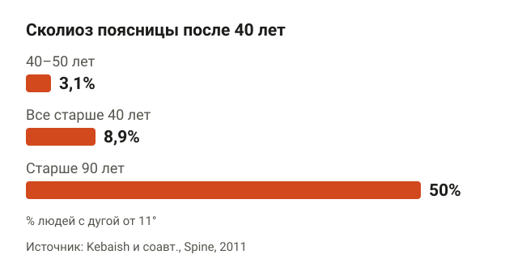<figcaption>После 40 лет сколиоз поясницы нашли у 8,85% людей, после 90 лет — у половины.</figcaption></figure>

Сколиоз — это боковое искривление позвоночника, обычно с поворотом позвонков. Его меряют на рентгене углом Кобба: это угол между краями самых наклонённых позвонков дуги. Сколиозом считают дугу от 10 градусов, меньшую дугу сколиозом не называют.

У подростков сколиоз встречается нечасто. В мета-анализе 2026 года собрали 104 исследования, 5,4 миллиона подростков из 33 стран: дуга от 10 градусов была у 1,26%, от 20 градусов — у 0,28%.

У взрослых картина другая, потому что к искривлению с юности добавляются возрастные изменения дисков и суставов позвоночника. В американском исследовании Kebaish и соавторов посмотрели снимки поясницы с денситометрии почти 3000 человек старше 40 лет. Сколиоз поясницы, в этом исследовании дугу от 11 градусов, нашли у 8,85%. В 40–50 лет — у 3,14%, после 90 лет — у половины. У мужчин и женщин частота была одинаковой, а у 80,6% дуга была небольшой.

В другом исследовании, Schwab и соавторов, у 75 здоровых добровольцев старше 60 лет сколиоз нашли у 68%, хотя никто из них о нём не знал. Средний угол был 17 градусов. По сути, у многих людей в зале есть небольшой сколиоз, и они тренируются, даже не догадываясь об этом.

## Можно ли заниматься в зале при сколиозе

<figure class="step">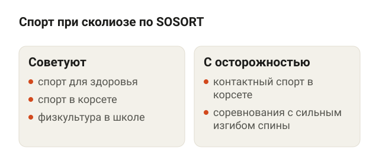<figcaption>Спорт советуют, ограничения на отдельные виды даёт врач.</figcaption></figure>

Можно. В рекомендациях SOSORT 2016 года шесть пунктов про спорт. Если коротко:

- общие спортивные занятия советуют из-за пользы для психики, координации и здоровья в целом;
- спорт рекомендуют продолжать даже во время лечения корсетом;
- спорт не назначают как лечение сколиоза: он для формы и самочувствия, а не для выпрямления дуги;
- ограничения на отдельные виды спорта может дать врач по тяжести и росту дуги;
- соревновательный спорт, где позвоночник много и сильно гнётся, советуют избегать тем, у кого высокий риск роста дуги.

Отдельно авторы пишут, что занятия спортом, судя по исследованиям, не влияют на то, появится ли сколиоз и насколько он будет выражен.

Есть и прямые данные. В итальянском исследовании Negrini и соавторов наблюдали 785 подростков со сколиозом, которые носили корсет не меньше 20 часов в сутки. Средняя дуга была 40 градусов. У тех, кто занимался спортом 2 раза в неделю и чаще, шансы, что дуга через 18 месяцев уменьшится, были в 1,59 раза выше, чем у тех, кто занимался раз в неделю или реже. Чем чаще спорт, тем выше были шансы. Это подростки в корсете, а не взрослые в зале, но данных, что тренировки вредят при сколиозе, исследование не дало.

Риск роста дуги и ограничения на спорт оценивает врач, обычно ортопед или вертебролог. Это касается в первую очередь подростков, пока позвоночник растёт.

## Выпрямят ли упражнения позвоночник

<figure class="step">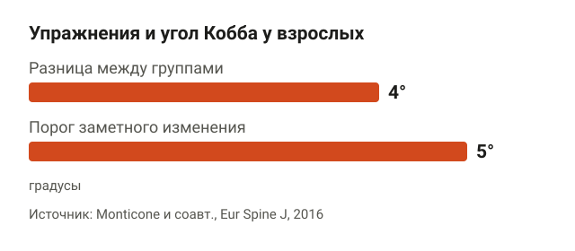<figcaption>Через год разница по углу Кобба была 4°, меньше порога заметного изменения в 5°.</figcaption></figure>

Честный ответ: заметно — нет. Сильнее всего это изучено у подростков, и даже там эффект скромный.

В обзоре Cochrane 2012 года нашли всего два подходящих исследования, 154 подростка. Вывод авторов: качественных доказательств, чтобы советовать специальные упражнения при сколиозе, не хватает. В мета-анализе 2025 года по упражнениям Шрот, это специальная система упражнений для сколиоза с коррекцией дыхания и положения корпуса, было 11 рандомизированных исследований и 446 подростков. Угол Кобба уменьшался, но в среднем меньше чем на 5 градусов. Именно 5 градусов врачи считают порогом заметного изменения.

У взрослых есть рандомизированное исследование Monticone и соавторов. 130 взрослых с дугой до 35 градусов, средний возраст 52 года, 20 недель занимались одной из двух программ. Первая группа делала упражнения с активной самокоррекцией, то есть учились сами выпрямлять корпус и удерживать это положение в движении, плюс работали с психологом над страхом движения. Вторая — обычную лечебную физкультуру: мобилизацию, растяжку и укрепление мышц спины.

Результаты такие:

- ограничения в повседневной жизни в первой группе снизились сильнее на 12 пунктов по 100-балльной шкале, и это сохранилось через год;
- боль и качество жизни тоже улучшились сильнее;
- по углу Кобба разница через год была 4 градуса, то есть меньше того же порога в 5 градусов.

Соответственно, цель тренировок в зале при сколиозе у взрослого — не прямой позвоночник на снимке, а сильная спина, меньше боли и уверенность в движениях. Систематический обзор Everett и Patel по безоперационному лечению сколиоза у взрослых вообще нашёл только слабые данные: лечебная физкультура может помогать, но хороших исследований мало.

## Сколиоз: упражнения в зале, с которых начать

<figure class="step">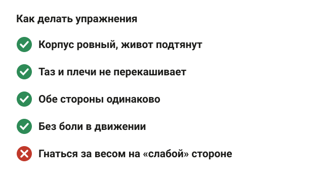<figcaption>Корпус ровный, обе стороны одинаково, без боли.</figcaption></figure>

Специальных «упражнений от сколиоза» для зала исследования не дают. Работают обычные силовые упражнения, если делать их технично и без боли. Начни с упражнений на мышцы корпуса и спины. В каждом держи корпус ровно и следи, чтобы таз и плечи не перекашивало.

**Планка на предплечьях.** Встань в упор на предплечья и носки, локти под плечами. Тело от головы до пяток в одну линию, живот подтянут, таз не провисает и не задирается вверх. Держи 20–40 секунд и дыши ровно.

<figure class="step move">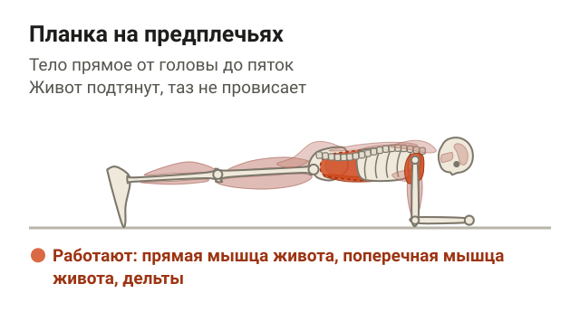</figure>

**«Птица-собака».** Встань на четвереньки: руки под плечами, колени под тазом. Вытяни вперёд правую руку и одновременно назад левую ногу, задержись на 2–3 секунды и вернись. Потом другая сторона. Спина ровная, таз не заваливается вбок, поясница не прогибается.

<figure class="step move">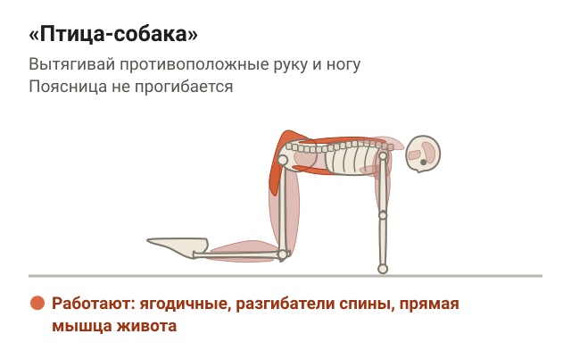</figure>

**«Мёртвый жук».** Ляг на спину, руки вытяни вверх, ноги согнуты в коленях и тазобедренных суставах под прямым углом. На выдохе опусти к полу правую руку за голову и выпрями левую ногу, потом вернись и смени стороны. Поясница прижата к полу всё время.

<figure class="step move">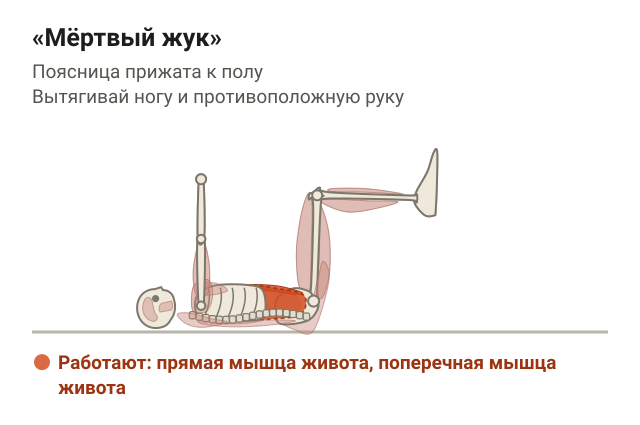</figure>

**Тяга гантелей в наклоне.** Наклонись вперёд с ровной спиной, колени слегка согнуты, гантели висят под плечами. Потяни гантели к поясу, сводя лопатки, и опусти. Поясница не округляется, шея на одной линии со спиной.

<figure class="step move"></figure>

**Гоблет-присед с гантелью.** Возьми гантель вертикально у груди, стопы чуть шире плеч. Садись вниз, отводя таз назад, колени идут по направлению носков. Спина ровная, вес на всей стопе, гантель остаётся у груди. Встань, выталкивая пол ногами.

<figure class="step move">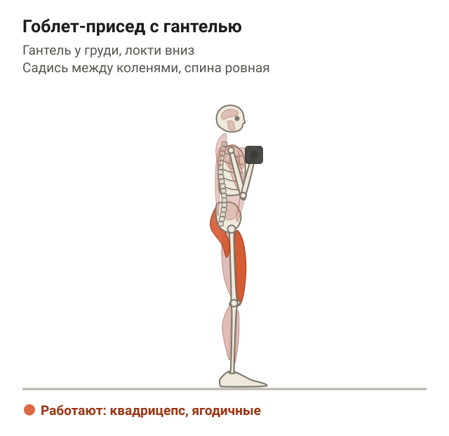</figure>

Если упражнение с одной стороны даётся хуже, это нормально: при сколиозе мышцы с двух сторон часто работают неодинаково. Делай обе стороны одинаково и не гонись за весом на «слабой» стороне. Больше упражнений на верх спины собрал в статье [как исправить осанку у взрослого](/stati/kak-ispravit-osanku-u-vzroslogo/).

## Как строить тренировку при сколиозе

<figure class="step">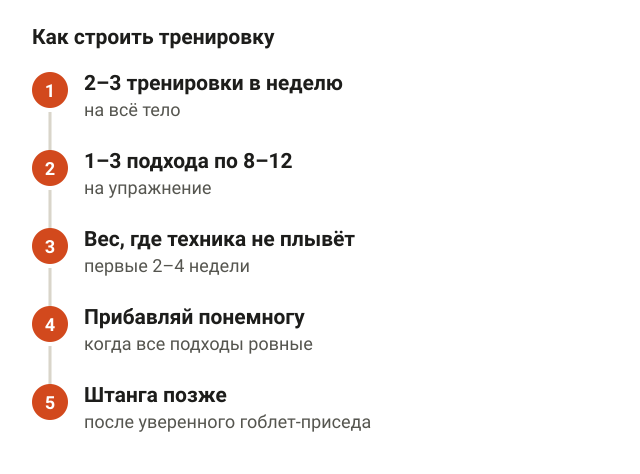<figcaption>Ориентир — общие рекомендации ACSM для новичков.</figcaption></figure>

Отдельных правил по объёму нагрузки при сколиозе исследования не дают, поэтому ориентир — общие рекомендации ACSM по силовым тренировкам для взрослых. Для новичка это 2–3 тренировки в неделю на всё тело, 1–3 подхода по 8–12 повторений на упражнение.

Как это применить:

1. Первые 2–4 недели работай с весом, при котором техника не плывёт до последнего повторения.
2. Добавляй вес, когда все подходы выходят легко и ровно. Прибавляй понемногу, например на следующую по весу пару гантелей.
3. Тяжёлые приседания и становую со штангой вводи позже, когда упражнения на корпус и гоблет-присед даются уверенно.
4. Следи за ощущениями в спине в день тренировки и на следующий. Небольшая усталость мышц — нормально. Боль, которая держится или отдаёт в ногу, — повод снизить нагрузку и показаться врачу.
5. Дай программе время. В исследовании Monticone программа шла 20 недель, а результат проверяли ещё через год.

Если в клубе есть тренажёры для спины, их тоже можно включать: тяга верхнего блока, гиперэкстензия. Принцип тот же: ровный корпус и вес, который ты контролируешь.

## Сколиоз и боль в спине

<figure class="step">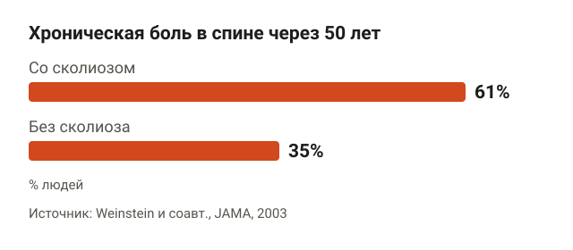<figcaption>Боль в спине чаще при сколиозе, но у 68% с болью она слабая или умеренная.</figcaption></figure>

Сколиоз не всегда болит. Лучше всего это показывает исследование Weinstein и соавторов, где людей с нелеченым сколиозом наблюдали 50 лет. Средний возраст на момент проверки — 66 лет.

- Хроническая боль в спине была у 61% людей со сколиозом и у 35% людей без него.
- Но у большинства с болью, 68%, она была слабой или умеренной.
- Авторы пишут, что такие люди живут активно и работают, а сколиоз в основном даёт боль в спине и недовольство внешним видом.

Получается, что у человека со сколиозом спина болит чаще, но не обязательно из-за самой дуги. Часто это та же неспецифическая боль, что бывает у всех: без конкретной причины на снимке. Как с ней работать упражнениями, разобрал в статье [неспецифическая боль в спине](/stati/nespecificheskaya-bol-v-spine/).

## Когда при сколиозе сначала к врачу

<figure class="step">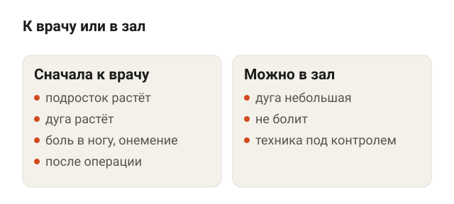<figcaption>Растущая дуга, подросток или онемение — сначала врач.</figcaption></figure>

Перед тренировками стоит показаться ортопеду или вертебрологу, если:

- сколиоз нашли у подростка, который ещё растёт: дуга может прибавлять, и врач решает, нужен ли корсет и специальные упражнения;
- дуга заметно растёт: плечо или лопатка стали выше, одежда сидит по-другому;
- угол большой — по рекомендациям SOSORT при больших дугах решение о лечении принимает врач, а не тренер;
- спина болит и вне зала, боль отдаёт в ногу, появилось онемение или слабость в ноге;
- после операции на позвоночнике: сроки и ограничения даёт хирург.

Если ничего из этого нет, а сколиоз небольшой и не болит, тренироваться можно как обычно, с упором на технику. Похожий подход к боли в пояснице описан в статье [боль в пояснице: упражнения](/stati/bol-v-poyasnice-uprazhneniya/).

## Шпаргалка

<figure class="step">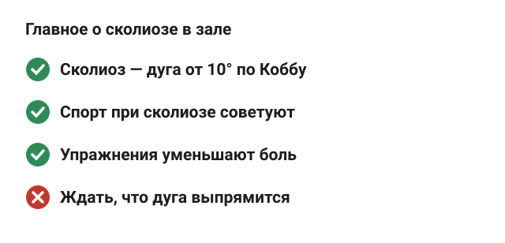<figcaption>Тренироваться можно, цель — сильная спина, а не прямой снимок.</figcaption></figure>

- Сколиоз — боковая дуга позвоночника от 10 градусов по Коббу.
- После 40 лет он есть примерно у 9% людей, после 60 — у многих, и часто человек о нём не знает.
- SOSORT советует людям со сколиозом заниматься спортом, связи спорта с ростом дуги не нашли.
- Упражнения не выпрямляют позвоночник заметно: в среднем меньше 5 градусов.
- Зато они уменьшают боль и ограничения в жизни.
- В зале — обычные силовые: планка, «птица-собака», «мёртвый жук», тяги, присед. Ровный корпус и постепенный рост веса.
- Подросток со сколиозом, растущая дуга, боль с онемением — сначала к врачу.
