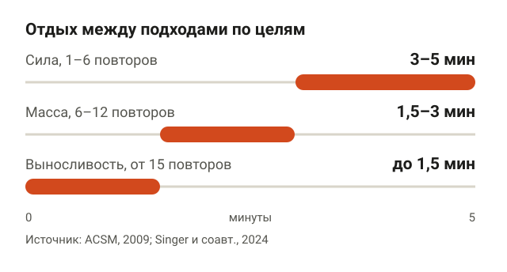
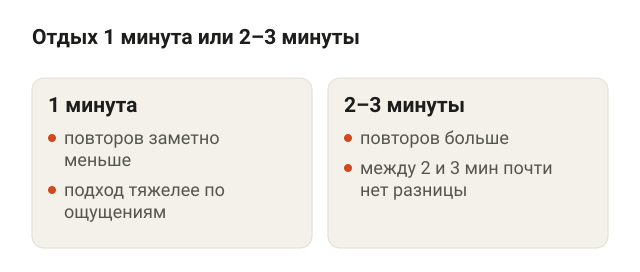
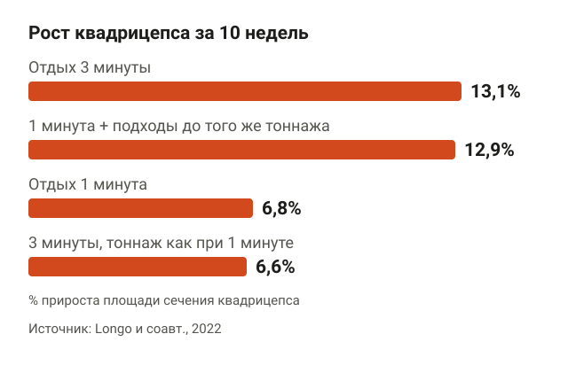
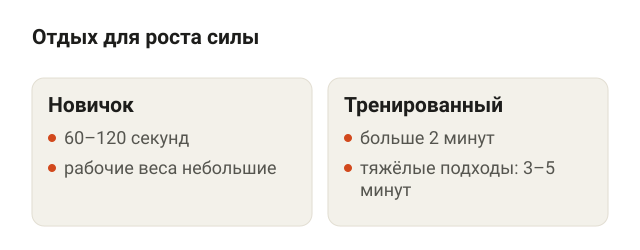
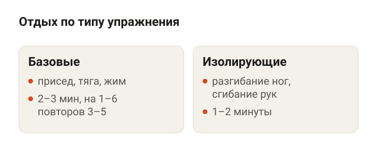
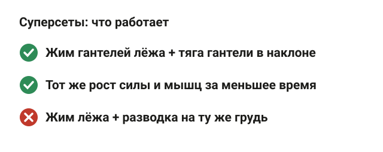
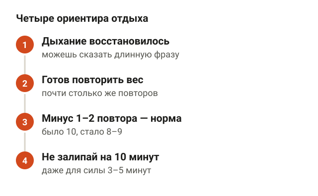
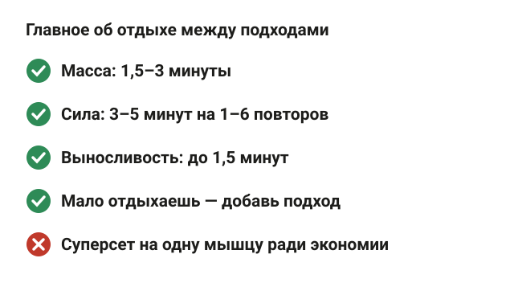

---
{
  "title": "Сколько отдыхать между подходами: для массы, силы и выносливости",
  "seo_title": "Сколько отдыхать между подходами: 1, 2 или 3 минуты",
  "description": "Сколько отдыхать между подходами для массы, силы и выносливости: что показали исследования, отдых в базовых упражнениях и суперсеты, если мало времени.",
  "slug": "skolko-otdyhat-mezhdu-podhodami",
  "date": "2026-11-09",
  "category": "trenirovki",
  "keyword": "сколько отдыхать между подходами",
  "tags": [
    "отдых между подходами",
    "набор массы",
    "сила",
    "суперсеты",
    "новичкам"
  ],
  "faq": [
    {
      "q": "Сколько отдыхать между подходами для набора массы?",
      "a": "1,5–3 минуты. В мета-анализе Singer и соавторов (2024) отдых дольше 60 секунд давал немного больше роста мышц, а дольше 90 секунд заметной разницы уже не было."
    },
    {
      "q": "Сколько отдыхать между подходами новичку?",
      "a": "1–2 минуты. По обзору Grgic и соавторов (2018) новичкам для роста силы хватает 60–120 секунд, а тренированным в тяжёлых подходах нужно больше 2 минут."
    },
    {
      "q": "Можно ли отдыхать 30 секунд, чтобы быстрее закончить тренировку?",
      "a": "Можно, но повторов в следующих подходах будет меньше, и для роста мышц придётся добавить подходы. Сэкономить время лучше суперсетами на противоположные мышцы: по мета-анализу 2025 года они сохраняют объём работы и результат."
    },
    {
      "q": "Отдыхать 5 минут между подходами — это не слишком много?",
      "a": "Для тяжёлых подходов на 1–6 повторов в базовых упражнениях нет: ACSM советует 3–5 минут. В изолирующих упражнениях и подходах на 10–12 повторов больше 3 минут обычно не нужно."
    }
  ],
  "sources": [
    {
      "title": "American College of Sports Medicine. American College of Sports Medicine position stand. Progression models in resistance training for healthy adults (Med Sci Sports Exerc, 2009)",
      "url": "https://doi.org/10.1249/MSS.0b013e3181915670"
    },
    {
      "title": "Singer A. и соавт. Give it a rest: a systematic review with Bayesian meta-analysis on the effect of inter-set rest interval duration on muscle hypertrophy (Front Sports Act Living, 2024)",
      "url": "https://doi.org/10.3389/fspor.2024.1429789"
    },
    {
      "title": "Schoenfeld B. J. и соавт. Longer interset rest periods enhance muscle strength and hypertrophy in resistance-trained men (J Strength Cond Res, 2016)",
      "url": "https://doi.org/10.1519/JSC.0000000000001272"
    },
    {
      "title": "Longo A. R. и соавт. Volume load rather than resting interval influences muscle hypertrophy during high-intensity resistance training (J Strength Cond Res, 2022)",
      "url": "https://doi.org/10.1519/JSC.0000000000003668"
    },
    {
      "title": "Grgic J. и соавт. Effects of rest interval duration in resistance training on measures of muscular strength: a systematic review (Sports Med, 2018)",
      "url": "https://doi.org/10.1007/s40279-017-0788-x"
    },
    {
      "title": "de Salles B. F. и соавт. Rest interval between sets in strength training (Sports Med, 2009)",
      "url": "https://doi.org/10.2165/11315230-000000000-00000"
    },
    {
      "title": "Rosa A. и соавт. Repetition performance, rating of perceived discomfort, and blood lactate responses to different rest interval lengths in single-joint and multijoint lower-body exercise (J Strength Cond Res, 2023)",
      "url": "https://doi.org/10.1519/JSC.0000000000004508"
    },
    {
      "title": "Zhang X. и соавт. Superset versus traditional resistance training prescriptions: a systematic review and meta-analysis (Sports Med, 2025)",
      "url": "https://doi.org/10.1007/s40279-025-02176-8"
    }
  ]
}
---
Сколько отдыхать между подходами, зависит от цели. Для массы хватает 1,5–3 минут: в мета-анализе 2024 года отдых дольше 60 секунд давал немного больше роста мышц, а дольше 90 секунд разницы уже не было. Для силы в тяжёлых подходах на 1–6 повторов отдыхай 3–5 минут. Для выносливости с лёгким весом и 15 повторами и больше — до 1,5 минут.

Ниже разбираю, почему отдых вообще влияет на результат, что показали исследования для массы и для силы, сколько отдыхать в базовых и изолирующих упражнениях и что делать, если на тренировку всего 45 минут.

## Сколько отдыхать между подходами: ответ по целям

<figure class="step"><figcaption>Сила — 3–5 минут, масса — 1,5–3 минуты, выносливость — до 1,5 минут.</figcaption></figure>

Американский колледж спортивной медицины (ACSM) в позиции о прогрессии силовых тренировок 2009 года даёт ориентиры под каждую цель. Я сверил их с более свежими обзорами и свёл в одну таблицу.

| Цель | Повторы в подходе | Отдых |
|---|---|---|
| Сила | 1–6 | 3–5 минут |
| Масса | 6–12 | 1,5–3 минуты |
| Выносливость | 15 и больше | до 1,5 минут |

Для массы ACSM пишет про 1–2 минуты, но работы после 2009 года сдвинули нижнюю границу. В мета-анализе Singer и соавторов (2024) отдых меньше минуты давал чуть меньше роста, поэтому в таблице 1,5–3 минуты. Для силы цифра 3–5 минут взята из той же позиции ACSM. Для выносливости ACSM советует лёгкий вес на 40–60% от максимума, больше 15 повторов и отдых короче 90 секунд.

Эти цифры — ориентир, а не секундомер. Если подход тяжёлый, а дыхание ещё сбито, можно отдохнуть на полминуты дольше. Ничего не сломается.

## Почему отдых влияет на результат

<figure class="step"><figcaption>С отдыхом в 1 минуту повторов заметно меньше. Между 2 и 3 минутами разница совсем маленькая.</figcaption></figure>

Во время подхода мышца тратит быстрые запасы энергии, и на их восстановление нужно несколько минут. Если отдыхать мало, в следующем подходе с тем же весом получится меньше повторов.

Это хорошо видно в исследовании Rosa и соавторов (2023). Люди делали присед в Смите и разгибание ног в тренажёре с весом, который можно поднять 10 раз, и отдыхали 1, 2 или 3 минуты. С отдыхом в 1 минуту повторов было заметно меньше. Между 2 и 3 минутами разница была совсем маленькой. Ещё одна деталь: с длинным отдыхом людям было субъективно легче, а присед давался тяжелее, чем разгибание ног.

То есть первая минута отдыха возвращает больше всего сил, вторая — меньше, третья почти ничего не добавляет к числу повторов в упражнениях на 10 повторов. Дальше всё упирается в то, сколько работы ты успеешь сделать за тренировку.

## Сколько отдыхать для набора массы

<figure class="step"><figcaption>Рост зависел от тоннажа, а не от минут отдыха: 1 минута с добавленными подходами дала почти как 3 минуты.</figcaption></figure>

Здесь три исследования, которые стоит знать.

Первое — Schoenfeld и соавторы (2016). 21 тренированного мужчину разделили на две группы: одна отдыхала 1 минуту, другая 3 минуты. Остальное было одинаковым: 8 недель, 3 тренировки на всё тело в неделю, 7 упражнений по 3 подхода на 8–12 повторов до отказа. У группы с 3 минутами передняя поверхность бедра выросла сильнее, на трицепсе был тот же тренд, а максимум в приседе и жиме лёжа вырос больше.

Второе — Longo и соавторы (2022) разобрались, почему так. 28 человек 10 недель делали разгибание ног одной ногой с 80% от максимума, и каждой ноге достался свой вариант:

- отдых 3 минуты — площадь сечения квадрицепса выросла на 13,1%;
- отдых 1 минута — на 6,8%;
- отдых 1 минута, но подходов добавили, чтобы общий тоннаж был как при 3 минутах, — на 12,9%;
- отдых 3 минуты, но тоннаж урезали до уровня 1 минуты — на 6,6%.

Тоннаж — это вес, умноженный на все повторы во всех подходах. По сути, рост зависел не от самих минут отдыха, а от того, сколько работы человек успевал сделать. Короткий отдых срезает повторы, и вместе с ними срезается рост.

Третье — мета-анализ Singer и соавторов (2024), где свели 9 рандомизированных исследований. Отдых дольше 60 секунд дал небольшое преимущество для роста мышц. А если отдыхать дольше 90 секунд, заметной разницы в росте авторы уже не нашли.

Отсюда практический вывод для массы: отдыхай столько, чтобы в следующем подходе сделать почти столько же повторов. Обычно это 1,5–3 минуты. Если отдыхаешь меньше, добавь подход, чтобы набрать тот же объём. Про то, сколько подходов нужно на мышцу в неделю, я подробно писал в статье [сколько подходов делать для роста мышц](/stati/skolko-podhodov-dlya-rosta-myshc/).

## Сколько отдыхать для силы

<figure class="step"><figcaption>Новичкам хватает 60–120 секунд, тренированным нужно больше 2 минут, в тяжёлых подходах — 3–5 минут.</figcaption></figure>

С силой картина ещё яснее. В систематическом обзоре Grgic и соавторов (2018) собрали 23 исследования, в них участвовали 491 человек. Вывод такой:

- силу можно наращивать даже с коротким отдыхом меньше 60 секунд;
- тренированным людям для максимального роста силы нужен отдых дольше 2 минут;
- новичкам хватает 60–120 секунд.

Раньше к похожему выводу пришли de Salles и соавторы (2009) в обзоре 35 работ: с весом 50–90% от максимума отдых 3–5 минут позволял сделать больше повторов в нескольких подходах и давал больший прирост силы.

Почему новичкам хватает меньше: их рабочие веса пока небольшие, и подход утомляет не так сильно. Когда в жиме лёжа на тебе 100 кг на 3 повтора, а не 40 кг на 10, после минуты отдыха следующий подход просто не получится.

## Отдых в базовых и изолирующих упражнениях

<figure class="step"><figcaption>Базовые с тяжёлым весом — 2–3 минуты, на 1–6 повторов — 3–5 минут. Изолирующие — 1–2 минуты.</figcaption></figure>

Базовые упражнения — присед, становая тяга, жим лёжа, тяга штанги — нагружают сразу много мышц и выматывают сильнее. В том же исследовании Rosa и соавторов присед в Смите давал больше лактата в крови и субъективной тяжести, чем разгибание ног в тренажёре.

Поэтому отдых внутри одной тренировки можно делать разным:

- **Базовые упражнения с тяжёлым весом:** 2–3 минуты, в подходах на 1–6 повторов — 3–5 минут.
- **Изолирующие упражнения** (разгибание ног, сгибание рук, махи гантелями): 1–2 минуты. Мышца одна, вес меньше, восстанавливается быстрее.

Перед первым рабочим подходом базового упражнения не забывай про разминочные подходы, их схему я разбирал в статье [разминка перед силовой тренировкой](/stati/razminka-pered-silovoy-trenirovkoy/).

## Если времени мало: суперсеты вместо долгого отдыха

<figure class="step"><figcaption>Суперсет на противоположные мышцы сохраняет повторы. Суперсет на одну мышцу урезает тоннаж.</figcaption></figure>

Самый частый аргумент против длинного отдыха — время. 7 упражнений по 3 подхода с отдыхом 3 минуты — это больше часа только на паузы.

Выход — суперсет: два упражнения подряд почти без отдыха между ними, потом пауза. В мета-анализе Zhang и соавторов (2025) свели 19 исследований, 313 участников. По сравнению с обычными подходами суперсеты дали:

- столько же повторов и тот же тоннаж за более короткую тренировку;
- такой же прирост силы и мышц в долгих исследованиях;
- более высокую тяжесть по ощущениям и больше лактата в крови.

Но работает это не со всеми парами. Суперсет на мышцы-антагонисты, то есть на противоположные группы, позволил сделать даже больше повторов, чем обычные подходы. Например, жим гантелей лёжа и тяга гантели в наклоне: пока работает спина, отдыхает грудь. А суперсет из двух упражнений на одну мышцу заметно урезал тоннаж. То есть «жим лёжа + разводка» как способ сэкономить время для роста не подходит.

## Как понять, что ты отдохнул

<figure class="step"><figcaption>Дыхание восстановилось, готов повторить вес, повторы падают не больше чем на 1–2, даже для силы хватает 3–5 минут.</figcaption></figure>

Секундомер полезен, но удобнее проверять себя по четырём ориентирам:

1. **Дыхание восстановилось.** Можешь спокойно сказать длинную фразу, а не ловишь воздух.
2. **Ты готов повторить тот же вес.** Не «как-нибудь дожму», а уверен, что сделаешь почти столько же повторов.
3. **Повторы падают не больше чем на 1–2.** Было 10, стало 8–9 — нормально. Стало 6 — в следующий раз отдыхай дольше или снижай вес.
4. **Ты не залип в телефоне на 10 минут.** Даже для силы ориентир 3–5 минут. Дольше — тренировка растягивается, а ты остываешь.

Если у тебя поднимается давление или есть проблемы с сердцем, длину отдыха и тяжесть подходов лучше обсудить с врачом. Для набора массы целиком, с питанием и программой, смотри статью [набор мышечной массы для мужчин](/stati/nabor-myshechnoy-massy-dlya-muzhchin/).

## Шпаргалка

<figure class="step"><figcaption>Масса — 1,5–3 минуты, сила — 3–5 минут, выносливость — до 1,5 минут. Мало отдыхаешь — добавь подход.</figcaption></figure>

- Масса: 1,5–3 минуты между подходами. Меньше минуты — немного меньше роста, больше 90 секунд — разницы почти нет.
- Сила: 3–5 минут в тяжёлых подходах на 1–6 повторов. Новичкам хватает 1–2 минут.
- Выносливость: до 1,5 минут, лёгкий вес, от 15 повторов.
- Рост зависит от объёма работы, а не от минут: если отдыхаешь мало, добавь подход.
- Базовые упражнения — отдыхай дольше, изолирующие — 1–2 минуты.
- Нет времени — суперсеты на противоположные мышцы, а не на одну и ту же.
- Ориентир: в следующем подходе повторов меньше не больше чем на 1–2.
