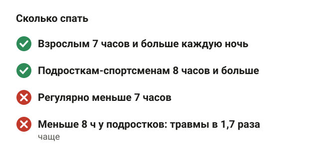
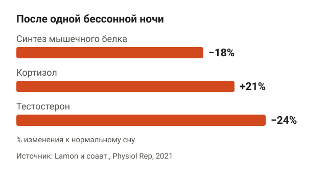
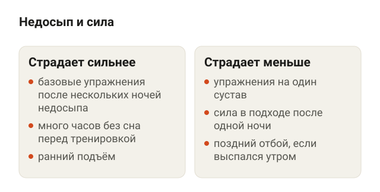
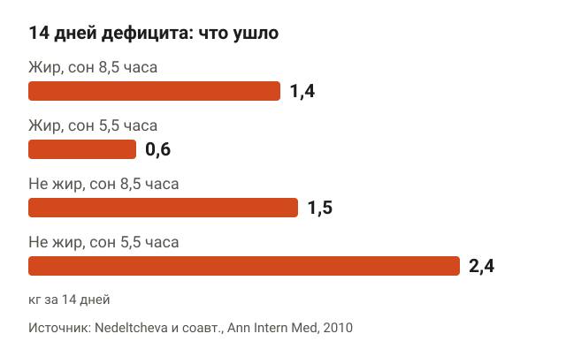
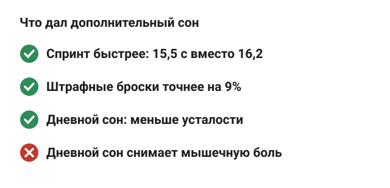
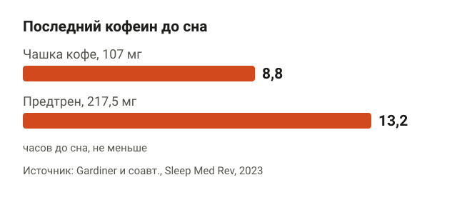
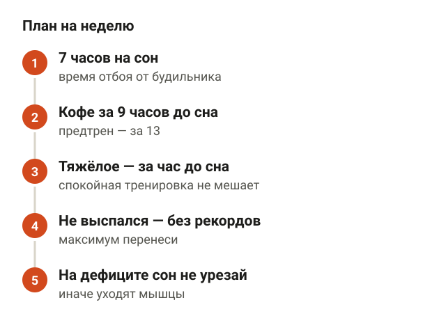
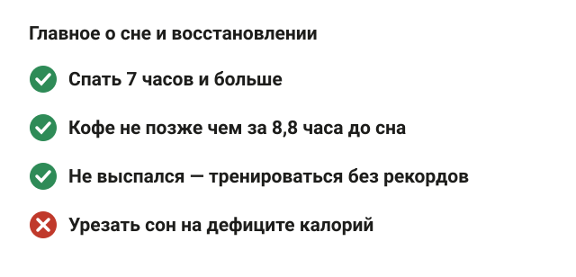

---
{
  "title": "Сон и восстановление после тренировок: сколько спать и что мешает",
  "seo_title": "Сон и восстановление после тренировок: сколько спать",
  "description": "Сколько спать, если ходишь в зал, что недосып делает с мышцами, силой и похудением, как кофе и вечерняя тренировка влияют на сон. С данными исследований.",
  "slug": "son-i-vosstanovlenie-posle-trenirovok",
  "date": "2026-11-06",
  "category": "travmy",
  "keyword": "сон и восстановление после тренировок",
  "tags": [
    "сон",
    "восстановление",
    "недосып",
    "кофеин",
    "похудение"
  ],
  "faq": [
    {
      "q": "Сколько нужно спать для восстановления после тренировки?",
      "a": "Взрослым — 7 часов и больше каждую ночь, это общая позиция Американской академии медицины сна. У подростков-спортсменов, которые спали меньше 8 часов, травмы были в 1,7 раза чаще."
    },
    {
      "q": "Можно ли тренироваться, если не выспался?",
      "a": "Можно. После одной бессонной ночи сила в подходе меняется мало, а тренировка частично сохраняет синтез мышечного белка. Попытки на максимум в базовых упражнениях лучше перенести на выспавшийся день."
    },
    {
      "q": "Растут ли мышцы, если мало спать?",
      "a": "Хуже. После одной бессонной ночи синтез мышечного белка был ниже на 18%, после пяти ночей по 4 часа в кровати — примерно на 19%. На дефиците калорий при коротком сне вместе с весом уходит больше мышц."
    },
    {
      "q": "За сколько часов до сна нельзя пить кофе?",
      "a": "По мета-анализу 24 исследований чашку кофе лучше выпить не позже чем за 8,8 часа до сна, а порцию предтренировочного комплекса — за 13,2 часа. Иначе кофеин отнимает в среднем 45 минут сна."
    }
  ],
  "sources": [
    {
      "title": "Watson N. F. и соавт. Recommended Amount of Sleep for a Healthy Adult: A Joint Consensus Statement of the AASM and SRS (J Clin Sleep Med, 2015)",
      "url": "https://doi.org/10.5664/jcsm.4758"
    },
    {
      "title": "Milewski M. D. и соавт. Chronic lack of sleep is associated with increased sports injuries in adolescent athletes (J Pediatr Orthop, 2014)",
      "url": "https://doi.org/10.1097/bpo.0000000000000151"
    },
    {
      "title": "Lamon S. и соавт. The effect of acute sleep deprivation on skeletal muscle protein synthesis and the hormonal environment (Physiol Rep, 2021)",
      "url": "https://doi.org/10.14814/phy2.14660"
    },
    {
      "title": "Saner N. J. и соавт. The effect of sleep restriction, with or without high-intensity interval exercise, on myofibrillar protein synthesis in healthy young men (J Physiol, 2020)",
      "url": "https://doi.org/10.1113/jp278828"
    },
    {
      "title": "Craven J. и соавт. Effects of Acute Sleep Loss on Physical Performance: A Systematic and Meta-Analytical Review (Sports Med, 2022)",
      "url": "https://doi.org/10.1007/s40279-022-01706-y"
    },
    {
      "title": "Knowles O. E. и соавт. Inadequate sleep and muscle strength: Implications for resistance training (J Sci Med Sport, 2018)",
      "url": "https://doi.org/10.1016/j.jsams.2018.01.012"
    },
    {
      "title": "Nedeltcheva A. V. и соавт. Insufficient sleep undermines dietary efforts to reduce adiposity (Ann Intern Med, 2010)",
      "url": "https://doi.org/10.7326/0003-4819-153-7-201010050-00006"
    },
    {
      "title": "Spiegel K. и соавт. Sleep curtailment in healthy young men is associated with decreased leptin levels, elevated ghrelin levels, and increased hunger and appetite (Ann Intern Med, 2004)",
      "url": "https://doi.org/10.7326/0003-4819-141-11-200412070-00008"
    },
    {
      "title": "Mah C. D. и соавт. The effects of sleep extension on the athletic performance of collegiate basketball players (Sleep, 2011)",
      "url": "https://doi.org/10.5665/sleep.1132"
    },
    {
      "title": "Boukhris O. и соавт. The effects of daytime napping on psychophysiological measures in physically active individuals and athletes: a systematic review and meta-analysis (Biol Sport, 2026)",
      "url": "https://doi.org/10.5114/biolsport.2026.153310"
    },
    {
      "title": "Gardiner C. и соавт. The effect of caffeine on subsequent sleep: A systematic review and meta-analysis (Sleep Med Rev, 2023)",
      "url": "https://doi.org/10.1016/j.smrv.2023.101764"
    },
    {
      "title": "Stutz J. и соавт. Effects of Evening Exercise on Sleep in Healthy Participants: A Systematic Review and Meta-Analysis (Sports Med, 2019)",
      "url": "https://doi.org/10.1007/s40279-018-1015-0"
    },
    {
      "title": "Kredlow M. A. и соавт. The effects of physical activity on sleep: a meta-analytic review (J Behav Med, 2015)",
      "url": "https://doi.org/10.1007/s10865-015-9617-6"
    },
    {
      "title": "Snijders T. и соавт. Protein Ingestion before Sleep Increases Muscle Mass and Strength Gains during Prolonged Resistance-Type Exercise Training in Healthy Young Men (J Nutr, 2015)",
      "url": "https://doi.org/10.3945/jn.114.208371"
    },
    {
      "title": "Reis C. E. G. и соавт. Effects of pre-sleep protein consumption on muscle-related outcomes — A systematic review (J Sci Med Sport, 2021)",
      "url": "https://doi.org/10.1016/j.jsams.2020.07.016"
    }
  ]
}
---
Сон и восстановление после тренировок связаны напрямую: взрослому нужно спать 7 часов и больше каждую ночь, и это минимум, а не идеал. После одной бессонной ночи синтез мышечного белка падает на 18%, а на дефиците калорий при коротком сне вместе с весом уходит больше мышц и меньше жира. Хорошая новость: сон можно поправить кофе по расписанию, временем тренировки и режимом, без таблеток и гаджетов.

Ниже разберу, сколько спать, что недосып делает с мышцами, силой и похудением, помогает ли спать больше и днём и как не испортить сон кофе и вечерней тренировкой.

## Сколько нужно спать, если ходишь в зал

<figure class="step"><figcaption>7 часов — нижняя граница для взрослых, у спортсменов-подростков меньше 8 часов связано с травмами.</figcaption></figure>

Американская академия медицины сна и Общество исследования сна в 2015 году собрали экспертов и выпустили общую позицию: взрослым нужно спать 7 часов и больше на регулярной основе ([Watson и соавт., 2015](https://doi.org/10.5664/jcsm.4758)). Меньше 7 часов регулярно связано с худшим здоровьем. Отдельной нормы «для тех, кто качается» в этой позиции нет, но 7 часов — нижняя граница для всех.

Про спортсменов есть данные, что граница может быть выше. В исследовании 112 школьников-спортсменов 12–18 лет те, кто спал в среднем меньше 8 часов, получали травмы в 1,7 раза чаще, чем те, кто спал 8 часов и больше ([Milewski и соавт., 2014](https://doi.org/10.1097/bpo.0000000000000151)). Честная оговорка: это подростки и опрос, а не эксперимент. Доказать, что травмы были именно из-за сна, такое исследование не может.

Практически: если спишь 6 часов и думаешь, почему не растут рабочие веса, начни не с новой программы, а с часа сна.

## Что недосып делает с мышцами

<figure class="step"><figcaption>Синтез мышечного белка ниже на 18%, кортизол выше на 21%, тестостерон ниже на 24%.</figcaption></figure>

Мышца растёт, когда синтез белка, то есть сборка новых белков в мышце, идёт быстрее распада. Сон влияет именно на эту сборку.

В рандомизированном исследовании 13 молодых мужчин и женщин одну ночь не спали совсем, а в другой раз спали нормально ([Lamon и соавт., 2021](https://doi.org/10.14814/phy2.14660)). После бессонной ночи:

- синтез мышечного белка был ниже на 18%;
- кортизол, гормон стресса, был выше на 21%;
- тестостерон был ниже на 24%.

Распад белка при этом не вырос. То есть одна плохая ночь не «съедает» мышцы, но тормозит их стройку.

Пять ночей по 4 часа в кровати проверили на 24 молодых мужчинах ([Saner и соавт., 2020](https://doi.org/10.1113/jp278828)). Синтез белка в мышечных волокнах упал с 1,53% до 1,24% в сутки, примерно на 19%. Интереснее третья группа: те, кто спал так же мало, но три раза за эти дни делал интервальную тренировку, сохранили синтез на уровне нормально спящих, 1,61% в сутки.

Соответственно, если неделя выдалась с недосыпом, тренировку лучше не пропускать, а провести. Она частично прикрывает мышцы, пока сон не наладится.

## Сила после бессонной ночи: что страдает сильнее

<figure class="step"><figcaption>В среднем результаты падают на 7,6%, сильнее — в базовых упражнениях после нескольких коротких ночей.</figcaption></figure>

Самый крупный разбор — мета-анализ 2022 года: 69 работ, 227 показателей, от спринта до силы ([Craven и соавт., 2022](https://doi.org/10.1007/s40279-022-01706-y)). Недосыпом считали 6 часов сна и меньше за сутки. В среднем результаты падали на 7,6%, и падение было во всех видах нагрузки, включая силу.

Две детали из этого анализа:

- каждый час без сна перед тренировкой снижал результат примерно на 0,4%;
- вредил не любой короткий сон, а прежде всего бессонная ночь и ранний подъём. Когда человек поздно лёг, но выспался утром, стабильного падения не было.

Систематический обзор 17 исследований про силовые даёт картину тоньше ([Knowles и соавт., 2018](https://doi.org/10.1016/j.jsams.2018.01.012)):

- одна бессонная ночь мало влияла на силу в подходе;
- несколько ночей подряд короткого сна снижали силу в многосуставных, базовых упражнениях: приседе, жиме, тяге;
- в упражнениях на один сустав, например сгибаниях на бицепс, такого падения не нашли.

Качество этих исследований авторы оценили как среднее или слабое, так что цифры — ориентир, а не закон. Что советует обзор, если тренироваться нужно невыспавшимся: тренироваться в группе или с партнёром, выпить кофе или поставить тренировку раньше в течение дня, пока не накопилось много часов без сна.

Если не выспался перед днём ног, тяжёлый присед на рекорд лучше перенести. Рабочий вес можно оставить, а попытку на максимум сделать в выспавшийся день.

## Сон и похудение: почему недосып мешает сушке

<figure class="step"><figcaption>При 5,5 часа сна жира ушло 0,6 кг вместо 1,4 кг, остальной массы — 2,4 кг вместо 1,5 кг.</figcaption></figure>

На дефиците калорий сон решает, что уйдёт вместе с весом. В рандомизированном исследовании 10 взрослых с лишним весом 14 дней сидели на умеренном дефиците калорий ([Nedeltcheva и соавт., 2010](https://doi.org/10.7326/0003-4819-153-7-201010050-00006)). Один раз им давали 8,5 часа на сон, другой раз — 5,5 часа. Диета была одинаковая.

- при 8,5 часа сна ушло 1,4 кг жира и 1,5 кг остальной массы тела;
- при 5,5 часа ушло только 0,6 кг жира и 2,4 кг остальной массы.

Остальная масса — это всё, что не жир: мышцы, вода, гликоген. Вес на весах уходил почти одинаково, но при коротком сне жира уходило на 55% меньше. Ещё люди сильнее хотели есть.

Голод при недосыпе объясняет исследование 12 молодых мужчин ([Spiegel и соавт., 2004](https://doi.org/10.7326/0003-4819-141-11-200412070-00008)). После двух ночей короткого сна:

- лептин, гормон сытости, был ниже на 18%;
- грелин, гормон голода, был выше на 28%;
- голод вырос на 24%, а тяга к сладкому и мучному — на 33–45%.

То есть невыспавшийся человек на диете ведёт бой с собственными гормонами. Как посчитать дефицит и собрать меню, разбирал в статье [дефицит калорий: меню на неделю](/stati/deficit-kaloriy-menyu-na-nedelyu/).

## Помогает ли спать больше и днём

<figure class="step"><figcaption>Почти 2 часа сна сверху ускорили спринт, дневной сон снял усталость, но не мышечную боль.</figcaption></figure>

Помогает, и это проверяли. Одиннадцать баскетболистов университетской команды 5–7 недель старались проводить в кровати не меньше 10 часов за ночь ([Mah и соавт., 2011](https://doi.org/10.5665/sleep.1132)). Сон вырос в среднем почти на 2 часа, на 111 минут за ночь. Результаты:

- спринт стал быстрее: 15,5 секунды вместо 16,2;
- точность штрафных бросков выросла на 9%, трёхочковых — на 9,2%;
- реакция стала быстрее, а дневная сонливость меньше.

Оговорка: игроков всего 11, контрольной группы не было, а баскетбол не силовой зал. Но направление понятное: если спишь мало, добрать сон — самое дешёвое улучшение.

Дневной сон разобрал мета-анализ 2026 года: 35 исследований, 489 спортсменов и активных людей ([Boukhris и соавт., 2026](https://doi.org/10.5114/biolsport.2026.153310)). Если ночью человек спал нормально, дневной сон:

- снижал усталость и улучшал настроение;
- тренировка после него ощущалась легче;
- улучшал ощущение восстановления.

На мышечную боль дневной сон не повлиял. А если ночь была бессонной, дневной сон не снял ни сонливость, ни усталость. Уверенность в этих выводах авторы оценивают как низкую, кроме ощущения тяжести тренировки. Если болят мышцы, что работает лучше, разобрал в статье [болят мышцы после тренировки](/stati/bolyat-myshcy-posle-trenirovki/).

## Кофе, вечерняя тренировка и белок перед сном

<figure class="step"><figcaption>Чашку кофе — не позже чем за 8,8 часа до сна, предтрен — за 13,2 часа.</figcaption></figure>

**Кофе.** Мета-анализ 24 исследований показал: кофеин сокращал ночной сон в среднем на 45 минут, а глубокого сна становилось меньше на 11 минут ([Gardiner и соавт., 2023](https://doi.org/10.1016/j.smrv.2023.101764)). Чтобы кофе не отнимал сон, авторы советуют:

- чашку кофе, это около 107 мг кофеина, выпивать не позже чем за 8,8 часа до сна;
- порцию предтренировочного комплекса, около 217,5 мг кофеина, — не позже чем за 13,2 часа.

Ложишься в 23:00 — последний кофе около 14:00. Предтрен перед вечерней тренировкой в 19:00 по этим расчётам отнимет часть сна.

**Вечерняя тренировка.** Мета-анализ 23 исследований не подтвердил, что тренировка вечером портит сон ([Stutz и соавт., 2019](https://doi.org/10.1007/s40279-018-1015-0)). Скорее наоборот: глубокого сна было чуть больше. Исключение — интенсивная тренировка, которая заканчивается меньше чем за час до сна. После неё засыпали дольше и спали меньше.

Регулярные тренировки сон в целом улучшают. Мета-анализ 66 исследований нашёл, что у тех, кто занимается регулярно, сон длиннее, засыпание быстрее и качество сна лучше, эффект от малого до среднего ([Kredlow и соавт., 2015](https://doi.org/10.1007/s10865-015-9617-6)).

**Белок перед сном.** 44 молодых мужчины 12 недель занимались силовыми ([Snijders и соавт., 2015](https://doi.org/10.3945/jn.114.208371)). Одна группа каждый вечер перед сном выпивала 27,5 г белка, другая — напиток без калорий. В группе с белком сила выросла на 164 кг в сумме упражнений, без белка — на 130 кг, и мышцы бедра выросли больше. Но у группы с белком было и больше белка за день, так что дело может быть просто в количестве.

Систематический обзор 9 исследований делает осторожный вывод: 20–40 г казеина, то есть медленного молочного белка, примерно за 30 минут до сна усиливают синтез белка ночью у молодых мужчин ([Reis и соавт., 2021](https://doi.org/10.1016/j.jsams.2020.07.016)). Для пожилых данных мало. Если дневной белок не добираешь, творог вечером — удобный способ, а сколько белка нужно в сумме, разбирал в статье [набор мышечной массы для мужчин](/stati/nabor-myshechnoy-massy-dlya-muzhchin/).

## Как наладить сон и восстановление после тренировок

<figure class="step"><figcaption>7 часов на сон, кофе по расписанию, тяжёлая работа за час до отбоя, без рекордов после недосыпа.</figcaption></figure>

Собрал выводы из исследований выше в план на неделю:

1. Отведи на сон не меньше 7 часов. Посчитай назад от будильника и поставь время отбоя.
2. Последний кофе — за 9 часов до сна, предтрен — за 13. Тренируешься вечером — бери предтрен без кофеина или обходись без него.
3. Тяжёлую тренировку заканчивай хотя бы за час до сна. Спокойная вечерняя тренировка сну не мешает.
4. Если не выспался, тренируйся, но без рекордов в базовых упражнениях. Попытку на максимум перенеси.
5. Сидишь на дефиците — сон не урезай: при 5,5 часа уходит больше мышц.
6. Есть возможность — добирай сон днём. Усталость он снимает, но ночной сон не заменяет.

Когда это уже не к тренеру. Если ты спишь 7–8 часов, а днём всё равно засыпаешь на ходу, если близкие говорят, что ты храпишь и перестаёшь дышать во сне, или если бессонница держится неделями, это повод к врачу. Режим и кофе тут уже не помогут.

## Шпаргалка

<figure class="step"><figcaption>Сон 7 часов и больше, кофе по расписанию, на дефиците сон не урезать.</figcaption></figure>

- Взрослым нужно спать 7 часов и больше. Подростки-спортсмены при сне меньше 8 часов травмировались в 1,7 раза чаще.
- Одна бессонная ночь снижает синтез мышечного белка на 18%. Тренировка в дни недосыпа частично это прикрывает.
- Недосып снижает результаты в среднем на 7,6%. Сильнее страдают базовые упражнения после нескольких коротких ночей.
- На дефиците при 5,5 часа сна жира уходит на 55% меньше, а мышц и воды — больше.
- Короткий сон усиливает голод и тягу к сладкому.
- Кофе — не позже чем за 8,8 часа до сна, предтрен — за 13,2 часа.
- Вечерняя тренировка сну не мешает, если тяжёлая работа закончилась больше чем за час до отбоя.
- 20–40 г казеина перед сном могут помочь молодым, если белка за день мало.
