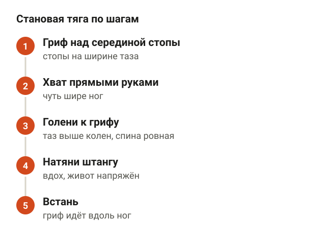
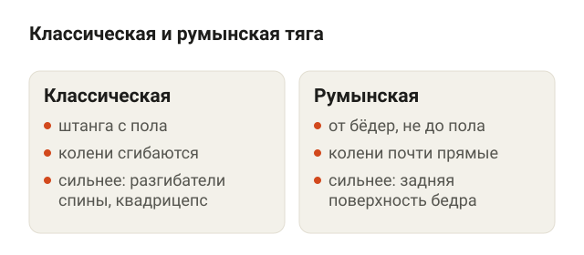
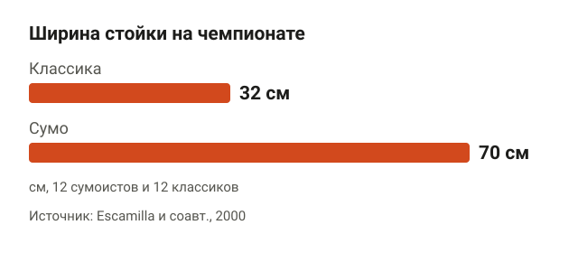
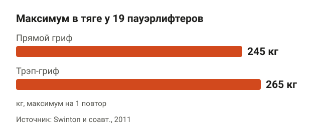
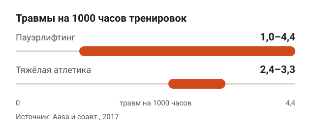
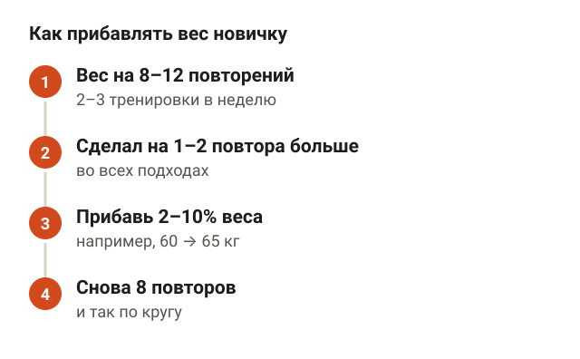
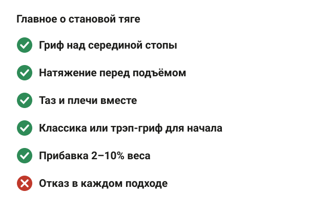

---
{
  "title": "Становая тяга: техника и ошибки новичков",
  "seo_title": "Становая тяга: техника выполнения и частые ошибки",
  "description": "Становая тяга по шагам: как встать к грифу, натянуть штангу и не нагружать поясницу. Классика, сумо и трэп-гриф, ошибки новичков и как прибавлять вес.",
  "slug": "stanovaya-tyaga-tehnika-i-oshibki",
  "date": "2026-11-08",
  "category": "trenirovki",
  "keyword": "становая тяга техника и ошибки",
  "tags": [
    "становая тяга",
    "техника",
    "новичкам",
    "поясница",
    "трэп-гриф"
  ],
  "faq": [
    {
      "q": "Какая правильная техника становой тяги?",
      "a": "Гриф над серединой стопы, хват прямыми руками чуть шире ног, голени касаются грифа, спина ровная. Перед подъёмом вдохни, напряги живот и натяни штангу, затем вставай, ведя гриф вдоль ног. Вверху просто выпрямись, без отклонения назад."
    },
    {
      "q": "Какие главные ошибки в становой тяге?",
      "a": "Гриф уходит вперёд от ног, штангу дёргают с пола без натяжения, таз поднимается раньше плеч, а вверху корпус отклоняют назад. Все четыре ошибки увеличивают нагрузку на поясницу и не помогают поднять вес."
    },
    {
      "q": "Почему болит поясница после становой тяги?",
      "a": "Чаще всего из-за веса не по силам, рывка с пола или грифа, который ушёл вперёд от ног. Мета-анализ Saraceni и соавторов 2020 года не нашёл связи между сгибанием поясницы при подъёме груза и болью, но данные низкого качества. Если боль не проходит несколько дней или отдаёт в ногу, это повод пойти к врачу."
    },
    {
      "q": "Что лучше для новичка: классика, сумо или трэп-гриф?",
      "a": "Классика или трэп-гриф. С трэп-грифом в исследовании Swinton и соавторов 2011 года максимум был 265 кг против 245 кг, а нагрузка на поясницу меньше. Сумо короче по пути штанги на 25–40%, но требует подвижного таза."
    },
    {
      "q": "Нужен ли пояс для становой тяги новичку?",
      "a": "На первых порах нет. Пояс помогает держать корпус под тяжёлым весом, но новичку полезнее научиться напрягать живот и задерживать дыхание без него. К поясу возвращаются, когда веса становятся близкими к максимуму."
    }
  ],
  "sources": [
    {
      "title": "Martín-Fuentes I., Oliva-Lozano J. M., Muyor J. M. Electromyographic activity in deadlift exercise and its variants. A systematic review (PLoS One, 2020)",
      "url": "https://doi.org/10.1371/journal.pone.0229507"
    },
    {
      "title": "Escamilla R. F. и соавт. A three-dimensional biomechanical analysis of sumo and conventional style deadlifts (Med Sci Sports Exerc, 2000)",
      "url": "https://doi.org/10.1097/00005768-200007000-00013"
    },
    {
      "title": "Escamilla R. F. и соавт. An electromyographic analysis of sumo and conventional style deadlifts (Med Sci Sports Exerc, 2002)",
      "url": "https://doi.org/10.1097/00005768-200204000-00019"
    },
    {
      "title": "Hanen N. C. и соавт. Biomechanical analysis of conventional and sumo deadlift (Front Bioeng Biotechnol, 2025)",
      "url": "https://doi.org/10.3389/fbioe.2025.1597209"
    },
    {
      "title": "Swinton P. A. и соавт. A biomechanical analysis of straight and hexagonal barbell deadlifts using submaximal loads (J Strength Cond Res, 2011)",
      "url": "https://doi.org/10.1519/JSC.0b013e3181e73f87"
    },
    {
      "title": "Hagerupsen K. и соавт. Comparison of resistance training using barbell half squats and trap bar deadlifts in recreationally active females: an eight-week randomised trial (BMC Sports Sci Med Rehabil, 2024)",
      "url": "https://doi.org/10.1186/s13102-024-00911-8"
    },
    {
      "title": "Aasa U. и соавт. Injuries among weightlifters and powerlifters: a systematic review (Br J Sports Med, 2017)",
      "url": "https://doi.org/10.1136/bjsports-2016-096037"
    },
    {
      "title": "Strömbäck E. и соавт. Prevalence and consequences of injuries in powerlifting: a cross-sectional study (Orthop J Sports Med, 2018)",
      "url": "https://doi.org/10.1177/2325967118771016"
    },
    {
      "title": "Saraceni N. и соавт. To flex or not to flex? Is there a relationship between lumbar spine flexion during lifting and low back pain? A systematic review with meta-analysis (J Orthop Sports Phys Ther, 2020)",
      "url": "https://doi.org/10.2519/jospt.2020.9218"
    },
    {
      "title": "Aasa B. и соавт. Individualized low-load motor control exercises and education versus a high-load lifting exercise and education in patients with low back pain: a randomized controlled trial (J Orthop Sports Phys Ther, 2015)",
      "url": "https://doi.org/10.2519/jospt.2015.5021"
    },
    {
      "title": "Berglund L. и соавт. Which patients with low back pain benefit from deadlift training? (J Strength Cond Res, 2015)",
      "url": "https://doi.org/10.1519/JSC.0000000000000837"
    },
    {
      "title": "American College of Sports Medicine. Progression models in resistance training for healthy adults (Med Sci Sports Exerc, 2009)",
      "url": "https://doi.org/10.1249/MSS.0b013e3181915670"
    },
    {
      "title": "Hackett D. A., Chow C. M. The Valsalva maneuver: its effect on intra-abdominal pressure and safety issues during resistance exercise (J Strength Cond Res, 2013)",
      "url": "https://doi.org/10.1519/JSC.0b013e31827de07d"
    }
  ]
}
---
Техника становой тяги держится на четырёх вещах: гриф стоит над серединой стопы и весь подъём идёт вдоль ног, спина ровная, перед подъёмом ты натягиваешь штангу, а не дёргаешь её с пола, и вверху просто выпрямляешься, без отклонения назад. Главные ошибки новичков — гриф уходит вперёд от ног, таз поднимается раньше плеч и подход начинается рывком. Первые недели работай с весом, который поднимаешь 8–12 раз, и прибавляй 2–10%, когда делаешь на 1–2 повтора больше плана.

Ниже разбираю становую тягу по шагам, какие мышцы в ней работают, чем отличаются классика, сумо и трэп-гриф, откуда берётся боль в пояснице и как подобрать вес. Мой личный рекорд в становой — 202,5 кг, и порядок ниже тот же, с которого я начинаю с клиентами: сначала положение у грифа, потом килограммы.

## Становая тяга по шагам: техника выполнения

<figure class="step"><figcaption>Гриф над серединой стопы, хват прямыми руками, голени к грифу, натяжение штанги, подъём вдоль ног.</figcaption></figure>

Становая тяга — подъём штанги с пола до положения стоя за счёт разгибания ног и таза. Руки в ней только держат гриф, тянут ноги и спина.

1. **Гриф над серединой стопы.** Встань к штанге так, чтобы гриф был над серединой стопы, примерно над шнурками. Стопы на ширине таза, носки чуть врозь.
2. **Хват прямыми руками.** Наклонись и возьми гриф хватом чуть шире ног. Руки прямые, гриф лежит в ладонях, обхвачен большим пальцем.
3. **Голени к грифу.** Согни колени, пока голени не коснутся грифа. Таз выше колен, но ниже плеч, плечи над грифом или чуть впереди него. Спина ровная от таза до шеи, взгляд в пол на 1–2 метра перед собой.
4. **Натяни штангу.** Вдохни, напряги живот, как перед ударом, и потяни гриф вверх, но ещё не отрывай его от пола. Блины чуть звякнут — это значит, слабина выбрана и тело собрано.
5. **Встань.** Толкай пол ногами. Гриф скользит вдоль голеней, проходит колени и идёт вдоль бёдер. Плечи и таз поднимаются вместе. Вверху колени и таз выпрямлены, плечи над тазом.

Опускание — то же в обратном порядке. Сначала таз уходит назад, гриф скользит вдоль бёдер, а после колен сгибаешь колени и ставишь штангу на пол. Бросать штангу сверху не нужно, но и опускать её медленно, по 5 секунд, тоже: для новичка достаточно контролировать её до пола.

Про дыхание. Вдох и задержка перед подъёмом, выдох наверху или когда штанга прошла колени. По обзору Hackett и Chow (2013), задержка дыхания на усилии повышает давление в животе и помогает держать корпус жёстким, но вместе с ним растёт и давление крови. Если у тебя повышенное давление или проблемы с сердцем, это нужно обсудить с врачом.

## Какие мышцы работают в становой тяге

<figure class="step"><figcaption>По датчикам в классике сильнее работают разгибатели спины и квадрицепс, в румынской — задняя поверхность бедра.</figcaption></figure>

Становая тяга нагружает почти всю заднюю поверхность тела и бёдра. Испанские исследователи (Martín-Fuentes и соавторы, 2020) собрали все работы, где активность мышц в тяге мерили датчиками на коже, то есть электромиографией. По датчикам в классической тяге сильнее всего работали разгибатели спины и квадрицепс, слабее — ягодичные и задняя поверхность бедра.

С румынской тягой картина другая. В ней задняя поверхность бедра по датчикам работала сильнее разгибателей спины. Это логично: в румынской тяге колени почти не сгибаются, движение идёт за счёт наклона в тазу, и бёдра растягиваются сильнее.

Румынскую тягу я часто даю новичкам раньше классической. В ней проще почувствовать, как таз уходит назад, а спина остаётся ровной, и не нужно каждый раз ставить штангу на пол.

**Румынская тяга со штангой.** Встань прямо, штанга в прямых руках у бёдер, стопы на ширине таза, колени чуть согнуты. Отводи таз назад и наклоняйся, гриф скользит вдоль бёдер. Опускайся, пока спина ровная и сзади бедра чувствуется растяжение, обычно гриф доходит до колен или чуть ниже, и выпрямляйся, толкая таз вперёд. Ориентиры: таз уходит назад, а не вниз; гриф всё время касается ног или идёт в паре сантиметров от них.

<figure class="step move"></figure>

Не стоит делать из этого вывод, что одно упражнение «на спину», а другое «на ноги». Датчики показывают, какая мышца сильнее возбуждена, а не какая вырастет больше. Обе тяги нагружают и спину, и бёдра, разница в акцентах.

## Классика или сумо: какую становую выбрать

<figure class="step"><figcaption>У сумоистов стойка в среднем 70 см, у классиков 32 см. Путь штанги в классике на 25–40% длиннее.</figcaption></figure>

Сумо — тяга с широкой постановкой ног и хватом между коленями. Американские исследователи (Escamilla и соавторы, 2000) засняли 12 сумоистов и 12 «классиков» на национальном чемпионате по пауэрлифтингу.

- Ширина стойки: у сумоистов в среднем 70 см, у классиков 32 см.
- Носки: у сумоистов развёрнуты на 42°, у классиков на 14°.
- Хват: у сумоистов уже, 47 см против 55 см.
- Корпус: у сумоистов на 5–10° вертикальнее.
- Путь штанги и проделанная работа в классике были на 25–40% больше.

Короче путь — больше килограммов, поэтому на соревнованиях многие тянут сумо. Мышцы тоже работают немного по-разному. В исследовании 2002 года (13 футболистов, вес на 12 повторений) в сумо по датчикам сильнее работали внутренняя и наружная головки квадрицепса, в классике — икроножная. В работе 2025 года (Hanen и соавторы, 30 опытных силовиков, 85% от максимума) классика сильнее нагружала разгибатели таза и двуглавую мышцу бедра.

Для новичка выбор простой: начинай с классики. Она ближе к тому, как ты поднимаешь вещи с пола в жизни, и в ней проще контролировать гриф. Сумо требует подвижности тазобедренных суставов, чтобы широко развести колени. Его можно попробовать позже, когда классика уже уверенно получается.

## Тяга с трэп-грифом: вариант для новичка

<figure class="step"><figcaption>С трэп-грифом максимум был 265 кг против 245 кг с прямым грифом, нагрузка на поясницу — меньше.</figcaption></figure>

Трэп-гриф, или гексагональный гриф, — шестиугольная рама, внутри которой ты стоишь. Ручки по бокам, вес проходит через линию тела, а не перед ногами.

Шотландские исследователи (Swinton и соавторы, 2011) сравнили тягу с прямым и трэп-грифом у 19 пауэрлифтеров. С трэп-грифом максимум был больше: в среднем 265 кг против 245 кг. Нагрузка на поясницу, таз и голеностоп по расчётам была меньше, на колени — больше. Пиковая мощность тоже выросла: 4872 Вт против 4388 Вт.

Работает ли трэп-гриф так же, как обычные базовые упражнения, проверили норвежцы (Hagerupsen и соавторы, 2024). 22 женщины 8 недель тренировались дважды в неделю: одна группа тянула трэп-гриф, другая приседала. Группа тяги прибавила в своём упражнении 18,4 кг, группа приседа в тяге — 11,7 кг. Прирост мышц, прыжка и скорости бега был похожим.

То есть если классическая тяга пока не получается или поясница на неё отзывается, трэп-гриф — нормальная замена, а не упрощённая версия для слабых. Ручки у него обычно выше, чем гриф прямой штанги, поэтому начинать проще.

## Частые ошибки в становой тяге

<figure class="step"><figcaption>Гриф вдоль ног, натяжение перед подъёмом, таз и плечи вместе. Ошибки: гриф впереди, рывок, отклонение назад.</figcaption></figure>

Большинство проблем в тяге видно со стороны за один подход. Вот что я исправляю у новичков чаще всего.

- **Гриф уходит вперёд от ног.** Чем дальше штанга от тела, тем длиннее рычаг и тем больше нагрузка на поясницу. Гриф должен идти вдоль голеней и бёдер. Если на голенях следы от грифа — это скорее нормально, чем плохо.
- **Рывок с пола.** Если дёргаешь штангу без натяжения, спина округляется в первый же момент. Сначала натяни гриф, потом вставай.
- **Таз уходит вверх первым.** Ноги выпрямились, а штанга ещё у пола, и вся работа достаётся спине. Таз и плечи поднимаются вместе.
- **Отклонение назад наверху.** Вверху достаточно выпрямиться. Наклон корпуса назад с прогибом в пояснице ничего не добавляет к подъёму.
- **Колени мешают грифу.** На опускании новички сгибают колени сразу, и гриф упирается в них. Сначала таз назад, колени — после того как гриф прошёл их.
- **Руки тянут штангу.** Согнутые локти не помогают поднять вес: руки только держат гриф. Они прямые, как канаты.

## Болит поясница после становой: виновата ли техника

<figure class="step"><figcaption>В пауэрлифтинге 1,0–4,4 травмы на 1000 часов, в тяжёлой атлетике 2,4–3,3 — как в других бесконтактных видах спорта.</figcaption></figure>

Поясница — самое частое место травм в силовых видах спорта. В систематическом обзоре Aasa и соавторов (2017) по пауэрлифтингу и тяжёлой атлетике чаще всего страдали позвоночник, плечо и колено. Но частота травм, из-за которых человек прерывает тренировки, — 1,0–4,4 на 1000 часов в пауэрлифтинге и 2,4–3,3 в тяжёлой атлетике. Это на уровне других бесконтактных видов спорта и ниже, чем в контактных.

Если считать травмой любую боль, которая мешает тренироваться, картина другая. В опросе 104 шведских пауэрлифтеров (Strömbäck и соавторы, 2018) 70% были травмированы на момент опроса, чаще всего болела область поясницы и таза. При этом полностью прекратили тренировки только 16% из них. То есть боль у силовиков частая, но в основном не настолько, чтобы бросать зал.

Отдельный вопрос — круглая спина. В мета-анализе Saraceni и соавторов (2020) сравнили, насколько сгибают поясницу при подъёме груза люди с болью в спине и без неё. В 9 из 11 исследований разницы не нашли, и связи между сгибанием поясницы при подъёме и появлением боли тоже не нашли. Качество исследований низкое, и почти все они про подъём лёгких грузов, а не про штангу в 100 кг.

Как я это применяю: учу держать спину ровной, потому что так проще контролировать тяжёлую штангу. Но если на последнем повторе спина чуть округлилась, это не катастрофа и не означает, что будет грыжа. Повод снизить вес или закончить подход, а не бросить тягу навсегда.

Становую даже используют при боли в пояснице. В шведском исследовании (Aasa и соавторы, 2015) 70 человек с повторяющейся болью в пояснице 8 недель занимались 12 раз под присмотром физиотерапевта: одна группа тянула штангу, другая делала лёгкие упражнения на контроль движения. Боль, сила и выносливость улучшились в обеих группах. По повседневной активности вторая группа выиграла больше: 4,2 балла против 2,5. Лучше всего от тяги выигрывали люди с меньшей болью и более выносливыми мышцами спины (Berglund и соавторы, 2015).

Если поясница болит после становой и не проходит за несколько дней, или боль отдаёт в ногу, это к врачу. Как отличить мышечную боль от травмы и что делать в первые дни, разобрано в статье [болит спина после тренировки](/stati/bolit-spina-posle-trenirovki/).

## С какого веса начать становую и как прибавлять

<figure class="step"><figcaption>Вес на 8–12 повторений, сделал на 1–2 повтора больше — прибавь 2–10% и снова работай на нижней границе.</figcaption></figure>

Первая тренировка — лёгкая штанга. Если блины маленького диаметра, гриф стоит слишком низко, и новичку тяжело взять его с ровной спиной. Тогда поставь штангу на блины или подставки, чтобы гриф был на высоте, как с большими блинами. Сделай 2–3 подхода по 8–10 повторов и посмотри, получается ли держать технику.

Дальше ориентир из позиции Американского колледжа спортивной медицины (ACSM) 2009 года для новичков:

- вес, с которым делаешь **8–12 повторений** в подходе;
- **2–3 тренировки в неделю** на всё тело;
- когда сделал на **1–2 повтора больше** плана, прибавляй **2–10%** веса;
- темп умеренный: 1–2 секунды вверх и 1–2 секунды вниз.

Допустим, ты тянешь 60 кг на 3 подхода по 8. На очередной тренировке во всех подходах вышло по 10. В следующий раз ставишь 65 кг и снова работаешь на 8. Шаг в 5 кг при 60 кг — около 8%, в рекомендацию укладывается.

Тянуть каждую тренировку не обязательно. Становая и присед нагружают одни и те же мышцы ног и спины, поэтому многие ставят их в разные дни. Технику приседа разбираю в статье [как правильно приседать со штангой](/stati/kak-pravilno-prisedat-so-shtangoy/), а сколько подходов на мышцу делать за неделю — в статье [сколько подходов делать для роста мышц](/stati/skolko-podhodov-dlya-rosta-myshc/).

Новичку не нужен отказ в тяге. Заканчивай подход, когда чувствуешь, что остаётся 1–2 повтора и техника ещё держится. Пояс на первых порах тоже не нужен. В исследовании Escamilla 2002 года с поясом по датчикам сильнее работала прямая мышца живота и слабее — косые, но учиться держать корпус, по-моему, лучше без него.

## Шпаргалка

<figure class="step"><figcaption>Гриф над серединой стопы и вдоль ног, натяжение перед подъёмом, классика или трэп-гриф, прибавка 2–10%.</figcaption></figure>

- Гриф над серединой стопы, хват прямыми руками чуть шире ног, голени касаются грифа.
- Перед подъёмом вдох, напряжённый живот и натяжение штанги без отрыва от пола.
- Гриф идёт вдоль ног, таз и плечи поднимаются вместе, вверху просто выпрямись.
- Новичку — классика или трэп-гриф: с ним максимум был 265 кг против 245 кг, а нагрузка на поясницу меньше.
- Сумо даёт путь штанги на 25–40% короче, но требует подвижного таза.
- Частота травм в пауэрлифтинге — 1,0–4,4 на 1000 часов, как в других бесконтактных видах спорта.
- Немного круглая спина на последнем повторе — повод снизить вес, а не бросить тягу.
- Вес на 8–12 повторений, прибавка 2–10%, когда сделал на 1–2 повтора больше.
