---
{
  "title": "Сутулость: упражнения в тренажёрном зале и план занятий",
  "seo_title": "Сутулость: упражнения в тренажёрном зале, с гантелями и резинкой",
  "description": "Какие упражнения в тренажёрном зале уменьшают сутулость: тяги, гиперэкстензия, гантели и резинка. Что показывают обзоры и сколько месяцев заниматься.",
  "slug": "sutulost-uprazhneniya-v-trenazhernom-zale",
  "date": "2026-11-01",
  "category": "spina-i-osanka",
  "keyword": "сутулость упражнения в тренажерном зале",
  "tags": [
    "сутулость",
    "осанка",
    "кифоз",
    "упражнения для спины",
    "тренажёрный зал",
    "гантели",
    "резинка"
  ],
  "faq": [
    {
      "q": "Можно ли убрать сутулость упражнениями?",
      "a": "Упражнения на укрепление спины уменьшают угол грудного кифоза, это показывают несколько мета-анализов. Эффект умеренный, а полного устранения сутулости исследования не доказали."
    },
    {
      "q": "Какие упражнения от сутулости делать в тренажёрном зале?",
      "a": "Те, что укрепляют разгибатели спины и мышцы лопаток: гиперэкстензию, горизонтальную тягу блока, тягу каната к лицу, тягу гантели в наклоне, разведения и Y-подъём. Добавь втягивание подбородка, если голова выдвинута вперёд."
    },
    {
      "q": "Нужно ли растягивать грудь при сутулости?",
      "a": "Можно, но как дополнение. Мета-анализ 2024 года с умеренной достоверностью не подтвердил растяжку как средство от мышечного дисбаланса, укрепление работает лучше."
    },
    {
      "q": "Что лучше для осанки: гантели или резинка?",
      "a": "Прямых сравнений в исследованиях нет. Гантели проще в прогрессии нагрузки, резинка удобна дома и в поездках, главное — техника и постепенная прибавка."
    },
    {
      "q": "Сутулость вызывает боль в спине?",
      "a": "Связь между осанкой и болью есть, но доказанной причины нет. Если спина болит вне тренировок, это повод сходить к врачу."
    }
  ],
  "sources": [
    {
      "title": "González-Gálvez N. et al. Effects of exercise programs on kyphosis and lordosis angle: a systematic review and meta-analysis (PLoS ONE, 2019)",
      "url": "https://www.ncbi.nlm.nih.gov/pmc/articles/PMC6488071/"
    },
    {
      "title": "Ponzano M. et al. Exercise for improving age-related hyperkyphosis: a systematic review and meta-analysis with GRADE (Arch Osteoporos, 2021)",
      "url": "https://www.researchgate.net/publication/392475606_Effect_of_Therapeutic_Exercise_on_the_Management_of_Hyperkyphosis_in_Adolescence_and_Young_Adulthood_A_Systematic_Review"
    },
    {
      "title": "Мета-анализ консервативных упражнений при кифозе (2025)",
      "url": "https://pmc.ncbi.nlm.nih.gov/articles/PMC12295994/"
    },
    {
      "title": "Katzman W. et al. SHEAF randomized controlled trial (Osteoporos Int, 2017)",
      "url": "https://www.ncbi.nlm.nih.gov/pmc/articles/PMC5715979/"
    },
    {
      "title": "Kamali F. et al. Manual therapy vs exercise therapy for thoracic hyperkyphosis, RCT (Physiother Theory Pract, 2016)",
      "url": "https://www.tandfonline.com/doi/full/10.3109/09593985.2015.1110739"
    },
    {
      "title": "Мета-анализ растяжки и укрепления при мышечном дисбалансе (Sports Medicine – Open, 2024)",
      "url": "https://www.ncbi.nlm.nih.gov/pmc/articles/PMC11150224/"
    },
    {
      "title": "Effect of therapeutic exercise on hyperkyphosis in adolescence and young adulthood: a systematic review (2025)",
      "url": "https://pmc.ncbi.nlm.nih.gov/articles/PMC12141983"
    },
    {
      "title": "Гиперкифоз и дыхательные техники: систематический обзор и мета-анализ (Healthcare)",
      "url": "https://pubmed.ncbi.nlm.nih.gov/42588352/"
    },
    {
      "title": "Upper crossed syndrome: мета-анализ (BMC Musculoskelet Disord, 2024)",
      "url": "https://www.ncbi.nlm.nih.gov/pmc/articles/PMC10832142/"
    },
    {
      "title": "Терапевтические упражнения при переднем положении головы: мета-анализ",
      "url": "https://pmc.ncbi.nlm.nih.gov/articles/PMC13361434/"
    }
  ]
}
---
При сутулости в тренажёрном зале лучше всего изучены упражнения, которые укрепляют разгибатели спины и мышцы, сводящие лопатки: тяги к поясу и к лицу, гиперэкстензия, разведения в наклоне. По мета-анализам, такие программы уменьшают угол грудного кифоза, и укрепление работает лучше, чем растяжка. Эффект умеренный и копится месяцами, а не неделями. Ниже разберём, какие упражнения делать с тренажёрами, гантелями и резинкой, сколько подходов и когда сначала нужен врач.

## Что такое сутулость и как её измеряют в исследованиях

<figure class="step">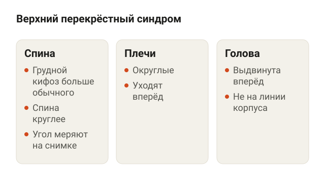<figcaption>Три признака, которые часто идут вместе при сутулости.</figcaption></figure>

Грудной кифоз — естественный изгиб грудного отдела позвоночника назад. Он есть у всех. Когда угол становится больше обычного, исследователи говорят о гиперкифозе. В быту это и называют сутулостью.

Часто сутулость идёт в комплекте с другими признаками. В научных работах этот набор называют верхним перекрёстным синдромом:

- повышенный грудной кифоз, то есть спина круглее обычного;
- округлые плечи, которые уходят вперёд;
- голова выдвинута вперёд относительно корпуса.

Оговорка к цифрам ниже: в большинстве работ угол измеряют на снимке или прибором. То есть исследования отвечают на вопрос «уменьшился ли угол», а не «перестал ли человек выглядеть сутулым».

Про боль. Отклонения осанки связаны с болью в мышцах и суставах, но это связь, а не доказанная причина. Сутулый человек не обязательно мучается со спиной, а ровный не застрахован от боли. Если спина болит и вне зала, ночью или боль отдаёт в руку, это к врачу. Подробнее про такие случаи — в статье [о неспецифической боли в спине](/stati/nespecificheskaya-bol-v-spine/).

## Что работает при сутулости: укрепление или растяжка

<figure class="step">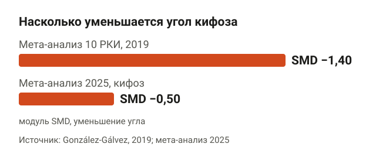<figcaption>Оба мета-анализа показывают эффект от среднего до большого.</figcaption></figure>

Коротко — укрепление. Сначала два термина.

- **РКИ** — рандомизированное контролируемое исследование: участников случайно делят на группы, одна занимается, другая нет или делает что-то другое.
- **SMD** — стандартизированная разница средних. Способ свести результаты разных исследований к одной шкале. Минус здесь значит, что угол кифоза уменьшился. Условно: около 0,2 — малый эффект, 0,5 — средний, 0,8 и больше — большой.

| Работа | Кто участвовал | Что нашли |
|---|---|---|
| González-Gálvez, 2019, мета-анализ 10 РКИ | разные группы людей | угол кифоза уменьшился, SMD −1,40; на поясничный прогиб явного эффекта нет |
| Мета-анализ 2025 года | люди с кифозом | SMD −0,50, качество доказательств умеренное |
| Обзор 2025 года по подросткам | только РКИ | углы грудного и поясничного кифоза улучшились по сравнению с контролем |
| Kamali, РКИ | 46 женщин, 5 недель, 15 занятий | упражнения и мануальная терапия одинаково уменьшили угол и увеличили силу разгибателей спины |
| Мета-анализ 2024 года | здоровые люди | растяжку как средство от мышечного дисбаланса не подтвердили, достоверность умеренная |

Разброс между −1,40 и −0,50 объясняется просто: в разные обзоры попали разные исследования и разные люди. Вывод у них один: эффект есть, от среднего до большого, и он не мгновенный.

Авторы обзора 2019 года отдельно пишут, что для кифоза укрепление, вероятно, важнее растяжки. Мета-анализ 2024 года это поддерживает: растяжка сама по себе дисбаланс не исправляет. Растягивать грудь в разминке никто не запрещает. Просто основное время тренировки отдавай тягам и разгибаниям.

## Какие мышцы держат спину ровно

<figure class="step">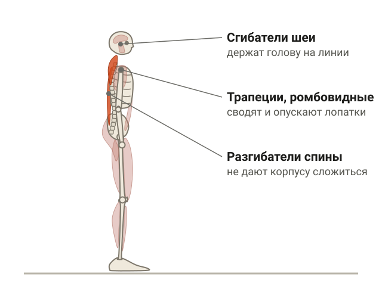<figcaption>Спину ровно держат разгибатели, мышцы лопаток и глубокие сгибатели шеи.</figcaption></figure>

В исследованиях укрепляли две группы: разгибатели спины и мышцы, которые фиксируют лопатки. Если разложить по мышцам:

- **Разгибатели спины** — длинные мышцы вдоль позвоночника. Разгибают его и не дают корпусу складываться вперёд.
- **Средняя и нижняя часть трапециевидной мышцы, ромбовидные** — сводят лопатки к позвоночнику и опускают их вниз.
- **Задняя дельта** — отводит руку назад и помогает удерживать плечи на месте.
- **Глубокие сгибатели шеи** — возвращают голову назад, на линию корпуса.

Грудные мышцы и передняя дельта в этой истории не враги. Просто в обычной программе их часто нагружают больше, чем спину, а жим лёжа делают охотнее, чем тягу. Хорошо знаю по себе: жим лёжа — любимое упражнение многих, включая меня.

## Упражнения от сутулости в тренажёрном зале

<figure class="step">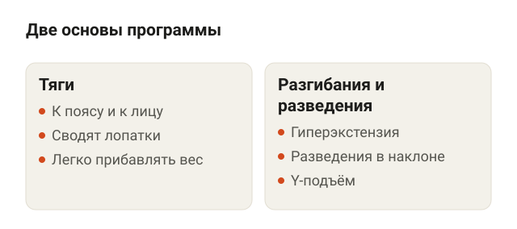<figcaption>Все упражнения в программе — тяги и разгибания.</figcaption></figure>

Все упражнения ниже — тяги и разгибания. Конкретно эти движения в исследованиях между собой не сравнивали: в работах описаны программы «на укрепление разгибателей спины и мышц лопатки». Я подобрал варианты, которые нагружают именно эти мышцы и в которых легко прибавлять рабочий вес.

### Тренажёры и TRX

<figure class="step">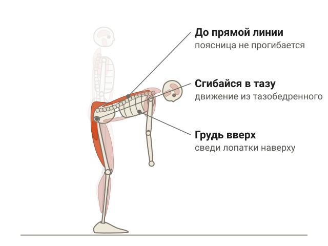<figcaption>В гиперэкстензии поднимайся до прямой линии от пяток до головы, не выше.</figcaption></figure>

**Гиперэкстензия.** Ляг бёдрами на подушку римского стула, пятки под валиками, руки скрещены на груди. Опустись вниз, сгибаясь в тазобедренном суставе, затем поднимись до прямой линии от пяток до головы. В верхней точке подними грудь и сведи лопатки. Ориентир: выше прямой линии не задираешься, поясница не прогибается дугой.

**Горизонтальная тяга блока сидя.** Сядь, упрись ногами, возьми рукоять, спина ровная, грудь вперёд. Сначала сведи лопатки, потом согни локти и подтяни рукоять к поясу. Ориентир: корпус не раскачивается назад, плечи не поднимаются к ушам.

**Тяга каната к лицу на кроссовере.** Поставь блок на уровне лица, возьми канат хватом сверху, отойди на шаг. Тяни канат к переносице, разводя локти в стороны и выше плеч, кисти в конце смотрят назад. Ориентир: голова не уходит вперёд навстречу канату, лопатки сводятся.

**Тяга в петлях TRX.** Встань лицом к креплению, возьмись за ручки и отклонись назад с прямыми руками. Подтяни грудь к рукам, сводя лопатки, медленно вернись. Ориентир: тело одной линией, таз не провисает. Чем ближе ноги к точке крепления и ниже корпус, тем тяжелее. В «Континенте», где я тренирую, петли висят в зоне функционального тренинга, но подойдут любые.

### Упражнения для осанки с гантелями

<figure class="step">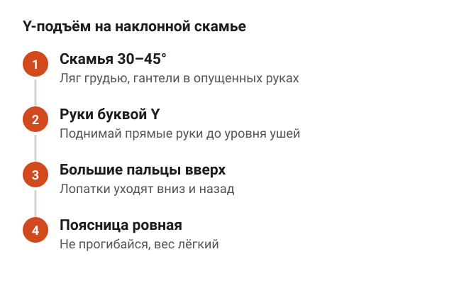<figcaption>Для Y-подъёма хватит гантелей по 1–3 кг.</figcaption></figure>

**Тяга гантели одной рукой в наклоне.** Колено и ладонь одной стороны на скамье, спина ровная, почти параллельно полу. Тяни гантель к поясу, локоть идёт назад вдоль корпуса. Ориентир: корпус не разворачивается, в верхней точке лопатка подходит к позвоночнику.

**Разведения гантелей в наклоне.** Сядь на край скамьи и наклонись грудью к бёдрам, гантели под коленями, локти слегка согнуты. Разводи руки в стороны до линии плеч. Ориентир: плечи не тянутся к ушам, гантели не забрасываешь рывком.

**Y-подъём лёжа на наклонной скамье.** Ляг грудью на скамью с наклоном 30–45°, гантели в опущенных руках. Поднимай прямые руки вперёд и вверх буквой Y до уровня ушей, большие пальцы смотрят вверх. Ориентир: лопатки уходят вниз и назад, поясница не прогибается. Хватит гантелей по 1–3 кг: нижняя трапеция сильно скромнее, чем кажется.

Прямых сравнений гантелей с тренажёрами и резинкой в исследованиях нет. Плюс гантелей практичный: вес прибавляешь мелким шагом.

### Упражнения для осанки с резинкой

<figure class="step">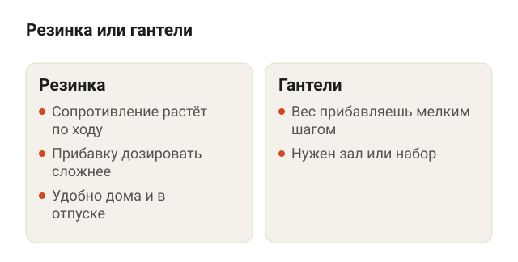<figcaption>Прямых сравнений нет, выбирай то, что удобнее тебе.</figcaption></figure>

**Разведение резинки перед грудью.** Встань прямо, возьми резинку хватом сверху на ширине плеч, руки прямые перед грудью. Растягивай резинку в стороны, пока она не коснётся груди. Ориентир: руки остаются прямыми, рёбра не выпячиваются вперёд.

<figure class="step move">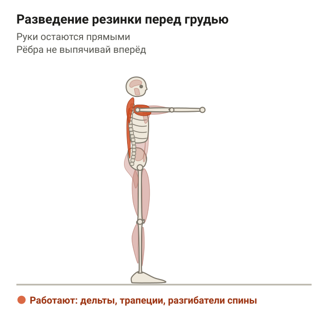</figure>

**Тяга резинки к лицу.** Закрепи резинку на уровне лица, возьми концы, отойди до натяжения. Тяни к переносице, разводя локти выше плеч. Ориентир: подбородок не уходит вперёд.

<figure class="step move">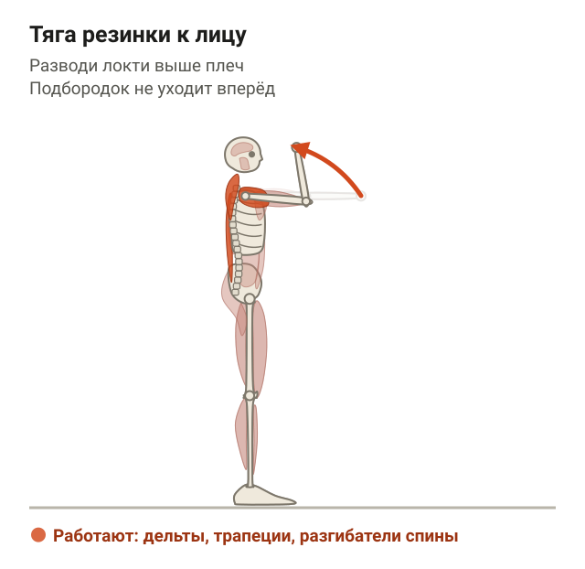</figure>

**Тяга резинки к поясу сидя.** Сядь на пол, ноги вперёд, середина резинки вокруг стоп. Тяни концы к поясу, сводя лопатки. Ориентир: корпус вертикален, не откидываешься назад.

<figure class="step move">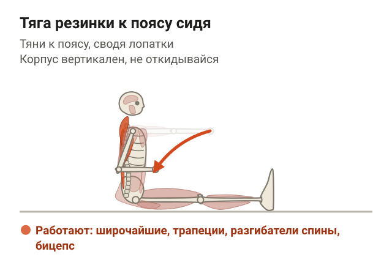</figure>

У резинки сопротивление растёт по ходу растяжения, и прибавку дозировать сложнее, чем с гантелями. Зато её удобно брать в отпуск и делать дома между тренировками.

### Шея и дыхание

<figure class="step">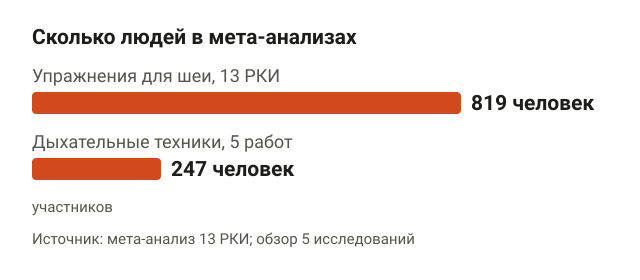<figcaption>Данные по шее собраны на большей выборке, чем по дыханию.</figcaption></figure>

При голове, выдвинутой вперёд, оценивают краниовертебральный угол — угол между горизонталью и линией от основания шеи к уху. Чем дальше голова вперёд, тем угол меньше. Мета-анализ 13 РКИ на 819 людях показал: упражнения этот угол улучшают, а в части анализов сильнее работало сочетание упражнений на шею и грудной отдел.

**Втягивание подбородка.** Встань спиной к стене, затылок, лопатки и таз касаются её. Втяни подбородок назад, будто делаешь двойной подбородок, затылок скользит вверх по стене. Держи 3–5 секунд. Ориентир: голова не наклоняется вниз, взгляд прямо.

<figure class="step move">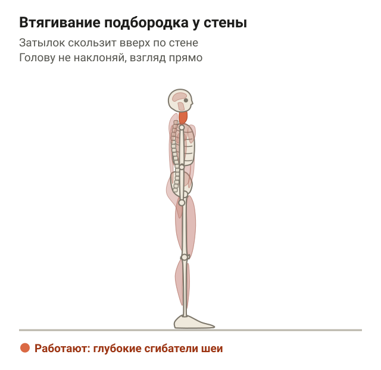</figure>

Про дыхание есть обзор с мета-анализом: 5 исследований, 247 участников. Добавление дыхательных техник к упражнениям сильнее уменьшало угол кифоза, чем одни упражнения. Достоверность умеренная, выборка маленькая, техники в работах разные.

**Дыхание в нижние рёбра лёжа.** Ляг на спину, колени согнуты, ладони на нижних рёбрах сбоку. Медленно вдохни носом, чтобы рёбра расходились под ладонями, выдохни ртом дольше, чем вдыхал. 5–6 вдохов. Ориентир: плечи не поднимаются, поясница у пола. Это не протокол из конкретного исследования, а вариант, который удобно вставить в разминку.

<figure class="step move">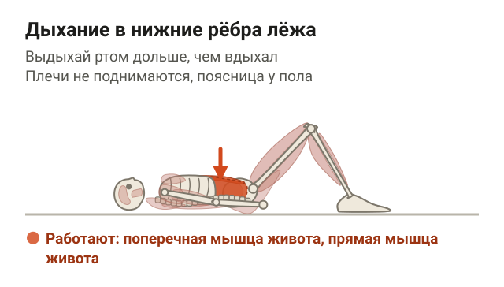</figure>

## Сколько заниматься и как прибавлять нагрузку

<figure class="step">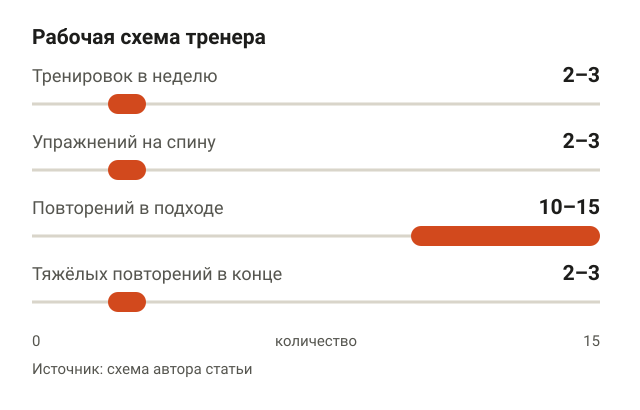<figcaption>Это схема из практики, точную дозу исследования пока не установили.</figcaption></figure>

По данным обзора, структурированные программы до 3 месяцев эффективны при грудном гиперкифозе. В исследовании Kamali изменения появились уже после 15 занятий за 5 недель. Точной дозы никто не установил: сколько подходов и раз в неделю оптимально, пока неясно.

Поэтому дальше — моя рабочая схема, а не цифры из исследований:

- 2–3 тренировки в неделю, упражнения можно добавить в твою текущую программу;
- 2–3 упражнения на спину и лопатки за тренировку плюс втягивание подбородка;
- 3 подхода по 10–15 повторений, последние 2–3 повторения тяжёлые, но техника держится;
- сначала прибавляю повторения до верхней границы, потом рабочий вес.

| День А | День Б |
|---|---|
| Гиперэкстензия 3×12–15 | Тяга гантели одной рукой 3×10–12 на сторону |
| Горизонтальная тяга блока 3×10–12 | Тяга в петлях TRX 3×10–12 |
| Тяга каната к лицу 3×12–15 | Y-подъём 3×12–15 |
| Втягивание подбородка 2×8 по 5 секунд | Разведение резинки 2×15–20 |

Как считать недельный объём на группу мышц, разбирал в статье [сколько подходов делать для роста мышц](/stati/skolko-podhodov-dlya-rosta-myshc/). Логика та же: если застреваешь на одних цифрах больше пары недель, добавь подход или смени вариант тяги.

## Можно ли исправить сутулость взрослому

<figure class="step">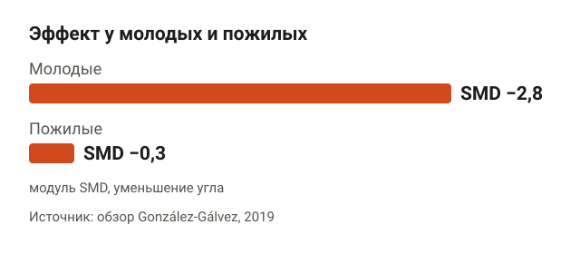<figcaption>С возрастом эффект программ заметно меньше, но он есть.</figcaption></figure>

Можно уменьшить угол, но чем старше человек, тем скромнее результат и слабее данные. В том же обзоре эффект программ у молодых — SMD −2,8, у пожилых — −0,3.

- **Ponzano, 2021:** 13 исследований, 586 пожилых людей с гиперкифозом. Качество доказательств — от очень низкого до умеренного. Неоднородность, то есть насколько результаты разных работ расходятся, от 0 до 58%.
- **SHEAF, Katzman, 2017:** 99 человек старше 60 лет. Программа укрепления спины и тренировки осанки может быть эффективной.

Вывод честный: после 60 упражнения тоже помогают, но исследований мало, а какие именно упражнения и в какой дозе работают лучше, ещё предстоит выяснить. Полный план для взрослых, включая привычки вне зала, — в статье [как исправить осанку у взрослого](/stati/kak-ispravit-osanku-u-vzroslogo/).

## Типичные ошибки в упражнениях от сутулости

<figure class="step">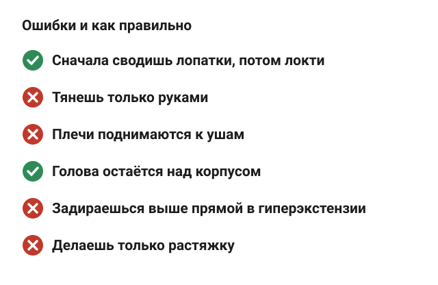<figcaption>Большинство ошибок связаны с лопатками, плечами и головой.</figcaption></figure>

- **Тянешь только руками.** Лопатки стоят на месте, работают бицепсы. Сначала сведи лопатки, потом сгибай локти.
- **Плечи к ушам.** В тягах и разведениях верх трапеции перехватывает нагрузку. Держи плечи опущенными.
- **Голова вперёд в тяге к лицу.** Тянешь канат, а подбородок едет навстречу. Голова остаётся над корпусом.
- **Переразгибание в гиперэкстензии.** Задираешься выше прямой линии за счёт поясницы. Останавливайся на прямой.
- **Только растяжка.** По данным мета-анализа 2024 года, одной растяжки мало.
- **Ждёшь результат через две недели.** Программы в исследованиях шли от 5 недель до 3 месяцев.

## Шпаргалка

<figure class="step">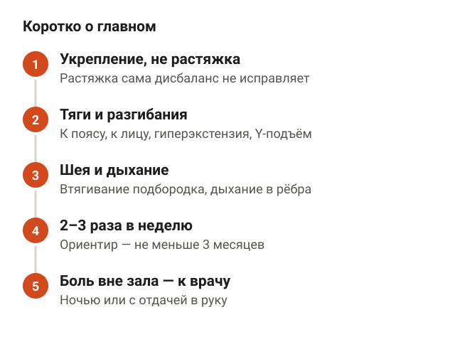<figcaption>Основные выводы статьи в пяти пунктах.</figcaption></figure>

- Сутулость в исследованиях — это гиперкифоз, увеличенный угол грудного отдела.
- Упражнения уменьшают этот угол: SMD от −0,50 до −1,40 по разным мета-анализам.
- Укрепление работает лучше растяжки.
- Основа — тяги к поясу и к лицу, гиперэкстензия, разведения и Y-подъём.
- Гантели, тренажёры или резинка — прямых сравнений нет, выбирай то, где удобно прибавлять нагрузку.
- Для головы, выдвинутой вперёд, добавь втягивание подбородка, а в разминку — дыхание в нижние рёбра.
- 2–3 тренировки в неделю, ориентир — не меньше 3 месяцев.
- После 60 эффект меньше, но он есть.
- Если спина болит вне зала, ночью или боль отдаёт в руку — сначала к врачу.
