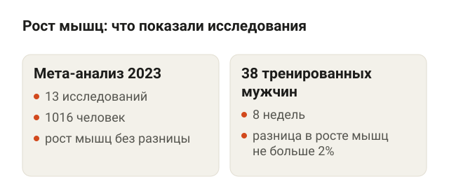
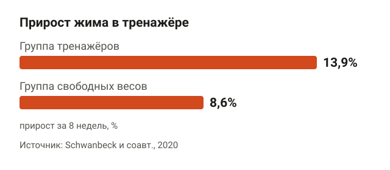
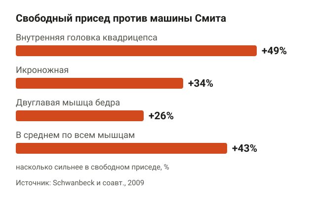
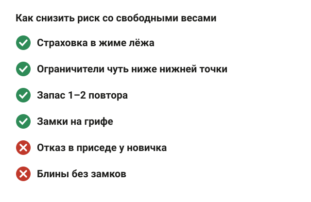
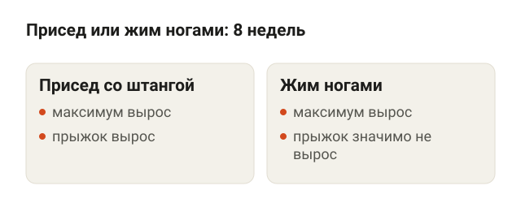
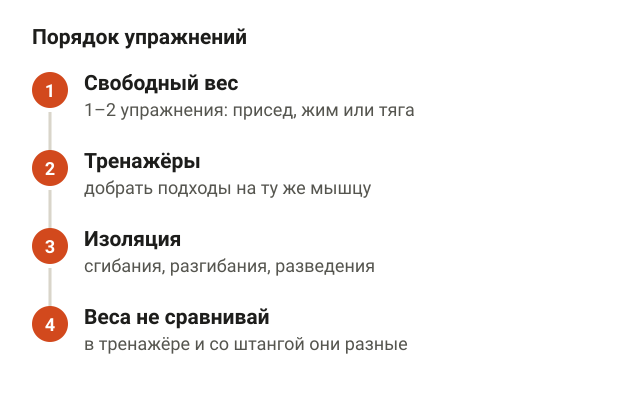
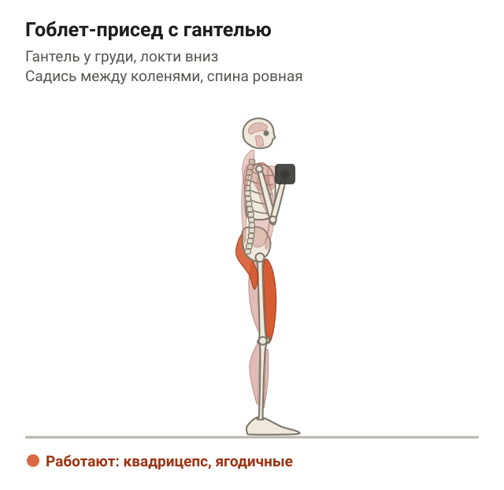
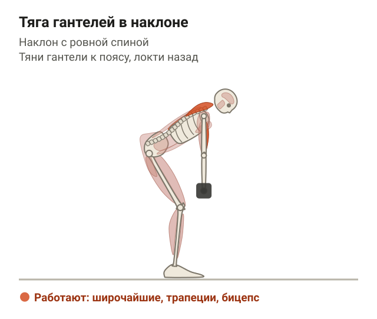
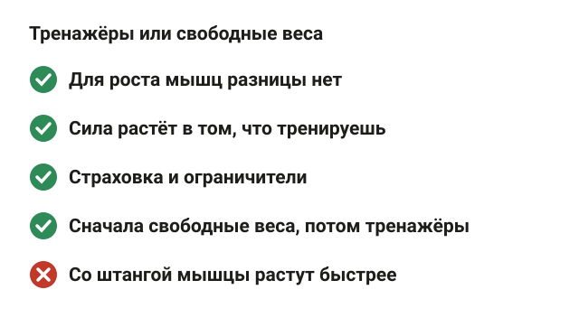

---
{
  "title": "Тренажёры или свободные веса: что лучше для мышц и силы",
  "seo_title": "Тренажёры или свободные веса: что лучше для мышц",
  "description": "Тренажёры или свободные веса: что показали исследования о росте мышц и силе, почему в тренажёре вес больше, что безопаснее новичку и как сочетать.",
  "slug": "trenazhery-ili-svobodnye-vesa",
  "date": "2026-11-10",
  "category": "trenirovki",
  "keyword": "тренажёры или свободные веса что лучше",
  "tags": [
    "свободные веса",
    "тренажёры",
    "рост мышц",
    "сила",
    "новичку"
  ],
  "faq": [
    {
      "q": "Можно ли накачаться только на тренажёрах?",
      "a": "Да. В мета-анализе 2023 года (13 исследований, 1016 человек) мышцы росли одинаково при тренировках в тренажёрах и со свободными весами. Важнее число подходов и близость к отказу, чем снаряд."
    },
    {
      "q": "Что лучше для новичка: тренажёры или свободные веса?",
      "a": "Тренажёры проще освоить, поэтому с них удобно начинать. Американский колледж спортивной медицины советует новичкам включать в программу и то, и другое: одно-два упражнения со свободным весом в начале тренировки, затем тренажёры."
    },
    {
      "q": "Машина Смита — это тренажёр или свободный вес?",
      "a": "Тренажёр: гриф идёт по направляющим. В исследовании 2009 года в приседе со свободной штангой мышцы по датчикам в среднем работали на 43% сильнее, чем в машине Смита, зато в ней проще держать равновесие."
    },
    {
      "q": "Что безопаснее: тренажёры или свободные веса?",
      "a": "Со свободными весами травм больше, но в 65,5% случаев из исследования 2010 года причиной был упавший вес, а не техника. Страховка, ограничители стойки, замки на грифе и запас 1–2 повтора этот риск снижают."
    }
  ],
  "sources": [
    {
      "title": "Haugen M. E. и соавт. Effect of free-weight vs. machine-based strength training on maximal strength, hypertrophy and jump performance – a systematic review and meta-analysis (BMC Sports Sci Med Rehabil, 2023)",
      "url": "https://doi.org/10.1186/s13102-023-00713-4"
    },
    {
      "title": "Hernández-Belmonte A. и соавт. Free-weight and machine-based training are equally effective on strength and hypertrophy: challenging a traditional myth (Med Sci Sports Exerc, 2023)",
      "url": "https://doi.org/10.1249/MSS.0000000000003271"
    },
    {
      "title": "Schwanbeck S. R. и соавт. Effects of training with free weights versus machines on muscle mass, strength, free testosterone, and free cortisol levels (J Strength Cond Res, 2020)",
      "url": "https://doi.org/10.1519/JSC.0000000000003349"
    },
    {
      "title": "Schwanbeck S., Chilibeck P. D., Binsted G. A comparison of free weight squat to Smith machine squat using electromyography (J Strength Cond Res, 2009)",
      "url": "https://doi.org/10.1519/JSC.0b013e3181b1b181"
    },
    {
      "title": "Marcos-Frutos D. и соавт. Central and peripheral fatigue following free-weight and Smith machine squat training (Int J Sports Physiol Perform, 2026)",
      "url": "https://doi.org/10.1123/ijspp.2026-0301"
    },
    {
      "title": "Wirth K. и соавт. Effect of 8 weeks of free-weight and machine-based strength training on strength and power performance (J Hum Kinet, 2016)",
      "url": "https://doi.org/10.1515/hukin-2016-0023"
    },
    {
      "title": "Johnen B., Schott N. Feasibility of a machine vs free weight strength training program and its effects on physical performance in nursing home residents: a pilot study (Aging Clin Exp Res, 2018)",
      "url": "https://doi.org/10.1007/s40520-017-0830-8"
    },
    {
      "title": "Kerr Z. Y. и соавт. Epidemiology of weight training-related injuries presenting to United States emergency departments, 1990 to 2007 (Am J Sports Med, 2010)",
      "url": "https://doi.org/10.1177/0363546509351560"
    },
    {
      "title": "American College of Sports Medicine. Progression models in resistance training for healthy adults (Med Sci Sports Exerc, 2009)",
      "url": "https://doi.org/10.1249/MSS.0b013e3181915670"
    }
  ]
}
---
Что лучше, тренажёры или свободные веса, исследования отвечают так: для роста мышц разницы нет. В мета-анализе 2023 года (13 исследований, 1016 человек) мышцы росли одинаково, а сила росла сильнее в том, на чём человек тренировался: со штангой — в штанге, в тренажёре — в тренажёре. Поэтому выбирать стоит по цели и удобству, а лучший вариант для большинства — сочетать одно с другим.

Ниже разбираю, что показали исследования о мышцах и силе, почему в тренажёре поднимаешь больше, что безопаснее новичку и как собрать тренировку из того и другого.

## Тренажёры или свободные веса: что лучше для роста мышц

<figure class="step"><figcaption>Мета-анализ 13 исследований (1016 человек) и 8-недельное исследование 38 тренированных мужчин: мышцы росли одинаково, разница не больше 2%.</figcaption></figure>

Свободные веса — это штанга, гантели и гири: траекторию задаёшь ты сам. Тренажёр ведёт вес по заданной линии через блок, рычаг или направляющие. Отсюда и спор: в свободных весах больше работы на удержание равновесия, а в тренажёре проще дожать мышцу до усталости.

На рост мышц эта разница почти не влияет.

- **Мета-анализ.** Haugen и соавторы (2023) собрали 13 исследований, где люди 18–60 лет минимум 6 недель тренировались либо со свободными весами, либо в тренажёрах. Всего 1016 участников, из них 219 женщин. Рост мышц в группах не отличался. Авторы пишут прямо: выбор между ними — дело предпочтений и цели.
- **Исследование с тренированными.** Hernández-Belmonte и соавторы (2023) 8 недель тренировали 38 мужчин со стажем. Одна группа делала присед, жим лёжа, тягу лёжа на скамье и жим над головой со штангой, другая — те же движения в тренажёрах. Всё остальное было одинаковым. Площадь сечения мышц бедра, груди и пресса по УЗИ выросла в обеих группах, разница между ними — не больше 2%.
- **Исследование с новичками.** Schwanbeck и соавторы (2020) 8 недель тренировали 46 молодых людей, из них 26 женщин. Толщина бицепса и квадрицепса выросла в обеих группах одинаково.

То есть мышце всё равно, что её нагружает: гриф или трос блока. Важнее, сколько подходов ты делаешь и насколько близко к отказу. Про объём я подробно писал в статье [«Сколько подходов делать для роста мышц»](/stati/skolko-podhodov-dlya-rosta-myshc/).

## Что лучше для силы: правило специфичности

<figure class="step"><figcaption>Жим в тренажёре за 8 недель: +13,9% у группы тренажёров и +8,6% у группы свободных весов.</figcaption></figure>

С силой картина другая. В мета-анализе Haugen сила в тестах со свободными весами выросла больше у тех, кто тренировался со свободными весами. Сила в тестах на тренажёрах, наоборот, чаще росла больше у тех, кто тренировался на тренажёрах, хотя здесь разница не дотянула до статистической значимости.

Это называют правилом специфичности: ты становишься сильнее в том движении, которое тренируешь. В работе Schwanbeck жим в тренажёре у группы тренажёров вырос на 13,9%, а у группы свободных весов — на 8,6%. Жим штанги лёжа и присед со штангой при этом выросли в обеих группах одинаково, на 11–19%.

Если сравнивать не «свой» тест, а силу в целом, разницы между способами нет. Hernández-Belmonte проверил участников в восьми тестах, по четыре упражнения в каждом варианте, и общий прирост силы различался не больше чем на 1,8%.

Вывод для зала простой. Хочешь пожать 100 кг штангой — жми штангу. Хочешь просто стать сильнее и крупнее — подойдёт и то, и другое.

## Почему в тренажёре поднимаешь больше

<figure class="step"><figcaption>В свободном приседе мышцы по датчикам работали сильнее: внутренняя головка квадрицепса на 49%, икроножная на 34%, двуглавая бедра на 26%, в среднем на 43%.</figcaption></figure>

В тренажёре вес идёт по заданной линии, и держать равновесие почти не надо. Поэтому рабочий вес в нём обычно больше: в обзоре Haugen упомянуты работы, где в машине Смита приседали больше, чем со свободной штангой.

Обратная сторона — меньше работают мышцы, которые держат равновесие. Schwanbeck и соавторы (2009) сравнили присед со штангой и присед в машине Смита с одинаковым по тяжести весом на 8 повторов. По датчикам на коже, то есть электромиографии (ЭМГ), в свободном приседе икроножная мышца работала на 34% сильнее, двуглавая мышца бедра — на 26%, внутренняя головка квадрицепса — на 49%. В среднем по всем мышцам — на 43%.

Тут есть оговорка. ЭМГ показывает, насколько мышца возбуждена в подходе, а не насколько она вырастет за месяцы. И долгие исследования из первого раздела как раз показали одинаковый рост мышц. Так что «стабилизаторы работают сильнее» — правда, а «со штангой растёшь быстрее» — уже нет.

Есть и плюс у тренажёра. В исследовании 2026 года (Marcos-Frutos и соавторы) 19 тренированных мужчин делали по 4 подхода по 9 приседаний со штангой и в машине Смита. После свободного приседа утомление нервной системы и мышц бедра было больше. Авторы делают вывод, что при одинаковом результате тренажёр может давать ту же силу с меньшей усталостью.

## Что безопаснее для новичка

<figure class="step"><figcaption>Страховка в жиме, ограничители в стойке, запас 1–2 повтора, замки на грифе. Ошибки: отказ в приседе у новичка, блины без замков.</figcaption></figure>

Американский колледж спортивной медицины (ACSM, 2009) пишет, что тренажёры проще освоить, поэтому их считают безопаснее для новичков. В зале это видно по первым тренировкам: в тренажёре человек сразу работает, а со штангой сначала надо поставить технику.

Реальные данные по травмам такие. Kerr и соавторы (2010) разобрали травмы в силовых тренировках, с которыми люди в США с 1990 по 2007 год попали в отделения неотложной помощи. В 90,4% случаев травма случилась со свободными весами. Но в 65,5% случаев причиной был вес, упавший на человека, а не сама техника.

Авторы мета-анализа 2023 года при этом осторожны: долгих исследований о травмах мало, и сказать, что тренажёры безопаснее по самой своей природе, пока нельзя. А в работе Hernández-Belmonte жалобы на боль и скованность в суставах за 8 недель уменьшились в обеих группах, без разницы между ними.

Получается, что опасна не штанга, а потеря контроля над ней. Что снижает риск со свободными весами:

- **Страховка в жиме лёжа.** Партнёр или ограничители стойки, если работаешь тяжело.
- **Ограничители в стойке для приседа.** Выставь их чуть ниже нижней точки, тогда штангу можно спокойно положить.
- **Запас 1–2 повтора.** Новичку не нужен отказ в приседе и жиме: последний повтор должен оставаться ровным.
- **Замки на грифе.** Блины без замков сползают, и штанга перекашивается.

Если в зале страховать некому, жим в тренажёре или жим гантелей решают ту же задачу без риска уронить гриф на грудь. Технику жима со штангой я разбирал в статье [«Жим лёжа: техника для начинающих по шагам»](/stati/zhim-lezha-tehnika-dlya-nachinayushchih/).

## Перенос силы на прыжки и быт

<figure class="step"><figcaption>120 мужчин, 8 недель: максимум вырос у обеих групп, высота прыжка значимо выросла только у тех, кто приседал.</figcaption></figure>

Свободные веса часто называют более «функциональными»: движения похожи на то, что ты делаешь вне зала. Данные это отчасти подтверждают.

Wirth и соавторы (2016) 8 недель тренировали 120 мужчин дважды в неделю. Одна группа приседала со штангой, другая делала жим ногами в тренажёре. Максимум в своём упражнении вырос у обеих групп. Но высота прыжка значимо выросла только у тех, кто приседал.

В мета-анализе Haugen прыжок вверх с места в целом не отличался между способами, данные по нему есть в пяти исследованиях. То есть преимущество штанги для прыжков есть, но небольшое и не везде.

Для пожилых людей картина похожая. В пилотном исследовании 2018 года (Johnen и Schott) 45 жителей дома престарелых в среднем 84 лет 12 недель тренировались со свободными весами или на тренажёрах. Разницы между группами в тестах на ходьбу и подъём по лестнице не нашли, а в тестах на вставание со стула и «встань и иди» улучшились обе группы. То есть и здесь важнее сам факт тренировок.

## Как сочетать тренажёры и свободные веса в одной тренировке

<figure class="step"><figcaption>Сначала одно-два упражнения со свободным весом, потом тренажёры на ту же мышцу, изолирующие упражнения в конце.</figcaption></figure>

ACSM в тех же рекомендациях советует новичкам включать в программу и тренажёры, и свободные веса. Авторы мета-анализа 2023 года предполагают, что сочетание может дать более полный рост мышц, но прямо это не проверяли.

В Hammer Fit «Континент», где я тренирую, есть и то, и другое: стойки для приседаний, помост для штанги и блочные тренажёры на все группы мышц. Поэтому я строю тренировку новичка так:

1. **Сначала одно-два упражнения со свободным весом.** Пока ты свежий, проще держать технику. Это присед, жим или тяга. ACSM тоже советует ставить многосуставные упражнения на большие мышцы перед односуставными.
2. **Потом тренажёры.** В них удобно добрать подходы на ту же мышцу, когда устал и техника со штангой начала бы плыть.
3. **Изолирующие упражнения в конце.** Сгибание и разгибание ног, разведения, бицепс в блоке.
4. **Рабочий вес в тренажёре не сравнивай со штангой.** Это разные упражнения, и вес в них разный.

С чего начать со свободными весами, если раньше работал только в тренажёрах. Два упражнения, которые проще всего освоить:

**Гоблет-присед с гантелью.** Возьми гантель вертикально за верхний блин и держи у груди, локти смотрят вниз. Стопы чуть шире плеч, носки слегка врозь. Садись вниз между коленями так глубоко, как получается с ровной спиной, и поднимайся, толкаясь всей стопой. Ориентиры: пятки на полу, колени идут по линии носков.

<figure class="step move"></figure>

**Тяга гантелей в наклоне.** Возьми по гантели в каждую руку, колени чуть согни, отведи таз назад и наклонись вперёд с ровной спиной. Руки висят под плечами. Тяни гантели к поясу, локти идут назад вдоль корпуса, внизу руки выпрямляются полностью. Ориентиры: спина ровная весь подход, корпус не раскачивается.

<figure class="step move"></figure>

Когда гоблет-присед получается уверенно, можно переходить к приседу со штангой. Как поставить его по шагам, разобрано в статье [«Как правильно приседать со штангой»](/stati/kak-pravilno-prisedat-so-shtangoy/).

## Шпаргалка

<figure class="step"><figcaption>Мышцы растут одинаково, сила — в том, что тренируешь. Сочетать: сначала свободные веса, потом тренажёры.</figcaption></figure>

- Для роста мышц разницы между тренажёрами и свободными весами нет: так показали мета-анализ 13 исследований и прямые сравнения.
- Сила растёт сильнее в том, на чём тренируешься. Нужна сила в штанге — тренируйся со штангой.
- В свободном приседе мышцы-стабилизаторы по датчикам работают сильнее, в среднем на 43%, но мышцы от этого быстрее не растут.
- Травмы со свободными весами чаще связаны с упавшим весом. Страховка, ограничители, замки и запас 1–2 повтора снижают риск.
- Лучший вариант для большинства — сочетать: сначала свободные веса, потом тренажёры.
