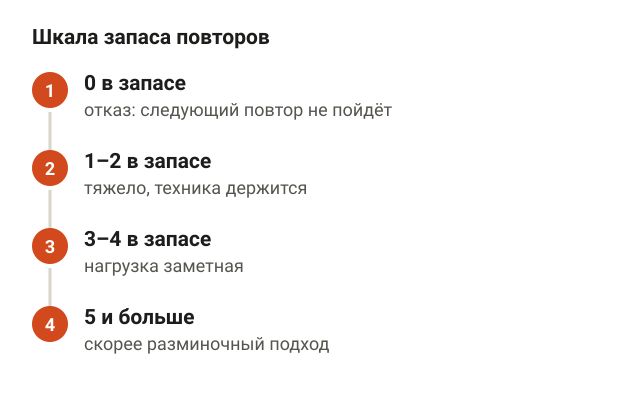
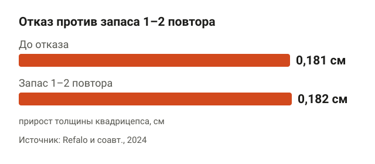
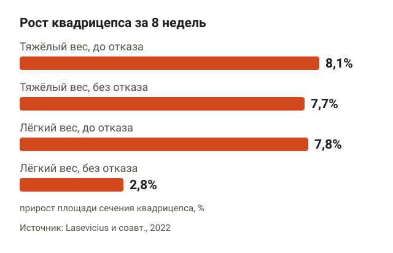
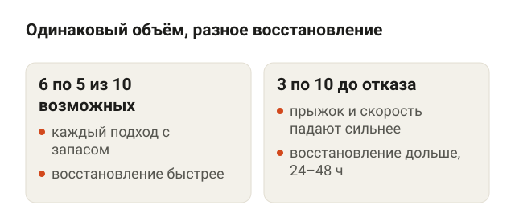
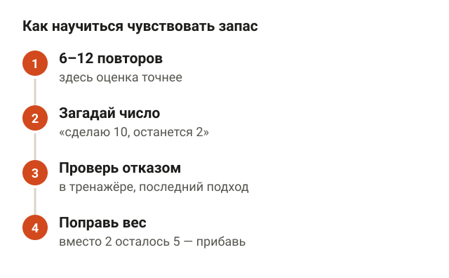
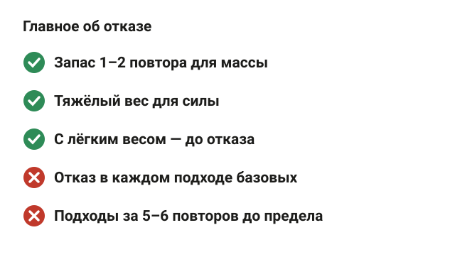

---
{
  "title": "Тренировка до отказа или не до отказа: что лучше для мышц и силы",
  "seo_title": "Тренировка до отказа или нет: что лучше для массы и силы",
  "description": "Тренировка до отказа или с запасом повторов: что показали мета-анализы о росте мышц и силе, когда отказ нужен, сколько после него восстанавливаться.",
  "slug": "trenirovka-do-otkaza",
  "date": "2026-11-11",
  "category": "trenirovki",
  "keyword": "до отказа или не до отказа тренировка",
  "tags": [
    "отказ",
    "запас повторов",
    "RIR",
    "рост мышц",
    "сила",
    "восстановление"
  ],
  "faq": [
    {
      "q": "Нужно ли тренироваться до отказа для роста мышц?",
      "a": "Не обязательно. Мета-анализы по 15 исследований не нашли значимой разницы в росте мышц между отказом и подходами без отказа, а запас 1–2 повтора в исследовании 2024 года дал тот же рост квадрицепса, что и отказ."
    },
    {
      "q": "Сколько повторов оставлять в запасе?",
      "a": "Для массы и силы большинству подходит 1–3 повтора в запасе с весом на 6–12 повторов. Если вес лёгкий и повторов больше 20, подход лучше доводить до отказа или почти до него."
    },
    {
      "q": "Можно ли делать каждый подход до отказа?",
      "a": "Можно, но восстановление будет медленнее: в исследовании 2017 года после подходов в отказ силовые показатели возвращались дольше, разница была видна через 24–48 часов. Отказ лучше оставить для тренажёров и последнего подхода."
    },
    {
      "q": "Отказ в приседе и жиме лёжа — это опасно?",
      "a": "В отказе техника начинает плыть, а в жиме штанга может остаться на груди. Поэтому в приседе, становой тяге и жиме оставляй 1–3 повтора в запасе, а жим лёжа близко к отказу делай со страховкой."
    }
  ],
  "sources": [
    {
      "title": "Grgic J., Schoenfeld B. J. и соавт. Effects of resistance training performed to repetition failure or non-failure on muscular strength and hypertrophy: a systematic review and meta-analysis (J Sport Health Sci, 2022)",
      "url": "https://doi.org/10.1016/j.jshs.2021.01.007"
    },
    {
      "title": "Refalo M. C., Helms E. R. и соавт. Influence of resistance training proximity-to-failure on skeletal muscle hypertrophy: a systematic review with meta-analysis (Sports Med, 2023)",
      "url": "https://doi.org/10.1007/s40279-022-01784-y"
    },
    {
      "title": "Robinson Z. P. и соавт. Exploring the dose-response relationship between estimated resistance training proximity to failure, strength gain, and muscle hypertrophy: a series of meta-regressions (Sports Med, 2024)",
      "url": "https://doi.org/10.1007/s40279-024-02069-2"
    },
    {
      "title": "Refalo M. C. и соавт. Similar muscle hypertrophy following eight weeks of resistance training to momentary muscular failure or with repetitions-in-reserve in resistance-trained individuals (J Sports Sci, 2024)",
      "url": "https://doi.org/10.1080/02640414.2024.2321021"
    },
    {
      "title": "Lasevicius T. и соавт. Muscle failure promotes greater muscle hypertrophy in low-load but not in high-load resistance training (J Strength Cond Res, 2022)",
      "url": "https://doi.org/10.1519/JSC.0000000000003454"
    },
    {
      "title": "Morán-Navarro R. и соавт. Time course of recovery following resistance training leading or not to failure (Eur J Appl Physiol, 2017)",
      "url": "https://doi.org/10.1007/s00421-017-3725-7"
    },
    {
      "title": "Halperin I. и соавт. Accuracy in predicting repetitions to task failure in resistance exercise: a scoping review and exploratory meta-analysis (Sports Med, 2022)",
      "url": "https://doi.org/10.1007/s40279-021-01559-x"
    },
    {
      "title": "Helms E. R., Cronin J., Storey A., Zourdos M. C. Application of the repetitions in reserve-based rating of perceived exertion scale for resistance training (Strength Cond J, 2016)",
      "url": "https://doi.org/10.1519/SSC.0000000000000218"
    }
  ]
}
---
Тренировка до отказа или не до отказа — для роста мышц разница небольшая, а для силы её почти нет. Два мета-анализа по 15 исследований не нашли значимого преимущества у отказа, а в восьминедельном исследовании 2024 года ноги росли одинаково, когда подход заканчивали в отказ и когда оставляли 1–2 повтора в запасе. Зато отказ дольше восстанавливается. Поэтому рабочая схема для большинства — подходы с запасом 1–3 повтора и отказ точечно, в тренажёрах и последнем подходе.

Ниже разбираю, что такое отказ и запас повторов, что показали исследования о массе и силе, когда отказ имеет смысл и как научиться чувствовать, сколько повторов у тебя осталось.

## Что такое отказ и запас повторов

<figure class="step"><figcaption>0 в запасе — отказ, 1–2 — тяжёлый подход с ровной техникой, 3–4 — силы ещё есть, 5 и больше — скорее разминка.</figcaption></figure>

Отказ — это повтор, который ты не можешь закончить с нормальной техникой, как ни стараешься. Штанга встала на середине пути, и всё. В исследованиях это называют мышечным отказом.

Удобнее мерить не сам отказ, а расстояние до него. Для этого есть шкала запаса повторов, по-английски RIR — repetitions in reserve. Её описали Helms, Zourdos и соавторы в 2016 году. Логика простая: закончил подход и честно ответил себе, сколько ещё раз мог бы поднять.

- **0 в запасе.** Это и есть отказ: следующий повтор не получится.
- **1–2 в запасе.** Подход тяжёлый, последние повторы медленные, но техника держится.
- **3–4 в запасе.** Нагрузка заметная, но ещё есть силы.
- **5 и больше в запасе.** Это уже скорее разминочный подход.

Эрика Хелмса, одного из авторов шкалы, я слушал на лекции «Пирамида мышц и силы». Шкала пригодится дальше: почти все современные исследования о близости к отказу считают именно повторы в запасе.

## До отказа или не до отказа: что показали исследования о росте мышц

<figure class="step"><figcaption>За 8 недель толщина квадрицепса выросла на 0,181 см на ноге с отказом и на 0,182 см на ноге с запасом 1–2 повтора.</figcaption></figure>

Если сравнивать отказ и подходы с запасом при похожем объёме, мышцы растут почти одинаково.

- **Мета-анализ 2022 года.** Grgic, Schoenfeld и соавторы собрали 15 исследований с молодыми взрослыми. Значимой разницы в росте мышц между отказом и подходами без отказа не нашли. Небольшое преимущество отказа показала только подгруппа тренированных людей.
- **Мета-анализ 2023 года.** Refalo, Helms и соавторы тоже разобрали 15 исследований. Когда отказ понимали в строгом смысле, то есть доводили подход до повтора, который уже не идёт, преимущества перед подходами с запасом не было. Если считать все определения отказа вместе, отказ давал преимущество, но авторы называют его тривиальным, то есть почти незаметным.
- **Исследование 2024 года.** Refalo и соавторы 8 недель тренировали 18 человек со стажем, 12 мужчин и 6 женщин, два раза в неделю. Одна нога делала жим ногами и разгибание ног в тренажёре до отказа, другая — с запасом 2 повтора в жиме ногами и 1 повтор в разгибаниях. Толщина квадрицепса выросла на 0,181 см на ноге с отказом и на 0,182 см на ноге с запасом.

То есть последний повтор «на зубах» почти ничего не добавляет к росту мышц. Гораздо больше значит, сколько всего тяжёлых подходов ты делаешь за неделю. Про это есть отдельная статья [«Сколько подходов делать для роста мышц»](/stati/skolko-podhodov-dlya-rosta-myshc/).

## Насколько близко к отказу нужно для массы и для силы

<figure class="step"><figcaption>Сила росла похоже в широком диапазоне запаса повторов. Масса росла немного больше, когда подход заканчивали ближе к отказу.</figcaption></figure>

В 2024 году Robinson и соавторы свели вместе исследования о близости к отказу и посмотрели, как результат меняется с числом повторов в запасе. Получилась разная картина для силы и для массы.

- **Сила.** Росла похоже в широком диапазоне запаса повторов. Связи между тем, сколько повторов человек оставлял, и приростом силы почти не было.
- **Масса.** Росла немного больше, когда подход заканчивали ближе к отказу.

Тут есть оговорка, которую делают сами авторы. Запас повторов в большинстве исследований не измеряли, а оценивали по описанию программы. Поэтому точную цифру, «сколько повторов в запасе лучше всего для массы», из этой работы не вытащить.

Как это совместить с предыдущим разделом. Подходы с запасом 1–2 повтора уже достаточно близки к отказу: в исследовании 2024 года такой запас дал тот же рост, что и отказ. А вот подход, где ты остановился за 5–6 повторов до предела, для роста мышц, скорее всего, слабоват.

## Когда отказ имеет смысл: лёгкий вес

<figure class="step"><figcaption>Тяжёлый вес: 8,1% с отказом и 7,7% без него. Лёгкий вес: 7,8% с отказом и 2,8% без отказа.</figcaption></figure>

Есть ситуация, где отказ решает. Это работа с лёгким весом.

Lasevicius и соавторы (2022) 8 недель тренировали 25 нетренированных мужчин в разгибании ног. Каждая нога работала по своей схеме: тяжёлый вес 80% от максимума или лёгкий 30%, до отказа или без отказа. Общий объём уравняли.

Площадь сечения квадрицепса выросла так:

- тяжёлый вес до отказа — на 8,1%;
- тяжёлый вес без отказа — на 7,7%;
- лёгкий вес до отказа — на 7,8%;
- лёгкий вес без отказа — на 2,8%, и этот прирост не был значимым.

С тяжёлым весом отказ ничего не добавил. А с лёгким весом без отказа мышца почти не выросла. Логика понятная: в подходе на 30 с лишним повторов первые 15–20 даются легко, и мышца по-настоящему нагружается только в конце.

Сила в этом исследовании росла больше от тяжёлого веса: на 33–34% против 16–18% у лёгкого, с отказом или без него.

Вывод для зала. Если тренируешься дома с лёгкими гантелями или резинкой, доводи подходы до отказа или почти до него. Если работаешь с весом на 6–12 повторов, достаточно оставить 1–2 повтора в запасе.

## Сколько восстанавливаться после отказа

<figure class="step"><figcaption>6 подходов по 5 с весом на 10 повторов и 3 подхода по 10 в отказ дают тот же объём, но после отказа восстановление медленнее, разница видна через 24–48 часов.</figcaption></figure>

Отказ дорого обходится восстановлению. Это видно по исследованию Morán-Navarro и соавторов (2017).

10 тренированных мужчин делали жим лёжа и глубокий присед по трём схемам. Вес везде был такой, что его можно поднять максимум 10 раз.

- **3 подхода по 5 повторов.** Половина от возможного.
- **6 подходов по 5 повторов.** Тот же общий объём, что в отказе, но каждый подход с запасом.
- **3 подхода по 10 повторов.** Каждый подход до отказа.

После отказа сразу сильнее падали высота прыжка и скорость штанги. А через 24–48 часов после подходов без отказа люди восстанавливались быстрее, чем после отказа, даже при одинаковом объёме. Маркеры утомления в крови после отказа тоже возвращались к норме медленнее.

Соответственно, если ты тренируешь одну мышцу 2–3 раза в неделю, частый отказ в тяжёлых базовых упражнениях может съесть следующую тренировку. Про паузы внутри тренировки я писал в статье [«Сколько отдыхать между подходами»](/stati/skolko-otdyhat-mezhdu-podhodami/).

## Как понять, сколько повторов осталось в запасе

<figure class="step"><figcaption>Подходы на 6–12 повторов, загаданное число перед подходом, проверка отказом в тренажёре, поправка веса. Ошибка оценки в среднем около 1 повтора.</figcaption></figure>

Честно оценить запас — навык, и сначала он у всех хромает. Halperin и соавторы (2022) собрали 12 исследований, 414 человек: люди называли, сколько повторов у них осталось, а потом делали подход до отказа.

- **Ошибка в среднем — около одного повтора.** Люди недооценивали себя: думали, что осталось меньше, чем было на деле, в среднем на 0,95 повтора.
- **Точнее в подходах до 12 повторов.** В длинных подходах ошибка росла.
- **Точнее ближе к концу подхода и в последних подходах.** Чем ближе к пределу, тем лучше человек его чувствует.
- **Стаж почти не помогал.** Тренированные ошибались примерно так же, как новички.

Как я учу этому новичков:

1. **Работай в диапазоне 6–12 повторов.** Здесь оценка точнее, чем в подходах на 20 раз.
2. **Перед подходом загадай число.** Например, «сделаю 10, и останется 2».
3. **Иногда проверяй себя отказом.** В тренажёре, где это безопасно, доведи последний подход до отказа и сравни с тем, что загадал.
4. **Поправь вес.** Если «2 в запасе» на деле оказались 5, вес лёгкий, прибавь.

## В каких упражнениях можно до отказа, а в каких нет

<figure class="step"><figcaption>Отказ — в тренажёрах, изолирующих упражнениях и последнем подходе. В приседе, становой и жиме — 1–3 повтора в запасе, жим близко к отказу — со страховкой.</figcaption></figure>

Даже если отказ подходит под твою цель, делать его везде не стоит.

- **Можно в тренажёрах и изолирующих упражнениях.** Разгибание и сгибание ног, разведения, бицепс в блоке. Если повтор не пошёл, ты просто отпускаешь вес.
- **Можно в последнем подходе упражнения.** Так усталость не переносится на следующие подходы.
- **Осторожно в приседе, становой тяге и жиме лёжа.** В отказе техника начинает плыть: спина округляется, штанга уходит с траектории. Здесь держи 1–3 повтора в запасе.
- **Жим лёжа до отказа — только со страховкой.** Партнёр у головы или упоры в раме чуть ниже груди. Как это настроить, разобрано в статье [«Жим лёжа: техника для начинающих»](/stati/zhim-lezha-tehnika-dlya-nachinayushchih/).
- **Новичку отказ не обязателен.** Пока техника не устоялась, мышцы и так растут от подходов с запасом.

Если болит сустав или спина и вне зала, отказ — точно не то, с чего начинать. С такой болью сначала к врачу.

## Шпаргалка

<figure class="step"><figcaption>Запас 1–2 повтора даёт тот же рост, что и отказ. С лёгким весом отказ нужен. После отказа восстановление медленнее.</figcaption></figure>

- Для роста мышц отказ даёт мало: мета-анализы по 15 исследований не нашли значимой разницы с подходами без отказа.
- Запас 1–2 повтора дал тот же рост квадрицепса, что и отказ: 0,182 см против 0,181 см за 8 недель.
- Силе всё равно, сколько повторов в запасе, в широком диапазоне. Ей важнее тяжёлый вес.
- С лёгким весом отказ нужен: без него мышца выросла на 2,8%, с ним — на 7,8%.
- После отказа восстановление медленнее, разница видна через 24–48 часов.
- Оценка запаса ошибается в среднем на 1 повтор. Иногда проверяй себя отказом в тренажёре.
- Отказ — в тренажёрах и последнем подходе. В приседе, становой тяге и жиме лёжа — 1–3 повтора в запасе.
