---
{
  "title": "Тренировка в растянутом положении мышцы: что даёт и как делать",
  "seo_title": "Тренировка в растянутом положении мышцы: рост и упражнения",
  "description": "Что даёт тренировка в растянутом положении мышцы: цифры исследований, частичные повторы или полная амплитуда, упражнения и как добавить их в программу.",
  "slug": "trenirovka-v-rastyanutom-polozhenii-myshcy",
  "date": "2026-11-10",
  "category": "trenirovki",
  "keyword": "тренировка в растянутом положении мышцы",
  "tags": [
    "растянутое положение",
    "амплитуда",
    "набор массы",
    "частичные повторы",
    "техника"
  ],
  "faq": [
    {
      "q": "Правда ли, что мышцы лучше растут в растянутом положении?",
      "a": "Для части мышц — да. Задняя поверхность бедра в сгибании ног сидя выросла на 14% против 9% лёжа, трицепс в разгибании над головой — на 19,9% против 13,9%. Но в сгибании рук в блоке с отведённым назад плечом разницы не нашли."
    },
    {
      "q": "Что такое частичные повторы в растяжении?",
      "a": "Это движение только в той половине амплитуды, где мышца длинная, например нижняя половина подъёма на носки. По исследованиям 2025–2026 годов они дают примерно такой же рост, как полная амплитуда."
    },
    {
      "q": "Нужно ли делать все упражнения в неполной амплитуде?",
      "a": "Нет. Полная амплитуда уже включает растянутое положение и в мета-анализе 2023 года в целом работала не хуже. Частичные повторы удобно добавлять в конце подхода, когда на полную амплитуду сил уже нет."
    },
    {
      "q": "Почему в разгибании из-за головы рабочий вес меньше?",
      "a": "Длинная головка трицепса растянута и в таком положении слабее. В работе Maeo 2023 вес над головой был на 34–39% меньше, а трицепс при этом вырос сильнее."
    }
  ],
  "sources": [
    {
      "title": "Maeo S. и соавт. Greater hamstrings muscle hypertrophy but similar damage protection after training at long versus short muscle lengths (Med Sci Sports Exerc, 2021)",
      "url": "https://doi.org/10.1249/MSS.0000000000002523"
    },
    {
      "title": "Maeo S. и соавт. Triceps brachii hypertrophy is substantially greater after elbow extension training performed in the overhead versus neutral arm position (Eur J Sport Sci, 2023)",
      "url": "https://doi.org/10.1080/17461391.2022.2100279"
    },
    {
      "title": "Kassiano W. и соавт. Greater gastrocnemius muscle hypertrophy after partial range of motion training performed at long muscle lengths (J Strength Cond Res, 2023)",
      "url": "https://doi.org/10.1519/JSC.0000000000004460"
    },
    {
      "title": "Wolf M. и соавт. Partial vs full range of motion resistance training: a systematic review and meta-analysis (Int J Strength Cond, 2023)",
      "url": "https://doi.org/10.47206/ijsc.v3i1.182"
    },
    {
      "title": "Wolf M. и соавт. Lengthened partial repetitions elicit similar muscular adaptations as full range of motion repetitions during resistance training in trained individuals (PeerJ, 2025)",
      "url": "https://doi.org/10.7717/peerj.18904"
    },
    {
      "title": "Havers T. и соавт. Partial range, full gains? The effect of 8 weeks of partial range of motion training at long muscle lengths on elbow flexor hypertrophy and strength in trained individuals (Eur J Sport Sci, 2025)",
      "url": "https://doi.org/10.1002/ejsc.70087"
    },
    {
      "title": "McMahon G. и соавт. Moderate intensity resistance training with partial range-of-motion at long muscle lengths elicits similar hypertrophy and architectural adaptations as high intensity resistance training using full range-of-motion (J Strength Cond Res, 2026)",
      "url": "https://doi.org/10.1519/JSC.0000000000005561"
    },
    {
      "title": "Larsen S. и соавт. The effects of shoulder extension angle on elbow flexor hypertrophy in the cable curl exercise (Front Physiol, 2026)",
      "url": "https://doi.org/10.3389/fphys.2026.1750722"
    },
    {
      "title": "Kubo K. и соавт. Effects of squat training with different depths on lower limb muscle volumes (Eur J Appl Physiol, 2019)",
      "url": "https://doi.org/10.1007/s00421-019-04181-y"
    },
    {
      "title": "Wolf M. и соавт. Does longer-muscle length resistance training cause greater longitudinal growth in humans? A systematic review (Sports Med Health Sci, 2026)",
      "url": "https://doi.org/10.1016/j.smhs.2025.03.001"
    },
    {
      "title": "Pedrosa G. F., Pereira M. R., Kassiano W. The interplay between muscle length, range of motion, and exercise selection: a review (Sports Med Int Open, 2026)",
      "url": "https://doi.org/10.1055/a-2733-7605"
    }
  ]
}
---
Тренировка в растянутом положении мышцы — это работа под нагрузкой на относительно большой длине мышцы. Например, разгибание локтя в блоке с рукой над головой или сгибание ног сидя. Это не обязательно самая тяжёлая точка повтора: длина мышцы и распределение сопротивления по амплитуде — разные вещи. В исследованиях 2021–2023 годов задняя поверхность бедра и трицепс в таком варианте упражнения выросли в 1,4–1,6 раза сильнее, чем при том же объёме работы с нагрузкой на укороченную мышцу. Но это не правило для всех мышц и всех упражнений, и ниже разбираю, где эффект есть, а где его не нашли.

Дальше: что значит «растянутое положение», какие цифры получили в исследованиях, нужны ли частичные повторы, какие упражнения выбрать и как встроить это в свою программу.

## Что значит тренировка в растянутом положении мышцы

<figure class="step">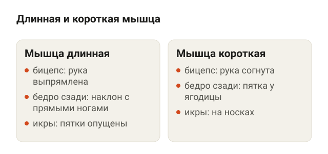<figcaption>Бицепс длинный при прямой руке, задняя поверхность бедра — в наклоне с прямыми ногами, икры — когда пятки опущены.</figcaption></figure>

У каждой мышцы есть длинное и короткое положение. Бицепс длинный, когда рука выпрямлена, и короткий, когда она согнута до конца. Задняя поверхность бедра длинная, когда ты наклоняешься с прямыми ногами, и короткая, когда пятка подтянута к ягодице.

Поднятое над головой плечо удлиняет длинную головку трицепса по сравнению с положением плеча у корпуса. Но внешняя нагрузка на локоть зависит ещё и от плеча силы: перпендикулярного расстояния от сустава до линии действия сопротивления. Для гантели эта линия направлена вертикально вниз, для блока — вдоль троса. Поэтому самая нижняя точка не обязана быть самой тяжёлой, а гантель и блок нельзя считать одинаковой нагрузкой.

Термины, которые встретятся дальше:

- **Растянутое положение** — участок амплитуды, где мышца длинная. В подъёме на носки это нижняя точка, где пятки опущены.
- **Частичные повторы в растяжении** — движение не на всю амплитуду, а только в её «длинной» половине. В англоязычных статьях это lengthened partials.
- **Полная амплитуда** — движение от одного крайнего положения до другого.

## Что показали исследования

<figure class="step">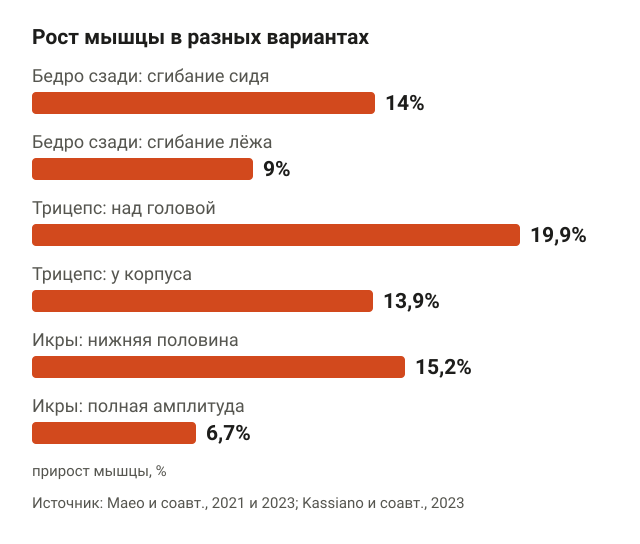<figcaption>Задняя поверхность бедра: 14% сидя против 9% лёжа. Трицепс: 19,9% над головой против 13,9% у корпуса. Икры: 15,2% в нижней половине против 6,7% в полной амплитуде.</figcaption></figure>

Самые наглядные работы сделала группа Sumiya Maeo в Японии. Сравнивали одно и то же упражнение в двух вариантах: одна рука или нога тренировалась с мышцей в длинном положении, другая — в коротком. Остальное было одинаковым.

**Сгибание ног сидя против лёжа** (Maeo и соавт., 2021). 20 человек 12 недель делали сгибание ног: одной ногой сидя, где задняя поверхность бедра растянута из-за наклона корпуса, другой — лёжа. 5 подходов по 10 повторов с 70% от максимума, 2 тренировки в неделю. Объём всей задней поверхности бедра на МРТ вырос на 14% сидя и на 9% лёжа.

**Разгибание рук над головой против разгибания у корпуса** (Maeo и соавт., 2023). 21 человек 12 недель разгибал руку в блоке: одну — над головой, другую — у корпуса. Трицепс над головой вырос на 19,9%, у корпуса — на 13,9%, то есть в 1,4 раза больше. Длинная головка выросла на 28,5% против 19,6%. Интересно, что рабочий вес над головой был на 34–39% меньше. Это результат конкретного протокола в блоке, а не доказательство того, что уменьшение веса само по себе ускоряет рост.

**Подъём на носки** (Kassiano и соавт., 2023). 42 девушки 8 недель делали подъём на носки в тренажёре в трёх вариантах: только нижняя половина амплитуды, только верхняя или полная. Внутренняя головка икроножной мышцы выросла на 15,2% при нижней половине, на 6,7% при полной амплитуде и на 3,4% при верхней.

В этих трёх работах варианты с большей длиной мышцы дали больший рост. Равное число подходов не означает одинаковые килограммы или одинаковую нагрузку во всех точках амплитуды. Переносить результат на любые мышцы и упражнения нельзя. Обзор 2026 года (Pedrosa, Pereira и Kassiano) делает такой же вывод, но с оговоркой: эффект есть, когда в растянутом положении на мышцу реально действует нагрузка, а не просто «мышца длинная, но висит без веса».

## Полная амплитуда или частичные повторы в растяжении

<figure class="step">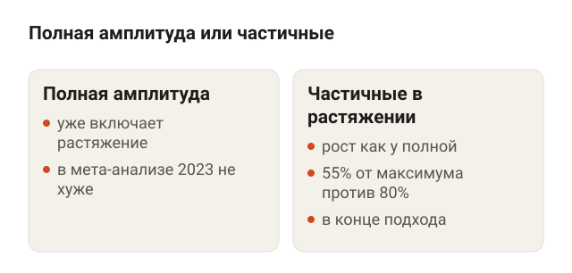<figcaption>Полная амплитуда уже включает растяжение. Частичные повторы в растяжении дают такой же рост, их удобно добавлять в конце подхода.</figcaption></figure>

Отсюда напрашивается идея: делать только «длинную» половину движения. Проверили и это.

В мета-анализе Wolf и соавторов (2023) в целом полная амплитуда давала чуть лучший результат, чем частичная, но разница была тривиальной. При этом частичные повторы в растяжении по росту мышц выглядели немного лучше полной амплитуды, хотя доверительный интервал широкий и вывод осторожный.

Дальше вышли новые работы:

- **Wolf и соавт., 2025.** 30 тренированных людей 8 недель качали верх тела: одна рука — полная амплитуда, другая — частичные повторы в растяжении. Бицепс и трицепс выросли одинаково.
- **Havers и соавт., 2025.** 13 тренированных людей делали сгибание на скамье Скотта одной рукой в нижней половине амплитуды (0–70°), другой — в полной (0–140°). Рост в середине плеча был одинаковым, ближе к локтю у частичных повторов — чуть больше, но разница маленькая. Максимум в подъёме на бицепс с полной амплитудой вырос незначительно больше.
- **McMahon и соавт., 2026.** Разгибание ног: частичные повторы в растяжении с 55% от максимума дали такой же рост бедра, как полная амплитуда с 80%.

Вывод для зала: полная амплитуда уже включает растянутое положение, поэтому она работает не хуже. Частичные повторы в растяжении — рабочий вариант, но не волшебный. Их удобно добавлять в конце подхода, когда на полную амплитуду сил уже нет.

## Где эффект не нашли

<figure class="step">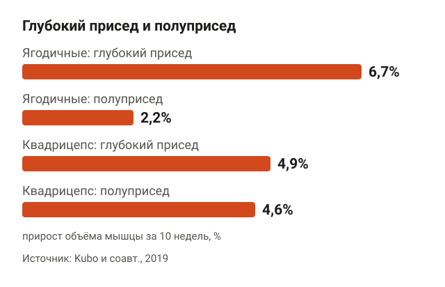<figcaption>Ягодичные в глубоком приседе выросли на 6,7% против 2,2%, а квадрицепс — почти одинаково: 4,9% и 4,6%.</figcaption></figure>

Чтобы не было ощущения, что растяжение решает всё, вот работы, где оно не сработало.

**Сгибание рук в блоке с рукой, отведённой назад** (Larsen и соавт., 2026). 24 нетренированных мужчины 10 недель делали сгибание рук в блоке: одной рукой с плечом, отведённым назад до упора, где бицепс длиннее, другой — с плечом в обычном положении. Сопротивление и амплитуда в локте были одинаковыми. Обе руки выросли примерно на 7–9%, разницы не нашли.

**Глубина приседа и прямая мышца бедра** (Kubo и соавт., 2019). Глубокий присед 10 недель дал больше роста ягодичных (6,7% против 2,2% у полуприседа) и приводящих мышц бедра (6,2% против 2,7%). А квадрицепс вырос одинаково: 4,9% и 4,6%. Прямая мышца бедра и задняя поверхность бедра не выросли ни в одной группе. Обычно это объясняют так: прямая мышца бедра в приседе почти не меняет длину, потому что растягивается в колене и одновременно укорачивается в тазобедренном суставе. Она просто постояла рядом.

**Продольный рост мышцы.** В систематическом обзоре Wolf и соавторов (2026) собрали 8 исследований, где мерили длину мышечных волокон. Тренировка в растянутом положении, вероятно, удлиняет волокна сильнее, но данные смешанные, а методы измерения неточные.

То есть эффект зависит от мышцы и упражнения. Лучше всего он подтверждён для двусуставных мышц, у которых одно упражнение может растянуть их сильнее: задняя поверхность бедра, длинная головка трицепса, икроножная мышца.

## Упражнения с нагрузкой в растянутом положении

<figure class="step">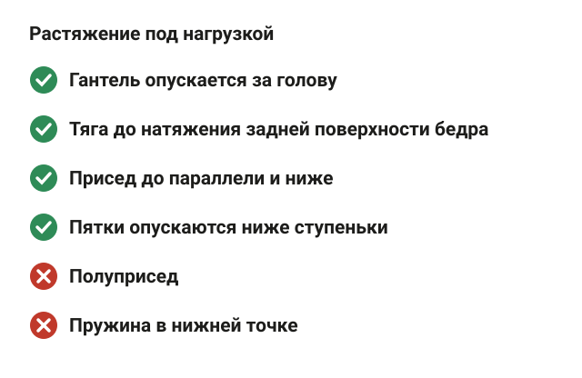<figcaption>Гантель опускается за голову, тяга — до натяжения задней поверхности бедра, присед — до параллели и ниже, пятки — ниже ступеньки.</figcaption></figure>

Ниже четыре упражнения, где мышца работает в длинном положении. Их техника проверена, и под каждым есть схема.

**Разгибание руки с гантелью из-за головы.** Стоя, гантель в одной руке над головой. Сгибай руку в локте, опуская гантель за голову, пока трицепс не растянется, затем разгибай руку вверх. Локоть смотрит вверх и не уходит в сторону, двигается только предплечье. Это тот же принцип, что в работе Maeo 2023, только с гантелью вместо блока.

<figure class="step move">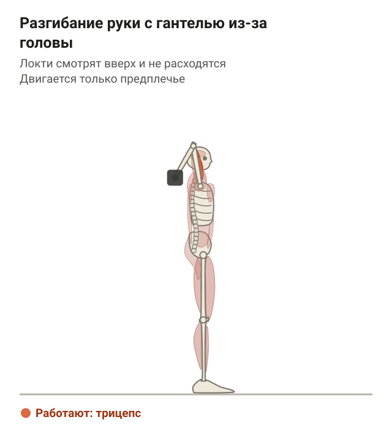</figure>

Результаты Maeo получены в блоке. Вариант с гантелью выше тоже меняет длину длинной головки трицепса, но профиль сопротивления другой: те же проценты роста ему приписывать нельзя.

**Румынская тяга со штангой.** Стоя, штанга в руках на уровне бёдер, колени чуть согнуты. Отводи таз назад и наклоняй корпус, гриф скользит вдоль ног. Опускайся, пока задняя поверхность бедра не натянется, а спина остаётся ровной, затем выпрямляйся. Колени во время движения почти не сгибаются, и задняя поверхность бедра в нижней точке длинная.

<figure class="step move"></figure>

**Приседания со штангой на спине.** Гриф на трапециях, стопы на ширине плеч. Опускайся, отводя таз назад, до бедра параллельно полу или ниже, если спина остаётся ровной. Гриф всё время над серединой стопы. Глубина важна для ягодичных и приводящих мышц: по Kubo 2019 они росли в глубоком приседе в 2–3 раза сильнее. Подробно техника разобрана в статье [как правильно приседать со штангой](/stati/kak-pravilno-prisedat-so-shtangoy/).

<figure class="step move">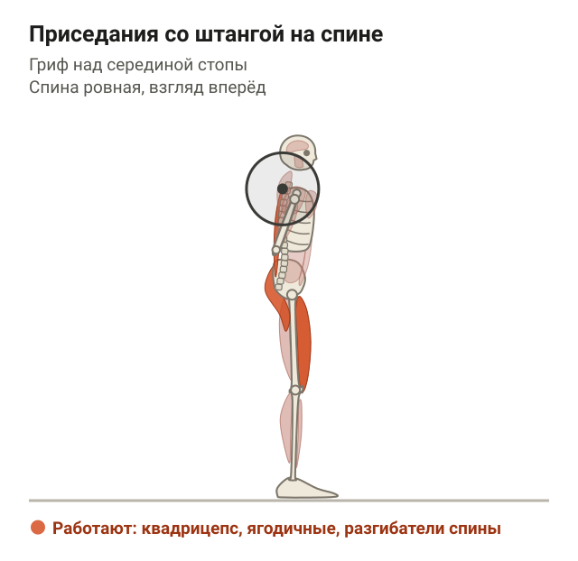</figure>

**Подъём на носки.** Встань носками на ступеньку, пятки свисают. Опускай пятки ниже ступеньки, пока икры не растянутся, затем поднимайся на носки до конца. Нижнюю точку не проскакивай пружиной, задержись на секунду. Если нужна опора для равновесия, возьмись рукой за стену или стойку.

<figure class="step move">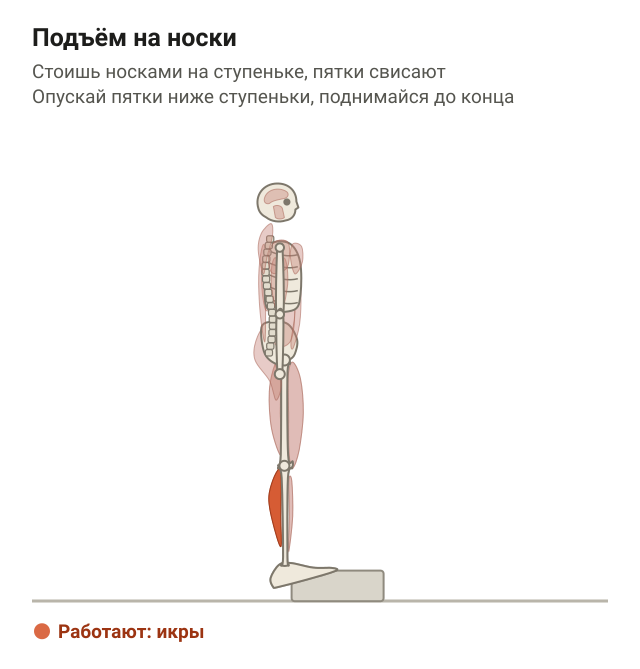</figure>

## Как добавить растянутое положение в свою программу

<figure class="step">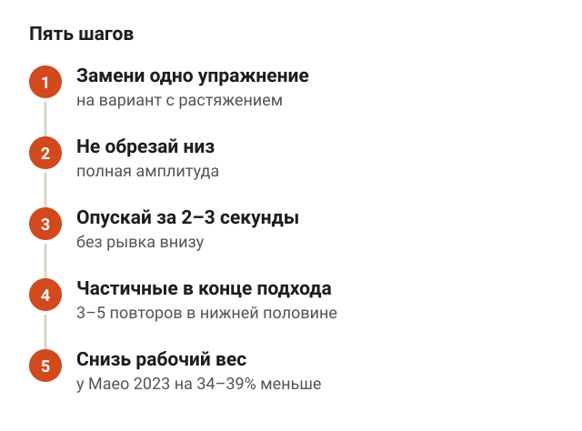<figcaption>Заменить упражнение, не обрезать низ, опускать за 2–3 секунды, частичные повторы в конце подхода, снизить вес.</figcaption></figure>

Переписывать всю программу не нужно. Вот порядок по шагам.

1. **Начни с выбора упражнений.** Замени одно упражнение на мышцу на вариант с растяжением: разгибание у корпуса на разгибание из-за головы, сгибание ног лёжа на сгибание сидя, подъём на носки с пола на подъём со ступеньки.
2. **Не обрезай низ.** Полная амплитуда уже включает растянутое положение. Самая частая ошибка в зале — недоделанная нижняя точка: полуприсед, румынская тяга до колен, жим лёжа, где гриф не доходит до груди.
3. **Контролируй опускание.** Опускай вес за 2–3 секунды и не отбивай его в нижней точке. Растянутое положение — место, где мышцу легко перегрузить рывком.
4. **Частичные повторы — в конце подхода.** Когда на полную амплитуду сил уже нет, сделай 3–5 частичных повторов в нижней половине. Так подход станет тяжелее без лишнего веса.
5. **Снизь рабочий вес.** В варианте с растяжением вес будет меньше. В работе Maeo 2023 он был на 34–39% ниже, и это не мешало росту.

Сколько подходов делать на мышцу в неделю, растянутое положение не меняет. Это я разбирал в статье [сколько подходов делать для роста мышц](/stati/skolko-podhodov-dlya-rosta-myshc/). Отдых между подходами — как обычно, подробнее в статье [сколько отдыхать между подходами](/stati/skolko-otdyhat-mezhdu-podhodami/).

## Кому это полезно, а кому подождать

<figure class="step">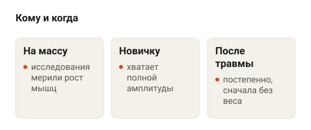<figcaption>Исследования мерили рост мышц. Новичку хватает полной амплитуды. После травмы растянутое положение возвращают постепенно.</figcaption></figure>

Тренировка в растянутом положении нужна прежде всего тем, кто работает на массу. Все исследования выше мерили рост мышц, а не силу или выносливость. Для силы в конкретном движении важнее тренировать именно ту амплитуду, в которой ты будешь его делать: в мета-анализе Wolf 2023 сила лучше росла в той амплитуде, в которой тренировались.

Новичку менять ничего не обязательно. В первые месяцы мышцы растут почти от любой нормальной программы, а полная амплитуда уже даёт растянутое положение. Важнее научиться технике базовых упражнений и прибавлять рабочий вес.

Осторожнее с растяжением под весом стоит быть тем, у кого недавно была травма мышцы или сухожилия, например растяжение задней поверхности бедра. Нагрузка в нижней точке зависит от упражнения и направления сопротивления; резкое увеличение нагрузки после травмы не подходит. После травмы растянутое положение возвращают постепенно, сначала без веса. Если боль появляется именно в растянутом положении и не проходит, это повод показаться врачу.

## Шпаргалка

<figure class="step">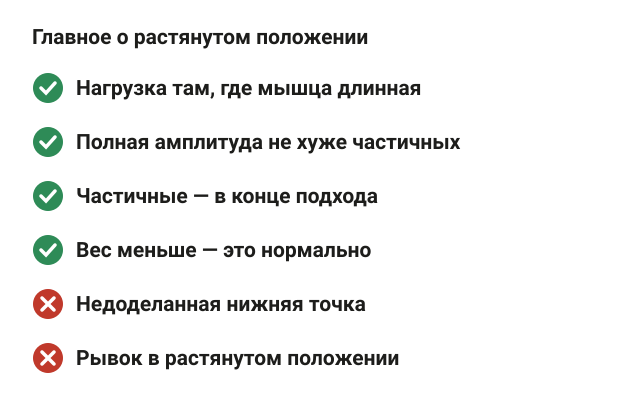<figcaption>Нагрузка там, где мышца длинная, полная амплитуда, частичные повторы в конце подхода, вес меньше — это нормально.</figcaption></figure>

- Тренировка в растянутом положении мышцы — работа под нагрузкой на большой длине мышцы. Пик сопротивления может находиться в другой точке.
- В исследованиях такой вариант давал больше роста: задняя поверхность бедра — 14% против 9%, трицепс — 19,9% против 13,9%, икроножная — 15,2% против 6,7%.
- Эффект есть, когда в растянутом положении на мышцу действует нагрузка. В сгибании рук в блоке с отведённым назад плечом разницы не нашли.
- Полная амплитуда работает не хуже частичных повторов в растяжении. Частичные повторы — дополнение в конце подхода.
- Простые замены: разгибание руки из-за головы, сгибание ног сидя, румынская тяга, глубокий присед, подъём на носки со ступеньки.
- Вес в таких вариантах меньше, и это нормально.
