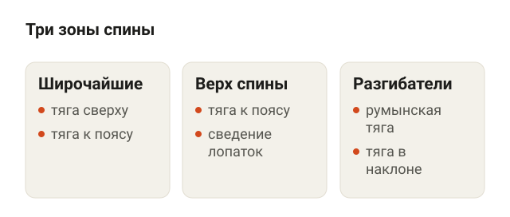
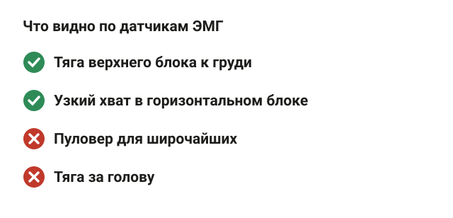
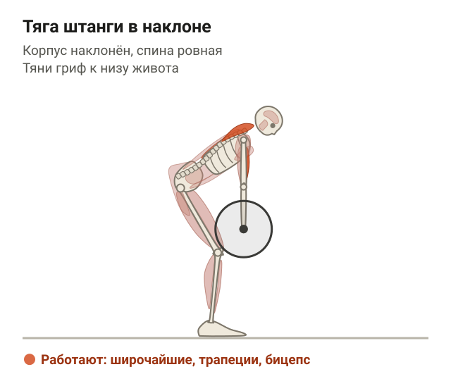
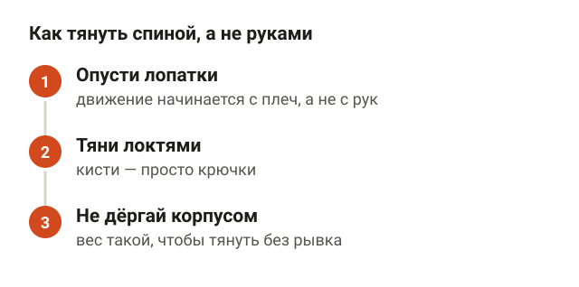
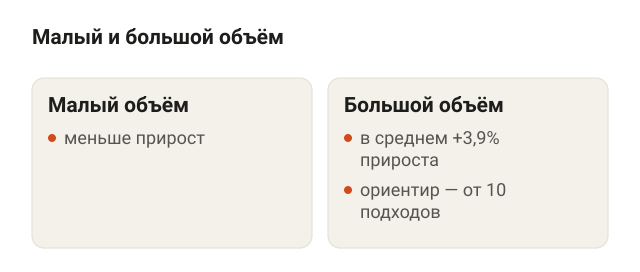
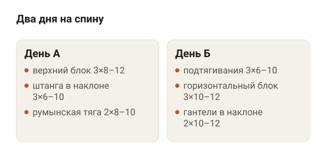
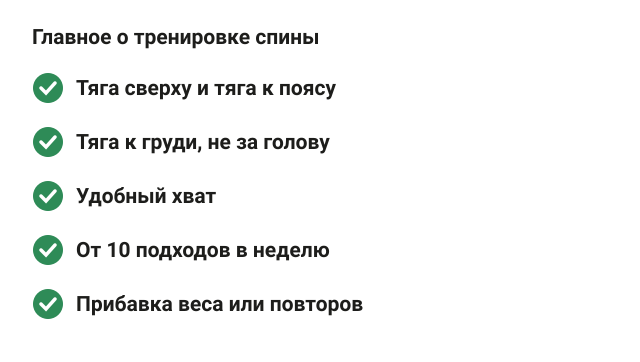

---
{
  "title": "Упражнения на спину в тренажёрном зале: техника и программа",
  "seo_title": "Упражнения на спину в тренажёрном зале: техника и программа",
  "description": "Упражнения на спину в тренажёрном зале: какие тяги нагружают широчайшие по данным исследований, важен ли хват, сколько подходов и программа на 2 дня.",
  "slug": "uprazhneniya-na-spinu-v-zale",
  "date": "2026-11-11",
  "category": "trenirovki",
  "keyword": "упражнения на спину в тренажёрном зале",
  "tags": [
    "спина",
    "широчайшие",
    "тяга верхнего блока",
    "подтягивания",
    "тяга штанги в наклоне",
    "программа тренировок"
  ],
  "faq": [
    {
      "q": "Какие упражнения на спину в тренажёрном зале самые полезные?",
      "a": "Одного лучшего нет. Нужна тяга сверху (тяга верхнего блока к груди или подтягивания), тяга к поясу (горизонтальный блок, штанга или гантели в наклоне) и упражнение с наклоном корпуса, например румынская тяга."
    },
    {
      "q": "Сколько раз в неделю тренировать спину?",
      "a": "Обычно хватает 2 тренировок, если за неделю набирается от 10 рабочих подходов на спину. По мета-анализу 2026 года для роста мышц важнее число подходов за неделю, чем частота."
    },
    {
      "q": "Как накачать спину без подтягиваний?",
      "a": "Тяга верхнего блока к груди нагружает широчайшие тем же движением, что и подтягивания, и вес в ней проще подобрать. Можно заменить подтягивания на неё или на гравитрон."
    },
    {
      "q": "Какой хват лучше для тяги верхнего блока?",
      "a": "Для широчайших почти любой: в исследовании 2025 года 7 вариантов хвата и наклона корпуса нагружали их одинаково. Бери тот, в котором удобно плечам, и тяни к груди, а не за голову."
    }
  ],
  "sources": [
    {
      "title": "Di Fonza D. и соавт. Electromyographic Analysis of Latissimus Dorsi Activation During Common Resistance Training Exercises: A Narrative Review (J Funct Morphol Kinesiol, 2026)",
      "url": "https://doi.org/10.3390/jfmk11030315"
    },
    {
      "title": "Buonsenso A. и соавт. Electromyographic Analysis of Back Muscle Activation During Lat Pulldown Exercise: Effects of Grip Variations and Forearm Orientation (J Funct Morphol Kinesiol, 2025)",
      "url": "https://doi.org/10.3390/jfmk10030345"
    },
    {
      "title": "Signorile J. F., Zink A. J., Szwed S. P. A comparative electromyographical investigation of muscle utilization patterns using various hand positions during the lat pull-down (J Strength Cond Res, 2002)",
      "url": "https://pubmed.ncbi.nlm.nih.gov/12423182/"
    },
    {
      "title": "Sperandei S. и соавт. Electromyographic analysis of three different types of lat pull-down (J Strength Cond Res, 2009)",
      "url": "https://doi.org/10.1519/JSC.0b013e3181b8d30a"
    },
    {
      "title": "Snyder B. J., Leech J. R. Voluntary increase in latissimus dorsi muscle activity during the lat pull-down following expert instruction (J Strength Cond Res, 2009)",
      "url": "https://doi.org/10.1519/JSC.0b013e3181bb7213"
    },
    {
      "title": "Paoli A. и соавт. Protein Supplementation Does Not Further Increase Latissimus Dorsi Muscle Fiber Hypertrophy after Eight Weeks of Resistance Training in Novice Subjects (Nutrients, 2016)",
      "url": "https://doi.org/10.3390/nu8060331"
    },
    {
      "title": "Schoenfeld B. J., Ogborn D., Krieger J. W. Dose-response relationship between weekly resistance training volume and increases in muscle mass: a systematic review and meta-analysis (J Sports Sci, 2017)",
      "url": "https://doi.org/10.1080/02640414.2016.1210197"
    },
    {
      "title": "Pelland J. C. и соавт. The Resistance Training Dose Response: Meta-Regressions Exploring the Effects of Weekly Volume and Frequency on Muscle Hypertrophy and Strength Gains (Sports Med, 2026)",
      "url": "https://doi.org/10.1007/s40279-025-02344-w"
    }
  ]
}
---
Упражнения на спину в тренажёрном зале делятся на две группы: тяги сверху (тяга верхнего блока, подтягивания) и тяги к поясу (тяга горизонтального блока, тяга штанги или гантели в наклоне). Для широчайших и верха спины нужны обе. Разгибатели вдоль позвоночника добирают румынская тяга и становая. Хватает 3–4 упражнений, 2 тренировок в неделю и от 10 рабочих подходов на спину за неделю с постепенной прибавкой веса.

Ниже разберу, какие мышцы спины тренировать, что показали исследования про хват и тягу за голову, как делать каждое упражнение и как собрать программу на 2 дня.

## Какие мышцы спины тренировать и что они делают

<figure class="step"><figcaption>Широчайшие тянут плечо вниз, верх спины сводит лопатки, разгибатели держат спину ровной в наклоне.</figcaption></figure>

Спина — это не одна мышца. Для тренировки удобно делить её на три зоны.

- **Широчайшие.** Самые крупные мышцы спины, они дают ширину. Их работа — тянуть плечо вниз и назад, к корпусу. Именно это происходит в тяге верхнего блока, подтягиваниях и тяге к поясу.
- **Верх спины: трапеции, ромбовидные, задняя дельта.** Сводят и опускают лопатки. Работают в тягах к поясу, особенно если в конце движения свести лопатки.
- **Разгибатели спины.** Тянутся вдоль позвоночника, держат спину ровной в наклоне. Нагружаются в румынской и становой тяге, тяге штанги в наклоне, гиперэкстензии.

Отсюда простое правило: в программе нужна хотя бы одна тяга сверху, одна тяга к поясу и одно упражнение с наклоном корпуса. Тогда спина получает нагрузку целиком, а не только широчайшие.

## Какие упражнения нагружают спину сильнее: что показали исследования

<figure class="step"><figcaption>Тяга к груди и узкий хват в тяге горизонтального блока нагружают широчайшие сильнее; пуловер — больше грудь, тяга за голову — заднюю дельту и бицепс.</figcaption></figure>

Почти все работы про упражнения на спину меряют ЭМГ — электрическую активность мышцы через датчики на коже. Это показывает, насколько сильно мышца работает в упражнении, но не то, насколько она вырастет за месяцы. Поэтому выводы ниже — про выбор техники, а не обещание прироста.

В 2026 году Di Fonza и соавторы собрали 23 исследования ЭМГ широчайших в тягах. Что получилось:

- **Тяга верхнего блока к груди** по датчикам нагружает широчайшие стабильнее других вариантов этого упражнения.
- **Ширина хвата** в тяге верхнего блока даёт противоречивые результаты: где-то разница есть, где-то нет.
- **В тяге горизонтального блока** широчайшие по датчикам работали сильнее с узким хватом и с локтями ближе к корпусу.
- **Пуловер** нагружает больше грудную, чем широчайшую.

Про тягу за голову есть два отдельных исследования. Signorile и соавторы в 2002 году сравнили 4 варианта тяги верхнего блока у 10 мужчин: широкий хват к груди дал самую высокую активность широчайших. Sperandei и соавторы в 2009 году дали 24 тренированным мужчинам 80% от разового максимума: по широчайшим разницы между тягой к груди, за голову и узкой рукоятью не было, но за голову сильнее работали задняя дельта и бицепс. Авторы прямо пишут, что тягу за голову лучше не делать.

## Упражнения на спину в зале: техника по шагам

<figure class="step"><figcaption>Две тяги сверху, три тяги к поясу и румынская тяга для разгибателей спины.</figcaption></figure>

Схемы ниже — для упражнений из базы, которую я проверил. Для блочных тренажёров и подтягиваний схем пока нет, их описываю словами.

**Тяга верхнего блока к груди.** Сядь, зафиксируй бёдра под валиками, возьмись за рукоять чуть шире плеч. Слегка отклонись назад, грудь вперёд. Тяни рукоять к верху груди, локти идут вниз и к бокам. Наверху дай рукам выпрямиться полностью, плечи поднимутся вслед за рукоятью. Ориентир: рукоять идёт к груди, а не за голову.

**Подтягивания.** Хват чуть шире плеч, можно прямой или обратный. Из виса тянись грудью к перекладине, локти идут вниз. Опускайся до прямых рук. Если подтянуться 5 раз не получается, начни с тяги верхнего блока или гравитрона (тренажёра для подтягиваний с противовесом).

**Тяга горизонтального блока.** Сядь, ноги в упоры, колени чуть согнуты, спина ровная. Тяни рукоять к животу, локти вдоль корпуса. В конце сведи лопатки, на возврате дай им разойтись вперёд. Корпус почти не раскачивается: если отклоняешься назад на каждом повторе, вес велик.

**Тяга штанги в наклоне.** Возьми штангу хватом чуть шире плеч, колени слегка согнуты. Отведи таз назад и наклонись вперёд примерно на 45° к полу, спина ровная. Тяни гриф к низу живота, локти назад. Опусти до прямых рук. Ориентир: корпус не поднимается при каждом повторе, иначе работают ноги, а не спина.

<figure class="step move"></figure>

**Тяга гантелей в наклоне.** То же движение, что со штангой, но с двумя гантелями. Ладони смотрят друг на друга, локти идут вдоль корпуса. Гантели дают больше амплитуды: рука уходит дальше назад, чем со штангой, гриф которой упирается в живот. Ориентир: поясница ровная, голова продолжает линию спины.

<figure class="step move"></figure>

**Румынская тяга со штангой.** Встань прямо со штангой в опущенных руках, колени чуть согнуты. Отводи таз назад, гриф скользит вдоль бёдер, спина ровная. Опускайся, пока чувствуешь натяжение задней поверхности бедра, обычно до середины голени. Вставай, толкая таз вперёд. Это упражнение для задней поверхности бедра и ягодиц, но разгибатели спины весь подход держат позвоночник ровным.

<figure class="step move"></figure>

Технику становой тяги с пола я разобрал отдельно в статье [«Становая тяга: техника и ошибки новичков»](/stati/stanovaya-tyaga-tehnika-i-oshibki/).

## Широкий или узкий хват: что меняется

<figure class="step"><figcaption>Сначала опусти лопатки, потом тяни локтями вниз и назад, корпус не раскачивай.</figcaption></figure>

Ответ короткий: для широчайших хват почти не важен. В 2025 году Buonsenso и соавторы проверили 7 вариантов тяги верхнего блока у 40 мужчин со стажем тренировок от 5 лет. Вес — 70% от разового максимума, варианты отличались хватом, шириной и наклоном корпуса. Разницы в работе широчайших не нашли. Отличалась только задняя дельта: она работала сильнее, когда к широкому хвату добавляли наклон корпуса назад на 30°.

То есть бери хват, в котором удобно плечам и можно добавлять вес. Условно, если широкий хват тянет плечо и мешает опустить локти, узкая или параллельная рукоять ничего не отнимет у широчайших.

Важнее другое — как ты тянешь. Snyder и Leech в 2009 году попросили 8 девушек-новичков сделать тягу верхнего блока сначала с базовыми указаниями, а потом после объяснения, как тянуть спиной, а не руками. Активность широчайших по датчикам выросла. Работа бицепса при этом не упала, то есть «выключить» руки не получится, но сместить нагрузку на спину можно. Рабочие подсказки:

- Начинай движение с опускания лопаток, а потом сгибай руки.
- Думай, что тянешь локтями вниз и назад, а кисти — просто крючки.
- Не дёргай корпусом, чтобы вытянуть вес.

## Сколько подходов на спину в неделю

<figure class="step"><figcaption>По мета-анализу 2017 года большой объём за неделю дал в среднем на 3,9% больше прироста мышц, чем малый.</figcaption></figure>

Спина растёт по тем же правилам, что и остальные мышцы. Paoli и соавторы в 2016 году 8 недель тренировали 18 новичков и мерили широчайшие на МРТ. Площадь сечения мышцы выросла, сила — на 17%. Половина участников ела 1,8 г белка на кг веса, половина — 0,85 г. Дополнительного роста от высокого белка в этом исследовании не нашли. Выборка маленькая, поэтому это не повод экономить на белке, а пример того, что тренировка первична.

Про объём есть две большие работы:

- **Schoenfeld и соавторы, 2017**, 15 исследований: каждый дополнительный подход в неделю давал примерно 0,37% прироста мышцы, а большой объём выигрывал у малого в среднем на 3,9%.
- **Pelland и соавторы, 2026**, 67 исследований и 2058 участников: чем больше подходов в неделю, тем больше рост, но каждый следующий подход добавляет меньше предыдущего. Частота тренировок на рост мышц почти не влияла — важнее, сколько подходов набирается за неделю.

На практике ориентир — от 10 рабочих подходов на спину в неделю. Подробнее про объём — в статье [«Сколько подходов делать для роста мышц»](/stati/skolko-podhodov-dlya-rosta-myshc/). Рабочий подход — это подход, где до отказа остаётся 1–3 повтора, а не разминочный.

## Программа тренировок на спину: 2 дня в неделю

<figure class="step"><figcaption>День А: тяга верхнего блока, тяга штанги в наклоне, румынская тяга. День Б: подтягивания, горизонтальный блок, тяга гантелей.</figcaption></figure>

Пример для человека, который уже уверенно держит спину ровной в наклоне. Между тренировками спины — минимум день отдыха.

**День А**
1. Тяга верхнего блока к груди — 3 подхода по 8–12.
2. Тяга штанги в наклоне — 3 подхода по 6–10.
3. Румынская тяга — 2 подхода по 8–10.

**День Б**
1. Подтягивания или тяга верхнего блока узкой рукоятью — 3 подхода по 6–10.
2. Тяга горизонтального блока — 3 подхода по 10–12.
3. Тяга гантелей в наклоне — 2 подхода по 10–12.

Получается 16 подходов тяг в неделю, плюс румынская тяга для разгибателей. Новичку можно начать с 2 подходов в каждом упражнении и через 3–4 недели добавить по подходу. Когда делаешь верхнюю границу повторов во всех подходах, прибавляй вес: 2,5 кг в тяге штанги, шаг блока в тренажёре.

Если цель — ровная осанка, а не размер спины, упражнения те же, но акценты другие. Это я разобрал в статье [«Сутулость: упражнения в тренажёрном зале и план занятий»](/stati/sutulost-uprazhneniya-v-trenazhernom-zale/).

## Почему спина не растёт: частые ошибки

<figure class="step"><figcaption>Тяга руками, раскачка, неполная амплитуда, тяга за голову, только тяги сверху и один вес месяцами.</figcaption></figure>

- **Тянешь руками.** Локти сгибаются раньше, чем опускаются лопатки, бицепс устаёт первым. Подсказки — в разделе про хват выше.
- **Раскачка корпусом.** В тяге штанги корпус поднимается на каждом повторе, в тяге блока — откидываешься назад. Вес большой, работают ноги и инерция.
- **Неполная амплитуда.** Рукоять не доходит до груди или руки не выпрямляются наверху. Спина получает меньше нагрузки, а цифра в дневнике растёт.
- **Тяга за голову.** По данным Sperandei широчайшим она ничего не добавляет, зато сильнее грузит заднюю дельту и бицепс.
- **Только тяги сверху.** Без тяги к поясу верх спины получает мало работы.
- **Один вес месяцами.** Без прибавки веса или повторов мышце не на что отвечать ростом.

Честная граница: если поясница болит не только в тренировке, но и в обычной жизни, это повод сходить к врачу, а не подбирать упражнения.

## Шпаргалка

<figure class="step"><figcaption>Тяга сверху, тяга к поясу и наклон; к груди, а не за голову; от 10 подходов в неделю и прибавка веса.</figcaption></figure>

- В программе нужна тяга сверху, тяга к поясу и одно упражнение с наклоном корпуса.
- Тяни к груди, а не за голову.
- Ширина хвата для широчайших почти не важна — бери удобный.
- Начинай с опускания лопаток, тяни локтями.
- От 10 рабочих подходов на спину в неделю, 2 тренировки.
- 6–12 повторов, 1–3 в запасе, прибавляй вес или повторы.
