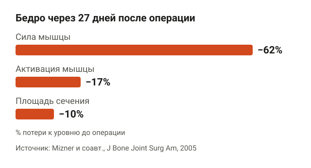
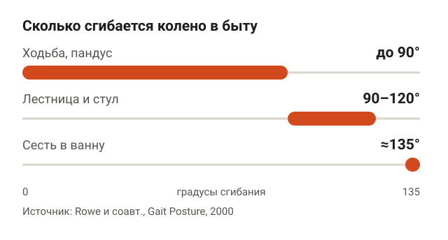
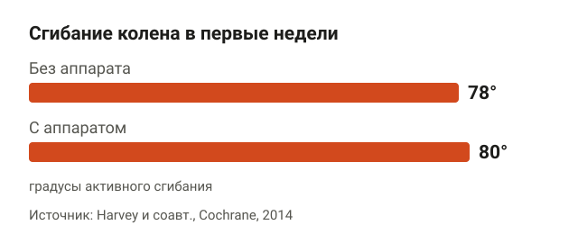
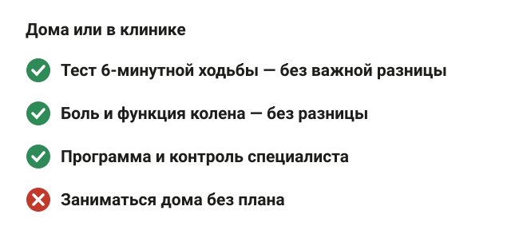
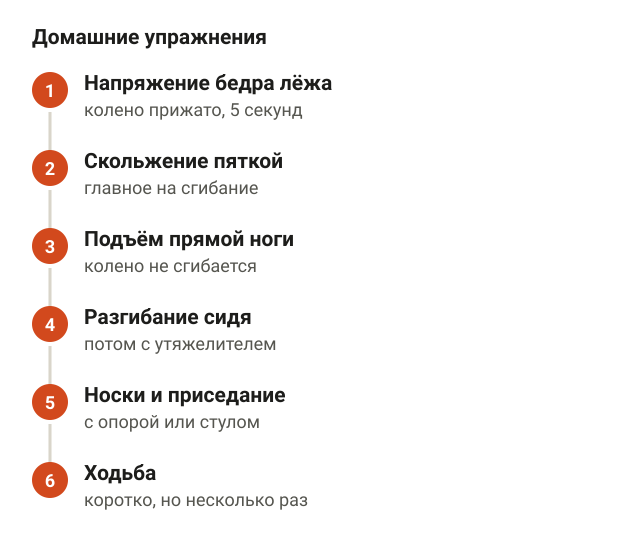
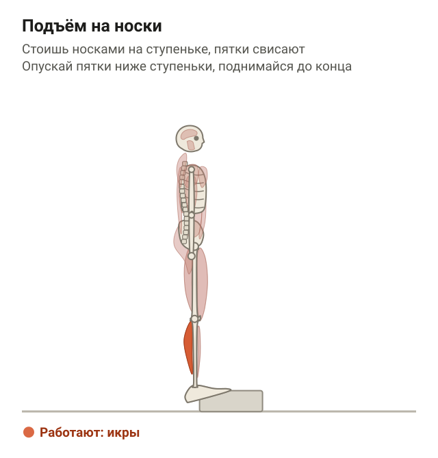
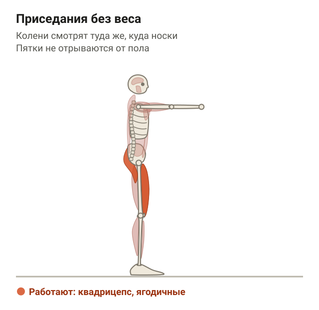
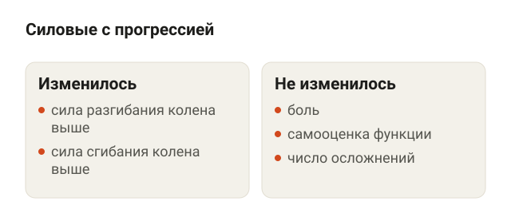
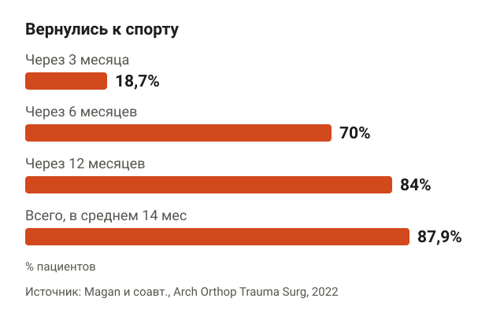
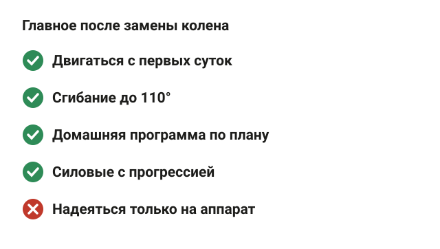

---
{
  "title": "Упражнения после эндопротезирования коленного сустава: что и когда",
  "seo_title": "Упражнения после эндопротезирования коленного сустава",
  "description": "Какие упражнения делать после замены колена дома, сколько должно сгибаться колено, нужен ли аппарат для разработки и когда можно в зал. С данными исследований.",
  "slug": "uprazhneniya-posle-endoprotezirovaniya-kolena",
  "date": "2026-11-07",
  "category": "travmy",
  "keyword": "упражнения после эндопротезирования коленного сустава",
  "tags": [
    "эндопротезирование",
    "колено",
    "реабилитация",
    "квадрицепс",
    "домашние упражнения"
  ],
  "faq": [
    {
      "q": "Когда можно начинать упражнения после эндопротезирования колена?",
      "a": "В первые сутки после операции. Консенсус общества ERAS относит раннюю активизацию к лучшей практике: человека поднимают как можно раньше, часто в день операции, и сразу начинают простые упражнения на напряжение бедра и сгибание колена."
    },
    {
      "q": "Насколько должно сгибаться колено после замены сустава?",
      "a": "Ориентир — 110 градусов. По измерениям Rowe и соавторов, для ходьбы хватает меньше 90 градусов, для лестницы и стула нужно 90–120, а чтобы сесть в ванну — около 135."
    },
    {
      "q": "Можно ли делать реабилитацию дома, а не в клинике?",
      "a": "Можно, если есть программа от специалиста. Мета-анализ в JAMA Network Open не нашёл важной для пациента разницы между занятиями дома и в клинике ни через 10 недель, ни через год."
    },
    {
      "q": "Нужен ли аппарат для разработки колена после эндопротезирования?",
      "a": "По Кокрейновскому обзору 24 исследований аппарат прибавляет к сгибанию в среднем 2 градуса и не влияет на функцию и качество жизни. Собственные упражнения он не заменяет."
    },
    {
      "q": "Когда можно вернуться в спорт после замены колена?",
      "a": "Через 6 месяцев к спорту вернулись 70% пациентов, через год — 84%, в среднем через 14 месяцев. Какие виды тебе можно, решает хирург."
    }
  ],
  "sources": [
    {
      "title": "Mizner R. L. и соавт. Early quadriceps strength loss after total knee arthroplasty (J Bone Joint Surg Am, 2005)",
      "url": "https://doi.org/10.2106/JBJS.D.01992"
    },
    {
      "title": "Mizner R. L. и соавт. Quadriceps strength and the time course of functional recovery after total knee arthroplasty (J Orthop Sports Phys Ther, 2005)",
      "url": "https://doi.org/10.2519/jospt.2005.35.7.424"
    },
    {
      "title": "Petterson S. C. и соавт. Time course of quad strength, area, and activation after knee arthroplasty and strength training (Med Sci Sports Exerc, 2011)",
      "url": "https://doi.org/10.1249/MSS.0b013e3181eb639a"
    },
    {
      "title": "Wainwright T. W. и соавт. Consensus statement for perioperative care in total hip and knee replacement: ERAS Society recommendations (Acta Orthop, 2020)",
      "url": "https://doi.org/10.1080/17453674.2019.1683790"
    },
    {
      "title": "Rowe P. J. и соавт. Knee joint kinematics in gait and other functional activities: how much knee motion is sufficient for normal daily life? (Gait Posture, 2000)",
      "url": "https://doi.org/10.1016/S0966-6362(00)00060-6"
    },
    {
      "title": "Harvey L. A. и соавт. Continuous passive motion following total knee arthroplasty in people with arthritis (Cochrane Database Syst Rev, 2014)",
      "url": "https://doi.org/10.1002/14651858.CD004260.pub3"
    },
    {
      "title": "Buhagiar M. A. и соавт. Inpatient or clinic-based vs home-based rehabilitation after total knee arthroplasty: a systematic review and meta-analysis (JAMA Netw Open, 2019)",
      "url": "https://doi.org/10.1001/jamanetworkopen.2019.2810"
    },
    {
      "title": "Liu H. и соавт. Efficacy and safety of lower limb progressive resistance exercise for patients with total knee arthroplasty: a meta-analysis (Arch Phys Med Rehabil, 2021)",
      "url": "https://doi.org/10.1016/j.apmr.2020.05.021"
    },
    {
      "title": "Bade M. J. и соавт. Early high-intensity versus low-intensity rehabilitation after total knee arthroplasty: a randomized controlled trial (Arthritis Care Res, 2017)",
      "url": "https://doi.org/10.1002/acr.23139"
    },
    {
      "title": "Magan A. и соавт. Time for return to sport following total knee arthroplasty: a meta-analysis (Arch Orthop Trauma Surg, 2022)",
      "url": "https://doi.org/10.1007/s00402-021-04180-9"
    },
    {
      "title": "Gränicher P. и соавт. Prehabilitation improves knee functioning before and within the first year after total knee arthroplasty: a systematic review with meta-analysis (J Orthop Sports Phys Ther, 2022)",
      "url": "https://doi.org/10.2519/jospt.2022.11160"
    }
  ]
}
---
Упражнения после эндопротезирования коленного сустава начинают в первые сутки после операции: встать с ходунками, напрячь бедро, согнуть и разогнуть колено. Главная цель первых недель — сгибание колена до 110 градусов и возврат силы четырёхглавой мышцы бедра, потому что именно она за первый месяц теряет больше всего. Заниматься дома по программе реабилитолога в среднем не хуже, чем в клинике, а силовые упражнения с отягощением безопасны и прибавляют силу.

Ниже разбираю, что происходит с ногой после операции, какие упражнения делать дома, нужен ли аппарат для разработки колена и когда можно вернуться в зал. Программу и сроки для тебя определяют хирург и реабилитолог, статья помогает понять, зачем каждое упражнение.

## Когда начинать упражнения после операции

<figure class="step"><figcaption>Сила четырёхглавой мышцы упала на 62%, активация — на 17%, площадь сечения — на 10%.</figcaption></figure>

Раньше после замены колена неделями лежали. Сейчас рекомендации ускоренного восстановления ERAS, это международное общество хирургов и реабилитологов, в консенсусе 2020 года относят раннюю активизацию к лучшей практике: человека поднимают как можно раньше, часто в день операции. Ранняя ходьба и упражнения входят в программу вместе с обезболиванием и обучением до операции.

Почему спешат. Четырёхглавая мышца бедра, то есть мышца на передней поверхности бедра, которая разгибает колено, после операции резко слабеет. Mizner и соавторы в 2005 году измерили 20 человек до и через 27 дней после эндопротезирования:

- сила четырёхглавой мышцы упала на 62%;
- произвольная активация мышцы, то есть способность мозга «включить» её целиком, упала на 17%;
- площадь сечения мышцы уменьшилась на 10%.

То есть мышца за месяц почти не похудела, но мозг перестал давать ей полный сигнал. Это называют артрогенным торможением: отёк и боль в суставе рефлекторно выключают мышцу. Поэтому первые упражнения простые, но частые: задача не нагрузить, а заставить мышцу снова работать.

Слабость бедра потом держится долго. В другом исследовании той же группы на 40 пациентах сила четырёхглавой мышцы за 6 месяцев так и не догнала здоровую ногу, а с результатами тестов на ходьбу и лестницу она была связана сильнее, чем амплитуда движения и боль. Petterson и соавторы на 61 пациенте показали, что даже через 52 недели мышца оперированной ноги оставалась меньше, чем здоровой.

Если операция только запланирована, начать можно ещё раньше. Тренировки до операции называют преабилитацией. Систематический обзор Gränicher и соавторов 2022 года собрал 16 исследований на 968 пациентах. Упражнения до операции улучшили функцию колена перед операцией и в первые 3 месяца после неё. Через 6–12 месяцев разницы с теми, кто не готовился, уже не было. Качество доказательств низкое и очень низкое.

То есть тренировки до операции не меняют итог через год, но облегчают первые недели, а это как раз самое тяжёлое время. Плюс человек заранее учится делать упражнения, которые потом понадобятся. Если колено болит при нагрузке уже сейчас, пригодится разбор о том, [почему болит колено после приседаний](/stati/bolit-koleno-posle-prisedaniy/).

## Сколько должно сгибаться колено после эндопротезирования

<figure class="step"><figcaption>Ходьбе хватает меньше 90°, лестнице и стулу нужно 90–120°, ванне — около 135°. Цель — 110°.</figcaption></figure>

Вторая задача — вернуть сгибание. Rowe и соавторы в 2000 году записали угол колена у 20 пожилых людей без проблем с суставами в обычных делах:

- ходьба, в том числе по наклонной, — меньше 90 градусов;
- лестница, обычный и низкий стул — от 90 до 120 градусов;
- сесть в ванну и встать из неё — около 135 градусов.

Авторы делают вывод: 110 градусов сгибания — разумная цель реабилитации. С таким коленом можно ходить, подниматься по лестнице и вставать со стула. Разгибание тоже важно: если колено не выпрямляется до конца, ходьба становится тяжелее, поэтому в программе есть упражнения и на сгибание, и на полное разгибание.

## Нужен ли аппарат для разработки колена

<figure class="step"><figcaption>Без аппарата — 78°, с аппаратом на 2° больше. Разница клинически незначимая.</figcaption></figure>

В больницах часто ставят аппарат для пассивной разработки, по-английски CPM. Он сам медленно сгибает и разгибает ногу, человек лежит.

Кокрейновский обзор Harvey и соавторов 2014 года собрал 24 рандомизированных исследования на 1445 пациентах. Результат:

- без аппарата активное сгибание в первые недели было в среднем 78 градусов, с аппаратом — на 2 градуса больше. Это клинически незначимая разница;
- боль ниже на 0,4 балла из 10, на функцию и качество жизни аппарат не повлиял;
- повторных вмешательств под наркозом для разработки колена было меньше, 1,6% против 7,2%, но качество этих данных очень низкое.

Вывод авторов: эффект аппарата слишком мал, чтобы оправдать его использование. То есть если аппарат дали, вреда нет, но заменить собственные упражнения он не может: мышцы во время пассивного движения почти не работают.

## Дома или в клинике: где заниматься

<figure class="step"><figcaption>Через 10 недель и через год важной разницы нет, если есть программа специалиста.</figcaption></figure>

Многие думают, что без ежедневного зала с реабилитологом колено не восстановится. Мета-анализ Buhagiar и соавторов 2019 года в JAMA Network Open это проверил. Пять исследований на 752 пациентах сравнили занятия в клинике и дома, ещё одно на 165 пациентах — стационарную реабилитацию и домашнюю программу.

Ни через 10 недель, ни через год разницы, важной для пациента, не нашли ни в тесте 6-минутной ходьбы, ни в оценке боли и функции колена по опроснику. Качество доказательств низкое и умеренное, но вывод повторяется в нескольких обзорах.

Важная оговорка: дома — это не «как-нибудь сам». Во всех исследованиях у людей была программа от специалиста, обучение и контроль. Домашняя программа работает, если её делают каждый день и по плану.

## Упражнения после эндопротезирования колена в домашних условиях

<figure class="step"><figcaption>Напряжение бедра, скольжение пяткой, подъём прямой ноги, разгибание сидя, носки, приседание, ходьба.</figcaption></figure>

Набор ниже — типичные упражнения первых недель, которые дают реабилитологи. Число повторений и порядок подбирает твой специалист, особенно если были осложнения. Ориентир по боли общий: умеренная боль во время упражнения допустима, если она проходит в течение часа и к утру отёк не растёт.

**Напряжение мышцы бедра лёжа.** Лёжа на спине, ноги прямые. Прижми подколенную ямку к кровати, напрягая переднюю поверхность бедра, носок тяни на себя. Держи 5 секунд, расслабь. Ориентир: надколенник подтягивается вверх. Это первое упражнение против выключения мышцы.

**Скольжение пяткой.** Лёжа на спине, сгибай колено, подтягивая пятку по кровати к ягодице, потом медленно выпрямляй ногу. Ориентир: двигаешься до ощущения натяжения, каждый день чуть дальше. Это главное упражнение на сгибание.

**Подъём прямой ноги лёжа.** Здоровая нога согнута, стопа на кровати. Напряги бедро оперированной ноги, чтобы колено было прямым, и подними ногу на 20–30 сантиметров, задержись и опусти. Ориентир: колено не сгибается при подъёме. Если сгибается, мышца пока не включается, вернись к первому упражнению.

**Разгибание колена сидя.** Сидя на стуле, медленно выпрями ногу в колене, задержись на 2–3 секунды и опусти. Позже добавляют лёгкую манжету-утяжелитель на голень.

**Подъём на носки.** Первые недели делай с пола: встань прямо, держись руками за спинку стула или стол, поднимись на носки, задержись на секунду и медленно опусти пятки. Когда уверенно стоишь, переходи на ступеньку у перил: встань на край носками, пятки свисают, опусти пятки ниже ступеньки и поднимись до конца. Ориентиры: колени прямые, вес на обеих ногах поровну, рука на перилах.

<figure class="step move"></figure>

**Приседание без веса.** Ноги на ширине плеч, руки вытяни вперёд. Отведи таз назад и опускайся, пока бедро не станет примерно параллельно полу, потом встань. Ориентиры: колени смотрят туда же, куда носки, пятки не отрываются от пола. Первые недели для страховки ставят сзади стул: опускаешься до касания сиденья и встаёшь, не помогая себе руками. Сначала стул повыше, потом пониже.

<figure class="step move"></figure>

**Ходьба.** Сначала с ходунками или костылями, потом с тростью, потом без опоры. Ходьба — тоже упражнение: несколько коротких прогулок в день полезнее одной длинной, после которой колено отекает.

Позже, когда сгибания хватает на полный оборот педалей, реабилитолог обычно добавляет велотренажёр с низким сопротивлением.

## Силовые упражнения после эндопротезирования: когда и сколько

<figure class="step"><figcaption>7 исследований: сила разгибания и сгибания выше, боль и осложнения без изменений.</figcaption></figure>

Через несколько недель упражнения без веса становятся лёгкими, и дальше нужна прогрессия, как в зале: больше сопротивление, меньше повторений. Это называют прогрессивной силовой тренировкой.

Мета-анализ Liu и соавторов 2021 года объединил 7 рандомизированных исследований. По сравнению с реабилитацией без отягощений силовая тренировка с прогрессией:

- увеличила силу разгибания колена (стандартизированная разница 0,72) и силу сгибания (0,47);
- не изменила боль и самооценку функции колена;
- не увеличила число нежелательных событий.

То есть силовые после операции безопасны и делают бедро сильнее, но сами по себе не делают колено менее болезненным.

Насколько рано можно начинать тяжело? Bade и соавторы в 2017 году разделили 162 человека на две группы. Первая с 4-го дня после операции делала упражнения с прогрессией отягощения и быстро переходила к упражнениям стоя, вторая занималась по щадящей программе. Обе группы — 26 занятий за 11 недель. Через 3 и 12 месяцев разницы не было ни в подъёме по лестнице, ни в ходьбе, ни в силе, ни в осложнениях. К году обе группы обошли свои результаты до операции.

Авторы объясняют это тем самым артрогенным торможением: в первые недели мышцу сдерживает не нехватка нагрузки, а сигнал из сустава. Поэтому раннюю тяжёлую программу можно делать, но чуда она не даёт. А вот дальше, когда отёк уходит, вес на тренажёре — это то, что возвращает мышце объём. Практический вывод для зала: темп прибавки веса задаёт отёк колена, а не календарь.

## Когда можно в зал и спорт после замены колена

<figure class="step"><figcaption>Через 3 месяца — 18,7%, через 6 — 70%, через год — 84%, всего 87,9% в среднем через 14 месяцев.</figcaption></figure>

Мета-анализ Magan и соавторов 2022 года собрал 9 исследований на 1307 пациентах:

- через 3 месяца к спорту вернулись 18,7%;
- через 6 месяцев — 70%;
- через 12 месяцев — 84%;
- в целом вернулись 87,9%, в среднем через 14 месяцев.

Под спортом здесь в основном понимают занятия, которыми человек занимался до операции. Какие виды тебе можно, решает хирург: это зависит от модели протеза и состояния кости.

В зале после согласования с хирургом подходят тренажёр для разгибания ног, жим ногами в комфортной амплитуде, подъёмы на носки, приседания к скамье и велотренажёр. Верх тела можно тренировать почти сразу, если ты можешь безопасно дойти до тренажёра и сесть в него. Про силовую работу для колена после других травм подробнее в статье о [реабилитации после травмы колена](/stati/reabilitaciya-posle-travmy-kolena/), а про технику приседаний с весом — в разборе [приседаний со штангой](/stati/kak-pravilno-prisedat-so-shtangoy/).

К врачу стоит вернуться, если колено стало горячим и красным, поднялась температура, отёк растёт несмотря на отдых, нога в голени болит и отекает или сгибание за 2–3 недели совсем не прибавляется.

## Шпаргалка

<figure class="step"><figcaption>Двигаться с первых суток, цель — 110° сгибания, силовые с прогрессией, спорт — по решению хирурга.</figcaption></figure>

- Двигаться начинают в первые сутки после операции.
- За первый месяц сила бедра падает на 62%, в основном потому, что мозг «выключает» мышцу. Первые упражнения — напряжение бедра, скольжение пяткой, подъём прямой ноги.
- Цель по сгибанию — 110 градусов: этого хватает на лестницу и стул.
- Аппарат для пассивной разработки прибавляет всего 2 градуса и собственные упражнения не заменяет.
- Домашняя программа от специалиста в среднем не хуже занятий в клинике.
- Силовые с прогрессией безопасны и прибавляют силу, но не уменьшают боль сами по себе.
- К спорту через год возвращаются 84%, какие виды можно — решает хирург.
