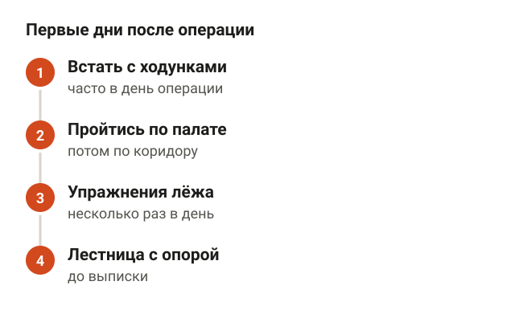
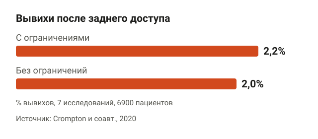
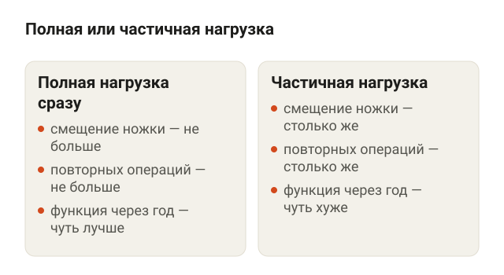
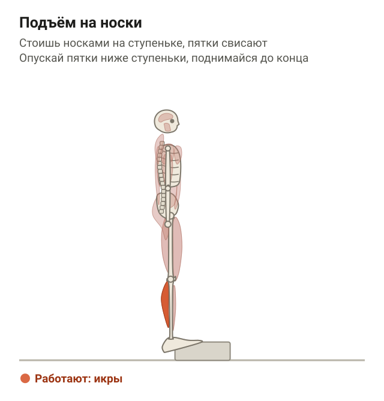
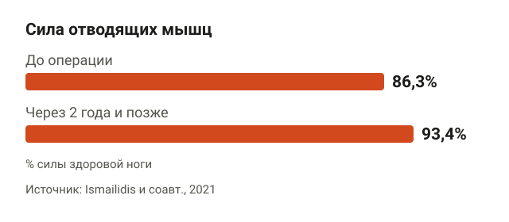
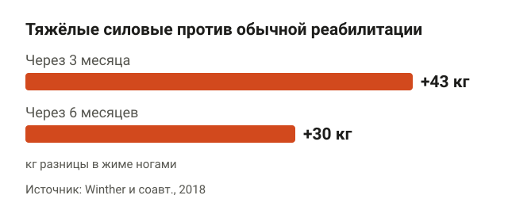
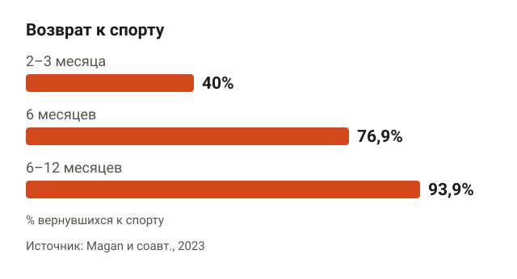

---
{
  "title": "Упражнения после эндопротезирования тазобедренного сустава: что делать",
  "seo_title": "Упражнения после эндопротезирования тазобедренного сустава",
  "description": "Какие упражнения делать после замены тазобедренного сустава дома, нужно ли правило 90 градусов, когда наступать на ногу и идти в зал. С данными исследований.",
  "slug": "uprazhneniya-posle-endoprotezirovaniya-tazobedrennogo-sustava",
  "date": "2026-11-08",
  "category": "travmy",
  "keyword": "упражнения после эндопротезирования тазобедренного сустава",
  "tags": [
    "эндопротезирование",
    "тазобедренный сустав",
    "реабилитация",
    "ягодичные мышцы",
    "домашние упражнения"
  ],
  "faq": [
    {
      "q": "Когда можно начинать упражнения после эндопротезирования тазобедренного сустава?",
      "a": "В первые сутки. Консенсус общества ERAS 2020 года относит раннюю активизацию к обязательной части лечения: человека поднимают как можно раньше, часто в день операции, и сразу дают простые упражнения лёжа и ходьбу с ходунками."
    },
    {
      "q": "Сколько соблюдать ограничения после замены тазобедренного сустава?",
      "a": "Срок и сами запреты задаёт хирург, они зависят от доступа и протеза. По мета-анализу Korfitsen и соавторов на 8835 пациентах запреты на сгибание больше 90 градусов и закидывание ноги почти не влияют на частоту ранних вывихов, поэтому многие клиники их сняли."
    },
    {
      "q": "Можно ли сразу наступать на ногу после эндопротезирования?",
      "a": "Чаще всего да, если хирург разрешил. По мета-анализу 17 исследований полная нагрузка сразу после операции с бесцементным протезом не увеличила смещение ножки протеза и число повторных операций."
    },
    {
      "q": "Когда можно в тренажёрный зал после замены тазобедренного сустава?",
      "a": "Обычно через несколько месяцев после согласования с хирургом. По мета-анализу Magan и соавторов к 6 месяцам к спорту вернулись 76,9% пациентов, через 6–12 месяцев — 93,9%. Силовые с весом в исследованиях начинали уже в первые недели под контролем специалиста."
    },
    {
      "q": "Почему хромаешь после эндопротезирования тазобедренного сустава?",
      "a": "Чаще всего из-за слабости отводящих мышц бедра, которые держат таз ровно при ходьбе. До операции они на 18,6% слабее, чем у здоровых людей, и восстанавливаются до 2 лет, поэтому их тренируют отдельно."
    }
  ],
  "sources": [
    {
      "title": "Wainwright T. W. и соавт. Consensus statement for perioperative care in total hip and knee replacement: ERAS Society recommendations (Acta Orthop, 2020)",
      "url": "https://doi.org/10.1080/17453674.2019.1683790"
    },
    {
      "title": "Konnyu K. J. и соавт. Prehabilitation for total knee or total hip arthroplasty: a systematic review (Am J Phys Med Rehabil, 2023)",
      "url": "https://doi.org/10.1097/PHM.0000000000002006"
    },
    {
      "title": "van der Vorst M. A. T. и соавт. Effectiveness of prehabilitation modalities before total hip arthroplasty: a systematic review and network meta-analysis (Ann Phys Rehabil Med, 2026)",
      "url": "https://doi.org/10.1016/j.rehab.2026.102114"
    },
    {
      "title": "Crompton J. и соавт. Do hip precautions after posterior-approach total hip arthroplasty affect dislocation rates? A systematic review of 7 studies with 6,900 patients (Acta Orthop, 2020)",
      "url": "https://doi.org/10.1080/17453674.2020.1795598"
    },
    {
      "title": "Korfitsen C. B. и соавт. Hip precautions after posterior-approach total hip arthroplasty do not influence early recovery: a systematic review and meta-analysis with 8,835 patients (Acta Orthop, 2023)",
      "url": "https://doi.org/10.2340/17453674.2023.11958"
    },
    {
      "title": "Smith T. O. и соавт. Assistive devices, hip precautions, environmental modifications and training to prevent dislocation and improve function after hip arthroplasty (Cochrane Database Syst Rev, 2016)",
      "url": "https://doi.org/10.1002/14651858.CD010815.pub2"
    },
    {
      "title": "Huang L. и соавт. Early unrestricted vs. partial weight bearing after uncemented total hip arthroplasty: a systematic review and meta-analysis (Front Surg, 2023)",
      "url": "https://doi.org/10.3389/fsurg.2023.1225649"
    },
    {
      "title": "Ismailidis P. и соавт. Abductor muscle strength deficit in patients after total hip arthroplasty: a systematic review and meta-analysis (J Arthroplasty, 2021)",
      "url": "https://doi.org/10.1016/j.arth.2021.03.042"
    },
    {
      "title": "Winther S. B. и соавт. A randomized controlled trial on maximal strength training in 60 patients undergoing total hip arthroplasty (Acta Orthop, 2018)",
      "url": "https://doi.org/10.1080/17453674.2018.1441362"
    },
    {
      "title": "Mikkelsen L. R. и соавт. Description of load progression and pain response during progressive resistance training early after total hip arthroplasty (Clin Rehabil, 2017)",
      "url": "https://doi.org/10.1177/0269215516628305"
    },
    {
      "title": "Magan A. A. и соавт. Time for return to sport following total hip arthroplasty: a meta-analysis (Hip Int, 2023)",
      "url": "https://doi.org/10.1177/11207000211041975"
    }
  ]
}
---
Упражнения после эндопротезирования тазобедренного сустава начинают в первые сутки после операции: встать с ходунками, пройтись по палате, напрячь бедро и ягодицы, подвигать стопой. Главная задача следующих месяцев — вернуть силу мышц, которые отводят ногу в сторону и держат таз ровно при ходьбе: до операции они слабее, чем у здоровых людей, и после неё восстанавливаются медленно. Силовые упражнения с весом после замены сустава безопасны и прибавляют силу быстрее обычной реабилитации без отягощений.

Ниже разбираю, какие ограничения после операции подтверждаются исследованиями, можно ли сразу наступать на ногу, какие упражнения делать дома и когда возвращаться в зал. Программу и сроки для тебя определяют хирург и реабилитолог, статья помогает понять, зачем каждое упражнение и откуда берутся правила.

## Когда начинать упражнения после замены тазобедренного сустава

<figure class="step"><figcaption>Встать с ходунками, пройтись по палате и коридору, упражнения лёжа, лестница с опорой до выписки.</figcaption></figure>

Раньше после замены сустава лежали по нескольку дней. Сейчас общество ERAS, международная группа хирургов, анестезиологов и реабилитологов, которая разрабатывает протоколы ускоренного восстановления, в консенсусе 2020 года относит раннюю активизацию к обязательной части лечения. Человека поднимают как можно раньше, часто в день операции, вместе с обезболиванием и обучением.

Порядок первых дней обычно такой:

- сесть на край кровати и встать с ходунками под контролем специалиста;
- пройтись по палате, потом по коридору;
- делать простые упражнения лёжа несколько раз в день;
- освоить ходьбу по лестнице с опорой до выписки.

Почему спешат. Лёжа мышцы слабеют, а ходьба и стояние сами по себе нагружают ногу и тренируют равновесие. По сути, первые недели ходьба — это главное упражнение, всё остальное к ней добавляется.

Если операция только запланирована, многие спрашивают про тренировки заранее. Тренировки до операции называют преабилитацией. Систематический обзор Konnyu и соавторов 2023 года нашёл по тазобедренному суставу 6 рандомизированных исследований, и данных не хватило ни для одного вывода о том, что преабилитация меняет результат после операции. Сетевой мета-анализ van der Vorst и соавторов 2026 года на 21 исследовании показал другое: силовые упражнения для ног и комплексные занятия улучшают функцию ещё до операции. То есть подготовка облегчает жизнь в период ожидания и учит упражнениям, которые потом понадобятся, но обещать по ней быстрое восстановление нельзя.

## Ограничения после операции: нужно ли правило 90 градусов

<figure class="step"><figcaption>С ограничениями вывих случился у 2,2% пациентов, без ограничений — у 2,0%.</figcaption></figure>

После замены сустава многим выдают список запретов: не сгибать ногу в тазобедренном суставе больше 90 градусов, не закидывать ногу на ногу и не заводить её за среднюю линию тела, не поворачивать колено внутрь. Эти ограничения придумали, чтобы протез не вывихнулся, особенно после заднего доступа, когда хирург заходит к суставу сзади. К ним добавляли приспособления: высокое сиденье для унитаза, высокий стул, захват для предметов.

Исследования этот подход пересмотрели. Систематический обзор Crompton и соавторов 2020 года собрал 7 исследований на 6900 пациентах после заднего доступа:

- вывих с ограничениями — 2,2%;
- вывих без ограничений — 2,0%;
- разницы в оценках боли, уверенности и возврата к делам почти во всех исследованиях не было.

Мета-анализ Korfitsen и соавторов 2023 года объединил 9 исследований на 8835 пациентах и пришёл к тому же выводу: ограничения не влияют или почти не влияют на ранние вывихи, а рутинно назначать их всем данные не подтверждают. Качество доказательств низкое и очень низкое, авторы прямо пишут, что качественные исследования могут изменить вывод.

Кокрейновский обзор Smith и соавторов 2016 года нашёл по этой теме всего 3 исследования на 492 пациентах. В одном из них довольны темпом восстановления были 135 из 151 человека без приспособлений и запретов на бытовые действия и 113 из 152 человек с ними. Качество этих данных тоже очень низкое.

Практический вывод: правила зависят от доступа, модели протеза и решения хирурга. Многие клиники запреты уже сняли, но если твой хирург их дал, выполняй. Спорить с ним по статье не надо, а вот спросить, какие именно движения тебе ограничены и на какой срок, стоит.

## Можно ли сразу наступать на оперированную ногу

<figure class="step"><figcaption>Полная нагрузка сразу после операции не увеличила смещение ножки протеза и число повторных операций.</figcaption></figure>

Второй частый вопрос — сколько ходить с костылями без нагрузки на ногу. Протезы бывают цементные, когда ножку фиксируют костным цементом, и бесцементные, когда кость сама врастает в поверхность протеза. Про бесцементные долго считали, что полная нагрузка в первые недели сдвинет ножку протеза.

Мета-анализ Huang и соавторов 2023 года собрал 17 исследований и сравнил полную нагрузку сразу после операции с частичной:

- смещение ножки протеза и проседание её в кости при полной нагрузке не увеличились;
- нарушений врастания и повторных операций больше не стало;
- результат по шкале функции сустава через год был немного лучше при полной нагрузке, но разница не достигла значимости.

Вывод авторов: полная нагрузка сразу не вредит и её можно поощрять. Решение о нагрузке для конкретного человека всё равно принимает хирург: это зависит от качества кости и того, как прошла операция. Костыли или ходунки в первые недели нужны не столько для разгрузки, сколько для равновесия: убирают их, когда ты перестаёшь хромать и уверенно стоишь на оперированной ноге.

## Упражнения после эндопротезирования тазобедренного сустава в домашних условиях

<figure class="step"><figcaption>Скольжение пяткой, отведение ноги, мостик, вставание со стула, подъём на носки. Ногу за середину не заводят.</figcaption></figure>

Набор ниже — типичные упражнения первых недель из программ реабилитологов. Число повторений, порядок и ограничения по амплитуде подбирает твой специалист. Общий ориентир по боли: умеренная боль во время упражнения допустима, если она проходит в течение часа и к утру не становится сильнее.

**Движения стопой лёжа.** Лёжа на спине, ноги прямые. Тяни носки на себя и от себя в спокойном темпе. Ориентир: двигается только голеностоп, нога лежит. Упражнение разгоняет кровь в голени, его делают с первого дня.

**Напряжение мышц бедра и ягодиц.** Лёжа на спине, прижми подколенную ямку к кровати и одновременно сожми ягодицы. Держи 5 секунд, расслабь. Ориентир: колено не сгибается, таз не отрывается.

**Скольжение пяткой.** Лёжа на спине, подтягивай пятку оперированной ноги по кровати к ягодице, сгибая колено и бедро, потом медленно выпрямляй ногу. Ориентир: если хирург дал ограничение 90 градусов, бедро не поднимается выше этого угла.

**Отведение ноги лёжа.** Лёжа на спине, ноги прямые, носки смотрят вверх. Отводи оперированную ногу в сторону по кровати и возвращай к середине, но не дальше неё. Ориентир: носок не разворачивается внутрь.

**Ягодичный мостик.** Лёжа на спине, колени согнуты, стопы на кровати. Сожми ягодицы и подними таз, задержись на 2–3 секунды и опусти. Ориентир: поднимаешься за счёт ягодиц, поясница не прогибается.

**Вставание со стула.** Сядь на высокий стул с подлокотниками, оперированная нога чуть впереди. Встань, перенося вес на обе ноги, и медленно сядь обратно. Ориентир: колени смотрят вперёд, не сводятся. Со временем стул пониже и без помощи рук.

**Отведение ноги в сторону и назад стоя.** Стоя у стола, держись за него руками. Отведи оперированную ногу в сторону на 20–30 сантиметров и верни. Потом так же отведи прямую ногу назад. Ориентир: корпус ровный, не наклоняешься в сторону и вперёд.

**Подъём на носки.** Встань носками на край ступеньки, пятки свисают. Опусти пятки ниже ступеньки, потом поднимись на носки до конца и задержись на секунду. Ориентиры: колени прямые, вес на обеих ногах поровну.

Первые недели делай то же самое с пола, держась руками за стол. На ступеньку переходи, когда уверенно стоишь на обеих ногах, и держись за перила.

<figure class="step move"></figure>

**Ходьба и лестница.** Ходьба — основное упражнение первых месяцев: несколько коротких прогулок в день полезнее одной длинной. На лестнице с перилами вверх шагает сначала здоровая нога, вниз — сначала оперированная, костыль идёт вместе с ней.

## Почему слабеет ягодичная мышца и сколько она восстанавливается

<figure class="step"><figcaption>До операции оперированная нога по силе составляла 86,3% от здоровой, через 2 года и позже — 93,4%.</figcaption></figure>

Отводящие мышцы бедра, в первую очередь средняя ягодичная мышца, держат таз ровно, когда ты стоишь на одной ноге. А при ходьбе ты стоишь на одной ноге половину шага. Если эти мышцы слабые, таз проваливается в сторону шагающей ноги и человек раскачивается при ходьбе. Это и есть та самая хромота после операции, которая держится дольше боли.

Мета-анализ Ismailidis и соавторов 2021 года собрал 19 исследований на 875 пациентах:

- ещё до операции сила отводящих мышц на больной стороне была на 18,6% меньше, чем у здоровых людей;
- через 4–6 месяцев после операции она выросла на 20,2% от уровня до операции, через 9–12 месяцев — на 29,6%;
- до операции оперированная нога по силе составляла 86,3% от здоровой, через 2 года и позже — 93,4%.

Авторы делают вывод: сила восстанавливается постепенно в течение 2 лет и, возможно, не до конца. Качество исследований низкое и умеренное. То есть протез убирает боль в суставе, но мышцы, которые годами работали вполсилы из-за артроза, сами не вернутся. Их нужно тренировать, и это задача уже не на месяц, а на год-два.

## Силовые упражнения с весом: когда и сколько

<figure class="step"><figcaption>Через 3 месяца группа с весом 85–90% от максимума была сильнее в жиме ногами на 43 кг, через 6 месяцев — на 30 кг.</figcaption></figure>

Когда упражнения без веса становятся лёгкими, дальше нужна прогрессия, как в зале. Вопрос в том, насколько рано можно добавлять серьёзный вес.

Winther и соавторы в 2018 году разделили 60 человек после замены тазобедренного сустава на две группы. Первая делала жим ногами и отведение оперированной ноги в тренажёре с весом 85–90% от максимума, 4 подхода по 5 повторений, 3 раза в неделю до 3 месяцев после операции. Вторая занималась по обычной программе реабилитации, в основном без веса или с лёгким. Результат:

- через 3 месяца группа с весом была сильнее в жиме ногами на 43 кг и в отведении на 3 кг;
- через 6 месяцев — на 30 кг и 3 кг;
- через год разницы уже не было, по боли, тесту 6-минутной ходьбы и опросникам функции разницы не было ни в одной точке.

Тяжёлые тренировки пациенты перенесли хорошо. Похожую картину дали данные Mikkelsen и соавторов 2017 года: 37 человек вскоре после операции 10 недель делали силовые 2 раза в неделю под контролем и упражнения дома 5 раз в неделю. Вес постепенно рос от 12 повторений в подходе до 8 в разгибании ног, отведении, сгибании и разгибании бедра. Боль во время упражнений у большинства была умеренной и со временем снижалась. У 13 человек в 24 занятиях боль кратковременно усиливалась.

То есть силовые после замены сустава безопасны и быстрее возвращают силу. Разница с обычной реабилитацией к году исчезает, но первые полгода с сильными ногами проще ходить, вставать и подниматься по лестнице. Сколько подходов делать, когда мышца уже готова к обычной нагрузке, подробно разобрано в статье [сколько подходов делать для роста мышц](/stati/skolko-podhodov-dlya-rosta-myshc/).

## Когда можно в зал и спорт после замены сустава

<figure class="step"><figcaption>Через 2–3 месяца к спорту вернулись 40%, к 6 месяцам — 76,9%, через 6–12 месяцев — 93,9%.</figcaption></figure>

Мета-анализ Magan и соавторов 2023 года собрал 11 исследований на 2297 пациентах:

- через 2–3 месяца к спорту вернулись 40%;
- к 6 месяцам — 76,9%;
- через 6–12 месяцев — 93,9%.

Под спортом в этих работах в основном понимают те занятия, которыми человек занимался до операции: ходьба, велосипед, плавание, зал. Бег и прыжки — отдельный разговор с хирургом, это зависит от модели протеза и состояния кости.

В зале после согласования с хирургом подходят жим ногами в комфортной амплитуде, отведение бедра в тренажёре, разгибание ног, подъёмы на носки, ягодичный мостик и велотренажёр. Верх тела можно тренировать почти сразу, если ты безопасно доходишь до тренажёра и садишься в него. Глубокий присед со штангой обсуждай с хирургом отдельно, а технику, когда до него дойдёт, смотри в разборе [приседаний со штангой](/stati/kak-pravilno-prisedat-so-shtangoy/). Если замену ждёт ещё и колено, порядок восстановления описан в статье об [упражнениях после эндопротезирования коленного сустава](/stati/uprazhneniya-posle-endoprotezirovaniya-kolena/).

К врачу стоит вернуться, если шов покраснел и стал горячим, поднялась температура, нога резко укоротилась или развернулась, появилась боль и отёк в голени или после щелчка в суставе нельзя наступить на ногу.

## Шпаргалка

<figure class="step"><figcaption>Ходьба с первых суток, правила от хирурга, полная нагрузка по разрешению, силовые для отводящих мышц.</figcaption></figure>

- Двигаться начинают в первые сутки после операции, главное упражнение первых недель — ходьба.
- Запреты на сгибание больше 90 градусов и закидывание ноги на ногу по обзорам почти не меняют частоту вывихов, 2,2% против 2,0%. Но правила для тебя задаёт хирург.
- Полная нагрузка на ногу сразу после операции с бесцементным протезом не вредит, если хирург её разрешил.
- Дома: движения стопой, напряжение бедра и ягодиц, скольжение пяткой, отведение ноги, мостик, вставание со стула, подъём на носки.
- Отводящие мышцы восстанавливаются до 2 лет и, возможно, не до конца, их нужно тренировать.
- Силовые с весом 85–90% от максимума безопасны и через 3 месяца дают плюс 43 кг в жиме ногами.
- К спорту через 6–12 месяцев возвращаются 93,9%.
