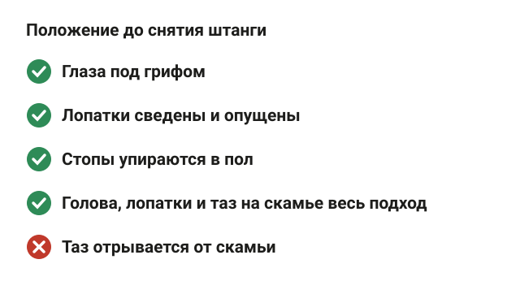
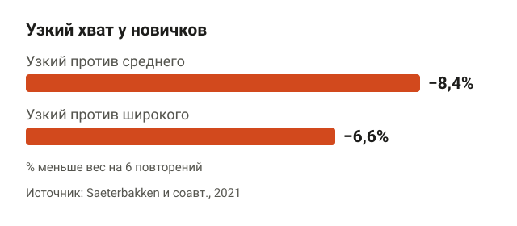
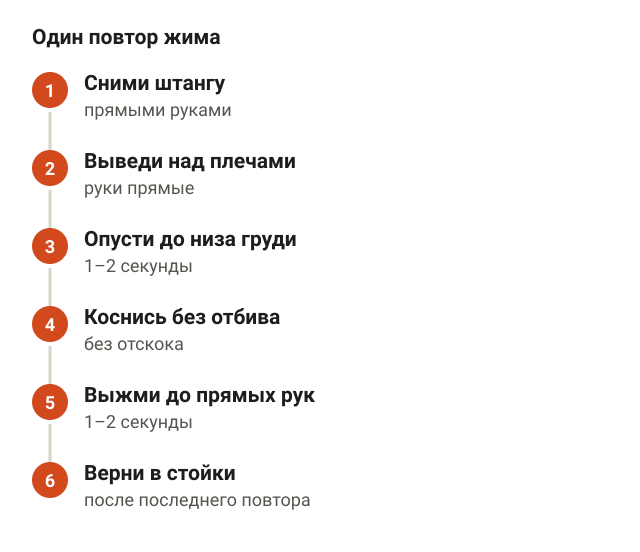
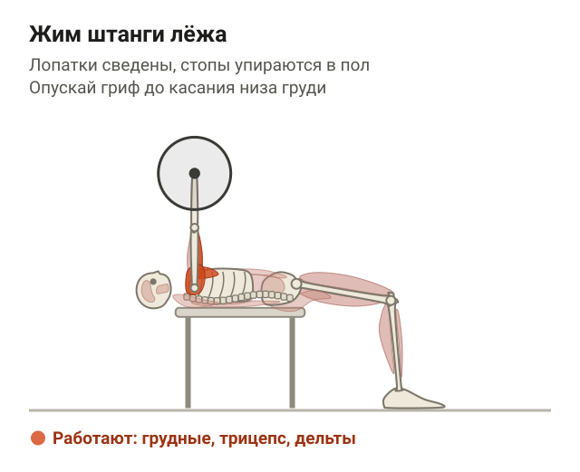
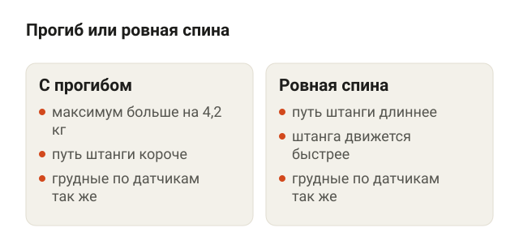
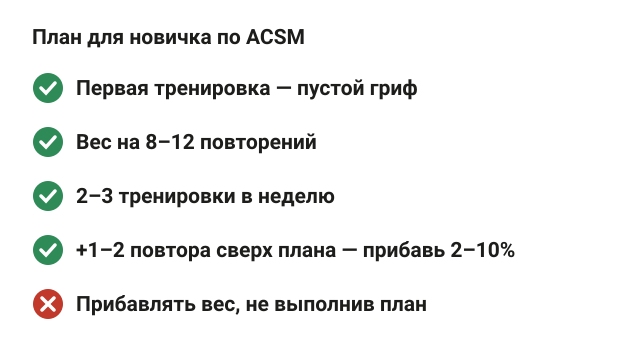
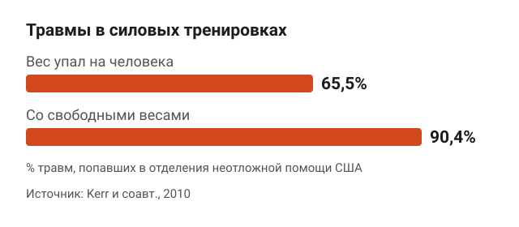
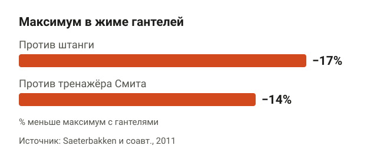
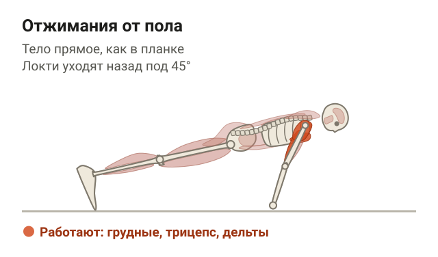
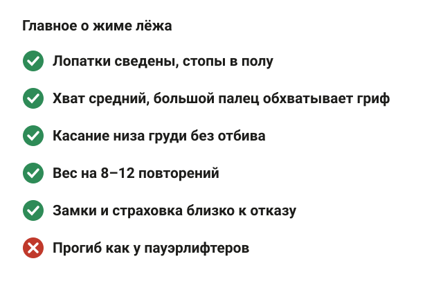

---
{
  "title": "Жим лёжа: техника для начинающих по шагам",
  "seo_title": "Жим лёжа: техника для начинающих — хват, прогиб, вес",
  "description": "Как лечь на скамью, какой хват взять, куда опускать штангу, нужен ли прогиб и с какого веса начать жим лёжа новичку. С данными исследований.",
  "slug": "zhim-lezha-tehnika-dlya-nachinayushchih",
  "date": "2026-11-08",
  "category": "trenirovki",
  "keyword": "жим лёжа техника для начинающих",
  "tags": [
    "жим лёжа",
    "техника",
    "новичкам",
    "грудные мышцы",
    "страховка"
  ],
  "faq": [
    {
      "q": "Куда опускать штангу в жиме лёжа?",
      "a": "До касания низа груди, примерно на линию сосков, без отбива. Наверху штанга стоит над плечами. Полная амплитуда в исследовании Martínez-Cava и соавторов дала больше силы, чем жим в 2/3 или 1/3 движения."
    },
    {
      "q": "Какой хват лучше для жима лёжа новичку?",
      "a": "Средний, чуть шире плеч. У новичков с узким хватом вес на 6 повторений был на 8,4% меньше, чем со средним, а между средним и широким разницы не было. Хват уже полутора ширин плеч меньше нагружает сустав между ключицей и лопаткой."
    },
    {
      "q": "Нужен ли прогиб в спине при жиме лёжа?",
      "a": "Новичку нет. У опытных силовиков прогиб прибавил к максимуму в среднем 4,2 кг за счёт более короткого пути штанги, а работа грудных мышц по датчикам не изменилась."
    },
    {
      "q": "С какого веса начинать жим лёжа?",
      "a": "С пустого грифа, чтобы поставить технику. Дальше — вес, который поднимаешь 8–12 раз, и прибавка 2–10%, когда делаешь на 1–2 повтора больше плана. Это рекомендация ACSM для новичков."
    },
    {
      "q": "Можно ли жать лёжа без страховки?",
      "a": "Можно, если стоят замки на грифе и скамья стоит в раме со страховочными упорами чуть ниже груди. Без этого близко к отказу жми только со страхующим: в 65,5% травм в силовых, попавших в травмпункты США, на человека падал вес."
    }
  ],
  "sources": [
    {
      "title": "American College of Sports Medicine. Progression models in resistance training for healthy adults (Med Sci Sports Exerc, 2009)",
      "url": "https://doi.org/10.1249/MSS.0b013e3181915670"
    },
    {
      "title": "Saeterbakken A. H. и соавт. The effect of grip width on muscle strength and electromyographic activity in bench press among novice- and resistance-trained men (Int J Environ Res Public Health, 2021)",
      "url": "https://doi.org/10.3390/ijerph18126444"
    },
    {
      "title": "Noteboom L. и соавт. Effects of bench press technique variations on musculoskeletal shoulder loads and potential injury risk (Front Physiol, 2024)",
      "url": "https://doi.org/10.3389/fphys.2024.1393235"
    },
    {
      "title": "Martínez-Cava A. и соавт. Bench press at full range of motion produces greater neuromuscular adaptations than partial executions after prolonged resistance training (J Strength Cond Res, 2022)",
      "url": "https://doi.org/10.1519/JSC.0000000000003391"
    },
    {
      "title": "Hackett D. A., Chow C. M. The Valsalva maneuver: its effect on intra-abdominal pressure and safety issues during resistance exercise (J Strength Cond Res, 2013)",
      "url": "https://doi.org/10.1519/JSC.0b013e31827de07d"
    },
    {
      "title": "Bartolomei S. и соавт. Flat-back vs. arched-back bench press: examining the different techniques performed by power athletes (J Strength Cond Res, 2024)",
      "url": "https://doi.org/10.1519/JSC.0000000000004778"
    },
    {
      "title": "Kerr Z. Y. и соавт. Epidemiology of weight training-related injuries presenting to United States emergency departments, 1990 to 2007 (Am J Sports Med, 2010)",
      "url": "https://doi.org/10.1177/0363546509351560"
    },
    {
      "title": "Kikuchi N., Nakazato K. Low-load bench press and push-up induce similar muscle hypertrophy and strength gain (J Exerc Sci Fit, 2017)",
      "url": "https://doi.org/10.1016/j.jesf.2017.06.003"
    },
    {
      "title": "Calatayud J. и соавт. Bench press and push-up at comparable levels of muscle activity results in similar strength gains (J Strength Cond Res, 2015)",
      "url": "https://doi.org/10.1519/JSC.0000000000000589"
    },
    {
      "title": "Saeterbakken A. H. и соавт. A comparison of muscle activity and 1-RM strength of three chest-press exercises with different stability requirements (J Sports Sci, 2011)",
      "url": "https://doi.org/10.1080/02640414.2010.543916"
    }
  ]
}
---
Техника жима лёжа для начинающих сводится к пяти вещам: глаза под грифом, лопатки сведены, стопы упираются в пол, хват средний, штанга опускается до касания низа груди без отбива. Первые недели работай с весом, который поднимаешь 8–12 раз, и прибавляй 2–10%, когда делаешь на 1–2 повтора больше плана. Так советует позиция Американского колледжа спортивной медицины (ACSM) для новичков.

Ниже разбираю жим лёжа по шагам: как лечь, какой хват взять, нужен ли прогиб, как дышать, с какого веса начать и чем заменить штангу, если она пока тяжела. Мой личный рекорд в жиме — 165 кг в софт-экипировке, но начинал я, как все, с пустого грифа, и порядок ниже тот же, что даю клиентам.

## Как лечь на скамью перед жимом

<figure class="step"><figcaption>Глаза под грифом, лопатки сведены, стопы в полу, голова, лопатки и таз на скамье.</figcaption></figure>

От того, как ты лёг, зависит половина подхода. Если положение плохое, дальше ты не жмёшь, а исправляешь его под весом.

1. **Глаза под грифом.** Ложись так, чтобы гриф был над глазами. Ниже, над подбородком, — штанга заденет стойки при подъёме. Выше, над лбом, — придётся тянуться к ней руками за голову.
2. **Лопатки сведены и опущены.** Сведи лопатки, как будто зажимаешь между ними карандаш, и опусти их к тазу. Так ты лежишь на лопатках, а не на плечах.
3. **Стопы упираются в пол.** Ступни стоят на полу всей подошвой, чуть шире таза, колени согнуты. Ноги не болтаются в воздухе и не лежат на скамье.
4. **Три точки на скамье.** Голова, лопатки и таз касаются скамьи весь подход. В исследованиях жима это стандартное требование к повтору, и в зале оно тоже работает: таз оторвался — значит, вес великоват.

Сведённые лопатки нужны не только для красоты. В биомеханическом исследовании 2024 года (Noteboom и соавторы, 10 опытных силовиков, 21 вариант жима) сведённые лопатки уменьшили сдвигающую нагрузку на плечевой сустав и работу вращательной манжеты. Подробно про плечи и жим есть в статье [болит плечо после жима лёжа](/stati/bolit-plecho-posle-zhima-lezha/).

## Какой хват выбрать новичку

<figure class="step"><figcaption>С узким хватом вес на 6 повторений на 8,4% меньше, чем со средним, и на 6,6% меньше, чем с широким.</figcaption></figure>

Самый частый вопрос на первой тренировке: где брать гриф. Ответ — средний хват, примерно на ширине чуть больше плеч. Предплечья в нижней точке стоят почти вертикально.

Норвежские исследователи (Saeterbakken и соавторы, 2021) сравнили три хвата у 28 мужчин, из них 13 новичков. Узкий хват был равен расстоянию между подмышками, широкий — 81 см, максимальная ширина на соревнованиях, средний — посередине между ними. Мерили, какой вес человек поднимает 6 раз.

У новичков с узким хватом вес на 6 повторений был на 8,4% меньше, чем со средним, и на 6,6% меньше, чем с широким. Между средним и широким разницы не нашли. По датчикам с широким хватом сильнее работал бицепс, слабее — трицепс, а грудные мышцы работали одинаково при всех трёх хватах.

Широкий хват при этом не бесплатный. В том же исследовании Noteboom хват уже полутора ширин плеч уменьшил сдавливание сустава между ключицей и лопаткой. Получается, средний хват даёт тот же вес, что и широкий, и меньше нагружает плечо. Поэтому для новичка выбор простой.

Как держать гриф: обхвати его большим пальцем, гриф лежит на основании ладони, ближе к запястью, а не на пальцах. Хват без большого пальца в зале называют «самоубийственным»: штанга может соскользнуть с ладони.

## Жим лёжа по шагам: техника для начинающих

<figure class="step"><figcaption>Снял прямыми руками, опустил до низа груди, коснулся без отбива, выжал до прямых рук.</figcaption></figure>

Положение есть, хват есть. Дальше сам повтор.

**Жим штанги лёжа.** Лопатки сведены, стопы упираются в пол. Сними штангу со стоек прямыми руками и выведи её над плечами. Опускай гриф до касания низа груди, примерно на линию сосков. Коснись груди без отбива и выжми штангу вверх до прямых рук, обратно над плечами. Ориентиры: локти не разводи в стороны под прямым углом к телу, они идут чуть к корпусу; запястья ровные, не заваливаются назад.

<figure class="step move"></figure>

Пять деталей, на которых новички чаще всего застревают:

- **Касание без отбива.** Штанга касается груди и уходит вверх, а не отскакивает от неё. Так засчитывали повтор в исследованиях хвата: лёгкое касание, отбив запрещён. Отбив поднимает штангу за счёт удара о грудь, а не за счёт мышц.
- **Полная амплитуда.** В исследовании Martínez-Cava и соавторов (2022) 50 мужчин 10 недель жали в полную амплитуду, в 2/3 или в 1/3 амплитуды. Полная амплитуда дала лучший прирост силы во всех трёх вариантах жима, даже в тех укороченных, которыми тренировались другие группы.
- **Темп.** ACSM для новичков советует умеренную скорость: 1–2 секунды вниз и 1–2 секунды вверх. Бросать штангу на грудь не нужно.
- **Дыхание.** Вдохни и задержи воздух перед опусканием, выдыхай, когда прошёл самую тяжёлую часть подъёма. Обзор Hackett и Chow (2013) показал, что задержка дыхания на усилии, то есть проба Вальсальвы, повышает давление в животе и, по мнению авторов, помогает держать корпус жёстким. Давление крови при этом тоже растёт. С тяжёлым весом больше 80% от максимума короткая задержка случается сама собой. Если у тебя повышенное давление или проблемы с сердцем, задержку дыхания обсуди с врачом.
- **Взгляд вверх.** Смотри в потолок, а не на штангу. Голова, которая тянется за грифом, отрывается от скамьи.

## Прогиб в спине: нужен ли он новичку

<figure class="step"><figcaption>Прогиб прибавил к максимуму 4,2 кг, работа грудных по датчикам не изменилась.</figcaption></figure>

Пауэрлифтеры жмут с выраженным прогибом в спине, и новички начинают это копировать. Разберёмся, что прогиб даёт.

В 2024 году итальянские исследователи (Bartolomei и соавторы) сравнили жим с прогибом и с ровной спиной у 15 опытных силовиков. С прогибом максимум был больше в среднем на 4,2 кг, потому что путь штанги короче. С ровной спиной штанга двигалась быстрее, а путь был длиннее. Работа грудных мышц по датчикам не отличалась.

То есть прогиб — инструмент, чтобы поднять больше килограммов на соревнованиях, а не чтобы лучше нагрузить грудь. Новичку он не нужен. Естественный небольшой изгиб в пояснице, когда сводишь лопатки, — нормально. Мостик, при котором таз еле касается скамьи, оставь до момента, когда соберёшься на помост.

## С какого веса начать и как прибавлять

<figure class="step"><figcaption>8–12 повторений, 2–3 тренировки в неделю, прибавка 2–10%, когда сделал на 1–2 повтора больше.</figcaption></figure>

Первая тренировка — пустой гриф. Стандартный олимпийский гриф весит 20 кг, в залах бывают и облегчённые грифы. Сделай 2–3 подхода по 10–12 повторов и посмотри, получается ли держать технику.

Дальше ориентир из позиции ACSM 2009 года для новичков:

- вес, с которым делаешь **8–12 повторений** в подходе;
- **2–3 тренировки в неделю** на всё тело, жим в каждой или через одну;
- когда сделал на **1–2 повтора больше** плана, прибавляй **2–10%** веса.

Допустим, ты жмёшь 40 кг на 3 подхода по 10. На очередной тренировке во всех подходах вышло по 12. Значит, в следующий раз ставишь 42,5 кг и снова работаешь на 10. При весе в 40 кг шаг в 2,5 кг — это примерно 6%, укладывается в рекомендацию.

Сколько подходов делать на грудь за неделю, разобрано в статье [сколько подходов делать для роста мышц](/stati/skolko-podhodov-dlya-rosta-myshc/). Для первых месяцев хватает нескольких рабочих подходов жима в неделю, остальное прибавит регулярность.

## Страховка и замки: как жать безопасно

<figure class="step"><figcaption>В 65,5% случаев на человека упал вес, в 90,4% травма случилась со свободными весами.</figcaption></figure>

Жим лёжа — упражнение, в котором штанга находится над грудью и шеей. Если не выжал, вес остаётся на тебе.

Исследование Kerr и соавторов (2010) разобрало травмы в силовых тренировках, с которыми люди попали в отделения неотложной помощи США с 1990 по 2007 год. В 65,5% случаев причиной был вес, упавший на человека. В 90,4% случаев травма случилась со свободными весами, а не в тренажёрах. Это данные по всем силовым упражнениям, не только по жиму, но картина понятная: травмирует не столько техника, сколько вес, который вышел из-под контроля.

Что делать:

- **Замки на грифе.** Без них блины при перекосе сползают с одной стороны, штанга переворачивается.
- **Страхующий.** Когда работаешь близко к отказу, попроси человека встать у головы. Он помогает снять штангу и забирает её, если повтор не идёт.
- **Ограничители.** Если жмёшь один, ставь скамью в силовую раму и выставляй страховочные упоры чуть ниже груди.
- **Запас повторов.** Новичку не нужен отказ в каждом подходе. Заканчивай подход, когда чувствуешь, что остаётся 1–2 повтора.

## Если штанга пока тяжела: отжимания и гантели

<figure class="step"><figcaption>С гантелями максимум на 17% меньше, чем со штангой, и на 14% меньше, чем в Смите.</figcaption></figure>

Не всем на старте удобно со штангой: гриф кажется тяжёлым, или нет страхующего. Это не повод пропускать жимовые упражнения.

**Отжимания от пола.** Упор лёжа, руки чуть шире плеч, тело прямое, как в планке: голова, спина и таз на одной линии. Опускайся, пока грудь почти не коснётся пола, и выжимай себя вверх. Ориентиры: локти уходят назад под 45° к корпусу, а не в стороны; таз не проваливается и не задирается.

<figure class="step move"></figure>

Отжимания нагружают те же мышцы, что и жим. В японском исследовании (Kikuchi и Nakazato, 2017) одна группа 8 недель жала штангу с весом 40% от максимума, другая отжималась с нагрузкой того же уровня. Прирост мышц груди и трицепса и силы в жиме был одинаковым. В испанском исследовании (Calatayud и соавторы, 2015) отжимания с резиной и жим с тем же уровнем активности мышц за 5 недель тоже дали одинаковый прирост силы. Если от пола пока не получается, отжимайся от скамьи: чем выше упор, тем легче.

**Жим гантелей лёжа.** Те же правила: лопатки сведены, стопы в полу. Но вес будет меньше. В исследовании Saeterbakken и соавторов (2011) максимум с гантелями был на 17% меньше, чем со штангой, и на 14% меньше, чем в тренажёре Смита, а работа грудных по датчикам не отличалась. Гантелям нужно больше контроля, поэтому и килограммов меньше.

Когда отжимаешься 15–20 раз и уверенно жмёшь гантели, переходи к штанге с пустого грифа. Жим лёжа вместе с приседом — основа набора массы, общий план есть в статье [набор мышечной массы для мужчин](/stati/nabor-myshechnoy-massy-dlya-muzhchin/).

## Шпаргалка

<figure class="step"><figcaption>Лопатки сведены, хват средний, касание без отбива, вес на 8–12 повторений, замки и страховка.</figcaption></figure>

- Лёг так, чтобы глаза были под грифом. Лопатки сведены и опущены, стопы упираются в пол, голова, лопатки и таз на скамье.
- Хват средний, гриф обхвачен большим пальцем. С узким хватом новички поднимали на 6,6–8,4% меньше.
- Опускай гриф до касания низа груди, без отбива, в полную амплитуду: 1–2 секунды вниз и 1–2 вверх.
- Вдох и задержка перед опусканием, выдох после трудной части подъёма.
- Прогиб как у пауэрлифтеров новичку не нужен: прибавляет около 4 кг к максимуму, но не нагрузку на грудь.
- Вес на 8–12 повторений, 2–3 тренировки в неделю, прибавка 2–10%, когда сделал на 1–2 повтора больше.
- Замки на гриф всегда, близко к отказу — со страхующим или в раме с упорами.
- Если штанга пока тяжела, начни с отжиманий и гантелей: прирост силы и мышц в исследованиях был тот же.
